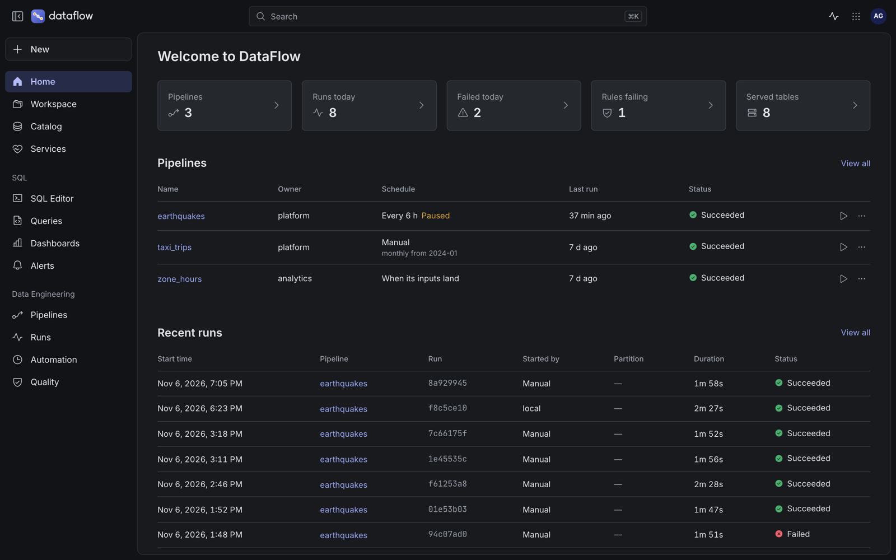
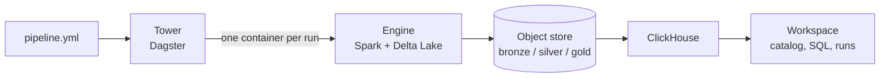
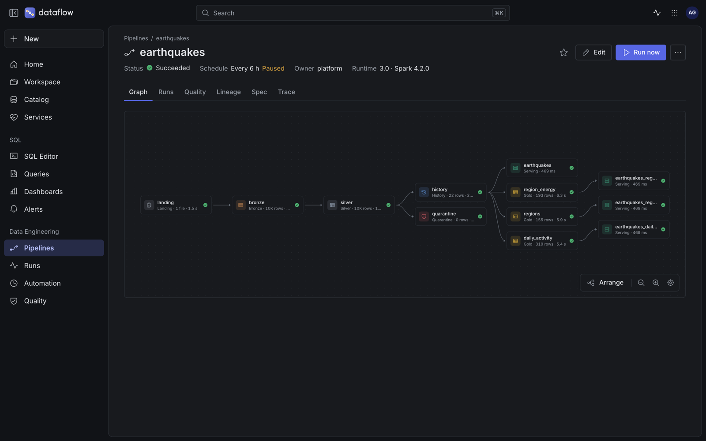
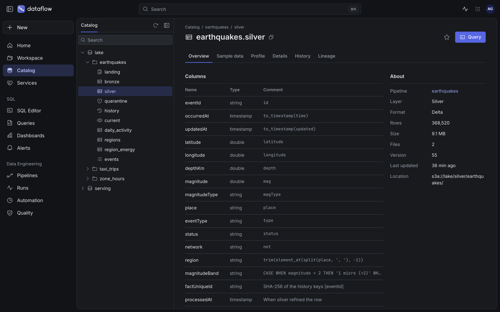
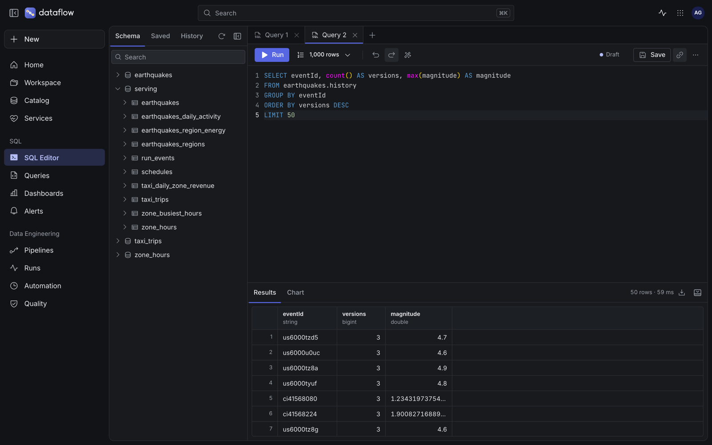
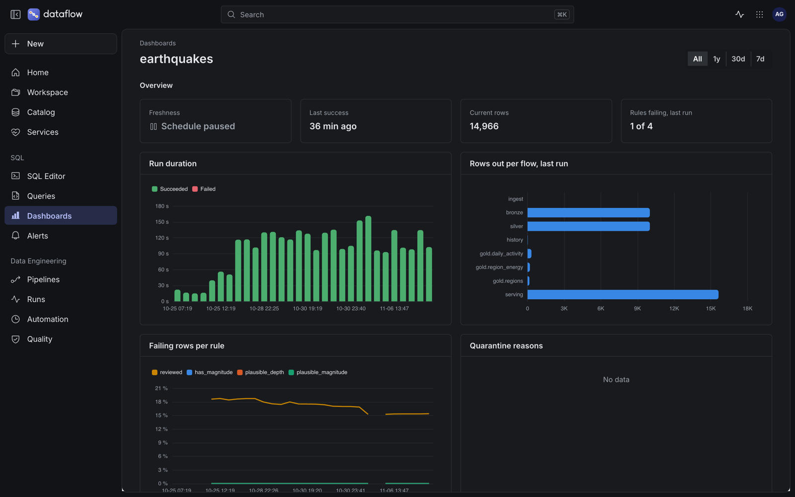

# DataFlow

A self-hosted lakehouse built on open-source tools: the workflow of platforms like Databricks, on infrastructure you run
yourself.

## What it does

You describe a dataset in one YAML file: where the data comes from, its schema, its quality rules and how much history
to keep. DataFlow loads it, checks it, keeps its history and makes it queryable with SQL, with no pipeline code to write.

## How it works

- **Tower** (Dagster) schedules runs, handles partitions and retries, and runs quality checks.
- **Engine** (Java 21, Spring Boot, Spark 4) starts for one run, writes Delta Lake tables and exits.
- **Object store** (RustFS, S3 API) holds the tables in an open format any engine can read.
- **ClickHouse** serves the tables for SQL and dashboards.
- **Workspace** (Spring Boot, React) is the web app: data catalog, SQL editor, run history and a spec editor.

## Screenshots

A pipeline, from the raw file to the served tables, with rows and time per step:

The catalog: every table, its columns and where each column comes from:

The SQL editor, querying the lake through ClickHouse:

A dashboard built automatically for each pipeline:

## Repository layout

| Folder | What |
|:--|:--|
| `dataflow-platform` | Engine, tower, Workspace, docs |
| `dataflow-examples` | Sample pipelines (earthquakes, taxi trips) |
| `dataflow-local` | The whole stack on one machine with Docker Compose |
| `dataflow-helm-charts` | Helm chart for Kubernetes |
| `dataflow-environments` | Per-environment settings for Argo CD |

To run it locally, see [`dataflow-local`](dataflow-local/README.md). The design is in
[`docs/design`](dataflow-platform/docs/design/lakehouse-architecture.md).
