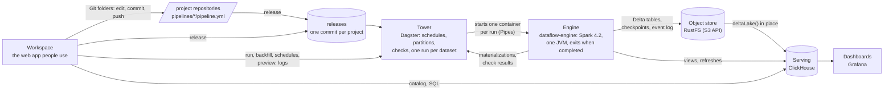

# DataFlow Platform

A small, self-hosted lakehouse, built the way Databricks, Snowflake and BigQuery build theirs. A dataset is a **pipeline
spec**: one YAML file under `pipelines/` of a **project** (a Git repository with a `dataflow.yml`) that declares the
source, the typed columns, the quality rules, how history is kept, the gold tables and what reaches the warehouse. One
generic engine runs every plan.

The example project, `dataflow-examples` (a sibling repository), holds two specs: NYC TLC taxi trips (monthly
partitions, 3M rows a month) and USGS earthquakes (a 30-day feed whose magnitudes get revised, every six hours).
Projects are edited in the Workspace's Git folders and **released**: a release freezes one commit in the `releases`
bucket, and every run uses exactly that commit.



| Part         | What                                                                                                                                                                                                                           | Where                                                       |
|:-------------|:-------------------------------------------------------------------------------------------------------------------------------------------------------------------------------------------------------------------------------|:------------------------------------------------------------|
| Specs        | Pipeline specs in project repositories, released per commit                                                                                                                                                                    | `dataflow-examples`, bucket `releases`                      |
| Tower        | When to run, the queue, retries, backfills, asset graph, checks                                                                                                                                                                | `tower/` (Dagster 1.13)                                     |
| Engine       | One run: ingest → bronze → silver (+ quarantine) → history → gold → serving → maintenance                                                                                                                                      | `apps/dataflow-engine`, `libs/`                             |
| Object store | Bytes: landing files and Delta tables                                                                                                                                                                                          | RustFS, bucket `lake`                                       |
| Serving      | Fast SQL: views over Delta, refreshed copies                                                                                                                                                                                   | ClickHouse database `serving`                               |
| Event log    | What happened in every flow of every run                                                                                                                                                                                       | `system/events/<dataset>/` (Delta), `serving.run_events`    |
| Dashboards   | Boards and trend alerts                                                                                                                                                                                                        | Grafana, in the sibling repo `dataflow-local`               |
| Workspace    | One web app over all of the above: catalog (profile, Delta details, time travel), SQL editor, pipelines, runs with the engine's log, quality, Git folders and releases, spec editor with a live graph, preview and data impact | `apps/dataflow-workspace` (+ Postgres database `workspace`) |

The engine imports nothing from the tower: it is a command line,
`dataflow-engine run --dataset=<id> --release=<project>@<commit> [--partition=<key>]`, and it talks to Dagster only
through JSON lines on stdout (the Pipes protocol). Between runs no JVM runs.

## Documentation

Design lives in [`docs/`](docs/README.md), diagrams
first: [workspace](docs/workspace.md), [architecture](docs/architecture.md), [pipeline specs](docs/pipeline-specs.md), [engine](docs/engine.md), [reliability](docs/reliability.md), [history and serving](docs/history-and-serving.md), [tower](docs/tower.md), [operations](docs/operations.md).
The code carries no comments; explanations belong in those pages. The reasoning behind v3
is [docs/design/lakehouse-architecture.md](docs/design/lakehouse-architecture.md); where it is
going, [docs/design/target-architecture.md](docs/design/target-architecture.md).

## Run it

This repository holds the code and builds the images. Running everything on one machine is the sibling repository
`dataflow-local` (Docker Compose); running it on Kubernetes is `dataflow-helm-charts`. Needs Docker (a 4 GB VM is
enough), Java 21 and Maven 3.9.15.

```bash
cd ../dataflow-local
```

```bash
./dataflow init
```

```bash
./dataflow build
```

```bash
./dataflow up
```

| URL                        | What                                                                                                            |
|:---------------------------|:----------------------------------------------------------------------------------------------------------------|
| **http://localhost:3080**  | **Workspace: catalog, SQL editor, pipelines, runs, quality, Git folders and releases, dashboards. Start here.** |
| http://localhost:3070      | Tower (Dagster): assets, runs, checks, schedules, backfills                                                     |
| http://localhost:9101      | Object store console (RustFS)                                                                                   |
| http://localhost:8123/play | ClickHouse                                                                                                      |
| http://localhost:3000      | Dashboards (Grafana)                                                                                            |

The first time, connect the examples in the Workspace: **Workspace → Shared → Create → Git folder**, remote
`file:///remotes/dataflow-examples.git`, then **Release → prod** in the folder. Run from the Workspace (Run now on a
pipeline, or Backfill on its Partitions tab), from the tower, from a terminal with the [command line](docs/cli.md), or
by hand with the released commit:

```bash
./dataflow run --dataset=taxi_trips --release=examples@<commit> --partition=2024-01
```

## Add a dataset

1. In the project's Git folder: **New pipeline**, edit `pipelines/<dataset>/pipeline.yml` (or write it in a clone). The
   loader rejects unknown keys, unparseable types or SQL, undeclared key columns and reserved names, and lists every
   problem at once.
2. Commit, push, then **Release → prod**. The tower reloads; the new dataset's assets, checks and schedule appear.
3. Run it.

No Java change, no image rebuild, no restart. Details: [projects and releases](docs/projects-and-releases.md).

```yaml
dataset: earthquakes
version: 3
source: { url: https://earthquake.usgs.gov/.../all_month.csv, format: csv, options: { header: "true" } }
schedule: "0 */6 * * *"
silver:
  columns:                    # typed from the raw bronze columns
    - { name: eventId,    type: string,    required: true, from: id }
    - { name: updatedAt,  type: timestamp,                 from: "to_timestamp(updated)" }
    - { name: magnitude,  type: double,                    from: mag }
  derive:
    - { name: region, type: string, from: "trim(element_at(split(place, ', '), -1))" }
  expectations:               # warn | drop (to quarantine) | fail (the run)
    - { name: plausible_magnitude, check: "magnitude BETWEEN -2 AND 10", on-failure: drop }
history: { keys: [eventId], sequence-by: updatedAt, track-history-except: [updatedAt] }
gold:
  - { name: regions, sql: "SELECT region, count(*) AS events FROM current GROUP BY region" }
serve:
  - { from: current,      table: earthquakes,         mode: view }
  - { from: gold.regions, table: earthquakes_regions, mode: copy, order-by: region }
```

## Repository

```
dataflow-bom/              managed dependency versions (Spark 4.2, Delta 4.4, Hadoop 3.5, AWS SDK v2)
libs/dataflow-config/      shared encrypted configuration and credential encryption
libs/dataflow-spec/        spec model, loader, validator; StageDataset, SpecProjection, CanonicalEncoding
libs/dataflow-engine-core/ flows, flow graph, expectations, SCD2 merge, event log, serving DDL, Pipes writer
apps/dataflow-engine/      Spring Boot command line: run, preview, impact (Dockerfile target engine)
apps/dataflow-workspace/   the web app: Spring Boot API over ClickHouse, the tower, Git and Postgres, plus ui/ (React)
tower/                     Dagster code location: the PipelineSpecs component (reads releases), failure email
cli/                       the dataflow command line (Python, standard library only)
docs/                      plain-language docs; design/ holds the v3 design and the target architecture, spikes/ its evidence
scripts/                   settings-reference.py, which writes docs/settings.md, and find-literals.py, which reports hardcoded values
Dockerfile                 images: engine, engine-k8s, workspace (the tower builds from tower/Dockerfile)
```

The project version lives only in `.mvn/maven.config`. The event-driven 2.0 design (Kafka between four stage services)
is tagged `v2.0.0-kafka`; the taxi-only 1.0 is `v1.0.0-taxi`.
