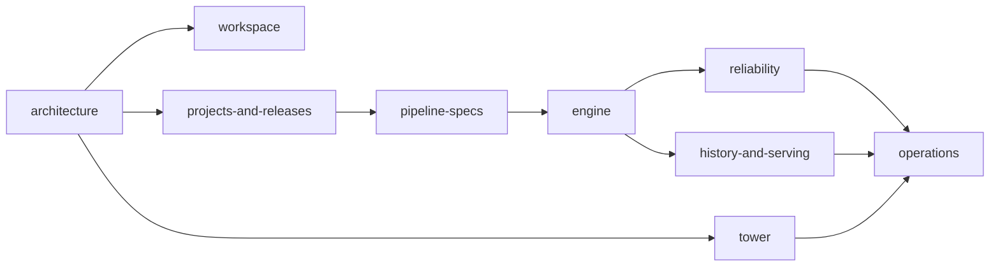

# DataFlow Platform documentation

DataFlow downloads public datasets on a schedule, cleans them, keeps every version of every record, and makes them
queryable in a web app and in dashboards. These pages explain how, in plain words, with real examples from the running
platform.

The code has no comments: the reasons behind it live here. The twelve big decisions of v3 (ADR-01 to ADR-12), the
alternatives that were weighed and why each technology was chosen are
in [design/lakehouse-architecture.md](design/lakehouse-architecture.md); the test results that backed them are
in [spikes/REPORT.md](spikes/REPORT.md). Where the platform is going (repository split, Git folders, releases,
transformations, login and grants, Kubernetes) is [design/target-architecture.md](design/target-architecture.md).

## Where to start

| If you want to                                                          | Read                                                                                                            |
|:------------------------------------------------------------------------|:----------------------------------------------------------------------------------------------------------------|
| Understand what the platform is and why it is built this way            | [Architecture](architecture.md)                                                                                 |
| Use the web app: browse tables, query, trace a value, change a pipeline | [Workspace](workspace.md)                                                                                       |
| Add a dataset or change one                                             | [Pipeline specs](pipeline-specs.md), or let the [Pipeline assistant](pipeline-assistant.md) draft it from a URL |
| Connect a project, commit, release                                      | [Projects and releases](projects-and-releases.md)                                                               |
| Write a transformation in Java                                          | [Transformations](transformations.md)                                                                           |
| Run, operate and fix the platform                                       | [Operations](operations.md)                                                                                     |

## All pages

| Page                                                     | What it explains                                                                                                                          |
|:---------------------------------------------------------|:------------------------------------------------------------------------------------------------------------------------------------------|
| [Architecture](architecture.md)                          | The pieces and why each technology, one earthquake followed from the USGS feed to a dashboard, a run end to end, where data lives, memory |
| [Workspace](workspace.md)                                | The web app: a tour, tracing a value to its source, changing a pipeline safely, Git folders, how it reads data, its API                   |
| [Projects and releases](projects-and-releases.md)        | Where pipelines live (project repositories), Git folders, drafts, commits, releases, how runs use a release                               |
| [Transformations](transformations.md)                    | Java steps in a pipeline: the contract, wiring inputs and params, what is checked, how a run compiles and loads them                      |
| [Pipeline specs](pipeline-specs.md)                      | The YAML file that declares a dataset, section by section; validation messages; the tables and columns it produces                        |
| [Command line](cli.md)                                   | `dataflow`: sign in, validate specs, start and follow runs, read logs, query                                                          |
| [Access](access.md)                                      | Grants on datasets, tables and folders; how the Workspace and ClickHouse enforce them; the audit log                                      |
| [Dashboards](dashboards.md)                              | The board every pipeline gets: freshness, runs, rules, and charts chosen from each table's columns; range, filters, open as SQL           |
| [Pipeline assistant](pipeline-assistant.md)              | Drafting a spec from a source URL: the rules for format, types, keys, rules, partitions and schedule, each choice with its reason         |
| [Engine](engine.md)                                      | The program that runs a pipeline: its commands, its steps, streaming and checkpoints, memory limits, logs, settings                       |
| [Housekeeping](housekeeping.md)                          | What the platform no longer needs, how it is listed and removed safely                                                                    |
| [Settings](settings.md)                                  | Every setting of the Workspace and the engine: its environment variable, default and meaning (generated)                                  |
| [Kubernetes](kubernetes.md)                              | The platform on Kubernetes: the chart, one run from the tower to Spark pods and back, scaling, settings, what a laptop cluster measured   |
| [Object storage](object-storage.md)                      | Selecting the lake store, connector identity, ClickHouse readers and the remaining cloud checks                                           |
| [Reliability](reliability.md)                            | What happens when things go wrong: crashes, retries, files that arrive twice, failing rules                                               |
| [History and serving](history-and-serving.md)            | How every version is kept, how gold tables are built, how ClickHouse publishes tables, maintenance                                        |
| [Tower](tower.md)                                        | The scheduler (Dagster): what it builds from the specs, how it starts the engine, the queue, alarms                                       |
| [Operations](operations.md)                              | Containers, memory and disk, commands, where state lives, secrets, troubleshooting, images                                                |
| [Code standards](development/code-standards.md) | The rules every change follows: design principles, names, size, errors, tests |
| [UI standards](development/ui-standards.md) | The rules every screen follows: building blocks, states, colour, words, access |
| [Hardcoded values](development/literals.md) | Where a value belongs, the design scale, and the finder that keeps literals out |
| [Engineering rules](development/engineering-rules.md) | The numbered `RULE-*` decisions every review checks against |
| [Build rules](development/build-rules.md) | One project version, where POM properties go, every pinned library and why |
| [Internals](development/internals.md) | Modules, configuration layering, and code-level facts too small for the other pages |
| [Technical debt](development/tech-debt.md) | What the project carries that it does not need, and a proposal for each |
| [Security scan fixes](development/qodana-remediation.md) | What the October 2026 code scan found; the Spring Boot 4 and Jackson 3 upgrade; libraries replaced, removed or pinned; how to check       |
| [Design: v3](design/lakehouse-architecture.md)           | The twelve decisions of v3, the alternatives weighed, how DataFlow compares with Databricks, Snowflake, BigQuery and ADF                  |
| [Design: target](design/target-architecture.md)          | Where DataFlow is going: repositories, Git folders and releases, transformations, login and grants, Kubernetes, GitOps                    |
| [Design: tenancy](design/tenancy.md)                     | Teams and companies on one platform: what isolates them today, three options, the recommendation (proposal)                               |

## Reading order

