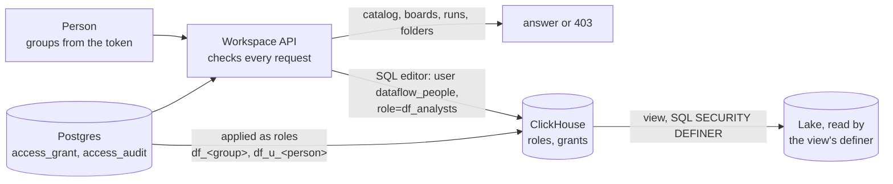

# Access

Who may see which data, run which pipeline and change which folder. People and their groups come from the login
provider ([signing in](workspace.md#signing-in)); what each group may do is a list of **grants** kept by the platform.
The design is section 7 of [design/target-architecture.md](design/target-architecture.md) (goal G8).

## Words used here

| Word          | Meaning                                                                   | Example                                                                                             |
|:--------------|:--------------------------------------------------------------------------|:----------------------------------------------------------------------------------------------------|
| Principal     | Who receives a right: a group or one person                               | `group:analysts`, `user:ada`                                                                        |
| Securable     | What the right is on                                                      | `dataset:earthquakes`, `table:earthquakes.gold.regions`, `folder:Shared/analytics`, `service:tower` |
| Privilege     | What the right allows                                                     | `SELECT`                                                                                            |
| Grant         | One principal, one securable, one privilege                               | `group:analysts` may `SELECT` `dataset:earthquakes`                                                 |
| Administrator | A member of a group listed in `dataflow.workspace.auth.admins` (`admins`) | holds every right                                                                                   |

## The rules

| On      | Privilege               | Allows                                                                                                                           |
|:--------|:------------------------|:---------------------------------------------------------------------------------------------------------------------------------|
| dataset | SELECT                  | Read every table of the dataset (lake tables, published tables), see its runs, board and spec                                    |
| dataset | RUN                     | Start runs and backfills, pause and resume its schedule, preview drafts of it                                                    |
| dataset | MANAGE                  | Everything above, and grant rights on it                                                                                         |
| table   | SELECT                  | Read that table only (and the published tables built from it)                                                                    |
| folder  | READ, RUN, EDIT, MANAGE | Open files; start previews from it; save, commit, push; release and grant (each level includes the ones before)                  |
| service | MONITOR                 | See the service on the Services page: health, reason, address. Services: `tower`, `serving`, `lake`, `sign-in`, `alerts`, `mail` |
| service | MANAGE                  | Also act on it (reload the pipeline specs in the tower, recreate the catalog views in ClickHouse) and grant it                   |

- **Additive, no deny.** A person's rights are the union of their own grants and their groups' grants, as in Unity
  Catalog and Lake Formation.
- **Teams own their pipelines.** A pipeline's `owner:` names a group (`owner: finance`). When a release reaches the live
  target, that group gets `MANAGE` on the dataset (once; the audit log names the release), so the team runs, grants and
  changes its own pipelines without an administrator, as an owner does in Unity Catalog.
- **Personal folders** (`Users/<you>/…`) belong to their owner and administrators; nobody can be granted rights on them.
  **Shared folders** start with their creator as manager; when creating one you can also name a team you belong to, and
  that group manages it too. A Git credential can be used only by the person who stored it.
- **Who grants**: anyone holding `MANAGE` on the securable, or an administrator.
- **The audit log** names who granted, revoked, ran, backfilled, stopped, paused, resumed and released what, and when.
  Administrators read it and download it as CSV in Settings → Access → History. Who read what is in ClickHouse's
  `system.query_log`, where each person's SQL carries `sql:<their name>`, shown on the Query History page.
- **Groups** are managed in the login provider (Keycloak's console, or the company's Entra ID or Okta): adding someone
  to `analysts` gives them what `analysts` holds at their next sign-in, with no change in DataFlow.
- **Without sign-in** (`WORKSPACE_AUTH=none`) everyone is an administrator, as before.

Grants are made in **Settings → Access** (Grant: dataset, table, folder or service; group or person; privilege) or
through the API.

## Where they are enforced

- **The Workspace API** checks the caller on every endpoint: the catalog and the SQL editor's schema list only what you
  may read, a table you may not read answers 403, run lists hide other datasets, starting a run needs `RUN`. A run
  with no dataset (a job an administrator started from Dagster) is for administrators only, in lists and when opened,
  and the schedule list shows only datasets you see.
- **ClickHouse** enforces the same grants for SQL typed by people, so a query cannot reach around the API. Each group
  with read grants becomes a ClickHouse role (`df_analysts`) holding `SELECT` on the catalog views and published tables
  it covers. People's queries run as the user `dataflow_people`, which has no rights of its own, with the person's roles
  named on the request (`role=df_analysts`) and `sql:<their name>` in `log_comment`, so `system.query_log` says who
  asked; administrators' queries carry the same tag.
  Administrators' queries run as the platform user.
- **Views read the lake for you.** Catalog views and published views are created with `SQL SECURITY DEFINER`: reading
  one uses the rights of the platform user that defined it, so a person with `SELECT` on `earthquakes.current` reads it
  without any right on the lake itself (`NAMED COLLECTION lake`), and a direct `deltaLake(lake, …)` in the editor is
  refused.
- `dataflow_people`'s password is derived from the platform's ClickHouse password (HMAC-SHA256), so every Workspace
  replica computes the same one and none is stored.
- **Every replica agrees.** Grants live in Postgres; each Workspace replica keeps them in memory, indexed by group and
  person, so a check reads only the caller's own grants. A change made on one replica is applied on the others within
  `access.refresh-every` (30 s): each reloads the grants and, only when they changed, applies them again to ClickHouse
  roles and storage policies.

### What a pipeline may read

A pipeline runs with the platform's credentials, so the person's rights are checked before it starts. A draft or a
release may read only what its author may read. The check happens when a preview, an impact task or a validation starts
and again at release.

| A pipeline reads                                  | Needs                                                                |
|:--------------------------------------------------|:---------------------------------------------------------------------|
| A table of another dataset (`inputs:`)            | `SELECT` on that table, unless the dataset is in the same project    |
| A public web address                              | Nothing                                                              |
| An internal address (`clickhouse`, `10.0.0.5`, `169.254.169.254`, `*.svc`) | The host in `dataflow.workspace.sources.allowed-hosts` |
| A path (`s3a://…`, `/data/…`)                     | A prefix in `dataflow.workspace.sources.allowed-paths`; none by default |
| A format other than a file format (`jdbc`)        | An administrator                                                     |
| A file of the lake, to infer a new pipeline       | `SELECT` on the dataset that holds it                                |

Administrators are not limited. The spec itself also closes the ways around this, for everyone: an expression may not
hold a subquery, gold SQL may read only `current`, references, inputs and gold tables of the pipeline, a table function
that reads files (`table_changes_by_path`) is refused, and a copy's `order-by` is a list of columns.

Other checks that come with it:

- **Task results belong to whoever started the task.** Reading one needs the run the task belongs to and being that
  person, or an administrator.
- **Spec and column lineage need the whole dataset.** Someone with `SELECT` on one table reads that table, and sees the
  pipeline's runs and graph, but not the SQL of its other tables.
- **Releases list only what you may see:** the datasets you are granted, or everything you released yourself.
- **Alerts with no dataset** are for administrators.

The engine follows a redirect only if it stays on the same host or leads to a public address, so a public URL cannot
lead a run to an internal service.

Two limits remain. A Java transformation is code, and it runs in the engine with the platform's credentials, so whoever
may run one can read anything the engine can. And grants are checked when a pipeline is released: it keeps reading a
table after its author's grant is revoked.

### The other apps

The platform's own tools cannot apply grants per person, so they are for administrators only, and the Workspace is
where everyone else works with data:

| App | Who may sign in | Why |
|:----|:----------------|:----|
| Dagster (tower) | `admins` | Its proxy allows only that group (`OAUTH2_PROXY_ALLOWED_GROUPS`) |
| Grafana | `admins`, as Grafana admins | Its boards take a dataset variable and read ClickHouse as one service user, so a viewer could pick any dataset; `GF_AUTH_GENERIC_OAUTH_ALLOWED_GROUPS` refuses everyone else, and its local login form is hidden |
| Mailpit | `admins` | Its proxy allows only that group |
| ClickHouse console | `admins` | It signs in as a ClickHouse user, not as the person |
| RustFS console | administrators, and dataset readers within their granted paths | The Workspace publishes a conditional policy from dataset `SELECT`/`MANAGE` grants; signed groups and username restrict object reads and prefix listings. See [storage access](storage-access.md). |

The Workspace hides what someone cannot open: for people outside `admins`, `/api/status` names only the RustFS console
among the apps (its link opens permitted dataset paths when scoped storage is enabled), and `/api/dashboards` lists no Grafana board. Everyone has the
generated boards of the datasets they may read, under Dashboards.

## Measured

On 2026-10-26, with two test accounts (removed afterwards): before any grant the analyst saw no dataset. After
`group:analysts SELECT dataset:earthquakes`:

| Request                                       | Answer                                                                            |
|:----------------------------------------------|:----------------------------------------------------------------------------------|
| datasets                                      | earthquakes only                                                                  |
| sample of `earthquakes.current`               | 200                                                                               |
| sample of `taxi_trips.current`                | 403, `lacks SELECT on table:taxi_trips.current`                                   |
| SQL `SELECT count() FROM earthquakes.current` | 10,235, in 19 ms                                                                  |
| SQL on `taxi_trips.current`                   | refused by ClickHouse: `necessary to have the grant SELECT ON taxi_trips.current` |
| SQL `deltaLake(lake, …)`                      | refused by ClickHouse: `NAMED COLLECTION ON lake`                                 |
| start a run of earthquakes                    | 403, `lacks RUN on dataset:earthquakes`                                           |

After the revoke, the analyst saw nothing again; the audit log holds the grant and the revoke.

## API

| Method | Path                                                  | What                                                                 |
|:-------|:------------------------------------------------------|:---------------------------------------------------------------------|
| GET    | `/api/access/grants`                                  | Grants you manage, and the ones that concern you                     |
| POST   | `/api/access/grants`                                  | `{securable, principal, privilege}`; needs `MANAGE` on the securable |
| DELETE | `/api/access/grants?securable=&principal=&privilege=` | Revoke                                                               |
| GET    | `/api/access/audit`                                   | Recent actions (administrators)                                      |

## Tests

| Test         | What it proves                                                                                                                                                                                                                           |
|:-------------|:-----------------------------------------------------------------------------------------------------------------------------------------------------------------------------------------------------------------------------------------|
| `AccessTest` | A dataset grant covers its tables; a table grant only that table; only managers grant, and it is audited; folder levels and personal folders; privileges must fit their securable; grants become ClickHouse roles with the right objects |
| `SignInTest` | Identity and groups come from the token; tokens for another application are refused                                                                                                                                                      |

## Not built yet

Isolation between companies sharing one platform: see the proposal in [design/tenancy.md](design/tenancy.md). Row policies (rows filtered per group; the boards' cache key will then include the role set), `GRANT`/`REVOKE` typed in
the SQL editor, a governance repository applied by CI, grants on transformations, and checking `Lake` reads of a run
against the run owner's grants.
