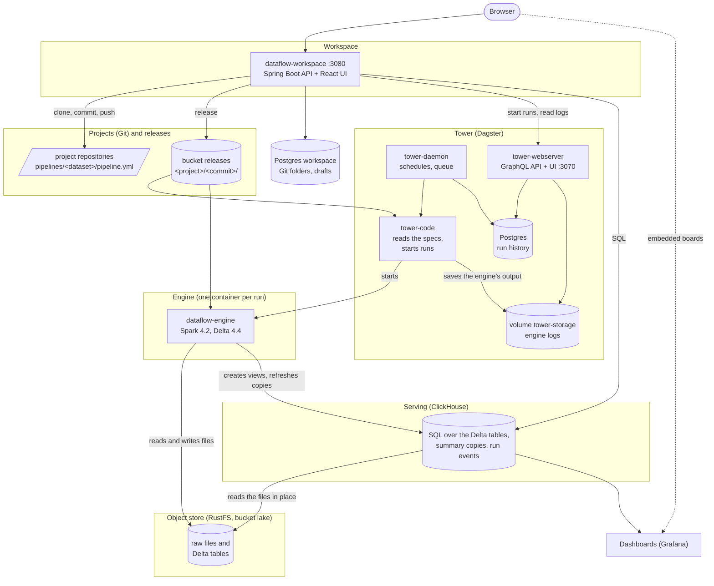
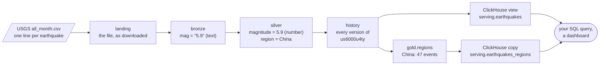
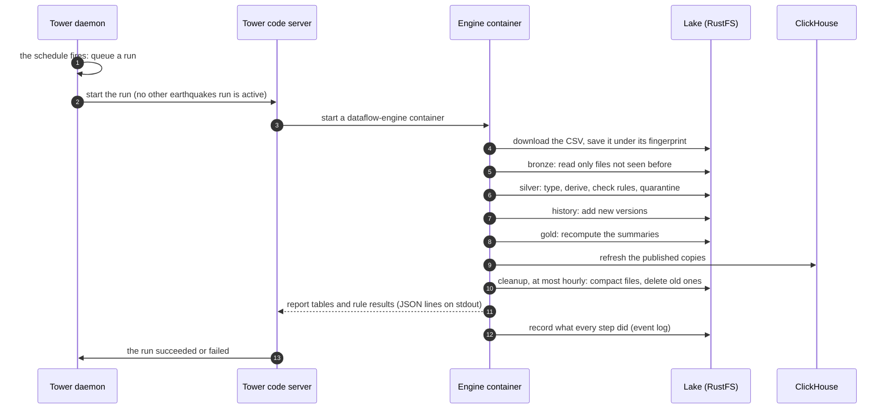
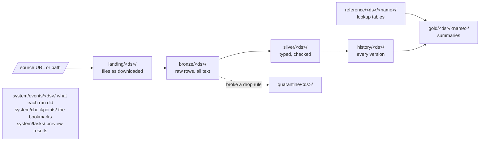
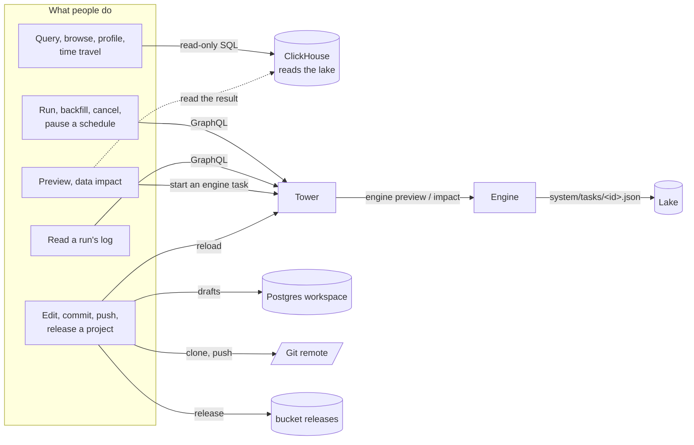

# Architecture

This page explains what each part of DataFlow does, why it is there, and what would break without it. It assumes you
know what a database, a SQL query and a Docker container are. Every other term is explained where it first appears, and
again in the [glossary](#words-used-in-these-docs) at the end.

## What DataFlow does, in one example

Every six hours, DataFlow downloads the US Geological Survey's file of last month's earthquakes: a CSV of about 10,000
rows, one per earthquake. It keeps a copy of the file, turns the text into typed columns, checks the rows against
quality rules, remembers every earlier version of each earthquake (USGS often revises a magnitude after the fact),
computes summaries such as "earthquakes per region", and makes all of it queryable with SQL and visible on dashboards.

A second dataset does the same with New York taxi trips: one file per month, about 3 million rows each.

Nobody writes code for a dataset. You describe it in one YAML file, `pipelines/earthquakes/pipeline.yml` in a **project
** (a Git repository, here `dataflow-examples`): where the data comes from, which columns to keep and with which types,
which rules a row must pass, how to recognise two versions of the same earthquake, which summaries to compute and which
tables to publish. The platform does the rest.

## The pieces

| Piece          | Technology                                | Its job, in one sentence                                                                                    |
|:---------------|:------------------------------------------|:------------------------------------------------------------------------------------------------------------|
| Pipeline specs | YAML files in project repositories (Git)  | Describe each dataset; Git records who changed what and when; a **release** freezes one commit for the runs |
| Object store   | RustFS (speaks the S3 API)                | Stores every file: the raw downloads and all the tables                                                     |
| Table format   | Delta Lake                                | Turns folders of data files into real tables, with transactions and history                                 |
| Engine         | Apache Spark, inside a small Java program | Reads, cleans, checks and writes the data; starts for a run and exits                                       |
| Tower          | Dagster, with Postgres                    | Decides when to run, queues runs, retries them, keeps the run history                                       |
| Serving        | ClickHouse                                | Answers SQL queries over the tables in milliseconds, for people and dashboards                              |
| Dashboards     | Grafana, with Mailpit                     | Charts and alerts on top of ClickHouse; Mailpit catches alert emails locally                                |
| Workspace      | A Java API and a React web app            | The one web page people use for all of the above                                                            |

Read the arrows as "uses". The engine is the only piece that writes data. ClickHouse only reads it. The Workspace never
touches the files directly: it asks ClickHouse.

## Follow one earthquake

Here is a real row from the run of 2026-10-25, followed from the USGS file to a query. The earthquake is `us6000u4ty`,
magnitude 5.9, "218 km ENE of Nagqu, China".

1. **Landing.** The engine downloads the CSV and saves it unchanged as
   `landing/earthquakes/all_month.bd8a205c5fd1587d.csv`. The part before `.csv` is a fingerprint of the file's content (
   the start of its SHA-256 hash). Downloading an identical file again gives the same name, so it is saved once and
   processed once.
2. **Bronze** (raw rows). Each CSV line becomes one row, and every value is kept as text, exactly as received:
   `mag = "5.9"`, `updated = "2026-10-25T12:16:10.327Z"`. Nothing is rejected here. If USGS adds a column one day, its
   values go into a catch-all column called `_rescued_data` instead of breaking the run.
3. **Silver** (clean rows). The spec says how to turn the raw columns into typed ones: `magnitude` is `mag` as a number,
   `updatedAt` is `updated` as a timestamp, `region` is the text after the last comma of `place` ("China"). Then the
   quality rules run. `magnitude BETWEEN -2 AND 10` passes. A row that broke a rule marked `drop` would go to a separate
   table, `quarantine`, with the names of the rules it broke, instead of into silver.
4. **History** (every version). If tomorrow's file says 6.0 instead of 5.9, history keeps both versions, each with the
   time it was valid, so you can always ask "what did we believe yesterday". This technique is called SCD type 2 ("
   slowly changing dimension, type 2"). A version that changed nothing is not stored again. Today `us6000u4ty` has one
   version.
5. **Gold** (summaries). The spec's gold queries run over the current version of every earthquake. `regions` counts
   events per region: China has 47.
6. **Serving.** ClickHouse publishes two tables for people and dashboards. `serving.earthquakes` is a view: a saved
   query that reads the latest version of each earthquake straight from the history files. `serving.earthquakes_regions`
   is a copy: the gold table copied into ClickHouse's own storage after each run, for the fastest dashboards.
7. **You.** In the Workspace's SQL editor, `SELECT * FROM serving.earthquakes WHERE eventId = 'us6000u4ty'` returns the
   row. A Grafana panel can chart `serving.earthquakes_regions`.

## Why each technology

For each piece: what it is, what it does here, why this one and not another, and what you would lose without it.

### Pipeline specs: YAML files in Git

- **What it is.** One text file per dataset, in the `pipelines/` folder of a project: a Git repository with a
  `dataflow.yml` at its root ([Projects and releases](projects-and-releases.md)). The platform's own repository holds no
  datasets; the examples are the project `dataflow-examples`.
- **What it does here.** It is the only place a dataset is defined. Releasing a project copies one commit of it to the
  releases store; the engine and the tower read that copy, and the Workspace shows the released specs and edits the
  files in Git folders.
- **Why this one.** Databricks, BigQuery and Azure Data Factory all keep pipeline definitions as files in Git, for the
  same reasons: a change is a reviewable diff, history and rollback come for free, and there is no second copy of the
  truth in a database that can drift from the code.
- **Without it.** Each dataset would need its own code, or its definition would live in a database where nobody can
  review or roll back a change.

### Object store: RustFS, speaking the S3 API

- **What it is.** A server that stores files ("objects") in top-level folders ("buckets") and lets programs read and
  write them over HTTP, with the same API as Amazon S3. RustFS is a small open-source server that implements that API.
- **What it does here.** It holds everything the platform writes: downloaded files, every table, the streaming
  bookmarks (checkpoints), the run statistics and the preview results. All of it lives in one bucket, `lake`.
- **Why this one.** The S3 API is how data tools talk to storage: Spark, Delta Lake and ClickHouse all speak it, so
  moving to Amazon S3, Google Cloud Storage or Azure later is a change of address and keys, not of code. RustFS replaced
  MinIO in v3 because MinIO stopped publishing its open-source server. It runs in about 350 MB.
- **Without it.** Data would sit on one container's disk, invisible to the others, and moving to the cloud would mean
  rewriting every read and write.

### Table format: Delta Lake

- **What it is.** A folder of Parquet files (a compressed file format that stores data column by column) plus a
  `_delta_log` folder of small JSON files. Each JSON file is one version of the table and lists which Parquet files were
  added or removed. The log is what turns a folder into a table.
- **What it does here.** Every table except landing is a Delta table. It gives:
    - **Transactions.** A write either fully happens or not at all. A reader never sees half a run.
    - **Merge.** "Update this row if it exists, insert it if not", which is how history adds new versions.
    - **Time travel.** Read the table as it was at version 12. The Workspace's History tab uses it.
    - **Change feed.** "Which rows changed since version 12?", turned on for history.
    - **Tagged writes.** A write can carry a tag; Delta refuses the same tag twice, so a retried batch never writes rows
      twice ([reliability](reliability.md)).
- **Why this one.** It is the table format of Databricks, and Spark (the engine) and ClickHouse (serving) both support
  it. Apache Iceberg is the main alternative and is also readable by both, but Delta is the more mature option with
  Spark and matches the Databricks model this platform follows.
- **Without it.** Tables would be plain folders of files: a crash in the middle of a write would leave half the files,
  there would be no merge, no history and no way to tell which files are current.

### Engine: Apache Spark, inside a small Java program

- **What it is.** Spark is a data processing engine: you give it transformations or SQL, and it runs them over data that
  can be much bigger than memory, using all the CPU cores. Here it runs in "local" mode: one machine, one Java process.
  Around it, a small Spring Boot program (Spring Boot is a Java framework) handles the command line, the configuration
  and the logs.
- **What it does here.** For each run, the tower starts one engine container. It runs every step of the dataset in
  order (download, bronze, silver, history, gold, publishing to ClickHouse, cleanup), writes the results as Delta
  tables, records what happened, and exits. Between runs, no engine is running. It also runs "preview" and "data impact"
  for the Workspace's spec editor: the same steps on a 20,000-row sample, writing only a result file.
- **Why this one.** Spark is the engine of Databricks and the reference implementation of Delta Lake. Its streaming mode
  can remember what it already processed (a checkpoint), which is how a run only handles new data. Spark SQL is also the
  language the specs use for column formulas and gold queries.
- **Why it is not always on.** A Spark process needs 1.2 to 1.8 GB of memory, and the whole platform runs in a 4 GB
  Docker VM. Starting it for a run costs a few seconds and frees that memory the rest of the time. That choice is also
  why something else (ClickHouse) must answer queries between runs.
- **Without it.** You would need another engine able to merge, check and write Delta tables at 3 million rows per file;
  none of the lighter tools does all of it today.

### Tower: Dagster, with Postgres

- **What it is.** Dagster is an orchestrator: a service that knows which jobs exist, starts them on a schedule or on
  request, queues them, retries failures and keeps a history of every run. It is written in Python and stores its
  history in a Postgres database. "Tower" is this project's name for it.
- **What it does here.** It reads the specs and turns each dataset into a job. It runs earthquakes on its schedule and
  taxi trips one month at a time (a "backfill" is "run these 12 months"). It allows at most 2 runs at once and 1 per
  dataset, so the 4 GB machine never runs out of memory and two runs never write the same table. It retries a failed run
  once, emails on failure, and saves each run's engine output.
- **Why this one.** Dagster models pipelines as data assets (tables), not only as tasks. That matches the platform: one
  asset per table, a check per quality rule, partitions per month. Airflow is the common alternative; it is task-centric
  and heavier (scheduler, API server, DAG processor, triggerer). Postgres rather than Dagster's default SQLite file,
  because three tower containers share the history, and Postgres is what Dagster recommends for that. It uses about 40
  MB here.
- **Without it.** You would write your own scheduler, queue, retry logic and run history. v3's design started that way;
  that proposal (a hand-built control service) was the road not taken; it remains in Git history at
  `docs/design/runtime-control-plane.md`.

### Serving: ClickHouse

**Why do we need ClickHouse at all, when the data is already in Delta tables?**

Because a Delta table is just files, and something has to read those files to answer a question. Take "how many
earthquakes per region?". Something has to open the Parquet files of `history/earthquakes/`, keep the current version of
each earthquake, group by region and count. In this platform, only two programs can do that: Spark and ClickHouse.

Spark is the wrong tool for this job. It is not running between runs (by design, to save memory), so every question
would first start a Java process and a Spark session. That takes seconds and 1.2 GB or more. A dashboard that refreshes
every 30 seconds, people in the SQL editor and the Workspace's catalog pages all need answers in milliseconds, from
something that is always on and small.

ClickHouse is that something:

- **It is a SQL server built for counting and grouping large tables.** It reads data by column, so a query that uses 2
  columns of a 20-column table reads only those 2.
- **It reads Delta tables in place.** `deltaLake(lake, filename = 'history/earthquakes/')` is a table function: it reads
  the Delta log and the Parquet files directly from RustFS. Nothing is copied or loaded first.
- **It is small and fast here.** It idles at about 210 MB. Measured on this machine: earthquakes per region over the
  view, 0.05 s; the average distance of 2.96 million taxi trips, 0.10 s; a profile of every column of those 2.96 million
  rows, about 1 s.

What it does in this platform:

1. **Answers the SQL editor.** Every query typed in the Workspace runs on ClickHouse, in read-only mode.
2. **Is the dashboards' data source.** Grafana has exactly one data source: ClickHouse.
3. **Is the Workspace's only way to read the lake.** The Workspace holds no storage credentials. The table pages,
   profiles, Delta details, run comparisons and quality trends are all ClickHouse queries.
4. **Publishes tables.** The engine creates a view or a copy for each `serve:` entry in a
   spec ([history and serving](history-and-serving.md)). A view always shows the latest data; a copy is refreshed after
   each run, for the fastest dashboards.
5. **Shows the run statistics.** `serving.run_events` combines every dataset's event log, so "how long did silver take
   this week" is one query.

The alternatives, and why not:

| Option                                                   | Why not here                                                                                                                                |
|:---------------------------------------------------------|:--------------------------------------------------------------------------------------------------------------------------------------------|
| Spark kept running as a SQL server (Spark Thrift Server) | An always-on Java process of 1 to 2 GB, and seconds per query instead of milliseconds                                                       |
| Trino                                                    | A strong SQL engine over Delta, but it wants several GB of memory and a coordinator process; too heavy for a 4 GB machine                   |
| DuckDB                                                   | Excellent and tiny, but it runs inside one program; it is not a server that Grafana and the Workspace can share. Kept in mind for notebooks |
| Postgres                                                 | Stores rows, not columns: every table would be copied into it after each run, and scanning 3 million rows would take seconds                |
| StarRocks, Apache Doris                                  | Capable warehouses, but several processes and more memory than ClickHouse for the same job                                                  |

What it costs:

- **A second SQL dialect.** Specs use Spark SQL (the engine runs them); the SQL editor uses ClickHouse SQL. Most queries
  look the same, but some functions differ: Spark writes `count(*) FILTER (WHERE ...)`, ClickHouse also offers
  `countIf(...)`. The editor's completion and function docs help.
- **Delta support is newer in ClickHouse than in Spark.** ClickHouse 26.10 ignores Delta's "deletion vectors" (a faster
  way to delete rows) when reading old versions, so deletion vectors are turned off on every table.

Without ClickHouse: no dashboards, no SQL editor, no catalog pages, no profiles. Every question would mean starting
Spark.

### Dashboards: Grafana, with Mailpit

- **What it is.** Grafana draws charts and evaluates alert rules from SQL queries. Mailpit is a fake mail server that
  catches emails so you can read them at http://localhost:8025 without sending anything to the internet.
- **What it does here.** Boards for runs, data quality and table health, all SQL on ClickHouse, embedded in the
  Workspace's Dashboards page. Alert rules such as "quarantine rate above 5%" or "nothing landed in 12 hours". Failure
  and alert emails go to Mailpit.
- **Why this one.** It is the standard open-source dashboard tool and has a ClickHouse plugin. The boards live in their
  `monitoring/` folder of `dataflow-local`.
- **Without it.** The Workspace still shows each run and each rule, but there would be no trend boards and no alert
  rules on data quality.

### Workspace: a Java API and a React web app

- **What it is.** A web application at http://localhost:3080. The back end is a Spring Boot (Java) service. The front
  end is a React app built with the Mantine component library, Monaco (the code editor inside VS Code) and React Flow (
  for graphs).
- **What it does here.** It is the one window onto the platform: the catalog of tables, the SQL editor, pipelines and
  their runs, quality rules, a spec editor with preview, the dashboards. It calls ClickHouse for data, the tower for
  runs, Git remotes for projects, its own Postgres database for Git folders and drafts, and the releases bucket to
  publish releases.
- **Why this one.** Without it, a person would juggle five interfaces: Dagster for runs, RustFS's console for files,
  ClickHouse's query page, Grafana, and a text editor plus Git for specs. A single workspace is much of Databricks'
  value; this is the same idea. The back end is Java so it can reuse the engine's spec loader and validator: the editor
  shows the exact errors a run would give. Monaco gives an editor of the quality people expect from Databricks or VS
  Code.
- **Without it.** The platform still works, but every task is spread over several tools, and a broken spec is only
  discovered when its run fails.

### Smaller choices

| Choice                          | Where                      | Why                                                                                                                |
|:--------------------------------|:---------------------------|:-------------------------------------------------------------------------------------------------------------------|
| Java 21, Maven                  | engine, Workspace back end | Spark and Delta are Java libraries; one build for the engine and the Workspace                                     |
| Python                          | tower only                 | Dagster definitions are Python; the tower decides when to run and never touches data                               |
| Docker Compose                  | every service              | One command starts the platform on a laptop; the same images can run on Kubernetes later                           |
| Jasypt                          | engine                     | Secrets in configuration are stored encrypted (`ENC(...)`); only one master key is passed in from outside          |
| JSON logs                       | engine, Workspace          | Each log line is a JSON object with the dataset, run and step, so the Workspace can show and filter it             |
| jOOQ                            | Workspace                  | Builds every SQL query as typed Java code instead of text, so a typo fails the build and values are always escaped |
| JGit                            | Workspace                  | Clones, commits and pushes projects from the web page without a `git` program in the container                     |
| Postgres (database `workspace`) | Workspace                  | Keeps Git folders, drafts, encrypted Git credentials and the release history, shared by every Workspace replica    |
| Dagster Pipes                   | engine to tower            | A tiny protocol: the engine prints JSON lines and the tower reads them, so the engine needs no Dagster library     |

## A run, end to end

What happens when the schedule fires for earthquakes:

Three things make a run safe to repeat:

- **Each step only reads what is new.** A step keeps a bookmark (a Spark "checkpoint") of what it already processed. If
  the USGS file did not change, bronze, silver and history find nothing new and write nothing. Run `6cbada49` on
  2026-10-25 did exactly that: 0 rows.
- **A retried step never writes twice.** Each write carries a tag made of the step's ID and its batch number. Delta
  refuses a tag it has already committed, so a run that crashed after writing and is retried skips that write.
- **One run per dataset at a time.** The tower never starts a second earthquakes run while one is active.

Details: [reliability](reliability.md).

## Where the data lives

The names bronze, silver and gold come from Databricks' "medallion" pattern: each layer is cleaner than the one before,
and you can always rebuild a layer from the one below it.

| Table              | Written by               | How                            | Kept in order by                 |
|:-------------------|:-------------------------|:-------------------------------|:---------------------------------|
| landing            | download step            | one file per distinct download | (files, not a table)             |
| bronze             | bronze step              | adds rows                      | arrival time (`_ingested_at`)    |
| silver, quarantine | silver step              | adds rows                      | arrival time                     |
| history            | history step             | merges new versions            | the record's ID (`factUniqueId`) |
| gold, reference    | gold and reference steps | replaced each run              |                                  |
| system/events      | every step               | adds rows                      |                                  |

"Kept in order by" is Delta's liquid clustering: files are organised so that queries filtering on that column read fewer
files. History also keeps a change feed.

Two settings apply to every table. Deletion vectors are off, because ClickHouse cannot read them correctly in old
versions. Deleted files are kept 168 hours (seven days), so time travel works for a week; the cleanup step sets that on
each table (`delta.deletedFileRetentionDuration`).

## From the Workspace

The Workspace runs no Spark and never reads lake files itself. Every action is a ClickHouse query, a call to the tower,
a Git operation, or a release written to the releases bucket (the only bucket it writes).

Details: [workspace](workspace.md).

## Memory

The platform is sized for a laptop with a 4 GB Docker VM. Measured on 2026-10-25:

| Container                                | Always on             | Memory                            | Job                                |
|:-----------------------------------------|:----------------------|:----------------------------------|:-----------------------------------|
| `dataflow-workspace`                     | yes                   | ~340 MiB (limit 640m)             | The web app                        |
| `dataflow-rustfs`                        | yes                   | ~350 MiB (limit 512m)             | Storage                            |
| `dataflow-clickhouse`                    | yes                   | ~210 MiB (limit 1g)               | Serving                            |
| `dataflow-tower-{code,webserver,daemon}` | yes                   | ~300 MiB together                 | Dagster                            |
| `dataflow-postgres`                      | yes                   | ~40 MiB                           | Dagster's run history              |
| `dataflow-grafana`, `dataflow-mailpit`   | yes (monitoring repo) | ~135 MiB                          | Dashboards, alert inbox            |
| engine                                   | during a run only     | up to 1800m (preview tasks 1200m) | One run or one preview, then exits |

When idle, the platform uses about 1.4 GB, which leaves room for one large run (a taxi month) or two small ones. That is
why the tower allows at most 2 runs at once. `rustfs-init` and `tower-db-init` run once at start-up and exit. Volumes:
`rustfs-data`, `clickhouse-data`, `postgres-data`, `tower-storage` ([operations](operations.md#volumes)).

## What v3 replaced

| 2.0                                                       | v3                                                | Why                                                                         |
|:----------------------------------------------------------|:--------------------------------------------------|:----------------------------------------------------------------------------|
| Four services passing messages through Kafka              | One engine container runs every step in order     | One process to start, debug and retry instead of four plus a message broker |
| A notification table, a dedup table, claim-check messages | Checkpoints, tagged Delta writes, the event log   | Spark and Delta already guarantee "each row once"; no extra bookkeeping     |
| A Spark connector that pushed rows into ClickHouse        | ClickHouse reads the Delta files itself           | No second copy to keep in sync; the connector also lacked a Spark 4.2 build |
| Prometheus, Loki, Alloy, exporters                        | The event log and the tower's logs, read with SQL | One storage and one language instead of four extra containers               |
| MinIO                                                     | RustFS                                            | MinIO stopped shipping open-source builds; RustFS speaks the same API       |
| Grafana and the Dagster UI as the only windows            | The Workspace (:3080)                             | One place for everything; the other UIs stay reachable from Settings        |

## Words used in these docs

| Word                 | Meaning                                                                                                         |
|:---------------------|:----------------------------------------------------------------------------------------------------------------|
| Asset, asset check   | Dagster's words for a table and a test on it                                                                    |
| Backfill             | Running a dataset for several past partitions, such as "the taxi months 2024-01 to 2024-12"                     |
| Bronze, silver, gold | Raw rows, clean rows, summaries ("medallion" layers)                                                            |
| Change feed          | A Delta feature that answers "which rows changed between two versions"                                          |
| Checkpoint           | A step's bookmark of what it already processed, so the next run starts after it                                 |
| Copy (serving)       | A ClickHouse table refreshed from a gold table after each run; fastest to query                                 |
| Delta table          | Parquet files plus a log of versions; supports transactions, merge and time travel                              |
| `deltaLake()`        | The ClickHouse function that reads a Delta table directly from storage                                          |
| Deletion vectors     | A Delta feature that marks deleted rows without rewriting files; off here                                       |
| Engine task          | A preview or data-impact job started from the spec editor; writes only a result file                            |
| Event log            | A Delta table per dataset with one row per run step and per quality rule                                        |
| Expectation          | A quality rule in a spec, such as `magnitude BETWEEN -2 AND 10`, with what to do on failure: warn, drop or fail |
| Flow                 | One step of a run: ingest, bronze, silver, history, gold, serving, maintenance                                  |
| Landing              | Downloaded files, unchanged, named by their content fingerprint                                                 |
| Liquid clustering    | Delta's way of keeping files organised by a column, so queries read fewer files                                 |
| Object store, S3 API | A file server for programs; S3 is the protocol everyone speaks                                                  |
| Orchestrator         | A service that schedules, queues, retries and records jobs; here Dagster, called the tower                      |
| Parquet              | A compressed file format that stores data column by column                                                      |
| Partition            | One slice of a dataset processed on its own, such as one taxi month                                             |
| Pipeline spec        | The YAML file that defines a dataset                                                                            |
| Quarantine           | The table of rows that broke a `drop` rule, with the rules they broke                                           |
| Run                  | One execution of a dataset's steps, started by a schedule, a backfill or a person                               |
| SCD type 2, history  | Keeping every version of a record with the period it was valid                                                  |
| Serving              | Publishing tables in ClickHouse for SQL and dashboards                                                          |
| Tagged write         | A Delta write carrying the stream's ID and batch number, so a replay is skipped                                 |
| Time travel          | Reading a Delta table as it was at an earlier version                                                           |
| View (serving)       | A saved ClickHouse query over a Delta table; always shows the latest data                                       |
