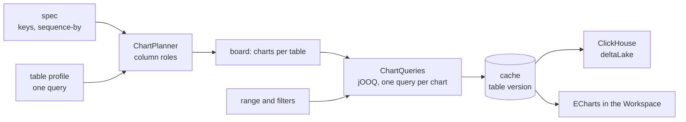

# Dashboards

Every pipeline gets a dashboard without anyone drawing it: Dashboards → a pipeline. It shows how the pipeline is doing (
freshness, runs, rules, quarantine) and what its tables hold (charts chosen from the columns). The design is section 11
of [design/target-architecture.md](design/target-architecture.md) (goal G9); this page is how it works today.

## Words used here

| Word        | Meaning                                                                                                                 | Example                                                      |
|:------------|:------------------------------------------------------------------------------------------------------------------------|:-------------------------------------------------------------|
| Board       | The generated dashboard of one pipeline                                                                                 | `/dashboards/earthquakes`                                    |
| Profile     | For each column of a table: type, empty values, distinct values, smallest and largest, measured by one ClickHouse query | `magnitude`: Float64, 515 distinct, -1.42 to 7.7             |
| Column role | What a column is for a chart, decided from its type and profile: time, category, measure, or never charted              | `occurredAt` is the time, `magnitudeType` a category         |
| Grain       | The width of a time bucket: hour, day, week or month                                                                    | `per day`                                                    |
| Freshness   | Whether the last successful run is as recent as the schedule promises                                                   | On time, Late, Never succeeded, Schedule paused, No schedule |

## What a board shows

**Overview**, from the spec and the event log:

| Part                                                      | Source                                                                                                                                                                                                       | Example                                               |
|:----------------------------------------------------------|:-------------------------------------------------------------------------------------------------------------------------------------------------------------------------------------------------------------|:------------------------------------------------------|
| Freshness                                                 | The last completed run and the schedule as the tower holds it (cron, time zone, paused or not): late when the next scheduled run should have finished more than an hour ago; a paused schedule is never late | every 6 hours, last success at 06:00: Late from 13:00 |
| Last success, current rows, rules failing in the last run | Event log, table profile                                                                                                                                                                                     | earthquakes: 10,235 rows, `1 of 4`                    |
| Run duration                                              | The last 30 runs, green when they succeeded, red when they failed, with the word in the tooltip                                                                                                              |                                                       |
| Rows out per flow, last run                               | `flow_progress` events, in pipeline order                                                                                                                                                                    | bronze 9,924, history 117, gold.daily_activity 219    |
| Failing rows per rule                                     | `expectation` events, as a share of the rows each rule checked, at most eight rules (the worst)                                                                                                              | `reviewed`: 1,827 of 9,924 (18.41 %)                  |
| Quarantine reasons                                        | The quarantine table's `failedExpectations`                                                                                                                                                                  |                                                       |

**One section per table**: `current` and every gold table that exists, with charts chosen by these rules:

| Role                 | How it is found                                                                                                                                                                 | Chart                                                                                                                                               |
|:---------------------|:--------------------------------------------------------------------------------------------------------------------------------------------------------------------------------|:----------------------------------------------------------------------------------------------------------------------------------------------------|
| Never charted        | System columns (`_…`, `factUniqueId`, `processedAt`, `computedAt`, `__START_AT`…), the history keys of `current`, and any column named `…id` that is unique in 9 rows out of 10 |                                                                                                                                                     |
| Time                 | The first date or timestamp column, preferring one that is not `sequence-by` (when an earthquake happened says more than when its record was last revised)                      | Rows over time; in a gold table, the sum of its first number over time                                                                              |
| Category             | A text column with 2 to 50 distinct values                                                                                                                                      | Bars of the top 20 (up to three such charts); the first category with at most 8 values (empty counted as one) also splits the time chart into lines |
| Many values, in gold | A gold table with no such category: its first text column                                                                                                                       | Bars of the top 20 by the table's first number (`events by region, top 20`), not filterable                                                         |
| Measure              | A number column with more than one value; coordinates excluded                                                                                                                  | A distribution in 30 buckets between the profile's smallest and largest value (up to four, not for gold tables, whose numbers are already sums)     |

The grain follows the span shown: up to 3 days per hour, up to 120 days per day, up to 3 years per week, beyond per
month (a date column never goes below a day).

**Size per layer**, stacked per day: for each table, bytes added minus bytes removed in its `_delta_log`, carried
forward and added up by layer. A day is the day the commit file was written, in UTC.

**Storage**, one row per Delta table of the pipeline, from its `_delta_log` and one listing of its data files (cached by
version):

| Column              | What it says                                                                                  |
|:--------------------|:----------------------------------------------------------------------------------------------|
| Versions            | Commits                                                                                       |
| Files, Size         | Live files and their bytes                                                                    |
| Average file        | Size divided by files                                                                         |
| Small files         | Live files under `catalog.small-file` (32 MB); several of them mean `OPTIMIZE` has work to do |
| Waiting for cleanup | Data files in the store minus live bytes: what `VACUUM` can remove once the retention passes  |
| Reclaimed           | Bytes `VACUUM` reported deleting (`VACUUM START` commits, when Delta logs them), else `—`     |

Maintenance runs at most once per `ENGINE_MAINTENANCE_INTERVAL`. Only commit files are read, so once Delta removes logs
older than its 30-day retention, the size history starts later and a table's live figures run low (and Waiting for
cleanup high), as for every figure read from `_delta_log` today.

## Changing a board

A project may add `dashboards/<dataset>.yml` next to its pipelines. It travels with releases, so a board shows what the
released commit asks for:

```yaml
hide: [current/histogram-depthKm]
first: [gold.daily_activity/time, current/bars-status]
```

- `hide` removes charts; `first` puts charts at the top of their table, in that order. A chart is `<table>/<chart>`, as
  in the chart's URL (`/api/boards/earthquakes/current/bars-status`).
- The file is checked when saved in a Git folder (unknown keys, ids that are not `<table>/<chart>`). An id that matches
  no chart is ignored. A released file with problems is ignored, and the board lists the problems at the top.

## Using it

- **Range**: All, 1y, 30d or 7d, counted back from the newest value of the table's time column (not from today, so a
  table of 2024 taxi trips still shows its last 30 days). It narrows every chart of a table that has a time column.
- **Filter by clicking a bar**: clicking a category bar adds `column = value` to every chart of that table; the filter
  shows as a chip next to the table's name, × removes it.
- **Table view**: every chart has one (the table icon), which is also how values stay readable for anyone who cannot
  tell two colors apart.
- **Open as SQL**: every table chart opens its exact query in the SQL editor, written against the catalog view (
  `earthquakes.current`) rather than the lake path:

```sql
select toDate("occurredAt") "chart_x",
       ifNull(toString("magnitudeBand"), '(empty)') "chart_series",
       count(*) "chart_y"
from "earthquakes"."current"
where "occurredAt" is not null
group by "chart_x", "chart_series"
order by "chart_x"
```

## How it works



- Measured on 2026-10-25 on earthquakes (10,235 current rows): the board found `occurredAt` as time, five categories and
  two measures (`depthKm`, `magnitude`); `daily_activity` sums `events` by day and `magnitudeBand`. Each chart query
  took 21 to 29 ms in ClickHouse; asking again came from the cache.
- Everything is decided in the Workspace (`dashboards` package): `ChartPlanner` turns a profile into charts,
  `ChartQueries` builds each chart's aggregation with jOOQ (no SQL strings), `Dashboards` caches. The browser receives
  only aggregated rows (at most 5,000 per chart), never the table.
- **Cached by table version.** Profiles and chart results are kept in memory (400 entries, least recently used dropped
  first), keyed by the table's Delta commit count as the catalog index last saw it, plus the range and filters. A new
  run makes a new version, so nothing stale is served for longer than the index refresh (2 minutes). With grants (G8),
  the key will also carry the person's role set, because two people may see different rows of one version.
- **Rendering**: Apache ECharts 6.1 (bar and line charts, canvas), loaded with the board page only. Colors: the eight
  categorical colors of the reference data-visualization palette, checked with its validator against the Workspace
  surfaces (white `#ffffff`, dark `#16181b`): every adjacent pair stays apart for color-blind readers (worst ΔE 9.1
  light, 8.4 dark) and for everyone else (worst 19.6 and 19.3). Three light colors are below 3:1 contrast on white,
  which is why tooltips and the table view exist on every chart. A series keeps its color when others are filtered
  away (colors follow names, not rank), green and red are reserved for run status and always come with the word, and a
  ninth series never gets a recycled color.
- The Grafana boards are still listed under Dashboards → Grafana until the generated boards cover lakehouse health;
  Grafana's long-term job is alerting only (ADR-25).

## Alerts

Grafana evaluates the alert rules (provisioned from `dataflow-local/monitoring/grafana/provisioning/alerting/`) and
emails them; the Workspace shows the ones firing on Home, each linked to its dataset's board.

| Rule                               | Reads                   | Fires when                                                                                     |
|:-----------------------------------|:------------------------|:-----------------------------------------------------------------------------------------------|
| Dataset late against its schedule  | `serving.schedules`     | The next scheduled run should have finished more than an hour ago; paused schedules never fire |
| Quarantine rate above 5%           | `serving.run_events`    | Over 5% of the rows checked in 24 hours went to quarantine                                     |
| Published copy not refreshing      | `system.view_refreshes` | A copy's daily refresh failed                                                                  |
| Many failing queries in ClickHouse | `system.query_log`      | More than 20 failing platform queries in 15 minutes (people's own queries left out)            |

- **Lateness follows each schedule.** Every 2 minutes the Workspace writes one row per scheduled dataset to
  `serving.schedules` (ReplacingMergeTree, newest row wins): the cron, whether the tower runs it or it is paused, the
  state (`fresh`, `late`, `paused`, `never`), the last success, when the next success is expected and how many hours
  late it is, the same computation as the board's Freshness tile. Measured on 2026-10-26: earthquakes, paused in the
  tower, appears as `paused` and does not alert.
- **Grafana's run boards follow the tower.** A run can fail in the tower after the engine logged it COMPLETED (the
  tower crashed, the worker died). Every 2 minutes the Workspace writes the tower's FAILED and CANCELED verdicts of each
  dataset's last 30 runs to `serving.run_verdicts` (ReplacingMergeTree, one row per run), and the runs and run boards
  take that status over the event log's, as the Runs pages do. The table appears 30 seconds after the Workspace starts;
  until then those boards show an error.
- **The Workspace reads alerts with a read-only token.** At start, `grafana-init` (monitoring stack) gives a Grafana
  service account `workspace` (Viewer) a new token, deletes the old ones, and writes it to the Docker volume
  `grafana-token`, which the Workspace mounts read-only. The Workspace lists Grafana's firing and pending alerts with it
  and shows each person only the alerts of datasets they may see. Without the monitoring stack, the panel stays hidden.

## API

| Method | Path                                                                      | What                                                                          |
|:-------|:--------------------------------------------------------------------------|:------------------------------------------------------------------------------|
| GET    | `/api/boards/{dataset}`                                                   | The board: per table, its time column, newest time, filter columns and charts |
| GET    | `/api/boards/{dataset}/overview`                                          | Freshness, last 30 runs, last run's flows, rule results, quarantine reasons   |
| GET    | `/api/boards/{dataset}/{table}/{chart}?range=30d&filter.magnitudeType=ml` | One chart's rows, its SQL, its grain, and whether it came from the cache      |

A filter on a column that is not one of the table's categories is refused, and filter values are inlined by jOOQ's
ClickHouse renderer with quotes escaped (`ChartQueriesTest` checks `ml' OR 1=1`).

## Tests

| Test                   | What it proves                                                                                                                                                                           |
|:-----------------------|:-----------------------------------------------------------------------------------------------------------------------------------------------------------------------------------------|
| `ChartPlannerTest`     | `current` charts time, categories and measures, never keys or system columns, and splits time by a small category; a gold table sums its first number and draws no distribution          |
| `ChartQueriesTest`     | The exact SQL of a split time chart; range and filters narrow the query with escaped values; histograms clamp into 30 buckets; grain follows span and range; an unknown range is refused |
| `FreshnessTest`        | Late, on time, no schedule, never succeeded                                                                                                                                              |
| `VerdictMirrorTest`    | The tower's FAILED verdict is written for its run; nothing is written when every run succeeded                                                                                           |
| `boardOptions.test.ts` | Colors follow series names and stop at eight; split time series become one line each; histogram buckets are labelled from the profile and empty ones filled                              |

## Not built yet

Cache keys with role sets once row policies exist (G8); Slack, Teams and webhook contact points (email only today);
creating a rule from a saved query.
