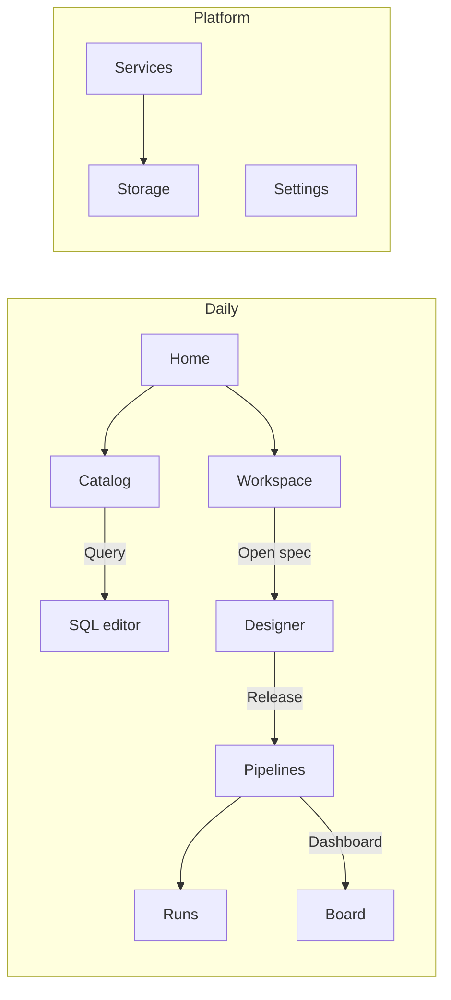
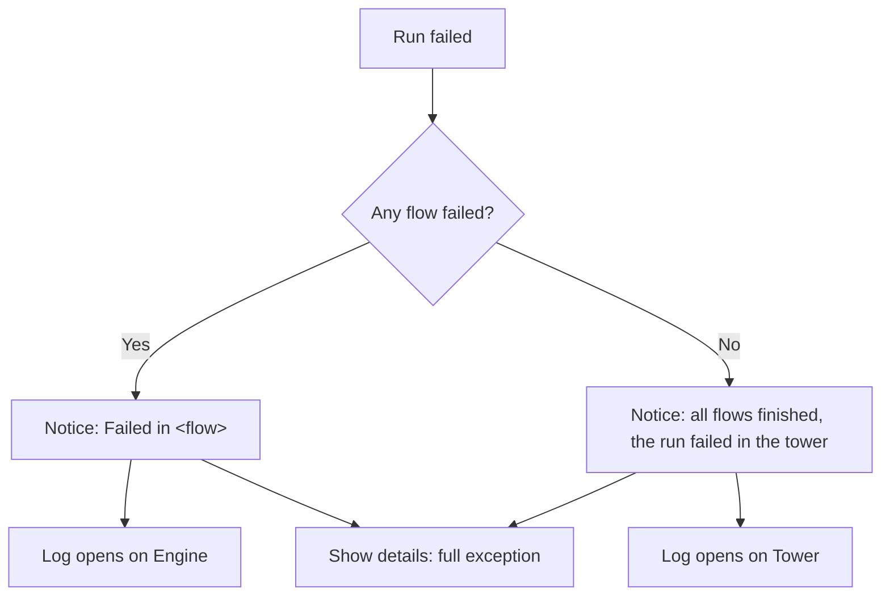

# Workspace UI and UX review

A critical review of the DataFlow Workspace (the web app at `:3080`), written on 2026-11-06 from the 143 screenshots in
[`docs/ui-maquetten/`](../ui-maquetten/README.md), the React code in `apps/dataflow-workspace/ui/src`, and the rules in
[UI standards](../development/ui-standards.md). It names what is wrong, why it hurts, what to change and in what order,
and records what was changed in the first implementation pass.

Reference products: Databricks for data engineering workflows, Snowflake for exploring data, Linear for precision and
consistency. The target is high functional density with low visual noise.

How to read a finding:

- **ID**, title, priority and kind. P0 blocks or misleads a core task. P1 is real friction on a frequent task. P2 is a
  noticeable inconsistency or inefficiency. P3 is polish. Kind is *usability* (it changes what people can do or
  understand) or *cosmetic* (it changes only how it looks).
- **Screens**: numbers from `docs/ui-maquetten/screens/`.
- **Problem**, **Why it hurts**, **Change**, **Impact**, and **Code** (paths under `apps/dataflow-workspace/ui/src`
  unless they start with `src/main/java` or another repository).
- **Done** marks findings fixed in this pass; the [roadmap](#implementation-roadmap) lists the rest.

## Contents

1. [Executive summary](#executive-summary)
2. [Current design assessment](#current-design-assessment)
3. [Key usability problems](#key-usability-problems)
4. [Screen-by-screen findings](#screen-by-screen-findings)
5. [Proposed design system](#proposed-design-system)
6. [Navigation and information architecture](#navigation-and-information-architecture)
7. [Workflow improvements](#workflow-improvements)
8. [Implementation roadmap](#implementation-roadmap)
9. [What the first pass changed](#what-the-first-pass-changed)
10. [Screenshots after the first pass](#screenshots-after-the-first-pass)
11. [Validation](#validation)
12. [Acceptance criteria](#acceptance-criteria)

## Executive summary

The Workspace already looks like one calm product. It has one indigo accent on neutral greys, a shared page header,
status as icon plus word in most tables, right-aligned numbers, tables instead of card grids, and a strict lint setup
that blocks raw colours, sizes and durations. None of that needs a redesign.

The problems that matter are about **trust**, **seeing the work**, and **safety**, not looks:

1. **Trust.** The same run is *Failed* on the Runs pages and *completed* on both dashboards (DA-1). A failed run shows a
   raw Python exception above an all-green graph, and its log opens on the tab without the error (RU-1). The Catalog
   states a wrong column derivation on gold and event tables (CA-1). Times appear in four formats and two time zones
   (SYS-6).
2. **Seeing the work.** The pipeline designer opens at zoom 0.56, where block labels render at about 7 px (DE-2). A
   selected or newly added block ends up hidden behind the Properties panel (DE-1). Pipeline graphs, run graphs and
   column lineage sit in fixed-height boxes that either leave half the screen empty or overflow it (SYS-5). At 1280 px
   the app sidebar and three side rails leave the designer canvas about 600 px wide (SH-4).
3. **Safety.** Five destructive or outward actions run on one click with no confirmation: remove a Git folder, delete a
   file, delete a saved query, revoke a grant, and release compute settings to production (SYS-3).
4. **Consistency at the system level.** The theme defines 17 font sizes (several half a pixel apart) and 9 radii, two
   tab systems, two breadcrumb separators, two table header styles, and status vocabularies with gaps (`Paused`,
   `Not checked` are improvised per page). Each page then invents a small variation.

The first implementation pass (see [roadmap](#implementation-roadmap)) consolidates the design scale, fixes the
designer viewport, adds the missing confirmations, makes run failures diagnosable from data the page already has, and
gives canvases the height they need.

## Current design assessment

What works and should be kept:

| Area | Keep |
|:--|:--|
| Visual identity | Dark-first neutral greys, one indigo accent, Inter and JetBrains Mono |
| Page frame | `PageHeader` with crumbs, title, meta row and one primary action; the rounded main surface |
| Status | `StatusBadge` and `StatusIcon` with icon plus word, labels in `lib/status.ts` |
| Tables | `NumberCell`, tabular figures, `TableSkeleton` for first loads |
| Search | ⌘K spotlight with scopes, keyboard hints and result counts (006, 007) |
| Designer | A form per block, a Problems list that jumps to the block, Unsaved state, Discard and Save |
| SQL editor | Persistent tabs, catalog completion, run statement under cursor, row limit, resizable results |
| Catalog table page | Overview, Sample data, Profile, Details, History, Lineage; Query as the primary action |
| Run timeline | Bars, rows out, change against the previous run and duration in one table (122) |
| Full refresh | Type-the-name confirmation (107), the model for every irreversible action |
| Guard rails | ESLint and Stylelint rules against raw values; `lib/contrast.test.ts` |

Where it falls short, by quality:

| Quality | Assessment |
|:--|:--|
| Information architecture | Sound top level; Services sits among daily tools; Storage has no entry; Settings only behind the avatar |
| Visual hierarchy | Good on list pages; weak on canvases, where text drops to 6 to 8 px |
| Density | Sidebar rows are heavier than content (14 px labels against 13 px tables); editors stack 3 toolbars and 4 side columns |
| Consistency | Many near-duplicates: 17 type sizes, 9 radii, 2 tab systems, 2 header styles, 4 time formats |
| Workflows | Editing loops break at modals (Preview, Impact) and at non-clickable problems; failures dead-end |
| Accessibility | Focus ring and contrast tokens are good; gaps in keyboard access to canvases, click-only rows, colour-only states, disabled buttons without reasons |
| States | Loading and failure handled almost everywhere; empty states often plain text with no next step |

## Key usability problems

Ranked by harm. Each links to its finding.

| # | Problem | Finding | P |
|:--|:--|:--|:--|
| 1 | A selected or added block is hidden behind the Properties panel | [DE-1](#de-1) | P0 |
| 2 | A failed run shows a raw exception above an all-green graph; the log opens without the error | [RU-1](#ru-1) | P0 |
| 3 | Dashboards say a failed run completed | [DA-1](#da-1) | P0 |
| 4 | The Catalog shows silver's derivation for gold and event columns | [CA-1](#ca-1) | P0 |
| 5 | The designer opens at an unreadable zoom | [DE-2](#de-2) | P1 |
| 6 | Five destructive or outward actions do not confirm | [SYS-3](#sys-3) | P1 |
| 7 | Canvases have fixed heights: empty space or a second scrollbar | [SYS-5](#sys-5) | P1 |
| 8 | Preview and Impact results cover the editor in a modal | [ED-1](#ed-1) | P1 |
| 9 | Problems in the code view cannot be clicked | [ED-2](#ed-2) | P1 |
| 10 | Column lineage is unreadable at laptop size | [CA-2](#ca-2) | P1 |
| 11 | Runs open only by clicking a table row | [RU-2](#ru-2) | P1 |
| 12 | Status shown by colour alone (Paused, partitions, drafts) | [SYS-2](#sys-2) | P1 |
| 13 | SQL results vanish on reload | [SQ-1](#sq-1) | P1 |
| 14 | Granting access means typing a principal from memory | [SE-2](#se-2) | P1 |

## Screen-by-screen findings

Screenshots are grouped into families. A finding that repeats across families is written once under *Cross-cutting*.

### Cross-cutting

**SYS-1 The design scale has more steps than the product uses** · P2 · cosmetic
- Screens: all.
- Problem: `theme.ts` defines 17 font sizes (`fine` 9.5 px to `display` 28 px, with 11, 11.5, 12, 12.5 and 13 all
  present) and 9 radii (2 to 12 px). In the code, `sm`, `xs`, `small` and `caption` carry about 90% of font-size uses;
  six radius keys are used once or twice.
- Why it hurts: half-pixel steps are invisible as hierarchy but visible as inconsistency; every new screen picks a
  slightly different size, and canvas text ends up at 6 to 10 px.
- Change: an 8-step type scale and 5 radii (see [Proposed design system](#proposed-design-system)), migrated by
  renaming every use, with no aliases left behind.
- Impact: one obvious choice per role; fewer sizes to review.
- Code: `theme.ts:24-48`, every `fz=`, `size=` and `var(--mantine-font-size-*)` use.
- **Done.**

**SYS-2 Status shown by colour alone** · P1 · usability
- Screens: 003, 014, 102, 105, 110, 127.
- Problem: `Paused` is amber text with no icon; the drafts count in the tree is an amber number; a partition's status
  is a 6 px coloured dot; `Added` is green text. `lib/status.ts` has no `PAUSED`, so each page improvises. The
  `warning` tone reuses the queued clock icon.
- Why it hurts: fails WCAG 1.4.1 (use of colour); a colour-blind person cannot tell paused from active.
- Change: add `PAUSED` to `lib/status.ts` and render it with `StatusBadge` wherever a schedule is shown; give the
  `warning` tone its own triangle icon.
- Impact: every state reads as icon plus word.
- Code: `lib/status.ts`, `components/StatusBadge.tsx:28-30`, `components/Schedule.tsx:15`,
  `components/PipelinesTable.tsx:50-51`, `pages/pipeline/PartitionsTab.tsx:53-68`.
- **Done**: `PAUSED` and the warning icon; partitions show a status icon in each cell (PI-2, 9375f48).

**SYS-3 Destructive or outward actions without confirmation** · P1 · usability
- Screens: 015, 058, 094, 136, 139.
- Problem: Remove Git folder, Delete file, Delete saved query (Queries page), Revoke grant, and Release on Compute run
  on one click. Revoke is also invisible until hover. The same actions confirm elsewhere (SQL Saved panel, Git bar
  Release).
- Why it hurts: drafts, unpushed commits, files and access are lost or changed by accident; production changes go out
  unseen.
- Change: each goes through `FormModal` with `danger` (or the existing release dialog) and names what goes. Revoke is
  always visible.
- Impact: no one-click loss.
- Code: `pages/WorkspacePage.tsx:187-201`, `pages/workspace/FileEditor.tsx:219-226`, `pages/QueriesPage.tsx:81-85`,
  `components/AccessPanel.tsx:43-55`, `components/settings/Settings.css:144-152`, `components/ComputePanel.tsx:70-86`.
- **Done.**

**SYS-4 Disabled controls do not say why** · P2 · usability
- Screens: 019, 024-028, 032, 034, 035.
- Problem: `FormModal` cannot carry a reason for a disabled submit; a disabled `IconAction` shows a filled grey square
  that looks pressed, and its tooltip never opens.
- Why it hurts: people click repeatedly and get no explanation.
- Change: disabled `IconAction` renders transparent at reduced opacity and keeps its tooltip by wrapping the button;
  `FormModal` takes a `submitHint`.
- Impact: every disabled control is one hover from its reason.
- Code: `components/actions/IconAction.tsx`, `components/FormModal.tsx`.
- **Done**: `IconAction` keeps its tooltip; `FormModal` shows `submitHint` beside its buttons, linked to the submit
  button, because a disabled button shows no tooltip.

**SYS-5 Canvases have fixed heights** · P1 · usability
- Screens: 044, 075, 105, 114, 116, 121, 124.
- Problem: the pipeline graph is 380 px, the run graph 320 px, lineage and spec 640 px, the catalog lineage 600 px, the
  run log 540 px, regardless of the window. At 900 px tall the graph leaves about 290 px empty; lineage runs past the
  bottom and hides its controls; the log scrolls inside a scrolling page.
- Why it hurts: the most important picture on the page is either too small or cut off, and two scrollbars compete.
- Change: one rule, the canvas fills the rest of the viewport (`calc(100dvh - top offset)`) with a 380 px floor.
- Impact: graphs use the screen they are given at 1280 × 800 and at 1440 × 900.
- Code: `pages/PipelinePage.tsx:108,159,175`, `pages/RunPage.tsx:148`, `pages/catalog/TableView.tsx:39`,
  `components/OutputLog.tsx:50`.
- **Done** for the pipeline and run graphs, lineage and the run log.

**SYS-6 Times in four formats and two time zones** · P1 · usability
- Screens: 098, 101, 108, 119, 124.
- Problem: tables show `Nov 6, 2026, 7:05 PM`; the log `19:05:50.329`; board axes `10-25 07:19` in UTC (they slice the
  raw string); Grafana cuts off the PM. Durations can read `1m 60s` because seconds are rounded after splitting.
- Why it hurts: the same run cannot be matched across views; a 3 PM run reads as 3 AM.
- Change: one local 24-hour format for every time and axis; round total seconds before splitting.
- Impact: every view lines up to the minute.
- Code: `lib/format.ts:30-34,62-65`, `lib/boardOptions.ts:192,264`.
- **Done** for the format and the duration bug; Grafana's own format is in `dataflow-local` (roadmap).

**SYS-7 Two tab systems, two breadcrumb styles, two table header styles** · P2 · cosmetic
- Screens: 014, 042, 067, 084.
- Problem: `TabStrip` (panes) and Mantine `Tabs` (pages) look and behave differently (no arrow keys in `TabStrip`);
  crumbs use `›` in the Workspace and `/` elsewhere; table headers are dimmed 500 inside a `Panel` and bold white
  elsewhere; a single pane title carries an active-tab underline, so `Catalog` and `Details` look like the only tab of
  a set.
- Why it hurts: the eye has to relearn each screen.
- Change: one global table header style; plain pane titles without underline; `/` as the only crumb separator; arrow
  keys in `TabStrip`.
- Impact: one look per element.
- Code: `components/Panel.css:40-44`, `components/layout/Pane.css:63-66`, `components/layout/Tabs.tsx`,
  `pages/WorkspacePage.tsx:137`.
- **Done** for headers, pane titles and crumbs; `TabStrip` takes arrows, Home and End with one Tab stop (9a01115). The
  closable query tabs stay a separate document variant, with the same key rule (ca8190a).

**SYS-8 One word, several meanings** · P2 · usability
- Screens: 005, 023, 045, 050, 057, 064, 084, 085, 093, 095.
- Problem: New and Create for the same menu; Home for the overview page and for the personal folder; Delete and Remove
  for one action; Preview for a spec run, a Markdown view and a table sample; Impact for a static check and an engine
  run; History for four different lists; Draft for "never saved" (SQL) and "saved, not committed" (files).
- Why it hurts: people cannot predict what a button does.
- Change: Preview stays the spec run; the schema action becomes `Sample rows`; the SQL panel's History becomes
  `Recent`; an unsaved query is `Unsaved`; `Delete` everywhere in the designer.
- Impact: one word, one meaning.
- Code: `components/SchemaBrowser.tsx:78-81`, `pages/sql/SqlTools.tsx:21`, `lib/queryTabs.ts:47-48`,
  `pages/workspace/designer/Inspector.tsx:29`.
- **Done**: menus that start something say New (sidebar, Workspace toolbar), page buttons say New and the noun
  (`New pipeline`, `New query`), and Create is only the submit verb inside a dialog.

**SYS-9 Empty states without a next step** · P2 · usability
- Screens: 013, 084, 087, 092, 094, 096.
- Problem: `Empty` alone, or plain text (`No saved queries`, `Run a query to see results`, `None`), with no action.
- Why it hurts: an empty page is a dead end, especially on first use.
- Change: `Empty` with a short title and one `Action` where there is a next step.
- Code: `pages/WorkspacePage.tsx:156`, `pages/sql/SqlTools.tsx:94`, `pages/sql/Results.tsx:72-79`,
  `pages/QueriesPage.tsx:43-47`.
- **Done** for the SQL editor's Saved and Recent panes, which name the shortcut that fills them, and for the
  Queries page, which tells an unmatched filter from an empty list. An empty Workspace folder keeps Create in its
  toolbar.

### Sign-in (001, 002)

**SI-1 Sign-in polish** · P3 · usability
- Problem: the show-password button has `tabindex="-1"`; step 2 drops the heading so the logo shifts 16 px.
- Change: make the button reachable; keep the heading on step 2. The email-first flow itself is clean.
- Code: `dataflow-local/sign-in/themes/dataflow/login/login-password.ftl:17-18`.
- **Done** for the keyboard (dataflow-local 452e717): Tab goes from the password to Show password. The heading on step 2
  comes from Keycloak's base template, which shows the account name there instead (roadmap).

### Shell: header, sidebar, search (003-012)

**SH-1 The sidebar is heavier than the content** · P2 · cosmetic
- Screens: 003, 004.
- Problem: nav labels are 14 px on 34 px rows with 20 px icons, the New button is 38 px with a shadow, section labels
  are 12.5 px; the content's body text is 13 px. The chrome draws the eye before the data.
- Change: 13 px labels, 32 px rows, 18 px icons, a flat New button, section labels at the caption size.
- Impact: the page content leads; two more items fit before scrolling.
- Code: `styles.css` (`.df-nav-link`, `.df-nav-section`), `components/shell/Shell.css` (`.df-nav-new`),
  `components/Shell.tsx:28`.
- **Done.**

**SH-2 Home hides failures among neutral counters** · P2 · usability
- Screens: 003.
- Problem: `Failed today 2` and `Rules failing 1` look exactly like `Served tables 8`; the title "Welcome to DataFlow"
  takes the place of a page name; a services notice repeats "Services" three times.
- Change: the two failure tiles show a failed status icon in the danger colour when above zero, neutral at zero; the
  page title is `Home`.
- Impact: a failure is the first thing seen on Home.
- Code: `pages/HomePage.tsx:62-73`.
- **Done.**

**SH-3 Navigation groups** · P2 · usability
- Screens: 003, 004, 131, 132.
- Problem: Services (platform health) sits in the primary group between Catalog and SQL; Storage has no entry; Settings
  opens only from the avatar menu.
- Change: a bottom `Platform` group with Services and Settings (Settings leaves the avatar menu); Storage linked from
  the Services lake row.
- Code: `components/Shell.tsx:30-57`, `pages/ServicesPage.tsx`.
- **Done**: the group, and Storage is found by search with its own title (one navigation list, 16d351a).

**SH-4 Editor pages give the work area too little width** · P2 · usability
- Screens: 029, 032, 039, 084.
- Problem: in the designer the 220 px sidebar sits next to three 40 px rails with rotated labels; with Blocks and
  Properties open the canvas is 614 px of 1440 (039) and about 600 of 1280. The SQL editor at 1280 leaves 780 px for
  the editor beside the schema panel.
- Change: the sidebar starts as the 56 px rail on full-height tool pages (Workspace file editor, SQL editor) unless the
  person expanded it there; the existing ⌘B toggles it.
- Impact: +164 px for the canvas and the editor.
- Code: `components/Shell.tsx:60-71`.
- **Done.**

**SH-5 Search and header polish** · P3 · cosmetic
- Screens: 006, 007, 009, 011.
- Problem: the search panel is a fixed 560 px tall; one column appears once per layer; the apps menu uses five tinted
  tiles and does not mark new-tab links; the shortcuts dialog uses capitals and lists Redo two ways.
- Change: `max-height`, 40 px rows, grouped columns; neutral tiles with an external-link icon; sentence case and ⌘⇧Z.
- Code: `components/SearchSpotlight.css:6,129`, `components/shell/HeaderActions.tsx:35-41`,
  `components/ShortcutsModal.tsx`.
- **Done** for results (64b6601): a column with one type across tables is one 44 px row that lists its tables. The
  panel height and the apps tiles are unchanged.

### Workspace: Git folders and files (013-028)

**WS-1 Remove Git folder deletes at once** · P1 · usability. Part of [SYS-3](#sys-3).
- Screens: 015.
- Problem: `⋯ → Remove` deletes the clone, with its drafts and unpushed commits, without asking.
- Change: confirm in a danger `FormModal` that names the folder and, when known, its drafts and unpushed commits.
- Code: `pages/WorkspacePage.tsx:187-201`.
- **Done.**

**WS-2 The Release dialog does not say what will run** · P1 · usability
- Screens: 020, 021.
- Problem: the same sentence for every target; no branch, no commit, no warning when local commits are not pushed,
  although `tree.branch`, `tree.head` and `tree.ahead` are loaded.
- Why it hurts: a production release is expensive to reverse and the person cannot see which commit goes live.
- Change: title `Release <folder> to <target>`; one line `branch @ commit`; a `Notice` when commits are not pushed.
- Code: `pages/workspace/GitActions.tsx:44-75`.
- **Done.**

**WS-3 Listing shows empty and redundant columns** · P2 · cosmetic
- Screens: 014, 016, 017.
- Problem: inside a Git folder `Branch` is always empty and `State` nearly always; `Type` repeats the icon.
- Change: show `Branch` and `State` only when a row has a value.
- Code: `pages/WorkspacePage.tsx:161-186`.
- **Done.**

**WS-4 Crumbs collapse with room to spare; Home means two places** · P2 · usability
- Screens: 013, 017, 022.
- Problem: crumbs collapse to `…` after two parts with 600 px free; the personal folder shows as `Users › ui-guide`.
- Change: show up to four crumbs; render the `Users/<me>` prefix as `Home`.
- Code: `pages/WorkspacePage.tsx:130-149`, `lib/workspace.ts:55`.
- **Done.**

**WS-5 Create dialogs: placeholders that look like values, disabled Create without a reason** · P2 · usability
- Screens: 019, 024-028.
- Problem: examples such as `sensor_readings` read as prefilled values while Create stays grey; From source keeps
  Create off until Sample runs without saying so; dialog titles and widths differ.
- Change: `submitHint` on `FormModal` (`Name the pipeline`, `Sample the source first`); one title pattern
  (`New pipeline in examples`); one width.
- Code: `components/FormModal.tsx`, `pages/workspace/CreateMenu.tsx`, `pages/workspace/GitActions.tsx:105-108`.
- **Done** for reasons and titles (`New pipeline in examples`); widths still follow the content.

### Pipeline designer (029-041)

**DE-1 A selected or added block is hidden behind Properties** · P0 · usability
- Screens: 036, 037, 038, 039.
- Problem: clicking a block, or adding one from Blocks, unfolds Properties to 360 px but the camera does not move;
  `regions`, `earthquakes_regions` and a new block sit outside the visible canvas.
- Why it hurts: people edit or create something they cannot see, and add a block twice because the first one
  "disappeared".
- Root cause: `reveal()` measures the canvas in the effect right after the selection changes, while the pane width is
  still animating, so the block counts as visible; when the canvas then shrinks, the resize handler returns early
  because a block is selected.
- Change: after the resize settles with a block selected, reveal that block; reveal tests against an inset margin and
  never zooms below the readable floor.
- Impact: every select, add and problem jump ends with the block visible beside its form.
- Code: `pages/workspace/designer/Canvas.tsx:111-127,197-211`, `DesignerTools.tsx:24-29`, `layout/Pane.css:9`.
- **Done.**

**DE-2 The designer opens at an unreadable zoom** · P1 · usability
- Screens: 029, 030, 031.
- Problem: the initial fit may shrink to zoom 0.5; seven ranks of 200 px blocks with 56 px gaps fit into about 1090 px
  at zoom 0.56, so labels render at 7 px. Fit to view uses a second rule (React Flow's `fitView`, floor 0.3).
- Change: one fit rule for opening and for the Fit button, with a readable floor of 0.85; a graph wider than the canvas
  is left-aligned (Source stays in view) instead of shrunk; rank gap 40 px.
- Impact: Source to gold is readable on open at 1440 px; serving is one short pan away.
- Code: `Canvas.tsx:62,97-109,263`, `components/graph/CanvasControls.tsx:28`, `lib/designerPositions.ts:8`.
- **Done.**

**DE-3 The canvas cannot be reached by keyboard** · P1 · usability
- Screens: 029-041, 011.
- Problem: the canvas frame has `tabIndex={-1}`; arrow-key moves between blocks, ⌘D and Delete work only after a
  mouse click and are missing from the shortcuts dialog.
- Change: the frame is focusable with a name and a visible focus ring; focusing it with nothing selected selects the
  first block; the shortcuts dialog gets a Pipeline designer group.
- Code: `Canvas.tsx:213-221`, `components/ShortcutsModal.tsx`.
- **Done.**

**DE-4 The silver column editor truncates names to ambiguity** · P1 · usability
- Screens: 033.
- Problem: in the 360 px panel, Name and From get about 71 px each; two rows both read `magnituc`; the header says
  `Req.`.
- Change: Properties opens at 440 px; Name and From get `minmax(120px, 1fr)`; the header says `Required`.
- Code: `pages/workspace/designer/IngestForms.tsx:103-105`, `DesignerTools.tsx:46`.
- **Done.**

**DE-5 A permanent warning for a known limit** · P2 · usability
- Screens: 029-040.
- Problem: earthquakes always shows `1 warning`: a Java gold table's columns are not traced. That is a by-design
  lineage gap, not a spec problem, so the badge stops meaning anything.
- Change: report it as a note on the Java table's Properties, not as a check warning.
- Code: `src/main/java/com/dataflow/workspace/lineage/ColumnLineage.java:130`.
- **Done**: the lineage no longer warns; a Java gold table's Properties end with a Lineage note
  (`designer/TableForms.tsx`).

**DE-6 Designer polish** · P3 · cosmetic
- Screens: 032-040.
- Problem: capitals in section titles (`LOCATION`, `READ`) and palette groups; a sentence under each block name;
  palette names clipped hard.
- Change: sentence case section titles; ellipsis on palette names.
- Code: `pages/workspace/designer/Designer.css`.
- **Done** for capitals and ellipsis.

### File editor and spec tools (042-066)

**ED-1 Preview and Impact results cover the editor** · P1 · usability
- Screens: 049-056.
- Problem: task output opens in a 90%-wide modal that dims the app and hides the YAML being fixed.
- Why it hurts: Preview drives a fix loop; each fix is close, edit, reopen.
- Change: show task output in a bottom `Pane`, as SQL results do, under both Code and Design.
- Code: `pages/editor/SpecTasks.tsx:67-73`, pattern in `pages/sql/Results.tsx:37`.
- **Done**: Preview, Impact and the designer's preview of one step all open in one bottom pane
  (`pages/editor/TaskPane.tsx`), reached through the `TaskTarget` context the file editor provides.

**ED-2 Problems cannot be clicked in the code view** · P1 · usability
- Screens: 042, 043.
- Problem: Problems rows are plain text; warnings are not passed to Monaco, so they get no marker.
- Change: each row is a button that reveals its line; warnings become Monaco markers.
- Code: `pages/editor/CheckTab.tsx:13-25`, `pages/workspace/FileEditor.tsx:285,320-334`.
- **Done** for problems: a problem with a line is a button that puts the cursor on it, in the same row as the
  designer's Problems pane (`components/IssueRow.tsx`). Warnings reach the UI as text without a line
  (`DraftCheck.warnings`), so their markers wait for the server to send one.

**ED-3 Delete file does not confirm; the leave dialog has no Save** · P1 · usability. Part of [SYS-3](#sys-3).
- Screens: 058, 061.
- Change: confirm Delete in a danger `FormModal` that names the file.
- Code: `pages/workspace/FileEditor.tsx:219-226,244-245`.
- **Done**: Delete confirms; leaving with unsaved changes offers Save and leave, Keep editing and Discard (653883d).

**ED-4 Two primary buttons in a file** · P2 · cosmetic
- Screens: 029, 039, 042, 059.
- Problem: the Git bar's Create is always indigo; Save turns indigo when the file is unsaved.
- Change: Create uses the default tone inside a file; Save stays the one primary.
- Code: `pages/workspace/CreateMenu.tsx:42`.
- **Done.**

**ED-5 Diff, Graph and the double header** · P2 · usability
- Screens: 042-047, 060-066.
- Problem: Diff lives in three places depending on file type; the Graph tab duplicates Design at 6 px text; the
  Details pane has a title row plus a tab row.
- Change: one full-width diff view mode for every file type; remove the Graph tab; tabs in the pane header.
- Code: `pages/workspace/FileEditor.tsx:75-79,289-311`, `pages/editor/GraphTab.tsx`.
- **Done** for the diff and Graph: Diff is a toolbar view for every file type (`pages/editor/FileDiff.tsx`, against
  Saved or Last commit); the Graph tab is gone; Problems, Impact and History are the Details pane's header tabs.

**ED-6 Preview grids waste height and misalign numbers** · P2 · cosmetic
- Screens: 050, 052-055.
- Problem: fixed 300 and 270 px grids; numbers left-aligned because only ClickHouse type names count as numeric;
  doubles printed raw (`8.938076479018297E10`).
- Change: one numeric-type test covering Spark and ClickHouse names; floats formatted with at most 6 fraction digits.
- Code: `components/DataGrid.tsx:20`, `pages/editor/TaskOutput.tsx:134-168`.
- **Done** for numbers: `isNumericType` in `lib/types.ts` reads Spark and ClickHouse names, and `columnText` prints
  `float` and `double` cells with at most 6 fraction digits (copy keeps the raw value). Fixed grid heights remain.

### Catalog (067-083)

**CA-1 Wrong derivation shown for gold and event columns** · P0 · usability
- Screens: 068, 079, 080.
- Problem: `ColumnRoles.of` applies silver's column roles by name to every non-bronze table, so
  `gold_regions.region` shows silver's `trim(element_at(...))` while gold computes `coalesce(region, 'Unknown')`.
  The column is titled `Comment` but holds an expression.
- Why it hurts: the page states a wrong fact as true.
- Change: the server applies silver roles only to silver, quarantine, history and current; the UI titles the column
  `Source`.
- Code: `src/main/java/com/dataflow/workspace/catalog/ColumnRoles.java:14-22`, `pages/catalog/TableView.tsx:169`.
- **Done**: header renamed in this pass, server fix in 71390ef.

**CA-2 Column lineage is unreadable at laptop size** · P1 · usability
- Screens: 075, 114, 115.
- Problem: a fixed 600 px canvas fitted to every column of every neighbour (fit floor 0.15), so text is about 7 px;
  the trace picker covers a table; the current table is not marked; column rows are clickable `div`s.
- Change: the canvas fills the viewport (SYS-5); neighbours collapse to the columns linked to the focused table, so a
  readable zoom fits; the picker moves above the canvas; the focused table gets an accent border; rows become buttons.
  A plain zoom floor was tried and rejected: centred at a higher zoom, it cut off the table headers.
- Code: `components/LineageGraph.tsx:52-57,130-131`, `components/LineageGraph.css`.
- **Done** (69a420f): the canvas fills the window; on a table page, neighbours show only the columns linked to it with
  a `+N columns` row, the focused table has the accent border, the trace picker sits in a toolbar above the canvas, and
  each column is a button.

**CA-3 History tab grammar and raw change types** · P2 · cosmetic
- Screens: 073, 074.
- Problem: `1 files added`, `1 rows written`; the changes dialog shows `update_preimage` and `update_postimage`.
- Change: `plural()` everywhere; map change types to Inserted, Closed and New version.
- Code: `pages/catalog/HistoryTab.tsx:113,127-136`.
- **Done**: plurals, and the changes grid names each row's change (Inserted, Before closing, Closed, Deleted).

**CA-4 Catalog landing: two filters, two-line rows** · P2 · usability
- Screens: 067.
- Problem: a tree search and a page filter do the same job; two-line rows fit 13 tables per screen.
- Change: one filter; one-line rows.
- Code: `pages/CatalogPage.tsx:40,165,183-194`.
- **Done**: the tree's search filters the landing table too; the SQL name has its own column, so rows are one line.

**CA-5 Lake and served table pages differ; Trace is hidden** · P2 · usability
- Screens: 068-070, 079, 081, 082.
- Problem: served pages lack copy-name, Download, the tab in the URL and Lineage; a gold table's title differs from its
  tree name; only the cursor shows that a row opens Trace, and the drawer is titled by a 64-character hash.
- Change: one shared header; a visible Trace row action; the drawer titled by the key.
- Code: `pages/catalog/ServedTableView.tsx:33-48`, `pages/catalog/TableView.tsx:58-66,209-211`,
  `components/WhyDrawer.tsx:33-42`.
- **Done** for Trace: traceable samples end each row with a Trace button (the drawer is now titled Trace). The
  shared header for served tables remains.

**CA-6 Details and Profile overflow; Missing column is noise** · P3 · cosmetic
- Screens: 071, 072, 083.
- Change: truncate long property values with a hint; draw the Missing bar only above 0% in the warning colour.
- Code: `pages/catalog/DetailsTab.tsx:45`, `components/ProfileTable.tsx:24,30,60`.
- **Done**: long property values truncate with the whole value on hover; the Missing bar shows only above 0%, in
  the warning colour.

### SQL editor, queries and alerts (084-096)

**SQ-1 Results vanish on reload** · P1 · usability
- Screens: 090, 092, 093.
- Problem: tabs and their SQL persist in `localStorage`; results live in component state.
- Change: keep each tab's last result in the query cache (capped at 1,000 rows); without one, offer Run again.
- Code: `pages/SqlPage.tsx:53,79`.
- **Done**: each tab's last result is kept in `sessionStorage` (first 1,000 rows), so it survives a reload but
  not the browser tab; a failed run or a closed tab drops it.

**SQ-2 Closing an unsaved query loses its SQL** · P2 · usability
- Screens: 085, 089.
- Change: closing a tab with unsaved SQL asks first; the close target is 24 px.
- Code: `pages/SqlPage.tsx:120-125`, `pages/sql/Sql.css:104`.
- **Done.**

**SQ-3 Chart settings reset and have no labels** · P2 · usability
- Screens: 086.
- Problem: X, Y and kind reset when switching Results and Chart; the selects have no accessible label; count axes get
  fractional ticks.
- Change: keep the choice on the tab; label the selects; integer ticks for integer columns.
- Code: `pages/sql/ResultChart.tsx:14-40`.
- **Done.**

**SQ-4 The Alerts page cannot create an alert** · P1 · usability
- Screens: 096.
- Problem: query alerts appear only once one exists, as a second table; creating one is a bell icon on a Queries row.
- Change: tabs Firing and Query alerts; an empty state with Add alert.
- Code: `pages/AlertsPage.tsx:21-32`, `components/QueryAlerts.tsx`.
- **Done**: tabs Firing and Query alerts, and Add alert in the header, which picks one of the person's saved
  queries without an alert.

**SQ-5 Queries table: three row icons, a non-verb button, delete without confirm** · P2 · usability
- Screens: 094, 095.
- Change: confirm Delete (SYS-3); the header button is `New query`.
- Code: `pages/QueriesPage.tsx:35,55-86`.
- **Done.**

### Dashboards (097-101)

**DA-1 Dashboards say a failed run completed** · P0 · usability
- Screens: 098, 101, 108, 119, 120.
- Problem: run 94c07ad0 is Failed in Runs; the Grafana runs board shows it completed with 0 failed, and the pipeline
  board's duration chart has no red bar. The boards read the engine's event log; the Runs pages read the tower.
- Why it hurts: someone checking health on Dashboards concludes nothing failed.
- Change: the boards read run status from the tower, as the Runs pages do.
- Code: `src/main/java/com/dataflow/workspace/dashboards/PipelineOverviews.java:57`,
  `dataflow-local/monitoring/grafana/dashboards/Pipeline/runs.json`.
- **Done** for the pipeline board and freshness (0dbd545); the Grafana runs board is in the roadmap.

**DA-2 Two chart languages** · P2 · cosmetic
- Screens: 098, 100, 101.
- Problem: single-series charts draw in a blue that is not the brand indigo; Grafana shows large coloured numbers and
  solid green status cells.
- Change: single series in the brand colour; Grafana stat panels without colour mode.
- Code: `lib/chartTheme.ts:3-6`, `runs.json`.
- **Done** for the Workspace charts.

**DA-3 Pipelines and their boards do not link** · P2 · usability
- Screens: 097, 098.
- Problem: two stacked tables on the list; no link from a pipeline to its board.
- Change: one table; a Dashboard icon action in the pipeline header.
- Code: `pages/DashboardsPage.tsx:31-89`, `pages/PipelinePage.tsx:49-56`.
- **Done** for the pipeline header link.

### Pipelines (102-118)

**PI-1 Header Status is really the last run** · P2 · usability
- Screens: 102, 105.
- Change: label it `Last run` and link it to that run.
- Code: `pages/PipelinePage.tsx:59`.
- **Done.**

**PI-2 Partitions by colour alone** · P1 · usability
- Screens: 110, 111.
- Change: a status icon in each cell; a count above the grid.
- Code: `pages/pipeline/PartitionsTab.tsx:11,53-68`.
- **Done.**

**PI-3 Layer colours collide with status colours** · P2 · cosmetic
- Screens: 105, 121, 125.
- Problem: quarantine icons are red and serving icons green, next to green status checks.
- Change: layer icons keep their shapes in neutral grey; colour is left to status.
- Code: `lib/layers.ts:17-31`.
- **Done**, differently: the owner kept coloured layers, since bronze, silver and gold share one icon and grey would
  leave nothing to tell them apart. The three tones that read as a status moved: gold `#cfa53a` to `#a5953a` (it was
  0.018 from dark warning in OKLab), serving `#3fa07f` to `#1c8cb4` (0.055 from success), quarantine `#c95b63` to
  `#a959ac` (0.085 from danger). Every layer tone now keeps 0.09 or more from each status colour in both themes, which
  `lib/contrast.test.ts` checks. The designer, graphs and search take the same tones.
  Silver `#8e9bab` and current `#4a9be0` were 2.83 and 2.98:1 on the light page, under the 3:1 icons need; they darken
  to `#8895a4` and `#4798dd`, and the same test checks every layer icon against the page in both themes.

**PI-4 Runs tab charts do not line up** · P2 · usability
- Screens: 108, 109.
- Change: one window for both charts; cap outliers; one tab stop per chart.
- Code: `pages/PipelinePage.tsx:114`, `components/RunDurations.tsx`, `components/RunMatrix.tsx`.
- **Done** (4d34a63): both charts cover the same 50 runs; durations scale to the 90th percentile and mark the runs that
  exceed it; each chart is one Tab stop moved through with the arrow keys; the rows legend is an icon and a word.

**PI-5 Trace is a tab holding only a form; the partition dialog has no default** · P2 · usability
- Screens: 112, 117, 118.
- Change: show the trace result in the tab; default the partition to the newest one not run.
- Code: `pages/pipeline/WhyTab.tsx`, `components/RunButton.tsx:22,40-51`.
- **Done** for the default: Run now opens on the newest partition that has not run (`lib/partitions.ts`). The trace
  result in the tab remains.

### Runs (119-126)

**RU-1 A failed run dead-ends** · P0 · usability
- Screens: 125, 126.
- Problem: four lines of `dagster._core.errors.DagsterInvariantViolationError: ...` in 12 px mono above a graph where
  every step is green (the engine finished, the tower failed afterwards); the Log tab opens on Engine, which has no
  error.
- Why it hurts: a person cannot tell whether the pipeline or the platform failed, or where to look.
- Change: from data the page already has, the notice title names the first failed flow (`Failed in silver`) or says
  `All flows finished; the run failed in the tower`; the exception's class name follows; the full text is behind
  `Show details`; when no flow failed, Log opens on Tower.
- Impact: the cause and its place in one look, with no new data.
- Code: `pages/RunPage.tsx:115-119,262`.
- **Done.**

**RU-2 Runs open only by clicking a row** · P1 · usability
- Screens: 108, 119, 120.
- Problem: a run opens through `<tr onClick>`; the run ID is plain grey text.
- Change: the run ID is a link to the run; the row click stays as a shortcut.
- Code: `components/RunsTable.tsx:38,58-59`.
- **Done.**

**RU-3 Failed runs cannot be triaged from the list** · P2 · usability
- Screens: 120.
- Change: with the Failed filter on, a `Failed in` column; split trigger from person.
- Code: `pages/RunsPage.tsx:32-37`, `components/RunsTable.tsx:60`.
- **Done** (e56104d, 27a1e0d) without a new API: with the Failed filter on, `Failed in` reads each pipeline's flow events
  and shows the first failed flow, `Tower` or `Before start`, by the same rule as the run page notice.

**RU-4 The run log wraps Spark tables** · P2 · usability
- Screens: 124, 126.
- Change: lines that start with `+-` or `|` keep their layout and scroll sideways; the log fills the viewport (SYS-5).
- Code: `styles.css:417-420`, `components/OutputLog.tsx`.
- **Done**: the log fills the viewport, and table lines (`lib/outputLine.ts`) keep their layout and scroll sideways.

### Automation, quality, services, storage (127-131)

**QS-1 Quality has no status column; 0 of 0 counts as passing** · P2 · usability
- Screens: 113, 123, 128, 129.
- Change: a Status column (Passed, Warning, Failed, Not checked when nothing was evaluated); Passing excludes rules
  that checked nothing.
- Code: `components/QualityRules.tsx:58-62`, `pages/QualityPage.tsx:16-17`.
- **Done.**

**QS-2 Automation uses the play icon for two meanings** · P2 · usability
- Screens: 127.
- Problem: ▷ runs a pipeline in Pipelines and resumes a schedule in Automation.
- Change: ▷ only for Run; schedule state as a labelled switch.
- Code: `components/TriggersTable.tsx:55-78`.
- **Done.**

**QS-3 Services stacks a second table; Storage is unreachable** · P3 · usability
- Screens: 130, 131.
- Change: ClickHouse figures behind a tab; link the lake row to Storage; external links marked.
- Code: `pages/ServicesPage.tsx:53,111-113`.
- **Done** (79aba80): serving activity is a tab for admins, external service links show a new-tab icon, and the lake
  row opens Storage.

### Settings and administration (132-143)

**SE-1 Revoke is hidden and does not confirm** · P1 · usability. Part of [SYS-3](#sys-3).
- Screens: 136, 138.
- Change: Revoke always visible; confirm naming the grant.
- Code: `components/AccessPanel.tsx:43-55`, `components/settings/Settings.css:144-152`.
- **Done.**

**SE-2 Granting access means typing a principal from memory** · P1 · usability
- Screens: 137.
- Problem: a free-text field; the audit already shows grants to typos and test leftovers; privileges in capitals.
- Change: a searchable select of known principals (existing grants and the person's groups) that still accepts a new
  name; privileges in sentence case with the codes as values.
- Code: `components/AccessPanel.tsx:20-27,169-173`.
- **Done.**

**SE-3 Compute's Release goes to production in one click** · P1 · usability. Part of [SYS-3](#sys-3).
- Screens: 139.
- Change: confirm before releasing; show why the row needs a release as visible text.
- Code: `components/ComputePanel.tsx:70-86`.
- **Done.**

**SE-4 Settings words** · P3 · cosmetic
- Screens: 132-143.
- Problem: the group "Workspace" (Access, Compute, Cleanup) collides with the sidebar's Workspace; Cleanup uses Clean,
  Clean up and Delete for one action.
- Change: group named `Platform`; `Delete` throughout Cleanup.
- Code: `pages/AdminPage.tsx:23-43`, `components/CleanupPanel.tsx:49,55-62`.
- **Done.**

## Proposed design system

The identity stays: dark first, neutral greys, one indigo accent, Inter for text and JetBrains Mono for code. What
changes is the number of choices. Counts below come from the code on 2026-11-06.

### Type

Before: 17 sizes. Three keys (`sm`, `xs`, `small`) carry about 90% of uses; ten keys have three uses or fewer; 9.5, 10
and 10.5 px, and 11, 11.5, 12 and 12.5 px, cannot be told apart as hierarchy.

After: 8 sizes, with one line height and weight per role. No capitals for emphasis; weights 400, 500 and 600 only.

| Key | px | Line | Weight | Use |
|:--|--:|--:|:--|:--|
| `micro` | 10 | 12 | 600 | Count pills only |
| `caption` | 11 | 16 | 400 | Row index, key caps, sub-meta |
| `xs` | 12 | 16 | 400, 500 | Secondary text, table headers, inline code, tooltips, chips |
| `sm` | 13 | 20 | 400, 500 | Body, tables, navigation, inputs, buttons |
| `md` | 14 | 20 | 600 | Panel and dialog titles |
| `lg` | 16 | 24 | 600 | Sub-page headings |
| `xl` | 20 | 28 | 600 | Page title |
| `display` | 28 | 36 | 600 | Markdown h1, hero numbers |

Migration, by renaming every use (no aliases kept): `fine`, `tiny`, `badge` to `micro`; `small`, `compact` to `xs`
(`xs` moves from 11.5 to 12 px); `lead` to `md`; `subheading` and the old 18 px `xl` to `lg`; `headline`, `heading`
and `title` to `xl`. Page titles move from 22 to 20 px.

### Radius

Before: 9 radii from 2 to 12 px, six of them used once or twice. After: 5, each with a role.

| Key | px | Use |
|:--|--:|:--|
| `xs` | 2 | Bars in micro charts |
| `sm` | 4 | Controls, chips, tree rows, cells (the default) |
| `md` | 6 | Panels, menus, tooltips, graph nodes, tiles |
| `lg` | 10 | The app surface, dialogs, the search panel |
| `xl` | 999 | Count pills, avatars, dots |

### Colour

The tokens stay in `styles.css` (`--df-*`) and `theme.ts`. Changes, all checked by `lib/contrast.test.ts`:

| Role | Dark | Light | Why |
|:--|:--|:--|:--|
| Shell | `#0f1114` (was `#111317`) | `#f7f8fa` | The main surface's edge was 1.07:1 against the shell |
| Text | `#e4e6ea` | `#1f2328` (was black) | Matches charts and the editor |
| Danger | `#ec7078` (was `#e5646e`) | `#b42b37` (was `#c8323f`) | Danger text on the active row was 4.20 and 4.37:1, under 4.5 |
| Focus | `#99a5f0` | `#4855c9` | One focus colour; six focus styles existed, four under 3:1 |
| Control border | `#6b727d` | `#868e99` | Input borders were 1.59 and 1.44:1, under the 3:1 for controls |
| Chart, single series | brand indigo | brand indigo | Charts drew a blue that is not the accent |

Colour still means only status or the primary action. Layer tones stay coloured, the owner's choice, but keep clear of
every status colour (PI-3).

### Focus

One rule everywhere: `outline: 2px solid var(--df-focus)`, offset 2 px on controls and -2 px on rows, tabs, tree nodes
and cells. `outline: none` is never used without this replacement.

### Sizes

| Element | Size |
|:--|:--|
| Buttons and inputs | 32 px (default), 28 px (toolbar); inputs were 36 px beside 32 px buttons |
| Bars (toolbars, pane heads, tab rows) | 40 px |
| Rows | 28 px dense (tree, data grid, log), 36 px tables, 52 px settings |
| Icons | 12, 14, 16, 20, 24 px |
| Sidebar | 220 px, rail 56 px, items 32 px at 13 px |
| Pointer targets | 24 px minimum |

### Elevation

| Level | Dark | Light | Used by |
|:--|:--|:--|:--|
| 0 Shell | `#0f1114` | `#f7f8fa` | Header, sidebar |
| 1 Surface | main plus hairline | white plus hairline | Pages, panes, nodes |
| 2 Raised | `#1f2227`, `0 4px 12px` at 32% black | white, `0 4px 12px` at 8% | Menus, popovers, graph controls |
| 3 Overlay | `#1f2227`, `0 16px 48px` at 48% black | white, `0 16px 48px` at 16% | Dialogs, search |

Eleven hand-written shadows become these two tokens in the next pass.

### Components: one way each

| Need | One component | Retire |
|:--|:--|:--|
| Tabs | Mantine `Tabs` keyboard model, `line` and closable `document` variants | `TabStrip` without arrow keys, query-tab CSS |
| Section | `Panel` | `SettingsSection` |
| Count pill | One `Count` | Four CSS copies with three sizes |
| Read-only dialog | `ViewModal` on `FormModal`'s widths | Six raw `Modal`s at four widths |
| Charts | ECharts through `EChart` | Recharts behind `@mantine/charts` (SQL chart only) |
| Navigation facts | One registry for routes, sidebar, search and titles | Four hand-kept lists; `/storage` already drifted |

The table rows above that are not in the [roadmap's done list](#implementation-roadmap) are the next pass.

## Navigation and information architecture

The top level is right: Workspace, Catalog, SQL and Data Engineering match how people work. Changes:

| Now | Proposed | Why |
|:--|:--|:--|
| Services in the primary group | Bottom group `Platform`: Services, Settings | Health and administration are not daily tools; Settings gets a visible entry |
| Settings only in the avatar menu | In the Platform group instead | Findable without guessing; one way in |
| Settings group "Workspace" | `Platform` | "Workspace" already names the Git folders page |
| Storage reachable only by URL | Linked from the Services lake row | Every page has a way in |
| Sidebar always 220 px | Rail by default on full-height tool pages, ⌘B to expand | The canvas and the editor are the work |
| Pipeline page without its board | Dashboard icon action in the pipeline header | A pipeline and its numbers one click apart |

## Workflow improvements

| Flow | Friction now | After |
|:--|:--|:--|
| Change a pipeline | Block hidden behind its form; unreadable on open | Block revealed beside its form; readable on open (DE-1, DE-2) |
| Investigate a failure | Raw exception, green graph, log on the wrong tab | Notice names where it failed; Log opens on the tab with the error (RU-1) |
| Find a run | Mouse only | Run ID is a link (RU-2) |
| Release | Same sentence for every target; Compute releases in one click | Branch and commit shown, unpushed warning; Compute confirms (WS-2, SE-3) |
| Clean up | One-click delete in five places | Every destructive action confirms (SYS-3) |
| Query | Unsaved SQL lost on close | Close asks first (SQ-2) |

## Implementation roadmap

Ordered by the brief: shared system, shell, designer, SQL, catalog, runs, dashboards, settings. Within each, the most
harmful first.

| Phase | Item | Findings | State |
|:--|:--|:--|:--|
| 1 System | 8-step type scale, 5 radii, one table header, plain pane titles, `/` crumbs | SYS-1, SYS-7 | Done |
| 1 System | `PAUSED` status, warning icon, 24-hour local time, duration rounding | SYS-2, SYS-6 | Done |
| 1 System | Disabled `IconAction` looks disabled and keeps its tooltip | SYS-4 | Done |
| 1 System | Canvases fill the viewport | SYS-5 | Done |
| 1 System | Confirm every destructive or outward action | SYS-3, WS-1, ED-3, SQ-5, SE-1, SE-3 | Done |
| 2 Shell | Lighter sidebar, Platform group, rail on tool pages, Home failure tiles | SH-1, SH-2, SH-3, SH-4 | Done |
| 3 Designer | Reveal after resize, one fit rule, readable floor, keyboard focus, wider Properties | DE-1 to DE-4, DE-6 | Done |
| 3 Editor | One primary in a file; Release shows branch and commit | ED-4, WS-2 | Done |
| 4 SQL | Confirm closing unsaved SQL; chart labels; Recent, Unsaved, Sample rows | SQ-2, SQ-3, SYS-8 | Done |
| 5 Catalog | Lineage height; plurals; Source column title | CA-2, CA-3, CA-1 | Done |
| 6 Runs | Failure notice, Log tab default, run ID link, Last run, log height | RU-1, RU-2, PI-1, RU-4 | Done |
| 7 Dashboards | Brand colour for single series; board link on the pipeline | DA-2, DA-3 | Done |
| 8 Settings | Platform group name, Cleanup verbs | SE-4 | Done |
| 3 Editor | Problems jump to their line; one problem row for the editor and the designer | ED-2 | Done |
| 3 Editor | Preview and Impact output in a bottom pane under Code and Design | ED-1 | Done |
| 3 Editor | One Diff view for every file type; no Graph tab; Details tabs in the pane header | ED-5 | Done |
| Next | Warnings with a line: found in the UI from the block the warning names | ED-2 | Done (9d1e4ee) |
| 3 Editor | Numbers right-aligned for Spark types; floats with at most 6 fraction digits | ED-6 | Done |
| 4 SQL | Each tab's last result survives a reload | SQ-1 | Done |
| 4 SQL | Chart axes and kind kept on the tab; whole-number ticks for integer columns | SQ-3 | Done |
| 4 SQL | Alerts page with Firing and Query alerts tabs and Add alert | SQ-4 | Done |
| 4 SQL | Empty Saved and Recent panes name their shortcut; Queries tells a filter miss from none | SYS-9 | Done |
| 1 System | New for menus and page buttons, Create only inside dialogs | SYS-8 | Done |
| Next | Line heights per type step (c353e32); elevation tokens (a58ac97); one chart engine (31ddd3b, 550d1ff); navigation registry (16d351a); pane tabs by keyboard (9a01115) | Design system | Done |
| Next | One tab rule: query tabs keep their closable look as a document variant and share the keyboard rule | Design system | Done (ca8190a) |
| 6 Runs | Partitions with a status icon per cell and counts above the grid | PI-2 | Done |
| 6 Runs | Quality status column; rules that checked nothing are Not checked | QS-1 | Done |
| 6 Runs | Schedule state is a labelled switch; ▷ means Run only | QS-2 | Done |
| Next | Layer tones clear of status colours: gold, serving and quarantine moved | PI-3 | Done |
| 8 Settings | Grant suggests known groups and people; privileges in sentence case | SE-2 | Done |
| 3 Editor | Create dialogs say why Create is off; one title pattern | WS-5, SYS-4 | Done |
| 3 Editor | Listing shows Branch and State only when a row has one; your own folder's crumb is Home | WS-3, WS-4 | Done |
| 5 Catalog | One filter and one-line rows on the landing; quiet Missing bars; truncated properties; row changes in words | CA-4, CA-6, CA-3 | Done |
| Next | Lineage collapsed to linked columns, toolbar, focus marker, keyboard rows; one table header for lake and served | CA-2, CA-5 | Done (69a420f, 3cec42a) |
| Next | Pipeline and run graphs readable on open, every node still in view: narrower read-only nodes, or top-down when the graph is much wider than the canvas. The designer's 0.85 floor was tried and dropped: at 1280 × 800 it pushed the gold statuses and every serving node off the run graph, whose job is to show which flow failed. Done instead by laying the graph top down when that fits it at least 15% larger (`lib/flowDirection.ts`) | SYS-5 | Done (3567292) |
| Server | Silver roles only on silver tables; pipeline board and freshness read tower status | CA-1, DA-1 | Done (71390ef, 0dbd545) |
| Server | No warning for the Java lineage gap; a note on the Java table's Properties | DE-5 | Done |
| Other repos | Grafana runs board reads tower status; Grafana time format and colours; sign-in heading on step 2 | DA-1, SYS-6, DA-2, SI-1 | Open (sign-in keyboard done, dataflow-local 452e717) |

## What the first pass changed

The pass changed only `apps/dataflow-workspace/ui/src`, in one commit per change on master after 0dbd545. The two
server fixes the review asked for (CA-1, DA-1) landed separately.

| Area | Files |
|:--|:--|
| Design scale and colour | `theme.ts`, `styles.css`, every CSS file using a removed font-size or radius key, `lib/contrast.test.ts` |
| Shared components | `components/actions/IconAction.tsx`, `StatusBadge.tsx`, `StatCard.tsx`, `DeleteQueryModal.tsx` (new), `layout/useRemainingHeight.ts` (new), `layout/Pane.css` |
| Logic with tests | `lib/format.ts` (24-hour time, duration rounding, `nounFor`), `lib/runFailure.ts` (new), `lib/graphViewport.ts`, `lib/queryTabs.ts`, `lib/status.ts` |
| Shell | `components/Shell.tsx`, `components/shell/Shell.css`, `pages/HomePage.tsx` |
| Designer | `pages/workspace/designer/Canvas.tsx`, `PipelineDesigner.tsx`, `DesignerTools.tsx`, `IngestForms.tsx`, `Inspector.tsx`, `Designer.css`, `components/graph/CanvasControls.tsx`, `lib/designerPositions.ts` |
| Pages | Workspace, file editor, Git bar, SQL editor and tools, Queries, catalog table and history, pipeline, run, Settings access, compute and cleanup |

## Screenshots after the first pass

In [`screens/`](screens/). `1440-*` are 1440 × 900 at 2×, the size of the originals; `1280-*` are 1280 × 800 at 1×.
Compare with the matching originals in [`../ui-maquetten/screens/`](../ui-maquetten/screens/).

| Screen | After | Before |
|:--|:--|:--|
| Home | [1440](screens/1440-home.png), [1280](screens/1280-home.png) | 003 |
| Designer as opened | [1440](screens/1440-designer.png), [1280](screens/1280-designer.png) | 029 |
| Designer, gold block selected | [1440](screens/1440-designer-gold-selected.png) | 036 |
| Designer, serving block selected | [1440](screens/1440-designer-serving-selected.png), [1280](screens/1280-designer-serving-selected.png) | 037 |
| Designer, block added | [1440](screens/1440-designer-block-added.png) | 039 |
| Designer, keyboard focus | [1280](screens/1280-designer-keyboard.png) | none |
| SQL editor with the sidebar rail | [1440](screens/1440-sql-editor.png), [1280](screens/1280-sql-editor.png) | 085 |
| Close unsaved query | [1280](screens/1280-sql-close-confirm.png) | none |
| Failed run | [1440](screens/1440-run-failed.png), [1280](screens/1280-run-failed.png) | 125 |
| Run log | [1440](screens/1440-run-log.png) | 123 |
| Pipeline graph | [1440](screens/1440-pipeline-graph.png) | 105 |
| Catalog table and lineage | [1440](screens/1440-catalog-table.png), [1440](screens/1440-catalog-lineage.png) | 068, 075 |
| Release dialog | [1280](screens/1280-release-dialog.png) | 021 |
| Remove Git folder, revoke access | [1280](screens/1280-remove-folder-confirm.png), [1280](screens/1280-revoke-confirm.png) | 015, 136 |
| Settings, access | [1440](screens/1440-settings-access.png) | 136 |
| Pipelines, runs, dashboards, quality, workspace | `1440-pipelines`, `1440-runs`, `1440-dashboards`, `1440-board`, `1440-quality`, `1440-workspace` | 102, 119, 097, 098, 128, 016 |

## Validation

| Check | Result |
|:--|:--|
| `npm run lint` (ESLint and Stylelint, zero warnings) | Passes |
| `npm run typecheck` | Passes |
| `npm test` (Vitest) | 45 files, 208 tests pass; new tests for run failures, tall graphs, duration rounding, 24-hour time, unsaved query status, page names, the Paused status, canvas heights, plural nouns, focus ring, input border and danger contrast |
| `python3 scripts/find-literals.py --check` | Passes against the baseline |
| Mermaid diagrams in this page | Render with mermaid-cli 11.12 |
| `npm run build` | Passes (the existing large-chunk warning remains) |
| Browser, 1440 × 900 and 1280 × 800, dark | Every screen above rendered against the live stack through the Vite dev server; no console errors |
| Keyboard | Tab reaches the designer canvas with a visible ring; arrows move between blocks; dialogs close on Escape |
| Dialogs | Revoke, Remove folder, Close query and Release opened and were cancelled; nothing was revoked, removed or released |
| Not checked | The light theme in the browser (only through the contrast test); screen readers |

## Later passes

After the roadmap rows were done, the same review kept going on what the reports found beyond them (2026-11-07):

| Change | Commit |
|:--|:--|
| Board overview uses `StatCard` and `Empty`; failing rules show the failed icon | 9511a31 |
| Dead and duplicate CSS removed, including CodeMirror leftovers | ee28a09 |
| One name per icon glyph | 88c6cb5 |
| `SettingsSection` replaced by `Panel` | f94eb98 |
| One `Count` for four count pills | 70c5d82 |
| One 40 px bar height for toolbars, pane heads, panel heads and query tabs | fc67c67 |
| `ViewModal` gives read-only dialogs `FormModal`'s widths | 722aefd |
| Light chart series and graph edge at 3:1; chart status colours tied to page tokens by test | 6c31542 |
| Editor line numbers 4.5:1 in light; selection and chosen suggestion in the indigo tint | bdd3975 |
| SQL functions complete by prefix | ebffc2c |
| A disabled action with a hint stays hoverable and focusable (`aria-disabled`); Commit and Push say why | 51d60c7 |
| Current branch shown with a check | a002e7c |
| Full refresh styled as destructive | 09e751d |
| Query history shows a failed run's error under its status | b8cfb5f |
| Layer tones keep clear of status colours; silver and current reach 3:1 (PI-3) | 5d690de, 96612ed |
| Keyboard sweep of 42 routes in both themes, comparing each Tab stop focused and blurred: graph nodes show the ring and open on Enter, edges and designer nodes leave the Tab order (23 silent stops on one pipeline graph) | 3fa3770 |
| Home tiles show the focus ring | 5e88df1 |
| Inputs show focus again: an override of ours cancelled Mantine's focus border everywhere | 7948298 |
| Trees show their cursor row on focus and name it with `aria-activedescendant` | ef0be69 |
| Query tab close is a 24 px target | 497dbad |
| Filters and pickers named by placeholder only get a label | 6388d47 |
| One `main` landmark, one `h1` and no skipped heading level on every route | d1e334b |
| The shortcuts dialog says how Tab leaves the code editors | 778094b |
| With every API call failing, pipeline, run, board and table pages keep their header above the error | c00f116 |
| SQL editor in sentence case in the sidebar and title | 7691b51 |
| Skip to content, and focus moves into the content after following a link (30 Tab stops to a table's Query became 10) | c190155 |
| A query link focuses the editor once Monaco has mounted | 517c08f |
| Screen readers hear a query's result summary and each preview or impact state change | 9d84eb9 |

Kept on purpose: `ToolbarButton` (it holds the toolbar preset), the Validate dialog's service details (server text shared
with Services), and the coloured layer icons (the owner's call; PI-3 moved the three that read as a status).

## Acceptance criteria

| Change | Accepted when |
|:--|:--|
| Design scale | `theme.ts` defines 8 font sizes and 5 radii; no other keys are used anywhere (`grep` finds none); lint, type check and tests pass; contrast test passes in light and dark |
| Designer viewport | At 1440 × 900 and 1280 × 800, opening earthquakes shows block labels at 11 px or more; clicking any block, adding a block and jumping from Problems leaves that block fully inside the visible canvas next to Properties; Fit to view and opening use the same rule |
| Designer keyboard | Tab reaches the canvas, which shows a focus ring; arrow keys move between blocks; the shortcuts dialog lists them |
| Confirmations | Remove folder, Delete file, Delete query, Revoke and Compute Release each open a dialog naming what changes, and do nothing on Cancel |
| Failed run | For a run where every flow succeeded but the run failed, the notice says so, shows the exception class, hides the full text behind Show details, and Log opens on Tower; for a run with a failed flow, the notice names that flow |
| Canvases | At 1280 × 800 and 1440 × 900, the pipeline graph, run graph, lineage and log reach the bottom of the window without a second page scrollbar |
| Status | Paused shows icon plus word everywhere a schedule is shown |
| Time | Every time in the Workspace uses the same local 24-hour format; no duration shows `60s` |
| Shell | On the Workspace file editor and the SQL editor the sidebar starts as a rail; ⌘B expands it; the choice holds per page kind |
