# DataFlow · Lakehouse Architecture v3

*How DataFlow is built, why each piece is there, and how it compares with Databricks, Snowflake, BigQuery and Azure Data
Factory.*

> **Status.** Accepted on 2026-10-24 (decisions ADR-01 to ADR-12, [section 16](#16-decisions)) and built the same day;
> the Workspace followed on 2026-10-25. This document describes v3 as built. The spike evidence is
> in [spikes/REPORT.md](../../spikes/REPORT.md). The code is in `dataflow-platform` (engine, tower, Workspace, specs) and
`dataflow-monitoring` (dashboards). The 2.0 design is Git tag `v2.0.0-kafka`. Where DataFlow is going next
> is [target-architecture.md](target-architecture.md).
>
> **Who it is for.** Anyone who knows what a database, a SQL query and a Docker container are. Every other term is
> explained where it first appears and again in the [glossary](#appendix-a-glossary).
>
> **How to read it.** Sections 0 to 2 are enough to understand the system: what it does, one row followed from start to
> end, and why each technology is there. Sections 3 and 4 explain the reasoning. Sections 5 to 14 go through each part in
> detail. Sections 15 and 16 are the history and the decisions.

---

## Contents

**Start here**

0. [The short version](#0-the-short-version)
1. [Follow one earthquake](#1-follow-one-earthquake)
2. [Why each technology](#2-why-each-technology)

**Why it is shaped this way**

3. [What the big platforms do](#3-what-the-big-platforms-do)
4. [What was wrong with DataFlow 2.0](#4-what-was-wrong-with-dataflow-20)

**How each part works**

5. [Pipeline specs](#5-pipeline-specs)
6. [A run, end to end](#6-a-run-end-to-end)
7. [Inside the engine](#7-inside-the-engine)
8. [One engine per run, not four services](#8-one-engine-per-run-not-four-services)
9. [The tower](#9-the-tower)
10. [The event log](#10-the-event-log)
11. [Storage and the table format](#11-storage-and-the-table-format)
12. [Serving](#12-serving)
13. [The Workspace and interactive work](#13-the-workspace-and-interactive-work)
14. [Running it](#14-running-it)

**History and decisions**

15. [How we got here](#15-how-we-got-here)
16. [Decisions](#16-decisions)

[Appendix A: glossary](#appendix-a-glossary) · [Appendix B: sources](#appendix-b-sources)

---

## 0. The short version

### What DataFlow does

Every six hours, DataFlow downloads the US Geological Survey's list of last month's earthquakes: a CSV file of about
10,000 rows, one per earthquake. It keeps a copy of the file, turns the text into typed columns, checks each row against
quality rules, remembers every earlier version of each earthquake (USGS often revises a magnitude after the fact),
computes summaries such as "earthquakes per region", and makes everything queryable with SQL and visible on dashboards.

A second dataset does the same with New York taxi trips: one file per month, about 3 million rows each.

Nobody writes code for a dataset. You describe it in one YAML file, `pipelines/earthquakes/pipeline.yml`: where the data
comes from, which columns to keep and with which types, which rules a row must pass, how to recognise two versions of
the same earthquake, which summaries to compute and which tables to publish. The platform does the rest.

### The pieces

| Piece          | Technology                                | Its job, in one sentence                                                       |
|:---------------|:------------------------------------------|:-------------------------------------------------------------------------------|
| Pipeline specs | YAML files in Git                         | Describe each dataset; Git records who changed what and when                   |
| Object store   | RustFS, which speaks the S3 API           | Stores every file: the raw downloads and all the tables                        |
| Table format   | Delta Lake                                | Turns folders of data files into real tables, with transactions and history    |
| Engine         | Apache Spark, inside a small Java program | Reads, cleans, checks and writes the data; starts for a run and exits          |
| Tower          | Dagster, with Postgres                    | Decides when to run, queues runs, retries them, keeps the run history          |
| Serving        | ClickHouse                                | Answers SQL queries over the tables in milliseconds, for people and dashboards |
| Dashboards     | Grafana, with Mailpit                     | Charts and alerts on top of ClickHouse; Mailpit catches alert emails locally   |
| Workspace      | A Java API and a React web app            | The one web page people use for all of the above                               |

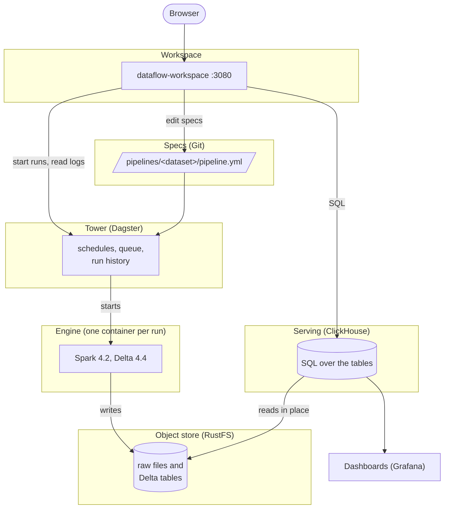

Read the arrows as "uses". Only the engine writes data. ClickHouse only reads it. The Workspace never touches the files:
it asks ClickHouse for data and the tower for runs.

### The design in five sentences

1. **A dataset is a file, not code.** One YAML file per dataset, in Git. One generic engine runs every file, the way one
   Databricks runtime runs every pipeline definition.
2. **A run starts a program and stops it.** For each run, the tower starts one engine container that does every step,
   from download to summaries, and then exits. Between runs, nothing is running. This replaced four services that ran
   all day and passed messages to each other through Kafka.
3. **Each step remembers where it stopped.** A step keeps a bookmark (a "checkpoint") of what it already processed, and
   every write carries a tag that Delta refuses to apply twice. So a run only handles new data, and a retried run never
   writes a row twice. This replaced three bookkeeping tables of 2.0.
4. **Run statistics are a table.** Every run adds rows to an "event log" table: how many rows each step read and wrote,
   how many broke each rule. Dashboards and alerts are SQL queries on it. This replaced four monitoring tools (
   Prometheus, Loki, Alloy, exporters).
5. **ClickHouse reads the tables where they are.** It reads the Delta files directly (a "view"), and keeps its own copy
   only of the tables dashboards hit hardest (a "copy"). This removed the program that copied every row into ClickHouse.

| Gone in v3                                                                              | Replaced by                                                            |
|:----------------------------------------------------------------------------------------|:-----------------------------------------------------------------------|
| Kafka and its UI and metrics exporter                                                   | Dagster (the tower): schedules, queue, run history, UI                 |
| feeder, processor, versioner, writer: four Java services running all day                | `dataflow-engine`: one container per run, nothing running between runs |
| Three bookkeeping mechanisms: a notifications table, a dedup gate, claim-check messages | Checkpoints, tagged writes and the event log                           |
| Prometheus, Loki, Alloy, postgres-exporter                                              | The event log and the tower's run logs, read with SQL                  |
| The Spark-to-ClickHouse connector (it held us on Spark 4.0)                             | ClickHouse reading Delta files itself                                  |
| MinIO (its open-source edition was archived in 2026)                                    | RustFS, after a compatibility test                                     |
| Spring Batch, a web server inside each service                                          | A plain command-line program                                           |

Long-running containers went from 16 to 9 (`rustfs`, `postgres`, `clickhouse`, three tower containers, `workspace`,
`grafana`, `mailpit`). Java programs running while idle went from 4 to 1 (the Workspace). The idle platform uses about
1.4 GB of memory.

---

## 1. Follow one earthquake

A real row from the run of 2026-10-25, followed from the USGS file to a query. The earthquake is `us6000u4ty`, magnitude
5.9, "218 km ENE of Nagqu, China".

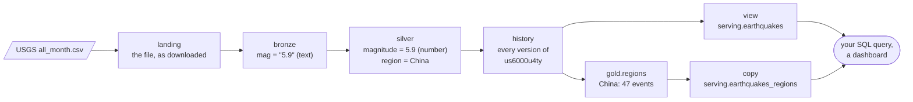

1. **Landing.** The engine downloads the CSV and saves it unchanged as
   `landing/earthquakes/all_month.bd8a205c5fd1587d.csv`. The part before `.csv` is a fingerprint of the content (the
   start of its SHA-256 hash). Downloading an identical file again gives the same name, so it is saved once and
   processed once.
2. **Bronze** (raw rows). Each CSV line becomes one row, and every value is kept as text, exactly as received:
   `mag = "5.9"`, `updated = "2026-10-25T12:16:10.327Z"`. Nothing is rejected here. If USGS adds a column one day, its
   values go into a catch-all column called `_rescued_data` instead of breaking the run.
3. **Silver** (clean rows). The spec says how to turn raw columns into typed ones: `magnitude` is `mag` as a number,
   `updatedAt` is `updated` as a timestamp, `region` is the text after the last comma of `place` ("China"). Then the
   quality rules run. `magnitude BETWEEN -2 AND 10` passes. A row breaking a rule marked `drop` would go to another
   table, `quarantine`, with the names of the rules it broke.
4. **History** (every version). If tomorrow's file says 6.0 instead of 5.9, history keeps both versions, each with the
   time it was valid, so you can always ask "what did we believe yesterday". This is called SCD type 2 ("slowly changing
   dimension, type 2"). A version that changed nothing is not stored again. Today `us6000u4ty` has one version.
5. **Gold** (summaries). The spec's gold queries run over the current version of every earthquake. `regions` counts
   events per region: China has 47.
6. **Serving.** ClickHouse publishes two tables. `serving.earthquakes` is a view: a saved query that reads the latest
   version of each earthquake straight from the history files. `serving.earthquakes_regions` is a copy: the gold table
   copied into ClickHouse's own storage after each run, for the fastest dashboards.
7. **You.** In the Workspace's SQL editor, `SELECT * FROM serving.earthquakes WHERE eventId = 'us6000u4ty'` returns the
   row. A Grafana panel charts `serving.earthquakes_regions`.

---

## 2. Why each technology

For each piece: what it is, what it does here, why this one and not another, and what you would lose without it.

### 2.1 Pipeline specs: YAML files in Git

- **What it is.** One text file per dataset, in the `pipelines/` folder of the Git repository.
- **What it does here.** It is the only place a dataset is defined. The engine reads it to know what to do, the tower to
  know what to schedule, and the Workspace to show and edit it.
- **Example.** Adding a rule means adding one line,
  `- { name: plausible_depth, check: "depthKm BETWEEN -10 AND 800", on-failure: warn }`, and committing it. The commit
  shows who added it and when; reverting the commit removes it.
- **Why this one.** Databricks (Asset Bundles), BigQuery (Dataform repositories) and Azure Data Factory (Git mode) all
  keep pipeline definitions as files in Git, for the same reasons: a change is a reviewable diff, history and rollback
  come for free, and there is no second copy of the truth in a database that can drift from the code.
- **Without it.** Each dataset would need its own code, or its definition would live in a database where nobody can
  review or roll back a change.

### 2.2 Object store: RustFS, speaking the S3 API

- **What it is.** A server that stores files ("objects") in top-level folders ("buckets") and lets programs read and
  write them over HTTP. The protocol is the one Amazon S3 defined, which almost every data tool speaks. RustFS is a
  small open-source server that implements it.
- **What it does here.** It holds everything the platform writes: downloaded files, every table, the checkpoints, the
  event logs and the preview results. All of it lives in one bucket, `lake`.
- **Example.** The history of earthquakes is the folder `s3://lake/history/earthquakes/`: Parquet data files plus a
  `_delta_log/` folder that lists them.
- **Why this one.** Because Spark, Delta Lake and ClickHouse all speak S3, moving to Amazon S3, Google Cloud Storage or
  Azure later is a change of address and keys, not of code. RustFS replaced MinIO because MinIO stopped publishing its
  open-source server (section 11.1). It runs in about 350 MB.
- **Without it.** Data would sit on one container's disk, invisible to the others, and moving to the cloud would mean
  rewriting every read and write.

### 2.3 Table format: Delta Lake

- **What it is.** A folder of Parquet files (a compressed file format that stores data column by column) plus a
  `_delta_log` folder of small JSON files. Each JSON file is one version of the table and says which Parquet files were
  added or removed. The log is what turns a folder into a table.
- **What it does here.** Every table except landing is a Delta table. It gives five things a folder of files cannot:
    - **Transactions.** A write either fully happens or not at all, so a reader never sees half a run.
    - **Merge.** "Update this row if it exists, insert it if not", which is how history adds new versions.
    - **Time travel.** Read the table as it was at version 12. The Workspace's History tab uses it.
    - **Change feed.** "Which rows changed since version 12?", turned on for history.
    - **Tagged writes.** A write can carry a tag; Delta refuses the same tag twice, so a retried batch never writes rows
      twice (section 6.3).
- **Example.** `history/earthquakes/_delta_log/00000000000000000017.json` records version 17 of the earthquakes history:
  the merge done by the run of 2026-10-25 08:15. Version 18 is the compaction that followed, and version 19 the
  maintenance step setting how long deleted files are kept.
- **Why this one.** It is the table format of Databricks, and both Spark (which writes) and ClickHouse (which reads)
  support it. Apache Iceberg is the main alternative and is also readable by both, but Delta is the more mature option
  with Spark and matches the Databricks model this platform follows.
- **Without it.** Tables would be plain folders of files: a crash in the middle of a write would leave half the files,
  and there would be no merge, no history and no way to tell which files are current.

### 2.4 Engine: Apache Spark, inside a small Java program

- **What it is.** Spark is a data processing engine: you give it transformations or SQL, and it runs them over data that
  can be much bigger than memory, using all the CPU cores. Here it runs in "local" mode: one machine, one Java process.
  Around it, a small Spring Boot program (Spring Boot is a Java framework) handles the command line, the configuration
  and the logs.
- **What it does here.** For each run, the tower starts one engine container. It runs every step of the dataset in
  order (download, bronze, silver, history, gold, publishing to ClickHouse, cleanup), writes the results as Delta
  tables, records what happened in the event log, and exits. It also runs "preview" and "data impact" for the
  Workspace's spec editor: the same steps on a 20,000-row sample, writing only a result file.
- **Example.** `dataflow-engine run --dataset=taxi_trips --partition=2024-01` processes January 2024: 2.96 million rows
  in about three minutes.
- **Why this one.** Spark is the engine of Databricks and the reference implementation of Delta Lake. Its streaming mode
  keeps a checkpoint of what it already processed, which is how a run only handles new data. Spark SQL is also the
  language the specs use for column formulas and gold queries.
- **Why it is not always on.** One Spark process needs 1.2 to 1.8 GB of memory, and the whole platform runs in a 4 GB
  Docker VM. Starting it for a run costs a few seconds (the earthquakes run starts downloading about 10 seconds after
  its container starts) and frees that memory the rest of the time. That choice is also why something else, ClickHouse,
  must answer queries between runs.
- **Without it.** You would need another engine able to merge, check and write Delta tables at 3 million rows per file.
  None of the lighter tools does all of that today.

### 2.5 Tower: Dagster, with Postgres

- **What it is.** Dagster is an orchestrator: a service that knows which jobs exist, starts them on a schedule or on
  request, queues them, retries failures and keeps a history of every run. It is written in Python and stores its
  history in a Postgres database. "Tower" is this project's name for it.
- **What it does here.**
    - Turns each spec into a job, with one entry per table in its graph and one check per quality rule.
    - Runs earthquakes on its schedule (`0 */6 * * *`: every six hours) and taxi trips one month at a time. A "backfill"
      is "run these 12 months".
    - Allows at most 2 runs at once and 1 per dataset, so the 4 GB machine never runs out of memory and two runs never
      write the same table.
    - Retries a failed run once, sends an email when a run fails, and saves each run's engine output.
- **Example.** Pressing Run on taxi trips for 2024-03 while 2024-02 is running queues the second run; it starts when the
  first one ends.
- **Why this one.** Dagster models pipelines as data assets (tables), not only as tasks. That matches the platform: one
  asset per table, a check per quality rule, partitions per month. Airflow is the common alternative; it is task-centric
  and heavier (scheduler, API server, DAG processor, triggerer). Section 9.1 compares four options. Postgres, rather
  than Dagster's default SQLite file, because three tower containers share the history, and Postgres is what Dagster
  recommends for that. It uses about 40 MB here.
- **Without it.** You would write your own scheduler, queue, retry logic and run history. v3's design started that way;
  that proposal (a hand-built control service) was the road not taken; it remains in the platform repository's Git
  history at `docs/design/runtime-control-plane.md`.

### 2.6 Serving: ClickHouse

**Why do we need ClickHouse at all, when the data is already in Delta tables?**

Because a Delta table is just files, and something has to read those files to answer a question. Take "how many
earthquakes per region?". Something has to open the Parquet files of `history/earthquakes/`, keep only the current
version of each earthquake, group by region and count. In this platform only two programs can do that: Spark and
ClickHouse.

Spark is the wrong tool for that job. It does not run between runs (by design, to save memory), so every question would
first start a Java process and a Spark session: several seconds and 1.2 GB or more each time. A dashboard that refreshes
every 30 seconds, people typing in the SQL editor and the Workspace's catalog pages all need answers in milliseconds,
from something always on and small.

ClickHouse is that something:

- **It is a SQL server built for counting and grouping big tables.** It reads data by column, so a query that uses 2
  columns of a 20-column table reads only those 2.
- **It reads Delta tables in place.** `deltaLake(lake, filename = 'history/earthquakes/')` is a table function: it reads
  the Delta log and the Parquet files straight from RustFS. Nothing is copied or loaded first.
- **It is small and fast here.** It idles at about 210 MB. Measured on this laptop: earthquakes per region over the
  view, 0.05 s; the average distance of 2.96 million taxi trips, 0.10 s; a profile of every column of those 2.96 million
  rows, about 1 s.

What it does in this platform:

1. **Answers the SQL editor.** Every query typed in the Workspace runs on ClickHouse, in read-only mode.
2. **Feeds the dashboards.** Grafana has exactly one data source: ClickHouse.
3. **Is the Workspace's only way to read the lake.** The Workspace holds no storage credentials. Table pages, profiles,
   Delta details, run comparisons and quality trends are all ClickHouse queries.
4. **Publishes tables.** The engine creates a view or a copy for each `serve:` entry of a spec (section 12).
5. **Shows the event log.** `serving.run_events` combines every dataset's run events, so "how long did silver take this
   week" is one query.

The alternatives, and why not:

| Option                                                   | Why not here                                                                                                                                               |
|:---------------------------------------------------------|:-----------------------------------------------------------------------------------------------------------------------------------------------------------|
| Spark kept running as a SQL server (Spark Thrift Server) | An always-on Java process of 1 to 2 GB, and seconds per query instead of milliseconds                                                                      |
| Trino                                                    | A strong SQL engine over Delta, but it wants several GB of memory and a coordinator process; too heavy for a 4 GB machine                                  |
| DuckDB                                                   | Excellent and tiny, but it runs inside one program and is not a server that Grafana and the Workspace can share. Kept in mind for notebooks (section 13.2) |
| Postgres                                                 | Stores rows, not columns: every table would be copied into it after each run, and scanning 3 million rows would take seconds                               |
| StarRocks, Apache Doris                                  | Capable warehouses, but several processes and more memory than ClickHouse for the same job                                                                 |

What it costs:

- **A second SQL dialect.** Specs use Spark SQL, because the engine runs them; the SQL editor uses ClickHouse SQL. Most
  queries look the same, but some functions differ: Spark writes `count(*) FILTER (WHERE ...)`, ClickHouse also offers
  `countIf(...)`. The editor's completion and function docs help.
- **Delta support is newer in ClickHouse than in Spark.** ClickHouse 26.10 ignores Delta's "deletion vectors" (a faster
  way to delete rows) when it reads old versions, so deletion vectors are turned off on every table (section 11.3).

Without ClickHouse: no dashboards, no SQL editor, no catalog pages, no profiles. Every question would mean starting
Spark.

### 2.7 Dashboards: Grafana, with Mailpit

- **What it is.** Grafana draws charts and evaluates alert rules from SQL queries. Mailpit is a fake mail server: it
  catches emails so you can read them at http://localhost:8025 without sending anything to the internet.
- **What it does here.** Boards for runs, data quality and table health, all SQL on ClickHouse, embedded in the
  Workspace's Dashboards page. Alert rules such as "quarantine rate above 5%" or "nothing landed in 12 hours". The
  tower's failure emails and Grafana's alert emails go to Mailpit.
- **Why this one.** Grafana is the standard open-source dashboard tool and has a ClickHouse plugin. The boards live in
  their own repository, `dataflow-monitoring`.
- **Without it.** The Workspace still shows each run and each rule, but there would be no trend boards and no alert
  rules on data quality.

### 2.8 Workspace: a Java API and a React web app

- **What it is.** A web application at http://localhost:3080. The back end is a Spring Boot (Java) service. The front
  end is a React app built with the Mantine component library, Monaco (the code editor inside VS Code) and React Flow (
  for graphs).
- **What it does here.** It is the one window onto the platform: the catalog of tables, the SQL editor, pipelines and
  their runs, quality rules, a spec editor with preview, and the dashboards. It calls three things: ClickHouse for data,
  the tower for runs, and Git for specs (section 13).
- **Why this one.** Without it, a person juggles five interfaces: Dagster for runs, RustFS's console for files,
  ClickHouse's query page, Grafana, and a text editor plus Git for specs. A single workspace is much of Databricks'
  value; this is the same idea. The back end is Java so it can reuse the engine's spec loader and validator: the editor
  shows exactly the errors a run would give. Monaco gives an editor of the quality people expect from Databricks or VS
  Code.
- **Without it.** The platform still works, but every task is spread over several tools, and a broken spec is only
  discovered when its run fails.

### 2.9 Smaller choices

| Choice         | Where                      | Why                                                                                                                          |
|:---------------|:---------------------------|:-----------------------------------------------------------------------------------------------------------------------------|
| Java 21, Maven | engine, Workspace back end | Spark and Delta are Java libraries; one build for the engine and the Workspace                                               |
| Python         | tower only                 | Dagster definitions are Python; the tower decides when to run and never touches data                                         |
| Docker Compose | every service              | One command starts the platform on a laptop; the same images can run on Kubernetes later (section 14.3)                      |
| Jasypt         | engine                     | Secrets in configuration files are stored encrypted (`ENC(...)`); only one master key comes from outside                     |
| JSON logs      | engine, Workspace          | Each log line is a JSON object with the dataset, run and step, so the Workspace can show and filter it                       |
| jOOQ           | Workspace                  | Builds every SQL query as typed Java code instead of text, so a typo fails the build and values are always escaped           |
| JGit           | Workspace                  | Commits spec edits from the web page without a `git` program in the container                                                |
| Dagster Pipes  | engine to tower            | A tiny protocol: the engine prints JSON lines on its output and the tower reads them, so the engine needs no Dagster library |

---

## 3. What the big platforms do

Before designing v3, we compared how the four big data platforms solve the same problems. This section is that
comparison.

### 3.1 Same ideas, four vocabularies

Each row is one job every data platform has to do; each column is how one vendor names it.

| Job                                          | Databricks                                                                                                 | Snowflake                                 | BigQuery (Google)                                 | ADF / Fabric (Microsoft)                                       |
|:---------------------------------------------|:-----------------------------------------------------------------------------------------------------------|:------------------------------------------|:--------------------------------------------------|:---------------------------------------------------------------|
| Raw files arrive                             | Volumes + Auto Loader                                                                                      | Stages + Snowpipe                         | Cloud Storage + BigLake / Data Transfer Service   | Copy activity into OneLake                                     |
| Transformations you declare rather than code | Lakeflow Spark Declarative Pipelines: streaming tables, materialized views, flows                          | Dynamic tables (query + target lag)       | Dataform (SQLX, incremental tables)               | Mapping data flows, metadata-driven pipelines                  |
| Quality rules inside the pipeline            | Expectations: warn, drop, fail                                                                             | Data metric functions                     | Dataform assertions                               | Data flow assert                                               |
| Keeping every version of a record            | `AUTO CDC ... STORED AS SCD TYPE 2`                                                                        | Streams + tasks, dynamic tables           | Incremental tables, `MERGE`                       | Data flow alter-row                                            |
| Deciding when to run                         | Lakeflow Jobs: schedule, file arrival, table update, continuous                                            | Tasks and task graphs                     | Dataform workflows, Workflows, Composer (Airflow) | Pipelines + triggers: schedule, tumbling window, storage event |
| Where the computing happens                  | Compute started per job run (recommended for production), serverless, shared clusters for interactive work | Virtual warehouses, separate from storage | Serverless slots                                  | Integration runtimes, Spark pools                              |
| Table names, owners, permissions             | Unity Catalog                                                                                              | Horizon                                   | Dataplex / BigLake                                | Purview, OneLake catalog                                       |
| Run statistics                               | System tables, pipeline event log (a Delta table)                                                          | Event tables, `ACCOUNT_USAGE`             | `INFORMATION_SCHEMA.JOBS`, assertion views        | Monitor hub, Log Analytics                                     |
| Pipelines as files in Git                    | Asset Bundles (`databricks.yml`, dev/prod targets)                                                         | Git integration, DCM projects             | Dataform repositories                             | ADF Git mode, Fabric deployment pipelines                      |
| Querying files without copying them          | SQL warehouses read Delta directly                                                                         | External / Iceberg tables                 | BigLake tables                                    | OneLake shortcuts                                              |

### 3.2 Eight patterns they all share

These eight patterns are the checklist v3 had to pass. Each one is explained with what it means in practice.

| #  | Pattern                                    | In plain words                                                                                    | Example                                                                        | What DataFlow 2.0 did instead                                           |
|:---|:-------------------------------------------|:--------------------------------------------------------------------------------------------------|:-------------------------------------------------------------------------------|:------------------------------------------------------------------------|
| P1 | **Declare datasets, not services**         | You describe the tables you want and the queries that fill them; the platform works out the order | A spec lists silver, history and gold; the engine runs them in the right order | A spec ✅, but executed by four services chained over Kafka              |
| P2 | **Compute per run, storage shared**        | A run gets its own processing power and gives it back when done; the data outlives it             | The engine container starts for a run and exits                                | Four Java services running all day, idle most of it                     |
| P3 | **Incremental by checkpoint**              | Each step remembers what it already processed and only reads what is new                          | The second run of the same file processes 0 rows                               | Kafka messages, a notifications table and a dedup gate, rebuilt by hand |
| P4 | **Quality inline, measured always**        | Rules run inside the pipeline, and every run records how many rows failed each rule               | `plausible_magnitude` failed 0 of 9,964 rows                                   | ✅ Done (warn / drop / fail, quarantine)                                 |
| P5 | **Telemetry is a table**                   | Run statistics are SQL tables in the platform itself                                              | `SELECT * FROM serving.run_events`                                             | Prometheus, Loki, Alloy, exporters and a Postgres table                 |
| P6 | **Definitions as code in Git**             | Pipelines are files in Git; the UI is for looking and developing                                  | `pipelines/earthquakes/pipeline.yml`                                           | ✅ Specs in Git, but read only when a service started                    |
| P7 | **Query in place, copy only when it pays** | SQL engines read the table files directly; only the busiest tables are copied                     | The view reads Delta; one summary is copied                                    | Every row copied into ClickHouse through a connector                    |
| P8 | **One catalog, one namespace**             | Tables have names, owners and permissions, not file paths                                         | `earthquakes.history` instead of `s3a://lake/history/earthquakes/`             | Paths only                                                              |

### 3.3 The shape they converge on

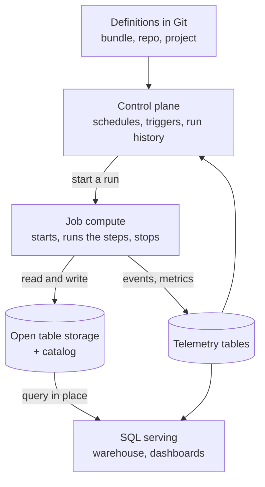

Five boxes. There is no message bus between steps of the same pipeline, no service running all day for each step, and no
separate metrics database for questions about data. DataFlow v3 is this picture built from open-source parts: Git,
Dagster, Spark, RustFS with Delta Lake, ClickHouse.

---

## 4. What was wrong with DataFlow 2.0

2.0 was not badly engineered: it resumed after crashes, never processed a chunk twice, kept every version of every
record and handled any dataset from a spec. But several of its parts were hand-made versions of things the platforms
ship as one feature.

| Piece of 2.0                                            | What it did                                                | How the big platforms do it                                        | Verdict                                                         |
|:--------------------------------------------------------|:-----------------------------------------------------------|:-------------------------------------------------------------------|:----------------------------------------------------------------|
| `pipeline.yml` specs, validator                         | Declared a dataset                                         | Pipeline definitions, Dataform SQLX                                | **Keep**, with the vocabulary of Databricks' Lakeflow pipelines |
| Kafka chain + claim checks (messages pointing at files) | Handed each chunk of data to the next service              | One pipeline run does every step                                   | **Retire**                                                      |
| `notifications` table, dedup gate, redelivery audit     | Made sure each chunk was handled once, kept an audit trail | Streaming checkpoints + an event log                               | **Retire**, replaced by checkpoints and the event log           |
| 4 services running all day                              | Isolation, independent deployment                          | Compute started per run                                            | **Retire**, one engine image instead                            |
| Day chunks (`chunk-by`)                                 | Kept memory bounded, unit of retry                         | Micro-batches (a few files at a time) and partitions for backfills | **Replace**                                                     |
| SCD2 merge + recomputing derived columns                | Every version of every record                              | `AUTO CDC ... SCD TYPE 2`                                          | **Keep**: open-source Spark only has type 1 so far              |
| Expectations + quarantine                               | Quality                                                    | Expectations                                                       | **Keep**                                                        |
| Writer: change feed → Spark connector → ClickHouse      | Copied every row to ClickHouse                             | Warehouses read the table format                                   | **Replace** with ClickHouse reading Delta itself                |
| Prometheus, Loki, Alloy, exporters                      | Monitoring                                                 | System tables + a built-in run UI                                  | **Retire** for questions about pipelines                        |
| MinIO                                                   | Object storage                                             | Cloud object storage                                               | **Replace**: its open-source edition was archived               |
| Grafana                                                 | Dashboards + alerts                                        | Built-in dashboards and alerts                                     | **Keep**, with a single ClickHouse data source                  |

The four services did not buy scale either: each ran Spark in local mode on the same machine, sharing the same
cores. [Section 8](#8-one-engine-per-run-not-four-services) works through that.

---

## 5. Pipeline specs

### 5.1 One spec per dataset is the industry norm

A common question is "why one pipeline per source; isn't that the opposite of generic?". It is the generic design. A
Databricks team writes one pipeline per domain, Dataform keeps one SQLX file per table, and Azure Data Factory's
metadata-driven pattern is one generic pipeline driven by one control-table row per source. In each case the platform is
generic and the definitions are data. Our specs are those rows, and the engine is the one generic pipeline.

v3 renamed the spec's fields to the words Databricks' Lakeflow and open-source Spark Declarative Pipelines use ("SDP",
Spark's own declarative pipeline framework, section 7.4), so anyone who knows those platforms can read a spec. It also
means the engine could one day hand specs to SDP instead of running them itself.

### 5.2 What a spec looks like

```yaml
dataset: earthquakes
version: 3
owner: platform
description: USGS events of the last 30 days; magnitudes get revised, so history matters

source:
  url: https://earthquake.usgs.gov/earthquakes/feed/v1.0/summary/all_month.csv
  format: csv
  options: { header: "true" }

schedule: "0 */6 * * *"

bronze:
  schema-evolution: rescue

silver:
  columns:
    - { name: eventId,    type: string,    required: true, from: id }
    - { name: occurredAt, type: timestamp, required: true, from: "to_timestamp(time)" }
    - { name: updatedAt,  type: timestamp,                 from: "to_timestamp(updated)" }
    - { name: magnitude,  type: double,                    from: mag }
    - { name: depthKm,    type: double,                    from: depth }
    - { name: place,      type: string,                    from: place }
    - { name: status,     type: string,                    from: status }
  derive:
    - { name: region, type: string, from: "trim(element_at(split(place, ', '), -1))" }
  expectations:
    - { name: has_magnitude,       check: "magnitude IS NOT NULL",       on-failure: drop }
    - { name: plausible_magnitude, check: "magnitude BETWEEN -2 AND 10", on-failure: drop }
    - { name: reviewed,            check: "status = 'reviewed'",         on-failure: warn }

history:
  keys: [eventId]
  sequence-by: updatedAt
  stored-as: scd2
  track-history-except: [updatedAt]

gold:
  - name: daily_activity
    sql: |
      SELECT to_date(occurredAt) AS day, count(*) AS events, round(max(magnitude), 1) AS maxMagnitude
      FROM current
      GROUP BY 1

serve:
  - { from: current,             table: earthquakes,                mode: view }
  - { from: gold.daily_activity, table: earthquakes_daily_activity, mode: copy, order-by: day }
```

What each section means, and what the other platforms call it:

| Section    | Meaning, with this example                                                                                                                               | Lakeflow / SDP                                                               | Snowflake       | BigQuery                       |
|:-----------|:---------------------------------------------------------------------------------------------------------------------------------------------------------|:-----------------------------------------------------------------------------|:----------------|:-------------------------------|
| `source`   | Download this URL, read it as CSV with a header line                                                                                                     | Auto Loader source, volume                                                   | Stage           | External table / transfer      |
| `schedule` | Cron expression: minute 0 of every 6th hour                                                                                                              | Job trigger                                                                  | Task schedule   | Workflow config                |
| `bronze`   | Keep rows as read; put unexpected columns in `_rescued_data` (`rescue`)                                                                                  | Streaming table over files                                                   | Snowpipe target | Raw table                      |
| `silver`   | `columns`: typed columns and the formula reading each one; `derive`: columns computed from earlier ones; `expectations`: rules and what to do on failure | Streaming table + expectations                                               | Dynamic table   | Incremental table + assertions |
| `history`  | `keys`: what identifies one earthquake; `sequence-by`: which version is newer; `track-history-except`: a change only in `updatedAt` is not a new version | `AUTO CDC ... SCD TYPE 2`, `sequence_by`, `track_history_except_column_list` | Streams + MERGE | Incremental MERGE              |
| `gold`     | Summary queries over `current` (the latest version of each earthquake)                                                                                   | Materialized views                                                           | Dynamic tables  | Tables / views                 |
| `serve`    | What ClickHouse publishes, as a view or a copy                                                                                                           | Serving from a SQL warehouse                                                 |                 |                                |

What a rule's `on-failure` does: `warn` keeps the row and counts it, `drop` sends the row to the quarantine table,
`fail` stops the run before anything is written. A rule whose value is NULL passes; `has_magnitude` is there to catch
NULLs.

Three changes from the 2.0 spec, each borrowed from the platforms:

1. **Bronze is raw, silver is typed.** In 2.0 values were converted to types on the way into bronze. Now bronze keeps
   the file as read, and conversions happen in silver. Fixing a silver bug becomes "rebuild silver from bronze": no new
   download, nothing lost.
2. **History says which version is newer.** `sequence-by` tells the merge which version wins, so a late or replayed
   batch can never overwrite fresher data. 2.0 trusted arrival order. `track-history-except` is the Databricks name for
   2.0's `ignore-for-changes`.
3. **No `chunk-by`.** Memory is bounded by reading a few files at a time ("micro-batches"), and backfills are tower
   partitions (section 9.4). For taxi data, one partition per monthly file:

```yaml
source:
  url: https://d37ci6vzurychx.cloudfront.net/trip-data/yellow_tripdata_{partition}.parquet
  format: parquet
  partitions: { monthly: { start: 2024-01 } }
```

A run of partition `2024-03` downloads `yellow_tripdata_2024-03.parquet`.

### 5.3 From spec to steps

The engine turns a spec into a small graph of **flows**. A flow is one step: "read from something, write to one table" (
the word comes from Spark Declarative Pipelines). The graph for the spec above:

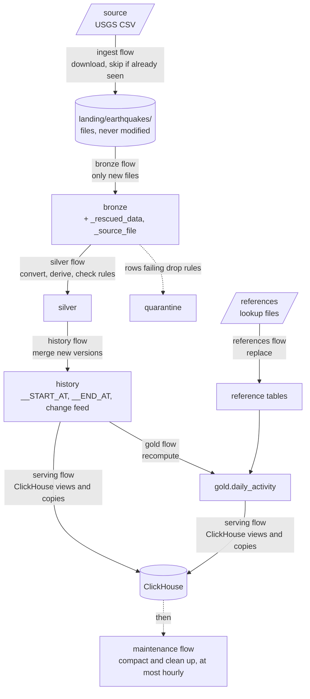

### 5.4 Columns the platform adds

Besides the spec's columns, the engine adds a few of its own. They use Databricks' names on purpose: anyone who knows
Databricks reads them without a manual.

| Column                         | Table           | Meaning                                                                                    | Example                                                 |
|:-------------------------------|:----------------|:-------------------------------------------------------------------------------------------|:--------------------------------------------------------|
| `_source_file`, `_ingested_at` | bronze, silver  | Which landing file the row came from, and when it was ingested                             | `all_month.bd8a205c5fd1587d.csv`, `2026-10-25 12:19:23` |
| `_rescued_data`                | bronze          | Values the spec did not expect, as JSON; empty when everything was expected                | `{"felt": "12"}` if USGS one day added a column `felt`  |
| `_run_id`                      | bronze, silver  | The run that wrote the row (Dagster's run ID)                                              | `033c9ee2-…`                                            |
| `factUniqueId`                 | silver, history | SHA-256 of the `keys`: one value per earthquake                                            | `0001a0e14d6cb…`                                        |
| `contentHash`                  | history         | SHA-256 of the tracked columns: if it changes, a new version is stored                     |                                                         |
| `failedExpectations`           | quarantine      | The rules a row broke                                                                      | `["has_magnitude"]`                                     |
| `__START_AT`, `__END_AT`       | history         | When a version became valid, and when it was replaced (`NULL` while it is the current one) | `2026-10-25 12:16:10`, `NULL`                           |

---

## 6. A run, end to end

### 6.1 The sequence

What happens when the schedule fires for earthquakes:

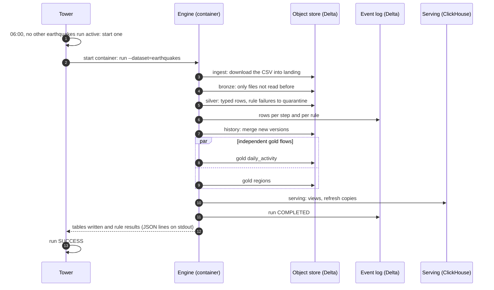

Two gold flows run at the same time because neither needs the other.

### 6.2 Two lifecycles

The tower tracks **runs**; the event log tracks the **flows** inside a run.

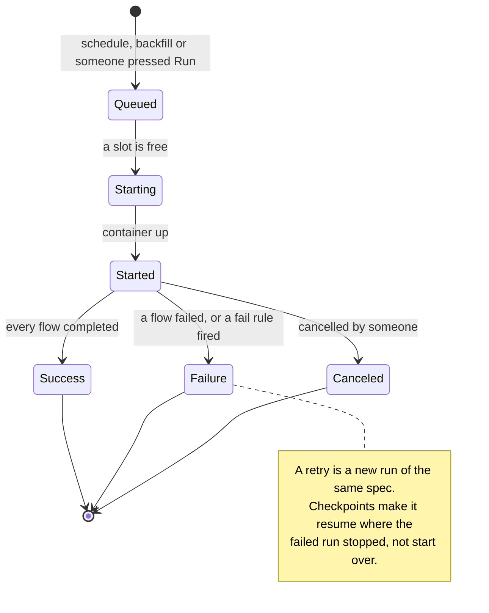

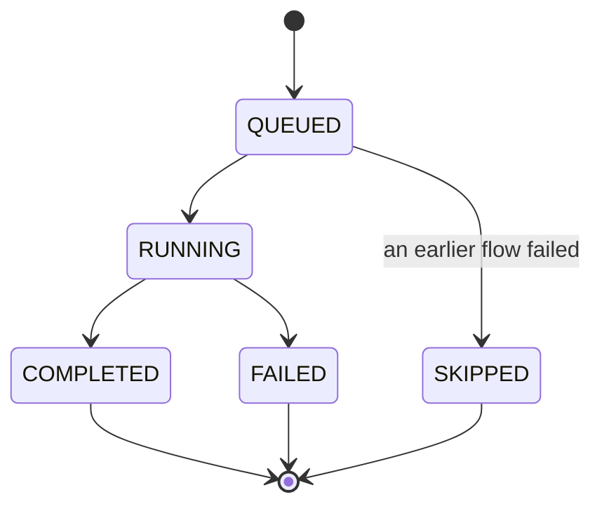

### 6.3 Only new data, never twice

Two mechanisms make runs safe to repeat. They are what "incremental by checkpoint, not by message" means.

**A checkpoint: each step remembers where it stopped.** The bronze, silver and history flows are Spark streaming
queries. A streaming query keeps a checkpoint folder (under `system/checkpoints/<dataset>/<flow>/`) that records what it
already read: which landing files for bronze, which table version of bronze for silver, which of silver for history. The
next run starts after that point. The query runs in "available now" mode: it processes everything new, then stops
instead of waiting for more.

Example from 2026-10-25: run `6cbada49` found the same USGS file as the run before it. Ingest recognised the
fingerprint, bronze, silver and history found nothing new, and the run wrote 0 rows. Run `a2b889fc` found a new file and
processed exactly that one: 9,964 rows.

**A tagged write: a retried batch is not written twice.** A streaming query works in batches. For each one it notes "
batch 12 will cover these files", processes them, writes the result, then notes "batch 12 done". If the engine dies
after writing but before the second note, the next run redoes batch 12. To stop that from writing the rows twice, every
write carries a tag: the stream's ID (`txnAppId`) and the batch number (`txnVersion`). Delta stores the tag in the same
commit as the rows, and refuses to apply a tag it already has. For the history merge, the same tag is passed as two
Spark session settings.

What can go wrong, and what handles it:

| What goes wrong                           | 2.0 answer                                               | v3 answer                                                                                                                      |
|:------------------------------------------|:---------------------------------------------------------|:-------------------------------------------------------------------------------------------------------------------------------|
| The engine crashes in the middle of a run | Kafka delivers the message again; a status row is reused | The tower retries the run; every flow resumes from its checkpoint                                                              |
| A batch is written twice                  | Each chunk replaced its own rows                         | Delta refuses the batch's tag the second time                                                                                  |
| The same file is downloaded twice         | New chunks, processed again                              | Landing names files by fingerprint; bronze's checkpoint never reads a file twice                                               |
| Two runs write one table                  | Not prevented                                            | Impossible: the tower allows one active run per dataset. With one writer per table, Delta on S3 needs no external lock service |
| The engine is stopped                     | Special shutdown handling                                | Nothing special: the run fails and the retry resumes                                                                           |
| Bad data                                  | Rules, stop on failure                                   | Same rules; `fail` fails the run and the tower shows the failing check                                                         |

Four mechanisms of 2.0 (claim checks, the notifications table, the dedup gate, shutdown detection) became two that Spark
and Delta already provide: checkpoints and tagged writes. Databricks' Auto Loader and Lakeflow streaming tables work the
same way.

---

## 7. Inside the engine

### 7.1 Classes

How the engine's Java code is organised. `PipelineRun` runs a spec: it builds the graph of flows, runs them level by
level and reports to the tower. Each step is a class implementing `Flow`.

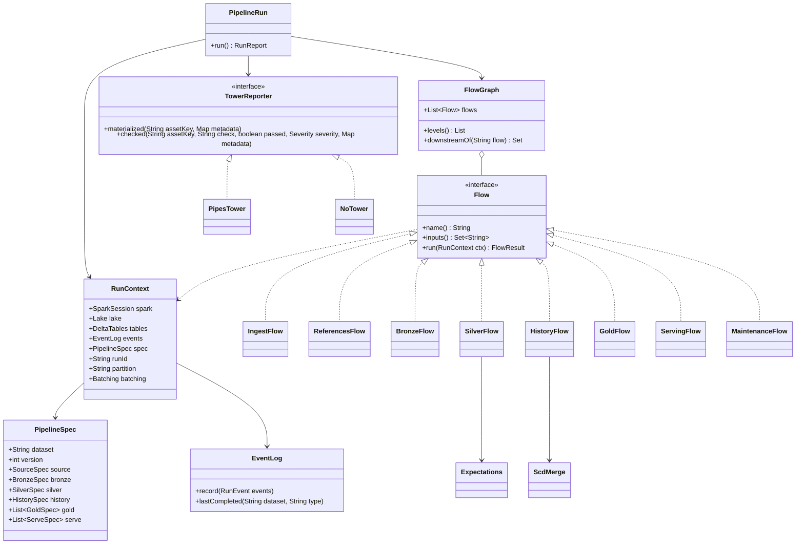

`PipesTower` reports to Dagster when the engine runs under the tower (Dagster sets the environment variable
`DAGSTER_PIPES_CONTEXT`); `NoTower` does nothing when you run the engine by hand. So the engine never depends on
Dagster. Rebuilding a single table from scratch ("full refresh") is not built yet.

### 7.2 The flows

| Flow        | Reads                                  | Writes                                     | How, in plain words                                                                                                                                                  |
|:------------|:---------------------------------------|:-------------------------------------------|:---------------------------------------------------------------------------------------------------------------------------------------------------------------------|
| Ingest      | Source URL or path                     | `landing/<dataset>/`                       | Downloads the file (or lists files matching a path), names it after its fingerprint, skips a fingerprint it already has                                              |
| References  | Lookup file URL or path                | `reference/<dataset>/<name>/`              | Reads the whole lookup file and replaces the table                                                                                                                   |
| Bronze      | Landing files                          | `bronze/<dataset>`                         | A streaming query notices new files; each is read on its own (so CSV headers match per file), unexpected columns go to `_rescued_data`, rows are appended with a tag |
| Silver      | Bronze                                 | `silver/<dataset>`, `quarantine/<dataset>` | Per batch: convert types, compute derived columns and `factUniqueId`, evaluate all rules in one pass, append kept rows to silver and dropped rows to quarantine      |
| History     | Silver                                 | `history/<dataset>`                        | Per batch: compute `contentHash`, keep the newest version per key, merge (close the old version, insert the new one) with a tag                                      |
| Gold        | History (current versions), references | `gold/<dataset>/<name>`                    | Runs the spec's SQL and replaces the table                                                                                                                           |
| Serving     | —                                      | ClickHouse                                 | Creates or replaces views, refreshes copies                                                                                                                          |
| Maintenance | Every table of the dataset             | Same tables                                | At most once an hour: compacts small files (`OPTIMIZE`), sets how long deleted files are kept, deletes older ones (`VACUUM`)                                         |

Flows that do not depend on each other, such as two gold tables, run at the same time (Spark's FAIR scheduler shares the
cores between them). If a flow fails, every flow after it is marked `SKIPPED` and the run fails.

Memory is bounded by the batch, not by the dataset: a write puts at most 500,000 rows per file, a streaming batch reads
at most two files, flow inputs are cached on disk rather than in memory, and the Java heap is 60% of the container's
1,800 MB. Without these limits the first full taxi month (2.96 million rows) crashed in silver with `Java heap space`;
with them it finishes in about three minutes.

### 7.3 Modules: what stayed, what went

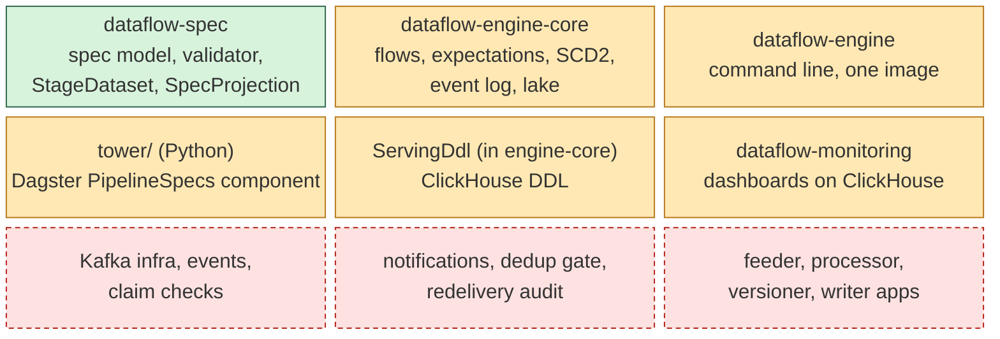

*Green: kept almost as is. Amber: new, mostly assembled from 2.0 code. Red, dashed: deleted. The
Workspace (`apps/dataflow-workspace`) came later and is described in section 13.*

### 7.4 Why not Spark's own declarative pipelines?

Since version 4.1, Apache Spark ships **Spark Declarative Pipelines** (SDP): you declare tables and the queries that
fill them, and Spark runs them in order, like Databricks' Lakeflow. Using it would mean writing less of our own engine.
Checked against our needs in October 2026:

| Need                                        | Open-source SDP (Spark 4.2)                                        | Verdict                                   |
|:--------------------------------------------|:-------------------------------------------------------------------|:------------------------------------------|
| Streaming tables, materialized views, flows | Yes, in Python and SQL                                             | Fine                                      |
| A Java API                                  | Not in the programming guide                                       | ❌ Our engine and team are Java            |
| Quality rules (expectations)                | Not documented in the open-source guide (a Databricks feature)     | ❌                                         |
| Keeping every version (SCD type 2)          | Type 1 in 4.2; type 2 accepted but still in progress (SPARK-58570) | ❌ We need type 2                          |
| Writing to ClickHouse                       | Output sinks are Python-only and append-only                       | Not needed: ClickHouse reads Delta itself |

So the engine stays ours for now, but it is shaped like SDP: same concepts, same column names, same flow behaviour. When
SDP gains quality rules and SCD type 2, each `Flow` can be replaced by its SDP equivalent without changing a single
spec.

---

## 8. One engine per run, not four services

2.0 used four services so the pipeline could "scale". This section explains why that did not add scale, and where scale
actually comes from.

### 8.1 Three ways to run

A JVM is a running Java program. Each 2.0 service was one JVM.

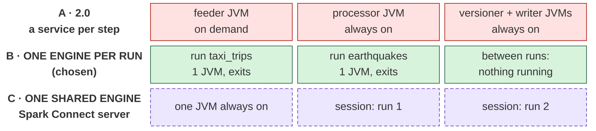

|                     | A · Service per step (2.0)                     | B · One engine per run (chosen)                                                     | C · One shared engine                                |
|:--------------------|:-----------------------------------------------|:------------------------------------------------------------------------------------|:-----------------------------------------------------|
| Memory when idle    | 3 to 4 JVMs, about 1 GB                        | **0**                                                                               | 1 JVM                                                |
| Start-up per run    | none                                           | several seconds (Java + Spark)                                                      | about 1 s                                            |
| If a spec is broken | Affects its step's service                     | **Only its own run fails**                                                          | Can bring down the shared engine and every run in it |
| How it scales       | It does not: every service used the same cores | More runs side by side; on a cluster, a big run gets more machines                  | A bigger server                                      |
| Who works this way  | Microservice designs                           | **Databricks job compute** (its recommendation for production), Spark on Kubernetes | Databricks shared clusters, Snowflake warehouses     |
| Good for            | Learning event-driven design                   | **Production pipelines**                                                            | [Notebooks](#13-the-workspace-and-interactive-work)  |

Databricks' own guidance settles it: production jobs should run on compute that starts for the job and stops after it ("
job compute"), not on shared clusters, which are for interactive work. That is model B.

### 8.2 Where the parallelism actually is

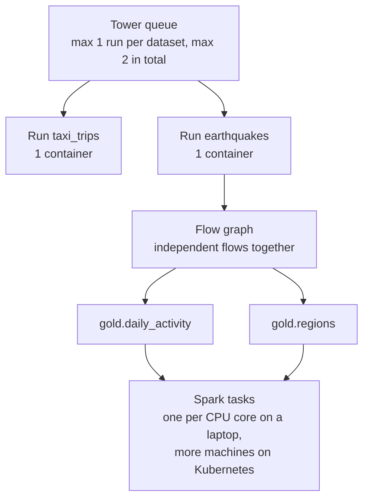

Work happens in parallel at three levels, and none of them needs one service per step:

1. **Across runs.** Different datasets run at the same time, each in its own container.
2. **Across flows.** Inside a run, independent flows run together.
3. **Across data.** Inside a flow, Spark splits the work into tasks, one per CPU core on a laptop, or across many
   machines on Kubernetes (same image, different setting).

**The laptop numbers.** 2.0 kept about 1.05 GB in three idle services, plus Kafka. In v3, memory is used only while a
run is active: up to 1.8 GB per run, nothing between runs. On a 4 GB machine the tower allows 2 runs at once; a full
taxi month needs the whole limit and is best run alone.

---

## 9. The tower

### 9.1 Choosing the orchestrator

| Option                                                | How it thinks                        | Language                              | What we would get                                                                                        | What we would miss                                                    | Verdict                 |
|:------------------------------------------------------|:-------------------------------------|:--------------------------------------|:---------------------------------------------------------------------------------------------------------|:----------------------------------------------------------------------|:------------------------|
| **Dagster OSS**                                       | Tables ("assets") and checks on them | Python definitions; runs any language | A graph of tables (lineage), monthly partitions and backfills, checks, queue limits, run logs, a real UI | Python in the stack; an acquisition (below)                           | ✅ **Chosen**            |
| Kestra                                                | Tasks in YAML                        | Java server, YAML                     | YAML editable in the UI, many plugins, Java like us                                                      | No notion of tables, so no lineage and no checks                      | Good second choice      |
| Airflow 3                                             | Tasks, with assets added             | Python                                | The biggest ecosystem                                                                                    | Heavier (scheduler, API server, DAG processor, triggerer); no catalog | Too heavy for this size |
| Our own service (an earlier proposal, in Git history) | Whatever we build                    | Java                                  | Full control                                                                                             | Months to rebuild a fraction of the above                             | ❌ Reinventing the wheel |

Why tables beat tasks for a lakehouse: Databricks, Snowflake and BigQuery all model tables and their dependencies ("gold
depends on history"), not "step 3 after step 2". Dagster is the open-source orchestrator built on that idea. Each table
of a spec becomes an asset, each quality rule becomes an asset check, and Dagster's UI shows the lineage for free.

**The acquisition.** Prefect announced on 13 July 2026 that it is acquiring Dagster Labs; Dagster says the open-source
project "will be actively developed, not just maintained". The risk is limited:

- The engine never imports Dagster. It is a command-line program: `dataflow-engine run --dataset earthquakes`.
- The Dagster side is one small Python package (section 9.2).
- If Dagster's future turns sour, Kestra or Airflow can call the same command. Leaving costs that package, not the
  platform.

### 9.2 How specs become Dagster definitions

Dagster "components" turn YAML into Dagster definitions. We wrote one component, `PipelineSpecs` (
`tower/src/dataflow_tower/`, about 250 lines of Python), and pointed it at `pipelines/`:

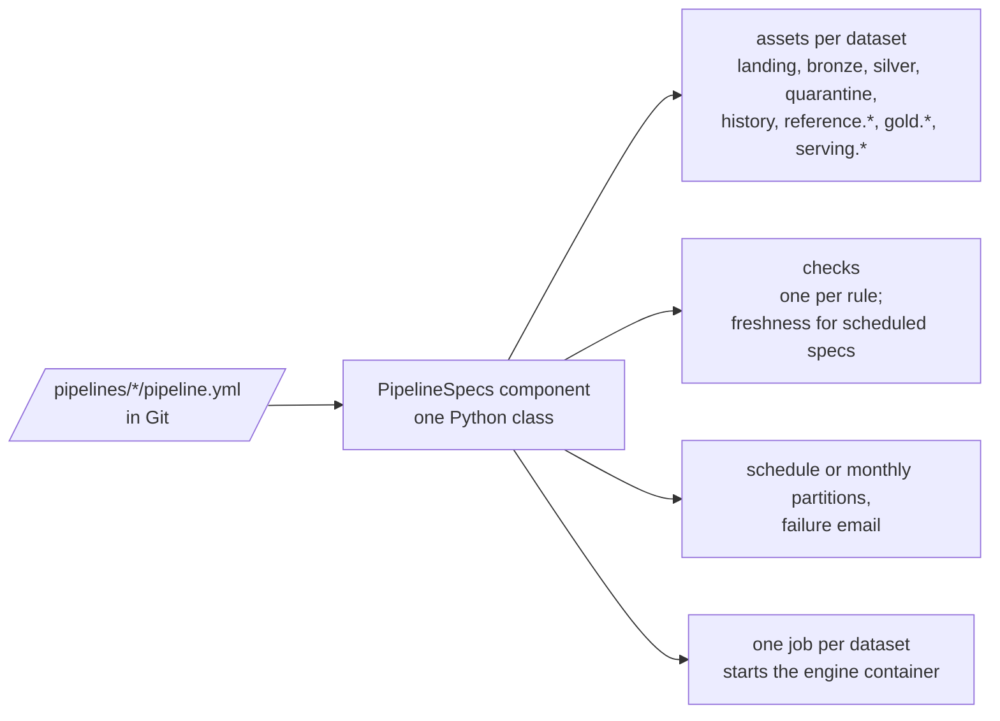

- The job starts the engine container with Dagster Pipes. The engine reports each table it wrote and each rule result by
  printing JSON lines on its output; Dagster reads them. The community Java client for Pipes printed every message
  twice (spike S3), so the engine writes the protocol itself in a small class.
- Adding a dataset means adding a folder and pressing "Reload definitions" (the Workspace does it after a save). Nothing
  is rebuilt or restarted.
- The run executes inside the `tower-code` container, which starts the engine through the Docker socket, mounts the
  specs and the download cache, and passes the engine's settings along. Every other line the engine prints is saved as
  the run's log on the volume `tower-storage`, readable from Dagster's UI and the Workspace.
- Python appears only here, because Dagster definitions are Python. The tower decides when to run and starts the Java
  engine; it never touches data.

### 9.3 The graph you see

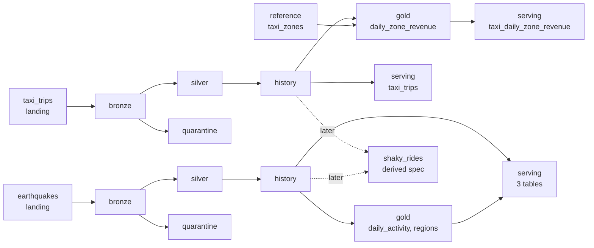

19 assets for the two example specs, with 8 checks (one per rule) on the two silver tables. `shaky_rides` is a
cross-dataset question ("do taxis slow down when the ground shakes?"): a spec reading two other specs' tables, run when
both have finished. Not built yet.

### 9.4 What can start a run

| Trigger                  | In the spec                    | How the tower does it                           | Built            | Databricks           | ADF                   | Snowflake            |
|:-------------------------|:-------------------------------|:------------------------------------------------|:-----------------|:---------------------|:----------------------|:---------------------|
| Schedule                 | `schedule: "0 */6 * * *"`      | Schedule, on by default                         | ✅                | Scheduled trigger    | Schedule trigger      | Task `SCHEDULE`      |
| A file arrived           | `trigger: on-landing`          | A sensor watching landing                       | not yet          | File arrival trigger | Storage event trigger | Snowpipe auto-ingest |
| Another dataset finished | `inputs`, no `schedule`        | Asset automation: sensor `<dataset>_on_inputs`  | ✅                | Table update trigger | Pipeline dependency   | Task `AFTER`         |
| Backfill                 | `partitions`                   | One run per partition                           | ✅ monthly, daily | Backfill runs        | Tumbling window rerun |                      |
| By hand                  |                                | Run button (Workspace or Dagster), `run.sh run` | ✅                | Run now              | Trigger now           | `EXECUTE TASK`       |

A schedule is on by default. Pausing it (from the Workspace or Dagster's UI) is stored in Postgres and wins over that
default until someone resumes it. The engine records what started a run (`schedule`, `backfill`, `sensor`, `manual`) in
every event.

### 9.5 One run per dataset

Each dataset has its own queue slot (a Dagster "concurrency pool" named `run-<dataset>`, limit 1), and at most 2 runs
execute at once on the laptop; a failed run is retried once. One active run per job is also Databricks' default. It does
a second job here: with a single writer per table, Delta on S3 needs no external lock service.

---

## 10. The event log

### 10.1 Run statistics are a table

Every platform in section 3 keeps its own run statistics as tables you can query: Databricks' pipeline event log and
system tables, Snowflake's event tables and `ACCOUNT_USAGE`, BigQuery's `INFORMATION_SCHEMA.JOBS`. DataFlow does the
same with one Delta table per dataset, `system/events/<dataset>/`, to which every run only adds rows. One table per
dataset, because Delta on S3 is safe with one writer per table, and the tower already runs one run per dataset at a
time. ClickHouse reads them in place and combines them as the view `serving.run_events`.

What a run adds, with examples from run `a2b889fc` of 2026-10-25:

| `event_type`    | When                                                     | Example                                                             |
|:----------------|:---------------------------------------------------------|:--------------------------------------------------------------------|
| `run`           | at the start (RUNNING) and the end (COMPLETED or FAILED) | `run COMPLETED`, 40 s                                               |
| `flow_progress` | once per flow                                            | `silver COMPLETED`, 9,964 rows in, 9,964 out, 0 dropped, 3.2 s      |
| `expectation`   | once per rule                                            | `plausible_magnitude`: 9,964 rows checked, 0 failing, action `drop` |
| `maintenance`   | when compaction and clean-up ran                         | which tables were compacted                                         |

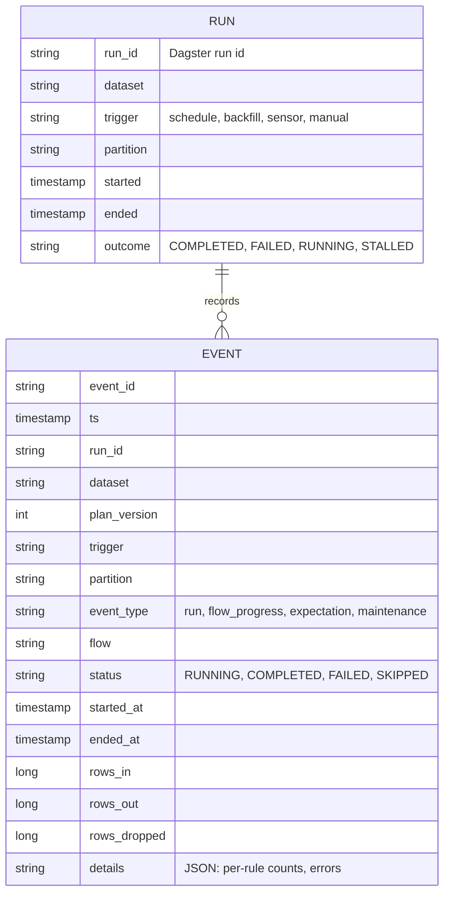

`RUN` is not stored: queries derive it from the `run` events of each `run_id` (a run with RUNNING and no end event for
two hours shows as STALLED). A typical question:

```sql
SELECT dataset, flow, status, rows_out, dateDiff('second', started_at, ended_at) AS seconds
FROM serving.run_events
WHERE event_type = 'flow_progress'
ORDER BY ts DESC
LIMIT 20;
```

### 10.2 Who records what

The tower and the event log answer different questions. The tower knows **whether** a run happened (queued, started,
succeeded, failed, retried) and keeps its log. The event log knows **what** the run did (rows per step, rules failed,
rows quarantined).

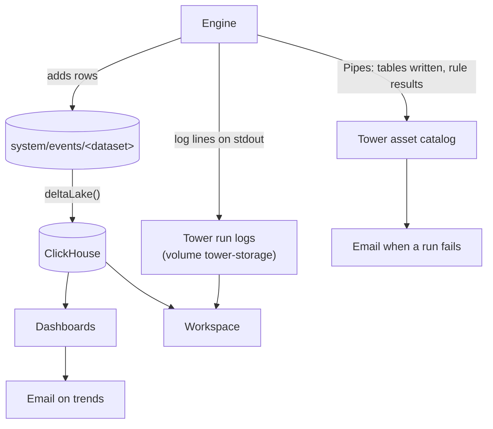

### 10.3 Every question has a screen

| Question                   | 2.0 screen                                   | v3 screen                                                                                                                        |
|:---------------------------|:---------------------------------------------|:---------------------------------------------------------------------------------------------------------------------------------|
| Did today's run land?      | Pipeline · Overview (Postgres notifications) | Workspace Home and Runs (a pop-up when a run finishes); Dagster's runs page; "Pipeline · Runs" board                             |
| Why is it slow?            | Run Detail + Spark History                   | Workspace run Timeline (with rows against the previous run) and the pipeline's run-duration chart; "Pipeline · Run detail" board |
| What did the engine log?   | Loki                                         | Workspace run Log tab, filterable and live; the same logs in Dagster's UI                                                        |
| Is a step falling behind?  | Kafka lag                                    | There are no steps running on their own, so no lag. Freshness checks answer "is it late?"                                        |
| Is the data getting worse? | Data quality board (Prometheus counters)     | Workspace Quality (failing share per rule over recent runs, quarantine reasons); Dagster checks; "Pipeline · Data quality" board |
| Are the tables healthy?    | Lakehouse board                              | Workspace catalog: Updated, Details (properties, clustering, protocol), Profile, History with time travel; the Lakehouse board   |
| Is the machine OK?         | Platform boards (exporters)                  | `docker stats`; ClickHouse's `system.*` tables. A real metrics stack comes back on Kubernetes, which provides one                |

### 10.4 Two alarms, two owners

- **"The run did not land"** belongs to the tower: when a run fails, an email goes out. It also works when the engine
  died too hard to write its own event log.
- **"The data is drifting"** belongs to the dashboards: Grafana alert rules on the event log, such as a quarantine rate
  above 5% or nothing landed in 12 hours.

---

## 11. Storage and the table format

### 11.1 MinIO is gone

MinIO's open-source edition lost its admin console in 2025, stopped shipping images and binaries in October 2025, went
into maintenance mode in December 2025 and was archived in 2026. A pinned image still runs, but it will never get
another fix.

| Option                                   | License    | Shape                                                         | For us                                                              |
|:-----------------------------------------|:-----------|:--------------------------------------------------------------|:--------------------------------------------------------------------|
| **RustFS 1.0** (released September 2026) | Apache 2.0 | One program, MinIO-like console, S3 API                       | ✅ **Chosen**: the closest to a drop-in replacement; passed spike S1 |
| SeaweedFS                                | Apache 2.0 | Mature, several components, S3 gateway                        | Fallback if RustFS had failed                                       |
| Garage                                   | AGPL       | Light, built for small spread-out clusters; a narrower S3 API | Fine for home labs; less certain for Delta                          |
| Pinned MinIO                             | AGPL       | What 2.0 ran                                                  | Fine for a few months, not a destination                            |
| Ceph RGW                                 | LGPL       | The enterprise answer                                         | Far too heavy for a laptop                                          |

### 11.2 Layout

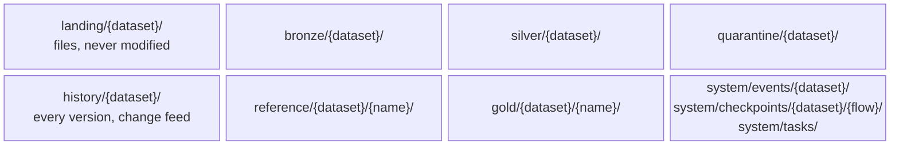

Landing holds files named by fingerprint; everything else is a Delta table, like Databricks' volumes and tables.
Checkpoints sit next to the data they protect, so the bucket alone is enough to resume. `system/tasks/` holds preview
results from the Workspace. The 2.0 MinIO bucket was copied byte for byte into a second RustFS bucket, `archive-v2`,
which ClickHouse reads under the name `archive_v2`.

The names bronze, silver and gold come from Databricks' "medallion" pattern: each layer is cleaner than the one before
it, and any layer can be rebuilt from the one below.

### 11.3 Delta features in use

| Feature                | What it is                                                                                  | Where                                                          | Why                                                                                                                                       |
|:-----------------------|:--------------------------------------------------------------------------------------------|:---------------------------------------------------------------|:------------------------------------------------------------------------------------------------------------------------------------------|
| Change data feed       | Delta can list the rows that changed between two versions                                   | history                                                        | Lets a consumer copy only what changed (ClickHouse reads it since 25.12)                                                                  |
| Liquid clustering      | Delta keeps files organised by a chosen column, so queries filtering on it read fewer files | history by `factUniqueId`; bronze and silver by `_ingested_at` | Replaces partitioning by folder; nothing to get wrong as data grows                                                                       |
| `OPTIMIZE`             | Merges many small files into fewer big ones                                                 | every table, at most hourly                                    | Each streaming batch writes small files; reading thousands of them is slow                                                                |
| `VACUUM` and retention | Deletes files no version needs any more, once they are older than the retention             | every table, at most hourly; retention 168 hours               | Keeps storage from growing forever; 168 hours is also how far back time travel works                                                      |
| ~~Deletion vectors~~   | A faster way to delete rows: mark them instead of rewriting the file                        | **off everywhere**                                             | Spike S2: ClickHouse 26.10 ignores them when reading old versions and miscounts them in the change feed. Revisit when ClickHouse fixes it |

A detail found on 2026-10-25: Delta 4.4 ignores `VACUUM ... RETAIN 168 HOURS` unless the number is 0, and uses the table
property `delta.deletedFileRetentionDuration` instead. So the maintenance flow sets that property on each table and runs
`VACUUM ... LITE` (a version of VACUUM that reads the log instead of listing every file). Spike S2 also confirmed that
ClickHouse reads `timestamp_ntz` columns, clustered tables and the change feed.

### 11.4 The catalog

A catalog gives tables names, owners and permissions, so people write `earthquakes.history` instead of a file path.

- **Now:** the specs are the catalog. The engine turns `earthquakes.history` into `s3a://lake/history/earthquakes/`. The
  Workspace makes it browsable and queryable: ClickHouse views named `<dataset>.<table>`, each table's columns with what
  the spec says about them, Delta details, a column profile, lineage and history.
- **Later: Unity Catalog OSS.** It is the catalog Databricks uses, open-sourced, and it moves fast: version 0.7.0 (
  October 2026) manages Delta tables, has a Spark 4.2 connector and a Postgres backend, and ClickHouse can read it (
  experimental). Two reasons to wait: there are known problems with S3-compatible stores and credentials, and nothing
  outside the platform needs table names yet. Revisit when notebooks or a second query engine need to find tables by
  name.

---

## 12. Serving

### 12.1 View or copy

ClickHouse publishes each table in the spec's `serve:` list in one of two ways:

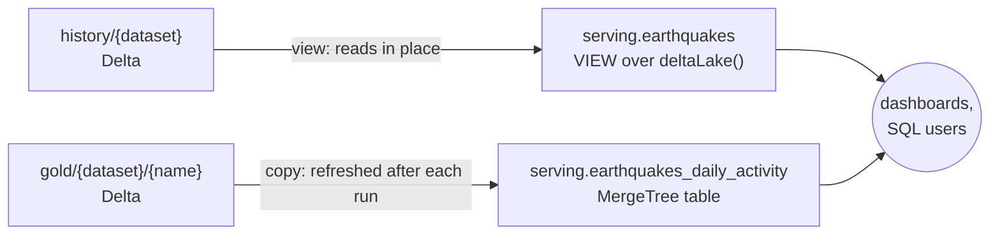

| Mode             | Use it for                                 | What happens                                                                                                                            | Cost                                                                               |
|:-----------------|:-------------------------------------------|:----------------------------------------------------------------------------------------------------------------------------------------|:-----------------------------------------------------------------------------------|
| `view` (default) | Most tables; anything queried now and then | A saved query: `SELECT * EXCEPT (contentHash, __END_AT) FROM deltaLake(lake, filename = 'history/earthquakes/') WHERE __END_AT IS NULL` | No copy; each query reads the Parquet files, and sees a new run's data immediately |
| `copy`           | Tables dashboards query all the time       | The table is copied into ClickHouse's own storage (a "MergeTree" table) and refreshed after each run                                    | One extra copy, refreshed per run                                                  |

A copy is built like this (ClickHouse's "refreshable materialized view": a query whose result is periodically written to
a table):

```sql
CREATE TABLE IF NOT EXISTS serving.earthquakes_daily_activity
ENGINE = MergeTree ORDER BY (day, magnitudeBand, eventType)
SETTINGS allow_nullable_key = 1
EMPTY AS SELECT * FROM deltaLake(lake, filename = 'gold/earthquakes/daily_activity/');

CREATE MATERIALIZED VIEW IF NOT EXISTS serving.earthquakes_daily_activity_refresh
REFRESH EVERY 1 DAY
TO serving.earthquakes_daily_activity EMPTY
AS SELECT * FROM deltaLake(lake, filename = 'gold/earthquakes/daily_activity/');

SYSTEM REFRESH VIEW serving.earthquakes_daily_activity_refresh;
SYSTEM WAIT VIEW serving.earthquakes_daily_activity_refresh;
```

The engine runs the last two lines at the end of each run, so the copy is refreshed then (the daily refresh is only a
safety net). A refresh replaces all rows at once. When a gold table's columns change, the engine notices the difference,
drops the copy and creates it again. `lake` is a ClickHouse "named collection": a saved address and key for RustFS, read
from the server's environment, so no query contains a secret.

This is pattern P7, "query in place, copy only when it pays", as Databricks SQL warehouses, BigQuery BigLake tables and
OneLake shortcuts do it.

### 12.2 What removing the connector made possible

In 2.0 a Spark connector pushed every row into ClickHouse. It only supported Spark 4.0 (its latest release, 0.10.2,
supports nothing newer) and had a known read failure with ClickHouse 26.9 and later. Since ClickHouse now reads the lake
itself:

- Spark 4.2 and Delta 4.4 became possible, and v3 runs on them (spike S4).
- A workaround for timestamps without time zones went away: ClickHouse reads `timestamp_ntz` as `DateTime64(6)`
  unchanged.
- The writer service, its own checkpoints and its table-creation logic went away with it.

---

## 13. The Workspace and interactive work

### 13.1 The Workspace

The Workspace (built 2026-10-25) is the window people use: one web app at http://localhost:3080. What it offers:

- **Catalog:** every table with its columns, a sample, a profile (missing values, distinct values, minimum and maximum
  per column), Delta details, history with time travel, lineage, and when it last changed.
- **SQL editor:** ClickHouse SQL with completion for tables, columns and ClickHouse's functions (with their
  documentation on hover), errors marked where they occur, quick fixes, charts and CSV download.
- **Pipelines and runs:** the graph of each run, a timeline that compares rows with the previous run, the engine's own
  log, schedules (pause and resume), monthly partitions and backfills.
- **Quality:** each rule with its failing share over recent runs, and why rows were quarantined.
- **Spec editor:** errors as you type, a live graph of the draft, a diff against the saved version, and two buttons that
  run the engine on a 20,000-row sample without writing anything: Preview (what the draft produces) and Data impact (
  what would change compared with the saved spec).

It holds no storage credentials and runs no Spark. Every action becomes one of three things:

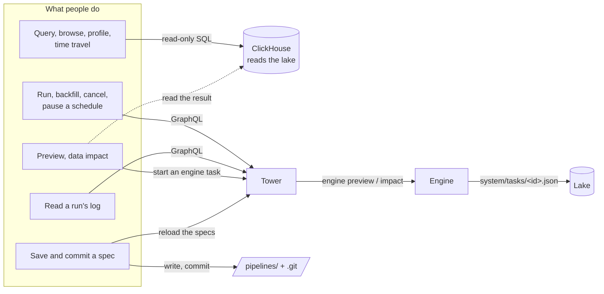

Details: [workspace.md](../workspace.md).

### 13.2 Notebooks, later

Notebooks would be for exploring data with code, as on a Databricks shared cluster. They are optional and not built.
Meanwhile ClickHouse and the Workspace's SQL editor cover interactive queries, including time travel.

| Option                            | Weight             | Good for                                             |
|:----------------------------------|:-------------------|:-----------------------------------------------------|
| DuckDB with its Delta extension   | No server, no Java | Looking at any table from a laptop shell or notebook |
| Spark Connect server + JupyterLab | About 1 GB         | Real Spark, the same code as the engine              |

Pipelines never run in a notebook. A spec that works in a notebook still runs as a normal run.

---

## 14. Running it

### 14.1 Containers

| Always on                                                                                                              | Optional                                                                                                            |
|:-----------------------------------------------------------------------------------------------------------------------|:--------------------------------------------------------------------------------------------------------------------|
| `rustfs`, `postgres`, `clickhouse`, `tower-webserver`, `tower-daemon`, `tower-code`, `workspace`, `grafana`, `mailpit` | `spark-history` (monitoring repo, not yet verified on Spark 4.2); later `unity-catalog`, `spark-connect`, `jupyter` |

Postgres stores Dagster's runs, schedules and events in its database `dagster`. The engine has no database: everything
it needs to resume is in the bucket. Two helpers run once at start-up and exit: `rustfs-init` creates the bucket,
`tower-db-init` the Dagster database. The engine runs as containers the tower starts, or by hand under the compose
profile `engine`.

### 14.2 Memory

Measured on 2026-10-25, platform idle:

|                              | 2.0, idle   | v3, idle                                              | v3, one run active                               |
|:-----------------------------|:------------|:------------------------------------------------------|:-------------------------------------------------|
| Stage services / engine      | ~1.05 GB    | 0                                                     | up to 1.8 GB (engine limit; Java heap 60% of it) |
| Kafka + its UI               | ~0.5 GB     | 0                                                     | 0                                                |
| Monitoring tools             | ~0.7 GB     | 0                                                     | 0                                                |
| RustFS, ClickHouse, Postgres | ~0.4 GB     | ~0.6 GB (RustFS 350 MiB, ClickHouse 210, Postgres 40) | ~0.6 GB                                          |
| Tower (three containers)     | —           | ~0.3 GB                                               | same                                             |
| Workspace                    | —           | ~0.34 GB                                              | same                                             |
| Grafana, Mailpit             | ~0.15 GB    | ~0.13 GB                                              | same                                             |
| **Total**                    | **~2.8 GB** | **~1.4 GB**                                           | **~3.2 GB at the engine's limit**                |

RustFS is the largest idle process (MinIO idled at about 90 MiB).

### 14.3 Kubernetes later, same design

| On the laptop (Docker Compose)                  | On Kubernetes                                       |
|:------------------------------------------------|:----------------------------------------------------|
| The tower starts one container per run          | The tower starts one pod per run                    |
| Spark in local mode inside the engine container | Same image; Spark spreads a big run over extra pods |
| RustFS, one node                                | A RustFS or SeaweedFS cluster, or a cloud bucket    |
| Postgres container                              | CloudNativePG                                       |
| ClickHouse container                            | The ClickHouse operator                             |

Nothing in the design changes between the two; only how runs are launched and where Spark runs.

---

## 15. How we got here

### 15.1 Spikes first

Before rewriting anything, four small experiments ("spikes") checked the risky assumptions, each with a pass criterion.
All four ran on 2026-10-24; evidence in `spikes/REPORT.md`.

| Spike                 | Question                                                             | Pass when                                                                                                                                                                | Result                                                                                                                                                    |
|:----------------------|:---------------------------------------------------------------------|:-------------------------------------------------------------------------------------------------------------------------------------------------------------------------|:----------------------------------------------------------------------------------------------------------------------------------------------------------|
| **S1 · Object store** | Does RustFS hold Delta tables written by Spark?                      | Spark creates, appends to, merges, compacts and vacuums a Delta table on RustFS, and streams from it with a checkpoint                                                   | **Pass**, 14 of 14, including retry-safe writes and the 3-million-row taxi month                                                                          |
| **S2 · ClickHouse**   | Can ClickHouse 26.x read our tables?                                 | It reads history and gold, including timestamps without time zone, deletion vectors, clustering and the change feed; a refreshed copy works; 3M-row query times recorded | **Partial**: everything passes except time travel and the change feed on tables with deletion vectors, so those are off. 3M-row queries take 30 to 110 ms |
| **S3 · Dagster**      | What does Dagster cost here, and can it start the Java engine?       | Dagster runs in compose with a measured memory; it starts a Java container that reports one table and one check                                                          | **Pass** with a workaround: 443 MiB idle; the community Java client sends every message twice, so the protocol is hand-written                            |
| **S4 · Engine stack** | Do our libraries run on Spark 4.2 + Delta 4.4 without the connector? | The full build passes on the new versions                                                                                                                                | **Pass**, 155 tests, after four dependency version pins and one source fix                                                                                |

### 15.2 Phases

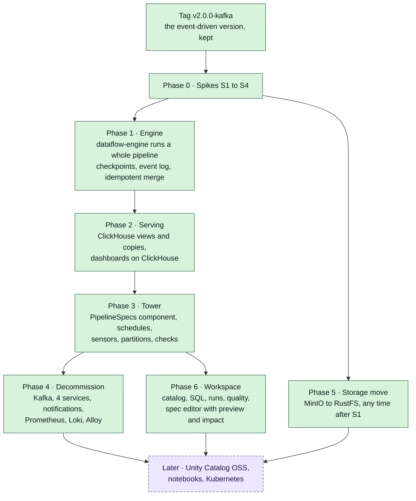

*Green: done. Phases 0 to 5 on 2026-10-24, in the order spikes, engine, tower, dashboards, storage move, decommission (
the copy needed MinIO still running); the Workspace on 2026-10-25. Lavender: later. The storage move was a copy: v3
tables were rebuilt from the sources, and the 2.0 bucket is kept as `archive-v2`.*

After the build, the same day: the airport names of earlier drafts were replaced by plain ones in code, configuration,
ClickHouse and dashboards (the lake columns too, by rebuilding bronze, silver and the event logs from landing), and the
2.0 leftovers were deleted: MinIO, Kafka and monitoring volumes, 2.0 images, the 2.0 ClickHouse database, and the 2.0
Postgres tables after a dump to `archive-v2/postgres/`.

On 2026-10-25 the Workspace followed: a Spring Boot and React app in front of the tower, ClickHouse and Git, its queries
built with jOOQ, its spec editor backed by two new engine commands (`preview`, `impact`) that run as tower jobs.
Polishing it surfaced two platform fixes: the engine's own log now reaches Dagster's UI and the Workspace (saved on a
volume shared by `tower-code` and `tower-webserver`), and the maintenance retention setting now takes effect (section
11.3).

As with `v1.0.0-taxi`, the old design keeps a tag, `v2.0.0-kafka` in both repositories: the Kafka version stays readable
and runnable as a reference for event-driven design.

### 15.3 Code: kept, reworked, deleted

| Kept (moved as is)                                                                                                                                                                                                        | Reworked                                                                                                                                                       | Deleted                                                                                                                                                                                                                                                               |
|:--------------------------------------------------------------------------------------------------------------------------------------------------------------------------------------------------------------------------|:---------------------------------------------------------------------------------------------------------------------------------------------------------------|:----------------------------------------------------------------------------------------------------------------------------------------------------------------------------------------------------------------------------------------------------------------------|
| Spec model and validator (fields renamed), `SpecProjection`, `StageDataset`, `CanonicalEncoding`, `Expectations`, the merge with derived-column backfill, lake maintenance, the S3 storage class, the Spark configuration | Feeder → ingest and bronze flows; processor → silver flow; versioner → history flow with tagged writes; gold publisher → gold flow; spec loader reads v3 specs | Kafka (producers, consumers, error handlers, topics, health), event classes, claim checks, notifications and their repositories and audit, shutdown handling, the Spring Batch job, the four apps, the web layer, the ClickHouse sink, database migrations 001 to 003 |

What each 2.0 class became:

| 2.0                                                                               | v3                                                                                               |
|:----------------------------------------------------------------------------------|:-------------------------------------------------------------------------------------------------|
| `PipelineSpec`, `PipelineSpecLoader`, `PipelineSpecValidator`, `PipelineRegistry` | `PipelineSpec`, `PipelineSpecLoader`, `PipelineSpecValidator`, `PipelineSpecs` (`dataflow-spec`) |
| `StageDataset`, `SpecProjection`, `CanonicalEncoding`                             | same, in `dataflow-spec`                                                                         |
| `Expectations`                                                                    | same logic, in `dataflow-engine-core`                                                            |
| `DefaultDeltaMergeGateway`                                                        | `ScdMerge` (`__START_AT`/`__END_AT`, sequence-by, stale versions)                                |
| `LakeMaintenance`                                                                 | `MaintenanceFlow`                                                                                |
| `S3DataLakeStorage`                                                               | `Lake` (plus `system/events`, `system/checkpoints`)                                              |
| `SparkAutoConfiguration`                                                          | `EngineConfiguration` in the engine app                                                          |
| `SourceFiles`                                                                     | `Sources` + `IngestFlow`                                                                         |
| `GoldPublisher`                                                                   | `GoldFlow`                                                                                       |
| `ClickHouseOlapSink`, `DeltaChangeFeed`                                           | `ServingFlow` + `ServingDdl` + `ClickHouseHttp`                                                  |

### 15.4 The rulebook after v3

The project's [engineering rules](../development/engineering-rules.md) (`RULE-*`) changed with v3:

| Rules                                                                    | Fate                   | Replacement                                                                                                                                                                                     |
|:-------------------------------------------------------------------------|:-----------------------|:------------------------------------------------------------------------------------------------------------------------------------------------------------------------------------------------|
| RULE-K01..K08 (Kafka)                                                    | Retired                | —                                                                                                                                                                                               |
| RULE-N01..N06 (notifications)                                            | Retired                | **F01** every flow writes a `flow_progress` event; **F02** the event log only grows                                                                                                             |
| RULE-B01..B05 (Spring Batch)                                             | Retired                | —                                                                                                                                                                                               |
| RULE-SP06 (chunk replacement)                                            | Replaced               | **F03** streaming flows checkpoint; every batch write carries a tag                                                                                                                             |
| RULE-S05, S10 (Kafka readiness, service metrics)                         | Retired for the engine | The tower monitors runs                                                                                                                                                                         |
| —                                                                        | New                    | **F04** one active run per dataset; **F05** bronze is raw, typing happens in silver; **F06** Git is the source of truth for specs; **F07** deletion vectors stay off on tables ClickHouse reads |
| Everything else (Maven, Spring configuration, Spark, data models, tests) | Unchanged              |                                                                                                                                                                                                 |

---

## 16. Decisions

Each line is a small architecture decision record (ADR): the decision, the alternative, why, and what it became. All
twelve were accepted on 2026-10-24.

| #      | Decision                                                                                                                           | Alternative considered                     | Why this one                                                                        | Outcome                                                                                              |
|:-------|:-----------------------------------------------------------------------------------------------------------------------------------|:-------------------------------------------|:------------------------------------------------------------------------------------|:-----------------------------------------------------------------------------------------------------|
| ADR-01 | **A run is one container running every step**                                                                                      | Keep 4 services + Kafka                    | P1, P2; Databricks' recommendation for production; nothing running between runs     | Built: `dataflow-engine` image, one container per run started by the tower                           |
| ADR-02 | **Only new data, by checkpoint**: streaming queries that stop when caught up, and tagged Delta writes                              | Notifications table + dedup gate           | P3; four hand-made mechanisms become two that Spark and Delta ship                  | Built: checkpoints on every stream, a tag on every batch write                                       |
| ADR-03 | **Raw bronze, typed silver**, `_rescued_data`, Lakeflow vocabulary in specs                                                        | Convert types on the way into bronze (2.0) | The medallion pattern as the platforms define it; silver can be rebuilt from bronze | Built                                                                                                |
| ADR-04 | **Keep our Java engine, shaped like Spark Declarative Pipelines**; adopt SDP flow by flow when it has quality rules and SCD type 2 | Rewrite in PySpark + SDP now               | SDP lacks SCD type 2 and documented quality rules, and has no Java API              | Built: flows shaped like SDP's; SCD type 2 in `ScdMerge`                                             |
| ADR-05 | **Dagster as the tower**; the engine does not depend on it                                                                         | Kestra; Airflow 3; our own service         | Its table-based model matches a lakehouse; leaving is cheap                         | Built: Dagster 1.13, one component, Pipes written by hand                                            |
| ADR-06 | **Run statistics are a table** (event log + Dagster's run storage); retire Prometheus, Loki, Alloy, exporters                      | Keep the monitoring stack                  | P5; fewer moving parts, SQL for everything                                          | Built: one event log per dataset, `serving.run_events`, dashboards and two alert rules on ClickHouse |
| ADR-07 | **ClickHouse reads Delta in place** (views), copies only the busiest tables; retire the Spark connector                            | Keep the writer service                    | P7; unblocks Spark 4.2 and Delta 4.4                                                | Built: views and refreshed copies; deletion vectors off (S2)                                         |
| ADR-08 | **RustFS replaces MinIO**, after spike S1                                                                                          | SeaweedFS, Garage, pinned MinIO            | Apache 2.0, closest to a drop-in replacement, released                              | Built: RustFS 1.0.3; MinIO bucket copied to `archive-v2`                                             |
| ADR-09 | **The specs are the catalog for now**; Unity Catalog later                                                                         | Unity Catalog now                          | Known problems with S3-compatible stores; nothing else needs table names yet        | Unchanged                                                                                            |
| ADR-10 | **The run is the unit of scale**; at most 1 per dataset and 2 in total on the laptop                                               | Scale by step                              | Parallelism lives in runs, flows and Spark tasks                                    | Built                                                                                                |
| ADR-11 | **Git is the source of truth for specs**; the tower reloads them                                                                   | Edit specs only through an API, as in ADF  | How production works on all four platforms                                          | Built; amended on 2026-10-25: the Workspace validates, saves and commits specs, which is still Git   |
| ADR-12 | **Databricks' system column names** (`_rescued_data`, `__START_AT`, `__END_AT`)                                                    | Keep 2.0's names                           | Readable by anyone who knows Lakeflow                                               | Built                                                                                                |

---

## Appendix A: glossary

| Word                 | Meaning                                                                           | Example                                                     | Industry term              |
|:---------------------|:----------------------------------------------------------------------------------|:------------------------------------------------------------|:---------------------------|
| Asset, asset check   | Dagster's words for a table and a test on it                                      | `earthquakes/silver`, check `plausible_magnitude`           | Table, data quality check  |
| Backfill             | Running a dataset for several past partitions                                     | Taxi months 2024-01 to 2024-12                              | Backfill                   |
| Batch, micro-batch   | The slice of new data a streaming query processes in one go                       | At most two new files                                       | Micro-batch                |
| Bronze, silver, gold | Raw rows, clean rows, summaries                                                   | `mag = "5.9"`, `magnitude = 5.9`, "China: 47"               | Medallion layers           |
| Change data feed     | Delta's list of rows that changed between two versions                            | Turned on for history                                       | CDF                        |
| Checkpoint           | A streaming step's record of what it already processed                            | `system/checkpoints/earthquakes/bronze/`                    | Streaming checkpoint       |
| Container            | One running instance of a Docker image                                            | `dataflow-clickhouse`                                       | Container, pod             |
| Copy (serving)       | A ClickHouse table refreshed from a gold table after each run                     | `serving.earthquakes_regions`                               | Materialized table         |
| Delta table          | Parquet files plus a log of versions                                              | `history/earthquakes/`                                      | Table format               |
| `deltaLake()`        | The ClickHouse function that reads a Delta table from storage                     | `deltaLake(lake, filename = 'gold/earthquakes/regions/')`   | External table             |
| Deletion vectors     | A Delta feature that marks deleted rows without rewriting files; off here         |                                                             |                            |
| Engine               | The program that runs a spec: `dataflow-engine`                                   | `dataflow-engine run --dataset=earthquakes`                 | Job compute                |
| Engine task          | A preview or data-impact job started from the spec editor                         | 20,000-row sample, ~13 s                                    |                            |
| Event log            | A Delta table per dataset with one row per run step and per rule                  | `system/events/earthquakes/`                                | Event log, system tables   |
| Expectation          | A quality rule, with what happens on failure: warn, drop or fail                  | `magnitude BETWEEN -2 AND 10`                               | Data quality rule          |
| Flow                 | One step of a run                                                                 | ingest, bronze, silver, history, gold, serving, maintenance | Flow (SDP)                 |
| History              | Every version of every record, each with the time it was valid                    | 5.9, then 6.0                                               | SCD type 2 table           |
| JVM                  | A running Java program                                                            |                                                             |                            |
| Landing              | Downloaded files, unchanged, named by fingerprint                                 | `all_month.bd8a205c5fd1587d.csv`                            | Landing zone, volume       |
| Liquid clustering    | Delta keeping files organised by a column                                         | history by `factUniqueId`                                   | Clustering                 |
| MergeTree            | ClickHouse's main table type, stored in ClickHouse itself                         |                                                             |                            |
| Object store, S3 API | A file server for programs, and the protocol everyone speaks                      | RustFS, bucket `lake`                                       | Object storage             |
| Orchestrator         | A service that schedules, queues, retries and records jobs                        | Dagster (the tower)                                         | Orchestrator, jobs service |
| Parquet              | A compressed file format storing data column by column                            |                                                             |                            |
| Partition            | One slice of a dataset processed on its own                                       | Taxi month `2024-03`                                        | Partition                  |
| Pipeline spec        | The YAML file that defines a dataset                                              | `pipelines/earthquakes/pipeline.yml`                        | Pipeline definition        |
| Pipes                | Dagster's protocol for programs in other languages: JSON lines on stdout          |                                                             |                            |
| Quarantine           | The table of rows that broke a `drop` rule                                        | `failedExpectations = ["has_magnitude"]`                    | Error table                |
| Run                  | One execution of a spec's steps                                                   | Run `a2b889fc`                                              | Job run, pipeline update   |
| SDP                  | Spark Declarative Pipelines, Spark's own framework for declared tables            |                                                             | Lakeflow (Databricks)      |
| Serving              | Publishing tables in ClickHouse for SQL and dashboards                            | `serving.earthquakes`                                       | SQL warehouse              |
| Spike                | A small experiment that checks a risky assumption before building                 | S1 to S4                                                    | Proof of concept           |
| Tagged write         | A Delta write that carries the stream ID and batch number, so a replay is skipped | `txnAppId`, `txnVersion`                                    | Idempotent write           |
| Time travel          | Reading a Delta table as it was at an earlier version                             | `SETTINGS delta_lake_snapshot_version = 12`                 | Time travel                |
| Tower                | This project's name for Dagster                                                   |                                                             | Orchestrator               |
| View (serving)       | A saved ClickHouse query over a Delta table, always up to date                    | `serving.earthquakes`                                       | View, zero-copy table      |
| Workspace            | The web app at :3080                                                              |                                                             | Workspace (Databricks)     |

**Earlier draft words.** Before 2026-10-24, drafts used an airport metaphor; older commits still contain it. Pipeline
spec was "flight plan", run "flight", engine "aircraft", tower "control tower", object store "hangar", serving "
arrivals", bronze "baggage hall", silver "terminal", history "passenger register", gold "business lounge", view "jet
bridge", copy "shuttle", event log "black box", dashboards "FIDS", maintenance "hangar maintenance", catalog "manifest",
notebooks "flight simulator".

---

## Appendix B: sources

**Databricks**

- [Lakeflow Spark Declarative Pipelines: AUTO CDC, SCD type 2](https://docs.databricks.com/aws/en/ldp/cdc)
- [Pipeline best practices (expectations)](https://docs.databricks.com/aws/en/ldp/best-practices)
- [Pipeline event log](https://docs.databricks.com/en/ldp/monitor-event-logs)
  and [its schema](https://docs.databricks.com/aws/en/dlt/monitor-event-log-schema)
- [Job triggers: scheduled, table update, file arrival, continuous](https://docs.databricks.com/aws/en/jobs/triggers)
- [Compute for jobs (job compute vs all-purpose)](https://docs.databricks.com/aws/en/jobs/compute)
  and [classic jobs](https://docs.databricks.com/aws/en/jobs/run-classic-jobs)
- [Asset Bundle configuration](https://docs.databricks.com/dev-tools/bundles/settings.html)
- [Medallion architecture](https://docs.databricks.com/lakehouse/medallion.html)
  and [Delta deployment guide (volumes for landing)](https://docs.databricks.com/aws/en/lakehouse-architecture/deployment-guide/delta-lake)
- [Auto Loader best practices (rescued data)](https://docs.databricks.com/aws/en/ingestion/cloud-object-storage/auto-loader/best-practices)
- [Spark Declarative Pipelines: why end-to-end declarative](https://www.databricks.com/blog/spark-declarative-pipelines-why-data-engineering-needs-become-end-end-declarative)

**Apache Spark, Delta, Unity Catalog**

- [Spark Declarative Pipelines programming guide](https://github.com/apache/spark/blob/master/docs/declarative-pipelines-programming-guide.md)
- [Spark 4.2.0 release notes](https://spark.apache.org/releases/spark-release-4-2-0.html)
  and [SPIP: Auto CDC for Apache Spark](https://lists.apache.org/thread/j6sj9wo9odgdpgzlxtvhoy7szs0jplf7)
- [Delta releases](https://github.com/delta-io/delta/releases)
  and [Delta Kernel + UC Delta APIs (Aug 2026)](https://delta.io/blog/2026-08-20-simplifying-your-open-lakehouse-with-the-delta-kernel-and-the-uc-delta-apis)
- [Delta idempotent writes in foreachBatch](https://docs.databricks.com/aws/en/structured-streaming/foreach.html)
- [Unity Catalog OSS releases](https://github.com/unitycatalog/unitycatalog/releases)

**Snowflake, BigQuery, Microsoft**

- [Snowflake dynamic tables](https://docs.snowflake.com/en/user-guide/dynamic-tables-intro)
  and [refresh](https://docs.snowflake.com/en/user-guide/dynamic-tables-refresh)
- [Snowflake Trail and event tables](https://docs.snowflake.com/en/developer-guide/logging-tracing/logging-tracing-overview)
- [Dataform assertions](https://docs.cloud.google.com/dataform/docs/assertions)
- [ADF metadata-driven copy](https://docs.azure.cn/ja-jp/data-factory/copy-data-tool-metadata-driven)
  and [Lookup activity](https://docs.azure.cn/en-us/data-factory/control-flow-lookup-activity)
- [OneLake shortcuts](https://blog.fabric.microsoft.com/blog/use-onelake-shortcuts-to-access-data-across-capacities-even-when-the-producing-capacity-is-paused?ft=All)

**ClickHouse**

- [Data lakes support](https://clickhouse.com/docs/reference/datalakes), [
  `deltaLake` table function](https://clickhouse.com/docs/sql-reference/table-functions/deltalake), [
  `DataLakeCatalog`](https://clickhouse.com/docs/engines/database-engines/datalakecatalog)
- [Integrating the Rust Delta Kernel (change feed since 25.12)](https://clickhouse.com/blog/integrating-rust-delta-kernel)
- [Refreshable materialized views](https://clickhouse.com/docs/materialized-view/refreshable-materialized-view)
- [Spark connector releases](https://github.com/ClickHouse/spark-clickhouse-connector/releases)

**Orchestration**

- [Dagster Components](https://docs.dagster.io/api/dagster/components), [Pipes](https://docs.dagster.io/api/dagster/pipes), [Java Pipes client](https://dagster.io/docs/integrations/libraries/java), [Docker deployment](https://docs.dagster.io/deploying/docker)
- [Prefect is acquiring Dagster (13 July 2026)](https://dagster.io/blog/prefect-is-acquiring-dagster)
- [Kestra 2.0](https://kestra.io/blogs/kestra-2-0-airflow-dagster-alternative), [Airflow 3 asset-aware scheduling](https://airflow.apache.org/docs/apache-airflow/3.3.2/authoring-and-scheduling/asset-scheduling.html)

**Storage**

- [MinIO maintenance mode and alternatives (InfoQ)](https://infoq.com/news/2025/12/minio-s3-api-alternatives/), [MinIO removes console features (Blocks and Files)](https://blocksandfiles.com/2025/06/19/minio-removes-management-features-from-basic-community-edition-object-storage-code/), [MinIO archived (Pinggy)](https://pinggy.io/blog/minio_archived_self_hosted_s3_alternatives/)
- [RustFS 1.0 GA](https://linuxiac.com/rustfs-1-0-s3-compatible-object-storage-reaches-ga/), [RustFS docs](https://docs.rustfs.com/)
- [Unity Catalog with MinIO: known issues (Ilum)](https://ilum.cloud/docs/features/catalogs/unity-catalog/)
