# DataFlow · Target Architecture

*What DataFlow becomes as a product: what changes from v3, why each piece is there, and how it compares with Databricks,
Snowflake, Azure Data Factory and dbt.*

> **Status.** Proposed on 2026-10-25. Being built since the same evening: stage 1 (repositories, projects, Git folders,
> releases), transformations (section 6), the pipeline assistant (section 12) and generated dashboards (section 11) are
> in, see section 15 and the decisions table. [`lakehouse-architecture.md`](lakehouse-architecture.md), next to this file,
> describes v3 as it runs today; this document describes where it is going. Each decision below is marked **accepted** (the user agreed) or **proposed** (to confirm before it is
> built).
>
> **Who it is for.** Anyone who has read the v3 document's sections 0 to 2. Every new term is explained where it first
> appears and again in the [glossary](#appendix-a-glossary).
>
> **How to read it.** Sections 0 and 1 give the whole picture and one change followed from start to end. Section 2
> justifies each new technology, section 3 compares with the big platforms. Sections 4 to 14 go through each part. Section
> 15 is the path from v3, section 16 the decisions.

---

## Contents

**Start here**

0. [The short version](#0-the-short-version)
1. [Follow one change](#1-follow-one-change)
2. [Why each new technology](#2-why-each-new-technology)
3. [What the big platforms do](#3-what-the-big-platforms-do)

**How each part works**

4. [Repositories](#4-repositories)
5. [Projects, Git folders and releases](#5-projects-git-folders-and-releases)
6. [Pipelines as steps, and transformations](#6-pipelines-as-steps-and-transformations)
7. [Identity and access](#7-identity-and-access)
8. [Storage anywhere](#8-storage-anywhere)
9. [Compute on Kubernetes](#9-compute-on-kubernetes)
10. [Configuration and GitOps](#10-configuration-and-gitops)
11. [Dashboards and alerts](#11-dashboards-and-alerts)
12. [The pipeline assistant](#12-the-pipeline-assistant)
13. [Housekeeping](#13-housekeeping)
14. [Installing and running](#14-installing-and-running)

**Path and decisions**

15. [From v3 to the target](#15-from-v3-to-the-target)
16. [Decisions](#16-decisions)

[Appendix A: glossary](#appendix-a-glossary) · [Appendix B: sources](#appendix-b-sources)

---

## 0. The short version

### What DataFlow becomes

A team installs DataFlow on its Kubernetes cluster with one Helm command and a short settings file: where its data
lives (Amazon S3, Azure Data Lake Storage, Google Cloud Storage, or any S3-compatible store), and which login service it
uses (its own Entra ID or Okta, or the bundled Keycloak). People sign in once. They connect their own Git repositories
to the Workspace and write pipelines there: the YAML specs of v3, now built from **steps**, some built in (cast, trim,
rules), some their own **transformations** written with Spark's Java API. They open a pull request, CI checks it, they
merge, and the platform runs exactly that commit, scaling Spark up and down with the load. Groups see only the tables
they were granted, enforced by ClickHouse itself. Dashboards appear by themselves for every dataset.

The v3 engine, tower, lake layout, event log and serving stay. What changes is around them: where people's work is kept,
how it gets to production, who may do what, and where it all runs.

### The pieces

| Piece               | Technology                                             | Its job, in one sentence                                              | New?          |
|:--------------------|:-------------------------------------------------------|:----------------------------------------------------------------------|:--------------|
| Pipeline specs      | YAML files in **the user's** Git repositories          | Describe each dataset, now as a list of steps                         | Moved         |
| Transformations     | Java classes using Spark's `Dataset` API, Spring beans | Logic a built-in step cannot express, reusable and shareable          | New           |
| Workspace           | Spring Boot + React                                    | The web app: catalog, SQL, pipelines, Git folders, grants, dashboards | Grows         |
| Control-plane store | Postgres, database `workspace`                         | Git folders, drafts, Git credentials, grants, audit                   | New           |
| Engine              | Spark 4.2 + Delta 4.4 in a Spring Boot command line    | Runs one pipeline at one commit, then exits                           | Grows         |
| Tower               | Dagster 1.13                                           | Schedules, queue, retries, asset graph; loads releases                | Changes input |
| Object store        | S3, ADLS Gen2, GCS or RustFS                           | Holds every file and table                                            | Any store     |
| Serving             | ClickHouse 26.10                                       | Views and copies over Delta, per-group grants                         | Grants        |
| Login               | Keycloak (or the customer's OIDC provider)             | One sign-in for every part                                            | New           |
| Dashboards          | ECharts inside the Workspace                           | Generated from specs and the event log                                | New           |
| Alerts              | Grafana Alerting only                                  | Rules as SQL over ClickHouse, email, Slack, Teams                     | Narrower      |
| Install             | Helm chart, Argo CD, External Secrets                  | Everything compose runs today, on Kubernetes, kept in Git             | New           |

### The picture

The **control plane** is what decides and remembers: the Workspace, its store, the tower, login. The **data plane** is
what touches data: the engine's Spark driver and executors, ClickHouse, the object store. Databricks and Snowflake draw
the same line; it is why code and access rules are never kept in the data lake.

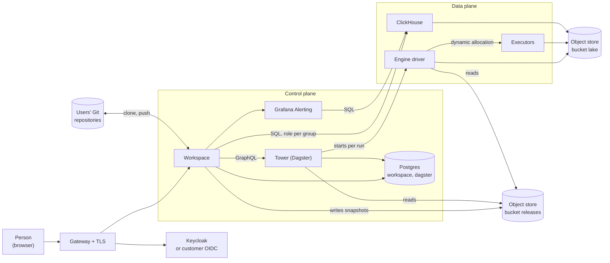

### The design in seven sentences

1. **People's work lives in their own Git repositories.** The platform repository holds only the platform; pipelines,
   transformations, notebooks and dashboards are in project repositories the Workspace connects, as Databricks Git
   folders do.
2. **Production runs a commit, not a file.** Merging releases an immutable snapshot of the project at that commit; every
   run is pinned to that release and records it.
3. **A pipeline is a list of steps.** Built-in steps (today's columns, derive and rules) and user transformations chain
   into one Spark plan, so Catalyst optimizes across them.
4. **A transformation is a small, typed, pure function.** One method, inputs and parameters as Java records, reads only
   through the platform, checked before it runs.
5. **Access rules live in the platform's catalog, enforced by every engine.** Groups come from the login provider;
   ClickHouse enforces each group's grants on every query.
6. **The installation is code too.** A Helm chart describes everything; one folder per environment holds its settings;
   Argo CD makes the cluster match Git.
7. **Derive, do not ask.** Dashboards, schemas, draft specs and checks are generated from what the platform already
   knows; people correct them.

### What changes from v3

| v3 today                                                                                   | Target                                                                                                           |
|:-------------------------------------------------------------------------------------------|:-----------------------------------------------------------------------------------------------------------------|
| Specs in `dataflow-platform/pipelines/`, next to the engine's code                         | Specs in users' project repositories; `dataflow-examples` holds the samples                                      |
| The Workspace edits files in one mounted checkout and commits them as "DataFlow Workspace" | Git folders: per-person clones kept by the control plane, branches, push, pull, authored by the signed-in person |
| A run reads whatever file is on disk                                                       | A run reads a release, pinned to a commit                                                                        |
| Silver = fixed sections `columns`, `derive`, `expectations`                                | Silver and gold = steps; the sections become built-in steps                                                      |
| Custom logic only as Spark SQL expressions                                                 | Transformations in Java, shareable, checked, versioned                                                           |
| Nobody signs in                                                                            | One login (OIDC), groups from the provider                                                                       |
| Every table visible to everyone                                                            | Grants per group, row filters, enforced in ClickHouse                                                            |
| Docker Compose on one machine                                                              | Helm on Kubernetes, executors that scale; compose stays for development                                          |
| RustFS only                                                                                | Any object store, chosen by one setting                                                                          |
| Spring Cloud Config planned                                                                | GitOps: Helm values per environment, applied by Argo CD                                                          |
| Grafana boards drawn by hand                                                               | Dashboards generated in the Workspace; Grafana keeps alerting only                                               |

---

## 1. Follow one change

Real names from the running platform. `taxi_trips` keeps the pickup zone as a number: `pickupLocationId = 161` is the
second busiest, with 143,461 trips in the loaded month. Only its gold query joins `taxi_zones` to turn 161 into "
Manhattan, Midtown Center". An engineer wants that name in silver itself, so every reader of `taxi_trips.current` gets
it.

1. Ada signs in with her company account. The Workspace already shows her Git folder `Users/ada/taxi-analytics`, a clone
   of her team's GitHub repository.
2. She creates the branch `zone-names` and clicks "New transformation", picks the typed trips and
   `taxi_trips.reference_taxi_zones` from the catalog. The Workspace generates
   `transformations/taxi/ZoneEnrichment.java` with an `In` record holding both inputs and their columns ready for
   completion.
3. She writes six lines (section 6.3), adds the step to `pipelines/taxi_trips/pipeline.yml`, and saves. The save stores
   a draft in Postgres, compiles the class, runs it on empty inputs: the plan has no Spark job, no lambda, no cross
   join; the step lands in silver; the output gains `pickupBorough` and `pickupZone`. She clicks the step and sees 20
   sample rows.
4. She commits and pushes. GitHub runs `dataflow validate` on the pull request; a teammate reviews and merges.
5. The merge releases commit `a41c9e2`: the Workspace writes the release `releases/taxi-analytics/a41c9e2/` and tells
   the tower to reload.
6. The next monthly run of `taxi_trips` is pinned to `a41c9e2`. The engine compiles `ZoneEnrichment` (cached by its
   source hash), loads it, reads `taxi_zones` at one Delta version, and writes silver and history as in v3. The event
   log records the commit.
7. An analyst in group `analysts` runs `SELECT pickupBorough, count(*) FROM taxi_trips.current GROUP BY 1`. The
   Workspace sends it to ClickHouse with `role=df_analysts`; ClickHouse checks the grant and runs it.

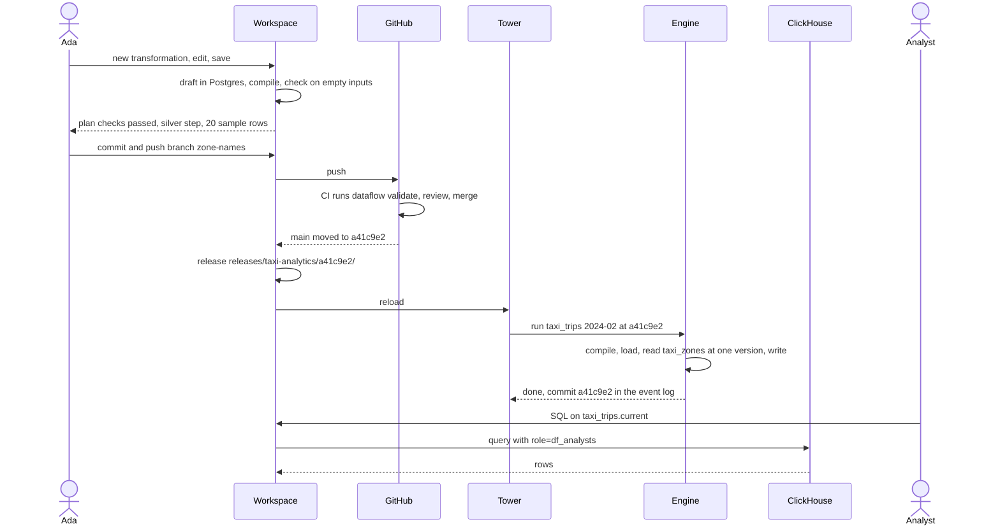

---

## 2. Why each new technology

The v3 technologies keep their reasons (v3 document, section 2). These are the new ones.

### 2.1 Kubernetes and Helm

- **What it is.** Kubernetes runs containers across a group of machines, restarts them when they fail and gives them
  storage and network. Helm packages everything an application needs on Kubernetes into one versioned "chart" with a
  settings file ("values").
- **What it does here.** Runs every always-on service, starts one engine driver pod per run and lets Spark ask for
  executor pods. `helm install dataflow` installs the whole platform.
- **Why this one.** It is where companies run data platforms; every cloud has a managed version. Databricks and
  Snowflake hide it, self-hosted Spark, Dagster and ClickHouse all document it. Helm is the standard package format.
- **Without it.** One machine's memory caps every run (today 4 GB for everything), and each team would rebuild the
  install by hand.

### 2.2 Argo CD (GitOps)

- **What it is.** A program inside the cluster that watches a Git repository and makes the cluster match it. Changing
  the platform means committing to that repository; Argo CD applies the change and shows any difference.
- **What it does here.** Applies the chart with each environment's values from `dataflow-environments`.
- **Why this one.** GitOps is how Kubernetes installs are run in industry; Argo CD and Flux are the two standard tools,
  Argo CD has the clearer UI to learn with. It replaces the planned Spring Cloud Config server (section 10.3).
- **Without it.** Settings would be changed by hand in the cluster, with no history and no review.

### 2.3 External Secrets Operator

- **What it is.** A Kubernetes add-on that copies secrets from a vault (AWS Secrets Manager, Azure Key Vault, Google
  Secret Manager, HashiCorp Vault) into Kubernetes secrets.
- **What it does here.** Gives each service its passwords and keys; the environments repository only names them.
- **Why this one.** Works with every cloud's vault, so the chart has one way to receive secrets. Jasypt stays for Docker
  Compose.
- **Without it.** Secrets would be typed into the cluster by hand or, worse, committed.

### 2.4 Keycloak

- **What it is.** An open-source login server: people sign in there and every application receives a signed token saying
  who they are and which groups they belong to (the OIDC standard).
- **What it does here.** One sign-in for the Workspace, Grafana, the object store console and Dagster's UI; it can also
  forward login to a company's Entra ID, Google or Okta ("identity brokering").
- **Why this one.** The most deployed open-source provider, Java like the rest of DataFlow, and its concepts (realms,
  clients, groups, token claims) are the same in Entra ID and Okta (D1, accepted). Companies can skip it and point
  DataFlow at their own provider.
- **Without it.** No way to know who is asking, so no grants, no audit, no per-person Git folders.

### 2.5 Postgres as the control-plane store, JGit for Git

- **What it is.** Postgres already holds Dagster's state. A second database, `workspace`, holds what the Workspace must
  remember. JGit is a Git implementation in pure Java (used by Eclipse and Gerrit), already in the Workspace.
- **What it does here.** Postgres keeps Git folders, drafts, encrypted Git credentials, then grants and the audit log;
  JGit clones, commits and pushes.
- **Why this one.** The big platforms keep people's working copies in their control plane, not in the data lake (section
  5.2). Postgres is already there, survives restarts, and is shared by several Workspace replicas; plain Git over HTTPS
  works with every provider.
- **Without it.** Edits would sit on one container's disk, lost on restart and invisible to a second replica.

### 2.6 The JDK compiler and Spring contexts

- **What it is.** The JDK can compile Java source from inside a running program (`javax.tools.JavaCompiler`). Spring can
  create a small child application context next to the main one and throw it away later.
- **What it does here.** Compiles transformations from source on save (Workspace) and at run start (engine), then loads
  them as Spring beans in a child context for that run only.
- **Why this one.** Source in Git is the truth: no jar to build, upload or trust. The engine image already contains the
  compiler module (`java --list-modules` in `dataflow-engine:latest` lists `jdk.compiler@21.0.11`).
- **Without it.** Users would build and upload jars, which cannot be reviewed in a pull request and drift from the
  source.

### 2.7 Apache ECharts

- **What it is.** An Apache charting library for the browser, drawing on canvas, fast on large series and themable.
- **What it does here.** Draws every generated dashboard and the SQL editor's charts, in the Workspace's light and dark
  themes (D4, accepted).
- **Why this one.** Same look and login as the rest; Grafana looked generic and needs a second login inside a frame;
  Superset is a second application to run.
- **Without it.** Dashboards stay hand-drawn Grafana boards.

---

## 3. What the big platforms do

| Question                     | Databricks                                                                            | Snowflake                                                               | Azure Data Factory                                             | dbt Cloud                                                  | DataFlow target                                                            |
|:-----------------------------|:--------------------------------------------------------------------------------------|:------------------------------------------------------------------------|:---------------------------------------------------------------|:-----------------------------------------------------------|:---------------------------------------------------------------------------|
| Where people's code lives    | Their Git repositories, cloned into Git folders in the control plane                  | Their Git repositories, cloned into a repository stage inside Snowflake | Their Git repository; each save is a commit, no clone          | Their Git repository, a development environment per person | Their Git repositories, Git folders kept in Postgres + a cache (section 5) |
| What production runs         | A Git ref (branch, tag, commit), or what an Asset Bundle deployed                     | Files from a branch or tag of the repository stage                      | What was published from the collaboration branch               | Jobs on the production branch                              | A deployed snapshot pinned to a commit                                     |
| Custom logic                 | Python or SQL functions returning DataFrames (declarative pipelines), notebooks, jars | Snowpark DataFrames in Java, Scala, Python; stored procedures           | Visual data flows compiled to Spark, with a text script behind | SQL models, Python models, macros                          | Java transformations on Spark's `Dataset` API, built-in steps              |
| How a graph is found         | Running the definitions; reads name their sources                                     | References in code                                                      | The canvas                                                     | `ref()` calls                                              | Running transformations on empty inputs (section 6.4)                      |
| Where grants live            | Unity Catalog's metastore; as code with Terraform                                     | The account; as code with Terraform or Permifrost                       | Azure RBAC                                                     | The warehouse's grants                                     | The platform's catalog database; optional governance repository            |
| How an install is configured | Workspace settings, Terraform                                                         | Account settings, Terraform                                             | ARM templates                                                  | Project settings                                           | Helm values per environment, Argo CD                                       |

The pattern they share: **content in the customer's Git, a control plane that remembers working state, production pinned
to a reviewed version, grants in the catalog, configuration as code.** The target takes all five.

---

## 4. Repositories

### 4.1 The split (accepted)

| Repository                       | Holds                                                                                                                                                                                                               | Produces                                                                                     | Owner                     |
|:---------------------------------|:--------------------------------------------------------------------------------------------------------------------------------------------------------------------------------------------------------------------|:---------------------------------------------------------------------------------------------|:--------------------------|
| `dataflow-platform`              | Code of every component: `libs/` (spec, engine-core, transformation-api), `apps/` (engine, Workspace + UI), `tower/`, Dockerfiles, docs, CI, the compose dev stack and `run.sh`. No datasets                        | Images `dataflow-engine`, `dataflow-workspace`, `dataflow-tower`, versioned by `${revision}` | Platform                  |
| `dataflow-helm-charts`           | Umbrella chart `dataflow`: Workspace, tower (Dagster's chart as a dependency), ClickHouse, Postgres, Keycloak, RustFS when no cloud store, Grafana Alerting with default rules, `values.schema.json`, upgrade hooks | Chart versions, each pinned to image versions                                                | Platform                  |
| `dataflow-environments`          | One folder per install and environment: an Argo CD `Application`, a values file, External Secrets references. No secrets                                                                                            | What Argo CD applies                                                                         | Whoever runs an install   |
| `dataflow-examples`              | A sample project: `earthquakes`, `taxi_trips`, one sample transformation                                                                                                                                            | The first Git folder anyone connects; test data for CI                                       | Platform                  |
| Project repositories             | Pipelines, transformations, notebooks, dashboards                                                                                                                                                                   | Releases                                                                                     | Users                     |
| Governance repository (optional) | Access rules as code                                                                                                                                                                                                | Applied by CI through the platform API                                                       | A company's security team |

Retired: `dataflow-monitoring` (its boards are replaced by generated dashboards, its alert rules move into the chart;
archived, tag `v2.0.0-kafka` kept) and `dataflow-config-repo` (renamed `dataflow-environments`).

### 4.2 How they connect

```mermaid
flowchart LR
    subgraph platform["Platform repositories"]
        PL["dataflow-platform"] -->|CI builds| IMG[["images<br/>engine, workspace, tower"]]
        HC["dataflow-helm-charts"] -->|references tags| IMG
        EX["dataflow-examples"]
    end
    subgraph install["One install"]
        ENV["dataflow-environments<br/>envs/prod"] -->|pins chart version + values| HC
        ARGO["Argo CD"] -->|watches| ENV
        ARGO -->|applies| K8S["Kubernetes cluster"]
    end
    subgraph users["Users"]
        PR["project repositories"] -->|Git folders, release| WSK["Workspace in the cluster"]
        GOV["governance repository"] -->|CI applies| WSK
    end
    K8S --- WSK
    EX -.->|connected as a sample| WSK
```

### 4.3 Why split this way

Each repository has one owner and one rhythm. The platform changes with releases; an install's settings change when its
operator decides; a project changes many times a day. Mixed in one repository, a dataset edit triggers a platform build,
a platform contributor can change a customer's pipeline, and an install's passwords sit next to source code. Databricks,
Snowflake and dbt draw the same lines: their product code is theirs, the customer's pipelines are in the customer's
repositories, and installs are configured apart.

---

## 5. Projects, Git folders and releases

### 5.1 A project

```
taxi-analytics/
├── dataflow.yml
├── pipelines/
│   └── taxi_trips/pipeline.yml
├── transformations/
│   └── taxi/ZoneEnrichment.java
├── notebooks/
└── dashboards/
    └── taxi_trips.yml
```

```yaml
project: taxi-analytics
targets:
  dev:  { mode: development }
  prod: { mode: production, branch: main }
```

`dataflow.yml` names the project and its **targets**: where a release goes and how it behaves. `dev` runs from a
person's branch and writes to an isolated area; `prod` runs what is on `main`. Databricks Asset Bundles use the same
word and idea.

### 5.2 Where Git folders are kept

| Platform           | Where a connected repository's working copy lives                                                                                                                                             |
|:-------------------|:----------------------------------------------------------------------------------------------------------------------------------------------------------------------------------------------|
| Databricks         | Cloned to disk in the control plane for each Git operation; notebooks in the control-plane database, other files on control-plane disk for up to 30 days; a working branch is limited to 1 GB |
| Snowflake          | A repository stage inside Snowflake, with all branches, tags and commits                                                                                                                      |
| Azure Data Factory | Nowhere: each save is a commit to the working branch, through the Git provider's API                                                                                                          |
| DataFlow           | Postgres (Git folder records and drafts) plus one cached clone per repository on each Workspace pod's disk                                                                                    |

Not in the data lake: engines and ClickHouse read and write it, it has no Git semantics, and code would fall under data
access rules. Not only on a pod's disk: a restart loses it and a second replica cannot see it.

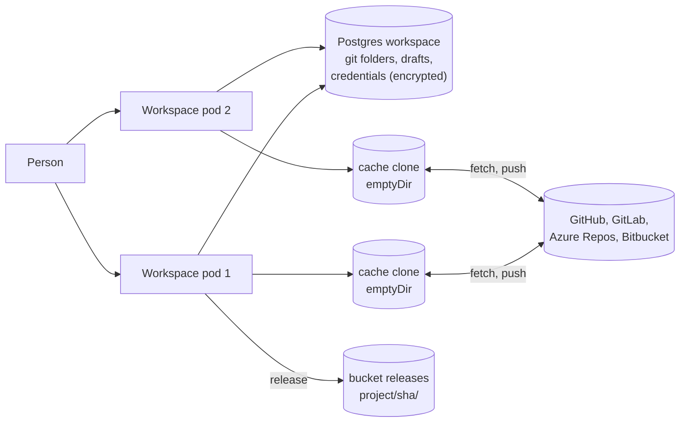

A **draft** is a saved edit not yet committed: one row per person and file, holding the content and the commit it
started from. Reading a file in a Git folder means the cached clone at the branch head with the person's drafts on top.
Committing builds a Git commit from that base and the drafts, then pushes. Losing a cache costs one fetch.

### 5.3 The life of a file

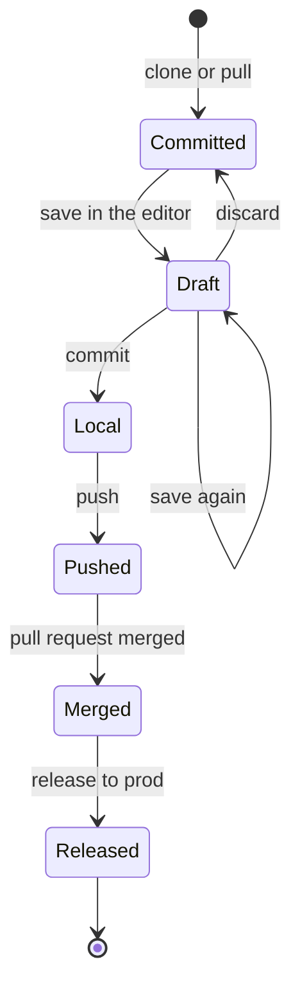

Every save is validated (spec checks, compilation, plan checks) before it is stored, so a draft that breaks something is
shown at once and never reaches a run.

### 5.4 From merge to run

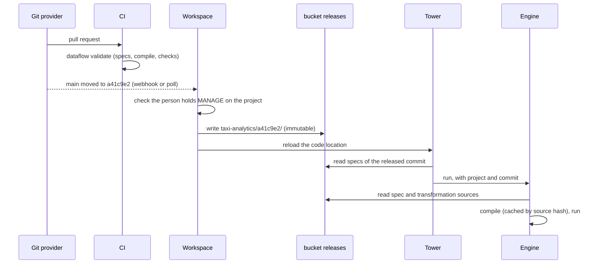

The tower and the engine can only read the `releases` bucket; only the Workspace writes it. A release never changes once
written, so a run id leads to the exact code it ran.

**Why a copy, when Git already has the files.** Git stays the source of truth; nobody edits a release. The copy exists
so that runs never talk to Git: the tower and the engine need no Git credentials for every provider, a provider outage
or an expired token never stops a scheduled run, only validated code that someone was allowed to release ever runs, and
a run stays reproducible after a force push or a deleted branch. A release is a few text files (specs, Java sources)
plus cached compiled classes, never data. Databricks Asset Bundles (files uploaded at deploy), Snowflake (repository
stage) and ADF (publish) keep such a copy too; Databricks jobs with a Git source clone at each run instead, which is the
alternative this design avoids. The word "release" avoids a clash with a Kubernetes `Deployment` and with Argo CD, which
deploys the platform itself, not projects.

### 5.5 Dev and prod

A dev run starts from a person's Git folder, at their branch and drafts, and writes under `dev/<person>/` in the lake
and to a ClickHouse database `dev_<person>`, so production tables are never touched. Prod runs only released commits.
dbt (a schema per developer) and Databricks (development mode of pipelines) do the same. Exact names are settled in the
G13 design.

### 5.6 Folder permissions

Personal folders (`Users/<person>/`) are private. Shared folders (`Shared/<name>/`) give each group one of four levels,
the ones Databricks uses for workspace objects:

| Level  | Allows                                   |
|:-------|:-----------------------------------------|
| READ   | Open files, see history                  |
| RUN    | Start dev runs and previews              |
| EDIT   | Save drafts, commit, push                |
| MANAGE | Change the folder's permissions, release |

Before single sign-on exists there is one person and one platform Git credential; with it, every person brings their own
and commits carry their name.

---

## 6. Pipelines as steps, and transformations

### 6.1 From sections to steps

In v3, silver is three fixed sections: `columns` (cast from bronze), `derive` (more columns), `expectations` (rules). In
the target they are three **built-in steps**, and a spec may add others in between. A spec with no `steps:` behaves
exactly as today.

```yaml
silver:
  steps:
    - { name: typed, use: columns }
    - name: zoned
      use: taxi/zone_enrichment@1
      inputs: { trips: typed, zones: reference.taxi_zones }
      params: { location-column: pickupLocationId, prefix: pickup }
    - { name: derived, use: derive, input: zoned }
    - { name: checked, use: expectations, input: derived }
  output: checked
```

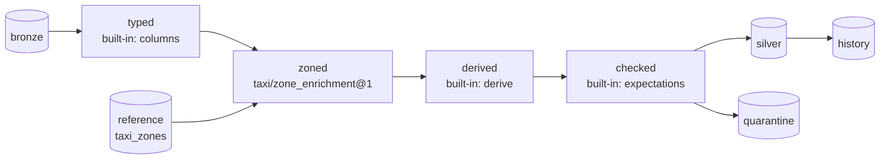

All steps of one stage become **one Spark plan**. Spark's optimizer (Catalyst) sees through every step: it pushes
filters to the read, drops unused columns, picks a broadcast join for the small zones table. No step boundary costs
anything.

### 6.2 The contract

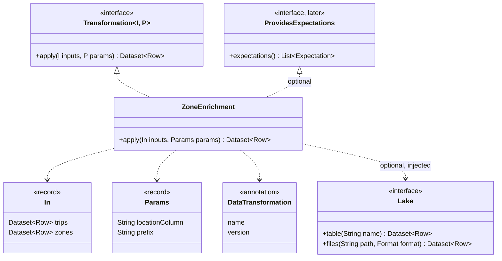

```java
public interface Transformation<I extends Record, P extends Record> {
    Dataset<Row> apply(I inputs, P params);
}
```

One method. **Inputs** and **parameters** are Java records, bound by name from the spec the way Spring binds
`@ConfigurationProperties` records (kebab-case, `@Validated`). The Workspace reads the record's fields to draw the step'
s inputs on the canvas, so nothing is declared twice. Proposed.

| Principle                    | How the contract meets it                                                                                                                                  |
|:-----------------------------|:-----------------------------------------------------------------------------------------------------------------------------------------------------------|
| Single responsibility        | A transformation is logic only; reading, writing, checkpoints, transactions and events stay in the engine                                                  |
| Open-closed                  | The platform grows by new transformations and new optional interfaces; this interface never changes                                                        |
| Liskov substitution          | The engine runs every transformation the same way, and checks the guarantees (section 6.5)                                                                 |
| Interface segregation        | One method; extra capabilities are opt-in interfaces found with `instanceof`, the pattern of Spark's DataSource V2 (`SupportsPushDownFilters`). None in v1 |
| Dependency inversion         | The code depends on `Dataset` and a tiny API, never on paths, `SparkSession` or the store                                                                  |
| Protected variations (GRASP) | Changing the storage, the catalog or Spark settings never touches user code                                                                                |
| Information expert (GRASP)   | The engine owns versions and grants, so it does the reading                                                                                                |

Why it can last: Spark 4.2's `org.apache.spark.sql.Dataset` is an abstract class in `spark-sql-api` (the classic
implementation is in `spark-sql`), made so the same API serves Spark Connect, Spark's remote client. The API module
`libs/dataflow-transformation-api` only ever grows; japicmp checks binary compatibility in every build.

### 6.3 Writing one

```java
@DataTransformation(name = "zone_enrichment", version = 1)
public final class ZoneEnrichment implements Transformation<ZoneEnrichment.In, ZoneEnrichment.Params> {

    public record In(Dataset<Row> trips, Dataset<Row> zones) {}

    public record Params(@NotBlank String locationColumn, @NotBlank String prefix) {}

    @Override
    public Dataset<Row> apply(In in, Params params) {
        Dataset<Row> zones = in.zones().select(
                col("LocationID").as("zoneId"),
                col("Borough").as(params.prefix() + "Borough"),
                col("Zone").as(params.prefix() + "Zone"));
        return in.trips()
                .join(broadcast(zones), col(params.locationColumn()).equalTo(col("zoneId")), "left")
                .drop("zoneId");
    }
}
```

What makes it easy:

- "New transformation" in the Workspace generates this class from tables picked in the catalog; Monaco completes their
  column names.
- Saving compiles it and shows errors as markers, the plan checks in plain words, and sample output rows of that step (
  ADF's debug mode does this per step).
- A test helper runs it on a few fixed rows: `Transformations.run(new ZoneEnrichment(), in, params)`, asserted with
  AssertJ.
- In IntelliJ, it is an ordinary Spring class depending on `dataflow-transformation-api`.

Java now; PySpark later through the same contract shape (dataclasses for inputs and parameters).

### 6.4 Reading anything in the lake

A transformation may read any table or file the person may read, through an injected `Lake`, never through
`spark.read()`:

```java
public ShakyRides(Lake lake) { this.lake = lake; }

Dataset<Row> quakes = lake.table("earthquakes.current");
```

`shaky_rides` ("do taxis slow down when the ground shakes?") is the cross-dataset question already on the v3 to-do list.
Going through `Lake` checks the grant, pins the table to one Delta version for the whole run, records the read for
lineage and the tower's dependency graph, and reads a raw file's schema with the same inference as the pipeline
assistant.

How the platform learns what a transformation reads: on save, it runs `apply()` on empty inputs with a recording `Lake`.
Databricks' declarative pipelines find their graph the same way, by running the definitions first. Because actions are
forbidden (section 6.5), a table name cannot depend on the data, so the reads seen at save are complete. At run time
they are recorded again; a difference fails the run.

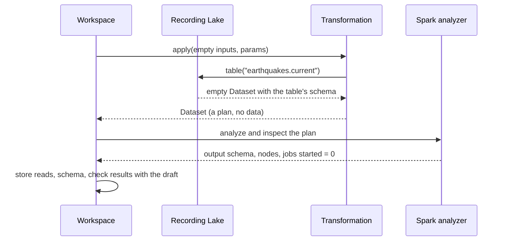

### 6.5 Checks before Catalyst

Catalyst already pushes filters, prunes columns, orders joins and picks broadcast joins. What it cannot fix are mistakes
in the code. The platform finds them on the plan built from empty inputs, deterministically:

| Check                                                            | How it is found                                                                      | Why it matters                                                                                                                            |
|:-----------------------------------------------------------------|:-------------------------------------------------------------------------------------|:------------------------------------------------------------------------------------------------------------------------------------------|
| Actions inside a transformation (`collect`, `count`, `show`)     | Spark jobs started while building the plan must be 0 (a `SparkListener` counts them) | Extra jobs and recomputation (RULE-SP08)                                                                                                  |
| Typed lambdas (`map`, `mapPartitions`, `filter(FilterFunction)`) | `MapElements` or `DeserializeToObject` nodes                                         | Opaque to Catalyst, like a UDF                                                                                                            |
| Non-deterministic expressions                                    | An expression's `deterministic` flag is false                                        | A replayed batch would differ (RULE-F03). Real example: `taxi_trips` makes `tripId` with `uuid()`, deliberately kept out of keys and hash |
| Cross join by accident                                           | A join with no condition                                                             | Row count explodes                                                                                                                        |
| `withColumn` in a loop                                           | Plan depth and size                                                                  | Very slow planning; `withColumns` instead                                                                                                 |
| `cache` without `unpersist`, `coalesce(1)`, a sort in the middle | Plan nodes                                                                           | Memory, lost parallelism, wasted work (RULE-SP09)                                                                                         |
| Aggregation in a silver step                                     | `Aggregate` or `Window` nodes                                                        | It would summarize one micro-batch, not the table: the step belongs in gold                                                               |
| Small lake input                                                 | Size from the Delta log                                                              | A broadcast hint before the run                                                                                                           |

Results are explained in plain words; dangerous ones block the save. The platform rewrites almost nothing on its own:
silently changing someone's code surprises them. Later, rewrites can be added as Catalyst rules through
`SparkSessionExtensions`, the hook Delta itself uses.

### 6.6 Silver or gold

Silver handles each new row once, incrementally, before history. Gold is recomputed on every run. The plan says where a
step belongs:

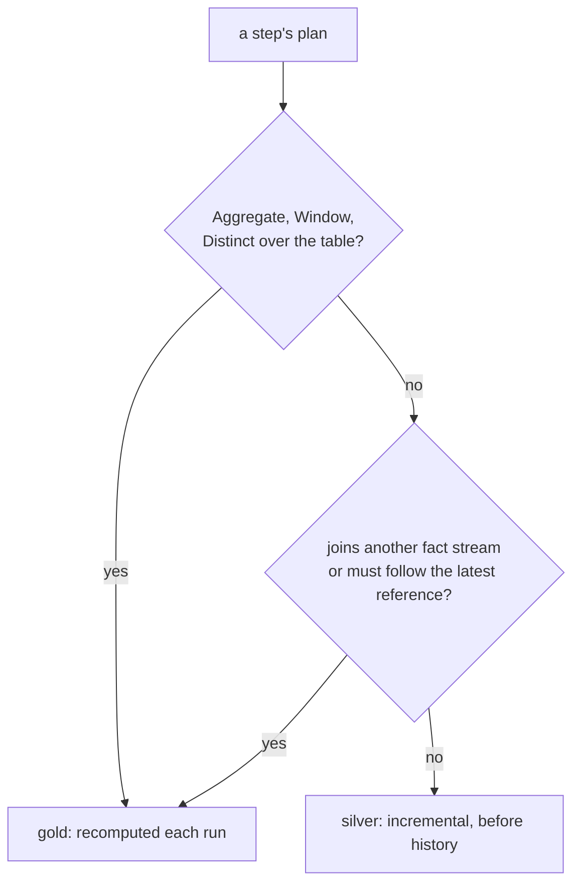

People do not need to know the layers; the editor shows where each step landed and why.

### 6.7 Three meanings of a join

A trip arrives on 1 October and is joined to `taxi_zones` version 5. On 10 October zone 161 is renamed in version 6.

| Meaning                                   | Trip of 1 October shows           | Where                                   | Cost                                                                     |
|:------------------------------------------|:----------------------------------|:----------------------------------------|:-------------------------------------------------------------------------|
| As of processing time (default in silver) | The name from version 5, for ever | Silver                                  | Incremental; same result on replay                                       |
| Latest                                    | The name from version 6           | Gold                                    | Every row recomputed when the reference changes                          |
| As of event time                          | The name valid at the pickup time | Silver, when the other side has history | Joins on `pickupTime BETWEEN z.__START_AT AND z.__END_AT`; deterministic |

The third is possible because DataFlow keeps SCD type 2 history for every dataset.

### 6.8 Compile, load, run

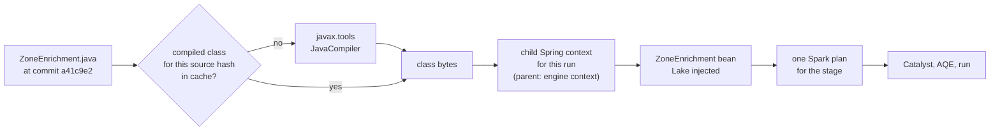

The child context is closed when the run ends. A transformation sees only its own context and the platform's API, never
the engine's internals.

### 6.9 Sharing and versions

A transformation is a catalog object with an owner, like a Unity Catalog function: owner and groups get READ, USE (put
it in a pipeline) or MANAGE. A spec pins a version (`taxi/zone_enrichment@1`); a new version never changes pipelines
that pinned the old one, which matters because a change in silver columns changes history's content hash.

### 6.10 The canvas

The Workspace draws a stage's steps as blocks (React Flow, already used for lineage). Dragging a block from the library
adds a step to the YAML; the YAML stays the truth, the canvas is an editor on it. ADF keeps a text script behind each
visual data flow for the same reason: review, diff and history.

---

### 6.11 The Workspace browser

People never see "Git folders" as a page of their own. Like Databricks, the Workspace has one **Workspace** browser: a
tree on the left (Home for your own items, Shared for the team's), a listing on the right (name, type, owner, modified),
and a **Create** menu where a Git folder is one kind of item next to a pipeline or a file. Opening a file keeps the same
tree on the left and the editor on the right.

Layout rules, everywhere in the Workspace:

| Rule                        | How                                                                                                                                                                                                         |
|:----------------------------|:------------------------------------------------------------------------------------------------------------------------------------------------------------------------------------------------------------|
| One tree                    | A single virtualized tree component (only visible rows are drawn, children load when opened) for the Workspace, the catalog and the SQL editor's schema; same row height, icons, hover and selection colors |
| Panes resize, within limits | Side panels resize by dragging and stop at a minimum width; a handle on the divider collapses a panel entirely                                                                                              |
| The sidebar can disappear   | The menu button hides the sidebar completely, with a short slide; the choice is remembered; narrow windows start without it                                                                                 |
| Colors from tokens only     | Neutral greys, one blue accent, status colors (success, warning, danger) for status only                                                                                                                    |
| Minimal text                | No explanatory sentences on screens; labels, values and status only                                                                                                                                         |

## 7. Identity and access

### 7.1 One login

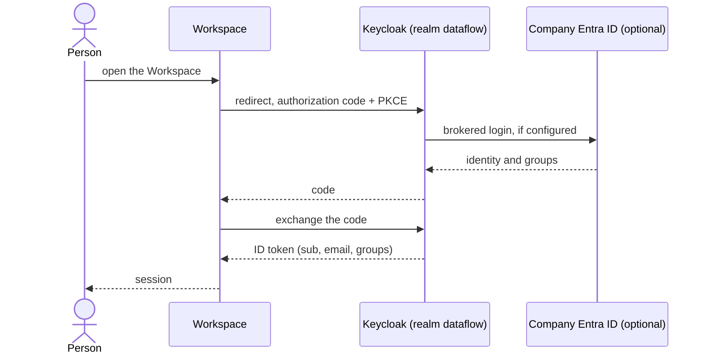

> **Built** on 2026-10-26 for the Workspace (Keycloak 26.7 realm `dataflow`, PKCE, sessions in Postgres, bearer tokens).
> Grafana, the RustFS console and Dagster's UI behind oauth2-proxy come with the Helm chart. How it works
> today: [workspace.md](../workspace.md#signing-in).

OIDC is the standard every provider speaks: the application never sees a password, it receives a signed token. The
Workspace uses Spring Security's OAuth2 login for browsers and bearer tokens for the command line and CI; sessions live
in Postgres so several replicas share them. Grafana and the RustFS console log in through the same realm; Dagster's UI,
which has no login, sits behind oauth2-proxy for administrators. Accepted (D1).

### 7.2 The model

Unity Catalog's model and words, so the knowledge transfers and a later move to Unity Catalog OSS is a copy:

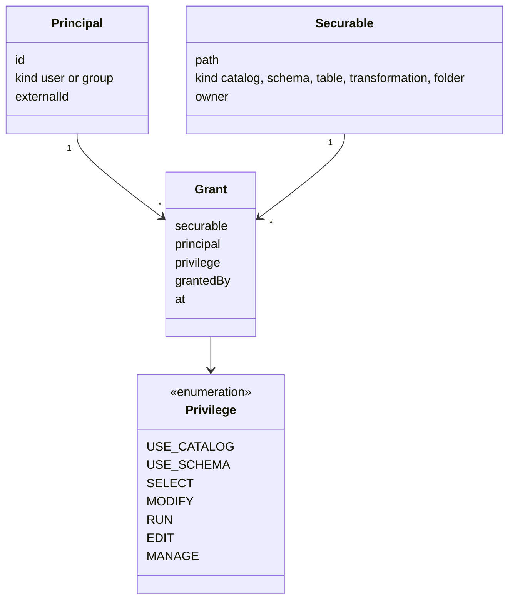

A **catalog** is an environment (`dev`, `prod`), a **schema** a dataset, a **table** a lake table or a published one.
Grants inherit downwards, owners hold everything on what they own, and effective rights are the union of a person's and
their groups' grants, with no deny rules (as Lake Formation and Unity Catalog do).

> **Built** on 2026-10-26: grants on datasets, tables and folders in Postgres with an audit log, checked by the
> Workspace API and applied as ClickHouse roles; people's SQL runs under those roles. Row policies, SQL `GRANT`, and the
> governance repository come later. How it works today: [access.md](../access.md).

### 7.3 Where the rules live (proposed, revises D2)

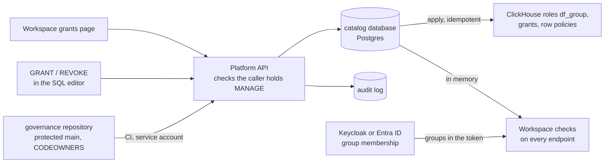

The rules live in the platform's catalog database, like Unity Catalog's metastore. Three ways to change them, all
through one API that checks the caller's own MANAGE right and writes an audit entry. Group **membership** stays in the
login provider: removing someone from a group cuts their access at their next token, no pull request needed.

Why not in project repositories, as first proposed: project repositories belong to their users. An `access:` section
applied on save would let anyone with a repository grant themselves anything, and a commit's author field is free text
that proves nothing. The governance repository is safe because it is protected, reviewed, and applied with an identity
the platform checks.

### 7.4 Where they are enforced

| Place         | How                                                                                                                                                                                                                                                                                                             |
|:--------------|:----------------------------------------------------------------------------------------------------------------------------------------------------------------------------------------------------------------------------------------------------------------------------------------------------------------|
| Workspace API | Every endpoint checks the caller's privileges against the catalog (held in memory) and the token's groups                                                                                                                                                                                                       |
| ClickHouse    | One role per group (`df_analysts`). The Workspace's query user holds every `df_` role but none by default; each request names the person's roles (`role=df_analysts`, ClickHouse 24.4+), so ClickHouse enforces exactly those grants and row policies. `log_comment` carries the person into `system.query_log` |
| Engine runs   | The platform's service identity; RUN is checked before the launch, every `Lake` read is checked against the run owner's grants                                                                                                                                                                                  |
| Dagster       | No direct access for people; its UI behind oauth2-proxy for administrators                                                                                                                                                                                                                                      |
| Dashboards    | Cache entries keyed by table version **and** role set, because two people can see different rows of one table                                                                                                                                                                                                   |

---

## 8. Storage anywhere

One setting, `LAKE_ROOT`, picks the store; everything else follows from it.

| `LAKE_ROOT`                                 | Store                                       | Spark connector | ClickHouse                                     | Credentials on a cloud |
|:--------------------------------------------|:--------------------------------------------|:----------------|:-----------------------------------------------|:-----------------------|
| `s3a://lake`                                | RustFS, MinIO, Amazon S3, any S3-compatible | `hadoop-aws`    | `deltaLake()`, `s3()`                          | IAM role (IRSA on EKS) |
| `abfss://lake@account.dfs.core.windows.net` | Azure Data Lake Storage Gen2                | `hadoop-azure`  | `deltaLakeAzure()`, `azureBlobStorage()`       | Workload identity      |
| `gs://lake`                                 | Google Cloud Storage                        | `gcs-connector` | Through the S3-compatible endpoint (to verify) | Workload identity      |

`LakeFunctions` stays the only Workspace class naming ClickHouse table functions. The engine selects S3A, Azure or
Google connector settings from the roots it reads; the Workspace and serving flow choose S3 or Azure table functions
from `LAKE_ROOT`. Prefixes are handled in file and table reads. This adapter work is built; cloud end-to-end
verification, native Azure/Google release stores and automatic ClickHouse collection configuration are
pending. [Object storage](../object-storage.md) records the current limits.

The Lakehouse dashboard's SQL over `_delta_log` will move into ClickHouse views created by the serving flow, so no
dashboard knows the store. Delta needs no extra log store: one writer per table (RULE-F04) is what makes plain S3 safe.
Each store must still pass what spike S2 checked on RustFS (`timestamp_ntz`, change feed, time travel).

---

## 9. Compute on Kubernetes

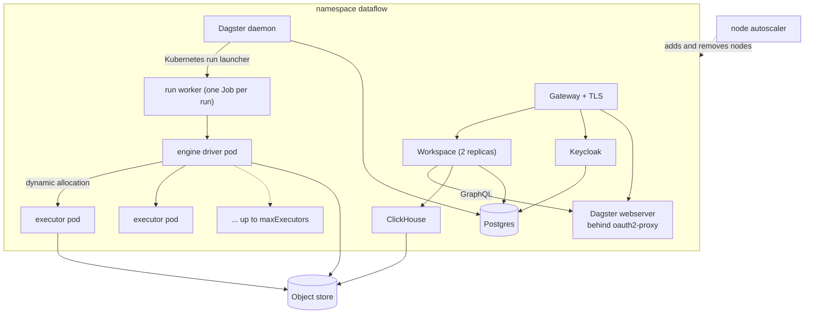

What scales Spark is **dynamic allocation**: the driver asks Kubernetes for executor pods when tasks queue up and gives
them back when idle (`spark.dynamicAllocation.enabled`, shuffle tracking, `minExecutors`, `maxExecutors`), and moves
data off an executor before it goes (`spark.decommission.enabled`). A node autoscaler (Karpenter, Cluster Autoscaler,
GKE Autopilot) adds machines under the pods.

Who starts the driver was decision D3. It was first built with the Spark Operator (A) on 2026-10-28. **Since 2026-10-31
it is B**, by the user's decision: the operator ran `spark-submit`, a Java process, inside itself for every run, which
cost a 768 MiB limit, a webhook, a CRD and a 1.33 GB image on a 5 GB machine, and nothing here used what it adds.
[Kubernetes](../kubernetes.md) describes the run.

|                                           | A. Spark Operator (replaced)                                                   | B. The tower starts the driver (built)                                                 |
|:------------------------------------------|:-------------------------------------------------------------------------------|:---------------------------------------------------------------------------------------|
| How                                       | Dagster creates a `SparkApplication`; the operator starts driver and executors | The run worker creates a Job for the driver; Spark's own Kubernetes scheduler starts executors |
| Extra parts                               | Operator, webhook, CRD                                                         | None                                                                                   |
| Reports to Dagster                        | The run worker reads the driver pod's log                                      | The same                                                                               |
| Resources, autoscaling, any Spark setting | `SparkApplication` fields                                                      | Pod spec + `spark.*` settings, from the spec's `compute:`                              |

Both read the same `compute:` section of a spec. Executors need Spark's launch scripts
under `/opt/spark`, which the distroless engine image does not have: `dataflow-engine-k8s` copies them from
`apache/spark:4.2.0` onto Ubuntu with the engine's Java 21 runtime and jars (503 MB).

```yaml
compute:
  executors: { min: 1, max: 8 }
  executor-memory: 4g
  driver-memory: 2g
  spark-conf:
    spark.sql.shuffle.partitions: "64"
```

---

## 10. Configuration and GitOps

### 10.1 Layers

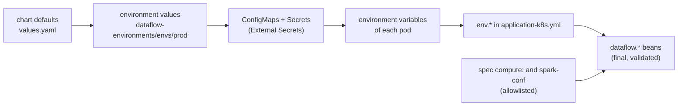

Broadest first, each layer overriding the one before. The v3 rule stays: beans bind only to `dataflow.*`, `env.*` only
feeds them inside the yml files. A Kubernetes profile, `application-k8s.yml` (RULE-S04 lists `k8s`), maps environment
variables, as `application-docker.yml` does for compose. A reference page is generated from Spring's configuration
metadata, so the documentation of every setting cannot drift from the code, and an admin page shows effective values
with secrets masked (G6).

### 10.2 GitOps (accepted)

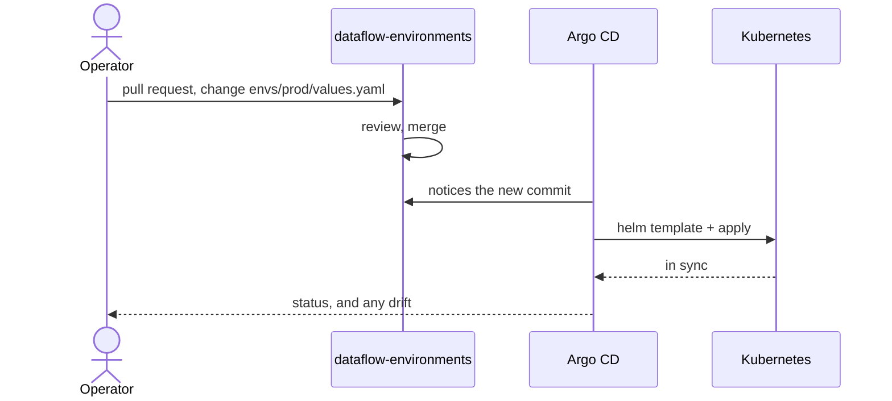

### 10.3 Why not a config server

Spring Cloud Config would serve only the two Spring programs (Workspace, engine); Dagster, ClickHouse, Keycloak and the
object store cannot read it. The engine starts once per run, so a server adds a network call and a failure point to
every run, and RULE-C04 (server up before anything starts) is a startup dependency. GitOps keeps what C02 and C03
wanted (configuration in Git, every change a commit, no secrets in the repository) and retires C01 and C04.

---

## 11. Dashboards and alerts

Generated, not drawn (G9). For every dataset, an overview from its spec and event log: freshness against its own
schedule, run history, rows per layer, rule pass rates, quarantine reasons, column profiles. For every gold and
published table, charts chosen from column roles: a time column gives a time series, a low-cardinality text column gives
bars and a filter, numbers give distributions and sums, keys are never charted. Every chart has "open as SQL". Optional
overrides in the project (`dashboards/<dataset>.yml`) pin, hide or reorder charts.

> **Built** on 2026-10-25: the overview and per-table charts, range, click-to-filter, table view, open as SQL, cache by
> table version. Overrides in `dashboards/<dataset>.yml`, role-keyed cache and Grafana alert listing come later. How it
> works today: [dashboards.md](../dashboards.md).

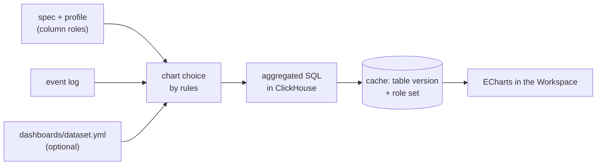

> **Alerts built** on 2026-10-26: lateness against each dataset's own schedule (`serving.schedules`, paused schedules
> excluded), platform health from ClickHouse system tables, firing alerts on the Workspace's Home through a read-only
> Grafana service account. See [dashboards.md](../dashboards.md#alerts).

Grafana stays for **alerting only** (D4, accepted): rules as SQL over ClickHouse, provisioned from files in the chart,
contact points for email, Slack, Teams and webhooks, silences. The Workspace lists firing and recent alerts through
Grafana's API, so nobody opens Grafana's UI (G3).

---

## 12. The pipeline assistant

A person pastes a URL or picks a path; the platform drafts a valid spec with every choice explained, by rules, not by a
language model (G11).

> **Built** on 2026-10-25 for http and https URLs (Create → Pipeline → From source); picking a lake path and reusing the
> inference for a transformation's raw-file inputs come later. How it works
> today: [pipeline-assistant.md](../pipeline-assistant.md).

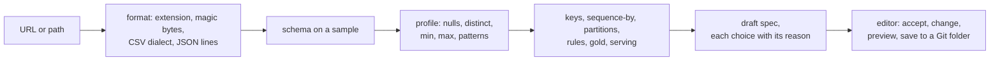

Example from the shipped sources: `yellow_tripdata_2024-01.parquet` has a month in its name, so the draft proposes
`{partition}` with monthly partitions from 2024-01; USGS `updated` is a timestamp later than `time`, so it becomes
`sequence-by`. The same inference reads a transformation's raw-file inputs (section 6.4).

---

## 13. Housekeeping

Built 2026-10-28 (Settings → Maintenance → Clean up, engine `clean` task): [Housekeeping](../housekeeping.md).

The platform lists what it created and no longer needs, with sizes, and removes it after a dry run, on demand or on a
schedule. It only ever touches what carries its labels (`org.dataflow.*`): on this machine, other projects' containers
stay untouched (G7).

| What                                                            | Rule                                                                |
|:----------------------------------------------------------------|:--------------------------------------------------------------------|
| Finished run pods and Jobs                                      | `ttlSecondsAfterFinished`; executors deleted with their driver      |
| Releases                                                        | Keep the last N per project and target, never one a recent run used |
| Git folder caches                                               | Re-fetched on demand, so safe to drop                               |
| Preview results `system/tasks/`, Spark event logs, compute logs | Retention setting each                                              |
| Checkpoints and catalog views of a removed dataset              | Listed, removed after confirmation                                  |

---

## 14. Installing and running

### 14.1 In minutes

```yaml
lake:
  root: s3a://acme-lake
  region: eu-west-1
  pathStyle: false
  ssl: true
rustfs:
  enabled: false
auth:
  mode: oidc
  issuer: https://login.microsoftonline.com/<tenant>/v2.0
  clientId: dataflow
gateway:
  enabled: true
  parentName: public
  hostname: dataflow.acme.internal
```

That is the whole values file for a first install (G5), with the keys of the `dataflow-secrets` Secret listed in the
chart's README; everything else has a default, validated by `values.schema.json`. Built 2026-10-28 and installed on
OrbStack's Kubernetes in 1 min 39 s. The Workspace checks storage, ClickHouse, the tower and the login provider and
explains any failure in plain words (Settings → Checks, and on Home for administrators; built 2026-10-28), then a person
connects a repository or starts from the examples. `helm upgrade` migrates Dagster's database, ClickHouse views and
roles by itself.

### 14.2 Locally

Docker Compose stays in `dataflow-platform` as the development stack, building from source, with Jasypt for secrets, as
today. The same chart also installs on a local Kubernetes (OrbStack has one built in) with RustFS and the bundled
Keycloak, once the Docker VM has the memory (Keycloak alone takes about 1 GB).

---

## 15. From v3 to the target

### 15.1 Order

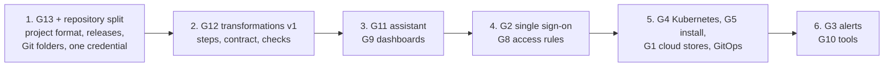

The split comes first because it changes where specs live, how the tower loads them and how the Workspace saves them;
everything after it saves into projects. Transformations share schema inference with the assistant. Login comes before
Kubernetes so the chart is built with login and grants in place. G6 (settings model) and G7 (housekeeping) fit where
they touch.

### 15.2 What moves where

| From                                        | To                                                                      |
|:--------------------------------------------|:------------------------------------------------------------------------|
| `dataflow-platform/pipelines/`              | `dataflow-examples/pipelines/` (with its history)                       |
| The Workspace's mounted checkout and `.git` | Git folders: Postgres + cache                                           |
| The tower's `/pipelines` mount              | Releases in the `releases` bucket                                       |
| `dataflow-monitoring` alert rules           | `dataflow-helm-charts` (Grafana Alerting)                               |
| `dataflow-monitoring` boards                | Generated dashboards (repository archived)                              |
| `dataflow-config-repo`                      | `dataflow-environments`                                                 |
| `docker-compose.yml`                        | Stays in `dataflow-platform` (development) and is mirrored by the chart |

The lake data does not move.

---

## 16. Decisions

Numbered after v3's ADR-01 to ADR-12.

| #      | Decision                                                                                                                                     | Alternative considered                                             | Why this one                                                                             | Status                                                       |
|:-------|:---------------------------------------------------------------------------------------------------------------------------------------------|:-------------------------------------------------------------------|:-----------------------------------------------------------------------------------------|:-------------------------------------------------------------|
| ADR-13 | **Repository split**: platform, charts, environments, examples, users' projects                                                              | One monorepo with pipelines inside                                 | One owner and one rhythm per repository; the big platforms keep customers' content apart | Accepted 2026-10-25; built                                   |
| ADR-14 | **GitOps** with Helm values per environment and Argo CD                                                                                      | Spring Cloud Config                                                | Covers every component, no server on the engine's start path, industry standard          | Accepted 2026-10-25; chart and `envs/local` built 2026-10-28 |
| ADR-15 | **Git folders** kept in Postgres + a per-pod cache, plain Git for every provider                                                             | Clones on a shared volume; ADF-style commits through provider APIs | What Databricks and Snowflake do (control plane); replicas share it; provider-neutral    | Accepted 2026-10-25; built                                   |
| ADR-16 | **Runs pinned to releases** (immutable snapshots of a commit)                                                                                | Run the file on disk (v3)                                          | Every run traceable to reviewed code                                                     | Accepted 2026-10-25; built                                   |
| ADR-17 | **Pipelines as steps**; today's sections become built-in steps                                                                               | Keep fixed sections                                                | Room for custom logic, one Spark plan per stage, backward compatible                     | Proposed                                                     |
| ADR-18 | **Transformations**: Java on Spark's `Dataset` API, one generic method, records for inputs and parameters, Spring beans compiled from source | Jars; UDFs; full classes with hand-written registration            | Optimizable by Catalyst, intuitive for Spring developers, reviewable, lasting            | Proposed                                                     |
| ADR-19 | **Reads through an injected `Lake`**, discovered on empty inputs                                                                             | `spark.read()` anywhere; inputs only from the spec                 | Grants, version pinning, lineage and dependencies without restricting what can be read   | Proposed                                                     |
| ADR-20 | **Checks on the plan before Catalyst**, few rewrites                                                                                         | Our own optimizer; no checks                                       | Catalyst already optimizes; mistakes in code are what it cannot fix                      | Proposed                                                     |
| ADR-21 | **Step placement from the plan**; joins as of processing time in silver by default                                                           | Let people pick the layer                                          | Aggregating in silver is wrong; people should not need to know layers                    | Proposed                                                     |
| ADR-22 | **Keycloak**, or the customer's OIDC provider                                                                                                | ZITADEL, Authentik, Dex                                            | Standard, Java, brokering, transferable concepts                                         | Accepted (D1)                                                |
| ADR-23 | **Access rules in the platform's catalog database**, optional governance repository                                                          | `access:` in each spec (first D2)                                  | Users own project repositories; Git authors prove nothing                                | Proposed (revises D2)                                        |
| ADR-24 | **ClickHouse roles per group, chosen per request** (`role=`)                                                                                 | A ClickHouse user per person                                       | Nothing copied per person; membership changes apply at the next login                    | Proposed (D2)                                                |
| ADR-25 | **Dashboards in the Workspace with ECharts**; Grafana for alerting only                                                                      | Grafana boards, Superset                                           | Same look and login, generated from specs                                                | Accepted (D4)                                                |
| ADR-26 | **Any object store through `LAKE_ROOT`**                                                                                                     | S3-compatible only                                                 | Teams bring the store they have                                                          | Proposed (G1)                                                |
| ADR-27 | **Spark Operator starts the driver on Kubernetes**                                                                                           | Dagster starting the driver pod                                    | The user's preference; Spark runs become Kubernetes resources; both read `compute:`      | Replaced by ADR-28 on 2026-10-31                             |
| ADR-28 | **The tower starts the driver as a Kubernetes Job; Spark's own scheduler starts executors**                                                  | Spark Operator                                                     | No controller, webhook or CRD; a Job already lists runs and removes itself               | Accepted 2026-10-31                                          |

---

## Appendix A: glossary

| Word                       | Meaning                                                                  | Example                                               | Industry term                            |
|:---------------------------|:-------------------------------------------------------------------------|:------------------------------------------------------|:-----------------------------------------|
| Argo CD                    | A program in the cluster that makes it match a Git repository            | Applies `envs/prod/values.yaml`                       | GitOps controller                        |
| Catalyst                   | Spark's query optimizer                                                  | Pushes a filter down to the Parquet read              | Query optimizer                          |
| Chart, values              | A Helm package and its settings file                                     | Chart `dataflow`, `values.yaml`                       | Helm chart                               |
| Control plane, data plane  | What decides and remembers; what touches data                            | Workspace, Postgres; engine, ClickHouse, object store | Same                                     |
| Release (of a project)     | An immutable snapshot of a project at one commit                         | `releases/taxi-analytics/a41c9e2/`                    | Release, bundle deployment               |
| Draft                      | A saved edit not yet committed                                           | Ada's change to `pipeline.yml` before her commit      | Working copy change                      |
| Driver, executor           | Spark's coordinating process; its worker processes                       | One driver pod, up to 8 executor pods                 | Same                                     |
| Dynamic allocation         | Spark asking for executors when busy and releasing them when idle        | `minExecutors: 1`, `maxExecutors: 8`                  | Autoscaling                              |
| Git folder                 | A connected repository in the Workspace, with its branch and drafts      | `Users/ada/taxi-analytics`                            | Databricks Git folder                    |
| GitOps                     | Running a system by committing its desired state to Git                  | Changing `envs/prod` by pull request                  | Same                                     |
| Grant, privilege           | A right given to a group on an object                                    | `SELECT` on `taxi_trips` to `analysts`                | Same                                     |
| Mixin (optional interface) | A small extra interface a class may implement to declare a capability    | `ProvidesExpectations`                                | Capability interface                     |
| OIDC, token                | The login standard; the signed statement of who someone is               | ID token with `groups: [analysts]`                    | Same                                     |
| Project                    | A Git repository of pipelines, transformations, notebooks and dashboards | `taxi-analytics`                                      | Bundle, dbt project                      |
| Role (ClickHouse)          | A named set of grants in ClickHouse, one per group                       | `df_analysts`                                         | Same                                     |
| Row policy                 | A filter ClickHouse adds to every query of a role                        | `region IN ('France', 'Germany')`                     | Row-level security                       |
| Step                       | One block of a stage: built-in or a transformation                       | `zoned`                                               | Transformation step                      |
| Target                     | Where and how a project is released                                      | `dev`, `prod`                                         | Bundle target, dbt target                |
| Transformation             | A user's Java class turning input tables into one output table           | `taxi/zone_enrichment@1`                              | DLT dataset function, Snowpark procedure |

v3's words (bronze, silver, gold, checkpoint, event log, view, copy) are in the v3 document's glossary.

## Appendix B: sources

- Databricks Git folders, limits and storage: <https://docs.databricks.com/aws/en/repos/limits>
- Snowflake Git repositories (repository
  stage): <https://docs.snowflake.com/en/developer-guide/git/git-overview>, <https://docs.snowflake.com/en/developer-guide/git/git-setting-up>
- Azure Data Factory source control and
  publishing: <https://learn.microsoft.com/training/modules/operationalize-azure-data-factory-pipelines/3-manage-source-control-solutions>
- Unity Catalog privileges and
  inheritance: <https://docs.databricks.com/aws/data-governance/unity-catalog/access-control>
- ClickHouse HTTP interface (`role` parameters): <https://clickhouse.com/docs/interfaces/http>
- ClickHouse and Delta Lake on S3, Azure, GCS: <https://clickhouse.com/docs/integrations/deltalake>
- Keycloak memory and CPU sizing: <https://www.keycloak.org/high-availability/concepts-memory-and-cpu-sizing>
- Kubeflow Spark Operator (Red Hat
  build): <https://docs.redhat.com/en/documentation/red_hat_openshift_ai_self-managed/3.5/html/creating_distributed_data_processing_applications_with_the_kubeflow_spark_operator/overview-of-kubeflow-operator_data-processing>
- Checked on this machine on 2026-10-25: `jdk.compiler` in `dataflow-engine:latest`; `Dataset` abstract in
  `spark-sql-api` 4.2.0; Spark 4.2 SQL functions (`CREATE TEMPORARY FUNCTION … RETURN`) and a barycentric projection in
  plain gold SQL, both run on a local Spark 4.2 session.
