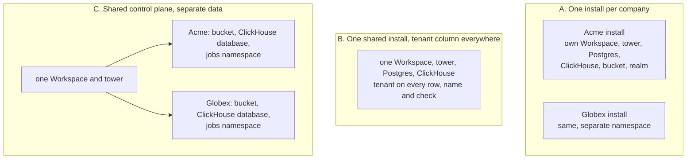
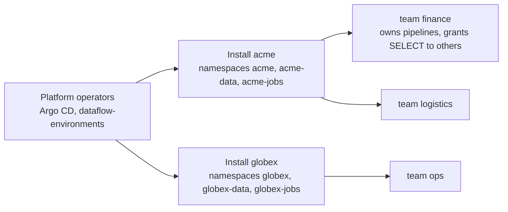

# Tenancy: teams and companies on DataFlow

**Status: accepted on 2026-10-30, as Databricks does it.** Databricks gives each customer company its own account, with
workspaces inside it and Unity Catalog grants on top; nothing is shared between two customers' accounts. DataFlow does
the same: **one install per company**, and **teams inside an install** through groups, grants and team ownership
(the plan below). Asked 2026-10-29: "isolation is mandatory"; 2026-10-30: "multi users, split accesses, teams, users,
companies".

## Words used here

| Word     | Meaning                                                                                       | Example                                         |
|:---------|:----------------------------------------------------------------------------------------------|:------------------------------------------------|
| Tenant   | A party whose data must never be seen by another party, not even by mistake                   | the companies Acme and Globex on one platform   |
| Team     | A group of people inside one tenant who own some pipelines and share them with other teams     | Acme's `finance` and `logistics` teams          |
| Install  | One running copy of DataFlow: its Workspace, tower, Postgres, ClickHouse, lake and sign-in     | the Helm release `dataflow` in namespace `acme` |
| Boundary | What stops one tenant from reading another's data: a check in code, or a separate component   | a grant check in the Workspace; a bucket        |
| Leak     | Any way data, names or activity of one tenant reach another: a query, a list, a log, a board   | a run list that shows Globex's dataset names    |

## What exists today

One install serves one organisation. Inside it, [grants](../access.md) decide who reads, runs and changes what: a
group gets `SELECT` on a dataset, `RUN` to start it, `EDIT` on a Git folder. The Workspace checks every request,
ClickHouse enforces the same grants for SQL, RustFS policies scope the storage console, and Dagster, Grafana and
Mailpit are for administrators only because they cannot check grants per person.

That is enough for **teams**. It is not enough for **companies**: several components are shared by everyone in the
install and hold every tenant's data or metadata at once.

| Shared component        | What a tenant could see of another tenant without extra work                               |
|:------------------------|:-------------------------------------------------------------------------------------------|
| Dagster (tower)         | every run, log, asset and schedule; its UI has no login of its own                         |
| Grafana                 | every board, one ClickHouse datasource for everything                                      |
| ClickHouse              | `system.query_log`, `system.tables` and errors that name other tenants' tables             |
| Postgres                | Workspace tables (folders, saved queries, grants, audit) with no tenant column             |
| Lake bucket             | one bucket; prefixes per dataset, not per tenant                                           |
| Keycloak                | one realm; group names of every tenant in one list                                         |
| Administrators          | `admins` hold every right in the install                                                    |

## Options

| Question                                   | A. Install per company                    | B. Shared install                            | C. Shared control, separate data             |
|:-------------------------------------------|:------------------------------------------|:---------------------------------------------|:---------------------------------------------|
| What stops a leak                          | separate components; nothing to forget    | a check in every query, list and log         | separate data; checks in Workspace and tower |
| Leak if one check is missing               | none                                      | yes                                          | metadata yes (names, runs), data no          |
| Dagster, Grafana                           | one each per company, its admins only     | must stay platform-only                      | must stay platform-only                      |
| Memory at rest (measured 2026-10-30)       | ~1.3 GB per company on Compose            | ~1.3 GB in all, plus tenant overhead         | ~1.3 GB plus a little per company            |
| Work to build                              | Helm values per company, a tenant list    | tenant id in every table, securable, name, cache key, log | tenant in securables, storage and ClickHouse names, tower scoping |
| Upgrades                                   | one per install (Argo CD rolls them)      | one                                          | one                                          |
| Familiar from                              | Databricks workspaces, Snowflake accounts | most SaaS apps                               | Databricks account + Unity Catalog metastores |

## Recommendation

Two levels, each with the boundary that fits it:

1. **Companies get their own install (A).** Isolation is mandatory and A is the only option where a forgotten check
   cannot leak anything: Dagster, Grafana and ClickHouse's system tables simply hold one company's data. The Helm chart
   already puts each install in its own namespaces, `dataflow-environments` already keeps one folder of values per
   install, and Argo CD already rolls them out, so a new company is a new folder of values, a bucket and a realm. Each
   company gets its own administrators; platform operators see installs, not data.
2. **Teams share their company's install (grants, built).** What is missing is ownership: a pipeline, a Git folder and a
   project belong to a team (`owner: finance` in `dataflow.yml`), the owning team gets `MANAGE` on release, the
   Workspace tree shows team spaces (`Shared/finance`), and lists can be filtered by team.

C stays the path for many small companies on one platform (SaaS), when the cost of one control plane each matters more
than the extra checks; B is not recommended because one missing `WHERE tenant = ?` leaks data.

## Plan

| Step | What                                                                                                           | Size |
|:-----|:---------------------------------------------------------------------------------------------------------------|:-----|
| 1    | `dataflow-environments`: one folder per company with its values (bucket, realm, admins group, quotas); a script that creates a company (bucket, realm from a template, secrets) | M |
| 2    | Install two companies on OrbStack Kubernetes and prove the boundary: a person of one cannot sign in to the other, list its datasets or read its bucket | M |
| 3    | Team ownership: `owner` of a pipeline and a project is a team group; release grants it `MANAGE`; Workspace filters by team | M |
| 4    | Done: a Shared folder can be created with a team as manager; lists by team are still to do                                                     | S    |
| 5    | Done: who granted, ran and released what, CSV export; reads are in `system.query_log`                                        | S    |

## What is decided already, whatever the option

- One authorization model ([access.md](../access.md)): principals, securables, privileges, grants, additive, audited.
- Tools that cannot check grants per person (Dagster, Grafana, Mailpit, ClickHouse console) stay administrator-only;
  everyone else works through the Workspace.
- Grant checks scale: each Workspace replica keeps grants indexed by person and group and reloads changes made by other
  replicas within `access.refresh-every`.

## Open questions

1. Will one platform host many small companies (C is cheaper) or a few large ones (A)?
2. May platform operators read a company's data to help it, and if so, with what audit?
3. Should a person belong to several companies with one login (one realm, groups per company) or one login per company
   (one realm each, simplest isolation)?
