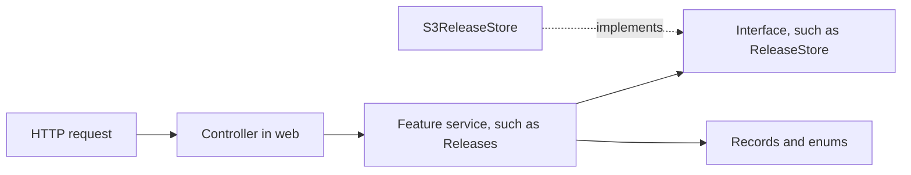

# Code standards

These rules bind everyone who changes code in any DataFlow repository: people and every AI agent. They exist so the code
reads as if one careful person wrote it, whichever model or session touched it last. They work with
[Hardcoded values](literals.md) and [UI standards](ui-standards.md).

*Elegant* has a plain meaning here: a new reader understands the code in one pass, and nothing is left to remove. Clever
code that needs a second read fails this test, however short it is.

## When rules pull apart

Decide in this order:

1. It works, and a test proves it.
2. It says what it means.
3. Each fact lives in one place.
4. It has the fewest parts that still do the first three.

Two more rules settle most arguments:

- **Build for today.** No option, layer, interface or parameter without a use today. Code that is more general than the
  problem costs every later reader, and the future it prepares for rarely arrives.
- **Match the file you are in.** Where this page asks for more than the file does, new code follows this page and the old
  code gets a task of its own. Do not mix a cleanup into a feature.

## Where code goes

Arrows are dependencies, and they never point back: nothing outside `web` imports `web`. A controller turns HTTP into one
service call and has no rules of its own. A service holds the rules and does not know about HTTP. A store talks to the
outside world and holds no rules. Packages follow features (`queries`, `uploads`, `runs`), so one feature changes in one
place.

## SOLID

Five rules for classes that stay easy to change.

| Principle | What it means | Here | Reject |
|:----------|:--------------|:-----|:-------|
| Single responsibility | A class has one reason to change | `UploadController` speaks HTTP; `LakeUploads` stores the file | A controller that builds storage keys |
| Open/closed | A new case is new code or data, not an edit of what works | A new dataset is a new `pipeline.yml`; a new status is one row in `TONES`; a new flow implements `Flow` | A growing `if` over a type name |
| Liskov substitution | Every implementation keeps the promise of its interface | Every `Flow` runs and reports the same way | An implementation that throws `UnsupportedOperationException` |
| Interface segregation | Callers depend only on what they use | `FavoriteStore`, `QueryAlertStore`: one small interface per feature | One `Store` with every query |
| Dependency inversion | Rules depend on an interface; the wiring picks the implementation | `Releases` takes a `ReleaseStore`; Spring supplies `S3ReleaseStore` | `new S3Client` inside a rule |

## GRASP

Nine questions for deciding which class gets a job. *Coupling* is how much one part must know about another; keep it low.
*Cohesion* is how much the contents of one part belong together; keep it high.

| Pattern | The question it answers | Here |
|:--------|:------------------------|:-----|
| Information Expert | Who does this? Whoever already holds the data | `PipelineSpec.silverSchema()`, `Lake.uploadsOf()`, `lib/status.ts` |
| Creator | Who makes this object? Whoever contains it or holds what it needs | `FlowGraphs` builds each `FlowGraph` |
| Controller | Who takes a request first? A thin object at the edge | `web/*Controller`, `EngineCommand` |
| Low Coupling | Which choice adds the fewest dependencies? | `dataflow-engine-core` has no Spring; the Workspace reads the lake only through ClickHouse |
| High Cohesion | Does this belong with what is already here? | One package per feature |
| Polymorphism | Behaviour varies by type? Put it on the type or in a table | `Flow` implementations; `Record<Tone, …>` tables in the UI instead of `switch` |
| Pure Fabrication | Nothing in the domain fits? Make a class that keeps the others clean | `ScdMerge`, `QueryAlertChecks`, `ClickHouse` |
| Indirection | Two sides must not know each other? Put one thing between them | `Tower` hides GraphQL; `api/client.ts` hides HTTP |
| Protected Variations | Something will change? Wrap it behind a stable face | `ReleaseStore`; `icons.tsx` hides the icon library |

Add a wrapper only at a point that really varies. Protecting something that never changes is over-engineering.

## Don't repeat yourself

- Repetition means one *fact* written twice, not two lines that look alike. Layer names live in `Layer`, routes in
  `lib/links.ts`. When a fact has two homes they drift apart.
- Code that looks alike but changes for different reasons stays apart. Wait for the third real copy before extracting.
- The wrong abstraction costs more than duplication. A shared function that grows a flag for each caller has failed: copy
  it back into its callers, remove what each one does not use, and only then look for what is really shared.
- A helper holds a whole idea. `startedBy(person)` in `RunService` replaced repeated tags. A constant holding a sentence
  fragment does not count; see [Hardcoded values](literals.md#two-mistakes-to-avoid).

## Values

No hardcoded or magic values. [Hardcoded values](literals.md) has the decision and the finder. In short: what someone
running an install would change is a setting; what several places share has one owner beside its concept; what is unclear
gets a name in its file; what is clear stays. There is no global `Constants` class.

## Names

- Use whole words that say what a thing is. `startedBy(person)`, not `buildTagMap(p)`.
- A class is a role: `ReleaseStore`, `QueryAlertChecks`. Never `Manager`, `Helper`, `Util`, `Impl`, `Base`; none exists
  today.
- A method that acts is a verb: `store`, `launch`. A method that answers is a noun: `partitions`, `spec`.
- A boolean reads as yes or no: `partitioned()`, `fullRefresh`.
- One thing has one word in Java, the API and the UI: `dataset`, `run`, `partition`.
- Use plain names, never the airport metaphor.

## Size

Limits stop the worst cases; the aim is what good code looks like. Split by meaning, never just to pass a limit.

| Thing | Aim | Build fails above |
|:------|:----|:------------------|
| Function or method | 30 lines | Java 60 |
| Parameters of a method or constructor | 3 | Java 7, UI 5, Python 6 |
| Paths through a function (*cyclomatic complexity*) | 10 | Java 15, Python 10 |
| Nesting | 2 levels | UI 4 |
| File | One concern | Java 500 lines, UI component 350, other TypeScript 600 |

The fields of a record are not parameters. A constructor with more than seven dependencies is a class doing too much.

## Functions and classes

- One function does one thing at one level of detail. Return early instead of nesting.
- A method either changes something or answers a question, not both.
- Keep logic pure and side effects at the edge: `LakeUploads.safeName` is pure and tested; `store` does the writing.
- Give everything the smallest visibility that works. Package-private is enough for a test.
- Compose objects instead of inheriting. There is no `Abstract*` or `Base*` class today.
- Dependencies arrive through the constructor (RULE-G05).

## Types and data

- Records for data, enums for closed sets. `Map<String, Object>` and plain strings stop at the JSON or YAML edge.
- Check input once at the edge; inside, trust the types.
- Prefer immutable values: records, `List.of`, `final`. Do not change what you were given.
- A public method that may have no answer returns `Optional`, not `null`.

## Errors

- Fail early, and say what happened and what to do: `dataset + " is partitioned; pick a partition"`.
- Never swallow an error; an empty `catch` fails the build.
- Catch only where you can act, with the narrowest type. `catch (Exception)` is for a boundary that turns any failure into
  a report, as `SetupChecks` does.
- A mistake the person can fix reaches them as a sentence (`IllegalArgumentException` becomes a 400 in `ApiErrors`). Stack
  traces and secrets never reach them.

## Comments and docs

No comments in code; the build rejects comment lines in Java, UI and Python source, tests aside. A name that needs a
comment is a name to change. Reasons and design go in
`docs/` as plain language with mermaid diagrams, updated in the same change as the behaviour.

## By language

**Java.** The [engineering rules](engineering-rules.md) apply. `@ConfigurationProperties` records, never `@Value` or `@Autowired`
(RULE-S01, RULE-S02). No SQL strings: jOOQ repositories build every query. The engine uses `Dataset<Row>` only, with pure
transformations (RULE-SP03, RULE-SP04). Use a stream when it reads better than a loop, and a loop otherwise.

**TypeScript and React.** Named exports only; no `any`, use `unknown` at the edge and narrow it. Components and hooks are
pure: same input, same output, no side effects while rendering. An Effect only synchronises with something outside React:

| Need | Do this, not an Effect |
|:-----|:-----------------------|
| A value computed from props or state | Compute it while rendering; `useMemo` only if measured slow |
| Reset state when a prop changes | Give the component a `key`; when it must stay mounted, keep the previous prop in state and adjust while rendering |
| Reset a form when its dialog closes | `FormModal`'s `onClosed`, so the text stays while the dialog fades out |
| Read the latest props inside an Effect or a listener it starts | `useEffectEvent`, never a ref written during rendering |
| React to a click or submit | Put it in the event handler |
| Tell the parent | Call its callback from the same handler, or lift the state up |
| Load data | A hook from `api/hooks` |
| Act once on a link (`/sql?q=`, `/admin?github=`) | A route `loader` reads it at navigation; the page adjusts state while rendering from `useLoaderData`, or the loader redirects |

Logic goes in `lib/` as pure, tested functions; components only render. See [UI standards](ui-standards.md).

**Python.** Dataclasses over dicts, one concern per module, settings read in one place, full type hints on public
functions.

**SQL.** Gold queries in specs are plain and readable. In ClickHouse give a derived value its own alias, because an alias
shadows a column of the same name.

**Compose, charts and shell.** Settings live in `settings.env` or chart values, secrets in `.env` or a secret store, never
in Git.

## Tests

- Every change of behaviour comes with a test that fails without it.
- The name states the behaviour: `aFileNameCannotLeaveItsFolder`. One behaviour per test.
- Test what callers see, not private details. No tests for getters or wiring.
- Use AssertJ in Java. Tests are code: the same care applies.
- GitHub runs the suites on every push. Read the result with `gh run`.

## What the build enforces

Value rules are listed in [Hardcoded values](literals.md#what-the-build-enforces). On top of those:

| Rule | Tool |
|:-----|:-----|
| Java method length, parameters, complexity, file length | Checkstyle, `checkstyle.xml` |
| Parameters of constructors Lombok writes (`@RequiredArgsConstructor`), which Checkstyle cannot see | `ConstructorParametersTest` in the engine, over every main class of the engine, engine core and spec |
| Java comments, `@Value`, `@Autowired`, `System.out`, `printStackTrace`, empty `catch`, star or unused imports | Checkstyle |
| UI file length, parameters, nesting, `any`, default exports | ESLint, `ui/eslint.config.js` |
| UI `fetch` outside `api/client.ts`, raw routes, palette colour names, `notifications` outside `components/notify`, icon library or Mantine buttons outside their wrappers | ESLint |
| React rules of hooks, Effect dependencies, `setState` in an Effect, refs or impure calls while rendering | ESLint, `eslint-plugin-react-hooks` |
| Python complexity, parameters, unused code, likely bugs, commented-out code | Ruff, `ruff.toml` |
| UI and Python comments | `.github/workflows/ci.yml` |

Everything else is checked in review. Never silence a rule or raise a limit to get a change through: fix the code, or ask
the owner of the project first. If a rule makes one case worse, break it on purpose and say why in the commit body.

## Before you commit

Read your own diff in this order:

1. **Design.** Do the pieces fit, and does each job sit in the right class?
2. **Behaviour.** Does it do what was asked, including when it fails?
3. **Complexity.** Could a new reader follow it quickly? Is anything there for a future that may not come?
4. **Tests.** Would they fail if this broke?
5. **Names.** Does each one say what the thing is?
6. **Repetition and values.** Is any fact written twice? Any magic value left?
7. **Consistency.** Does it look like the code around it?
8. **Docs.** Did `docs/` change with the behaviour?

## Sources

- [Beck's rules of simple design](https://martinfowler.com/bliki/BeckDesignRules.html), Martin Fowler: the order above.
- [What to look for in a code review](https://google.github.io/eng-practices/review/reviewer/looking-for.html), Google: complexity, over-engineering, consistency, the review order.
- [The wrong abstraction](https://sandimetz.com/blog/2016/1/20/the-wrong-abstraction), Sandi Metz: when duplication is cheaper.
- [GRASP](https://handin-ps.informatik.uni-tuebingen.de/teaching/ss18/se/5_grasp.pdf), lecture notes after Craig Larman's *Applying UML and Patterns*.
- [TypeScript style guide](https://google.github.io/styleguide/tsguide.html), Google: names, `unknown`, named exports.
- [You might not need an Effect](https://react.dev/learn/you-might-not-need-an-effect) and [Rules of React](https://react.dev/reference/rules): the table above.
