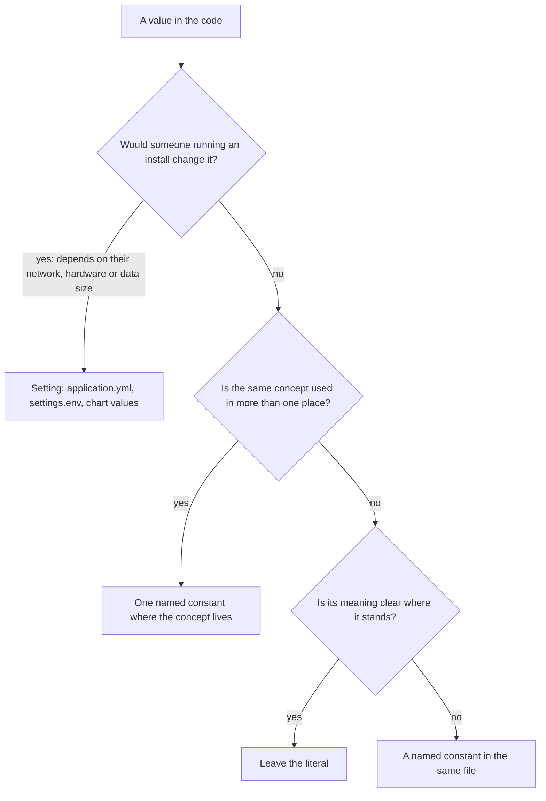

# Hardcoded values: the rules and the finder

A *literal* is a value written straight into code, such as `5000` or `"silver"`. A *magic value* is a literal whose
meaning you cannot tell from where it stands. This page says when a literal is fine, when it must move, and how the
build keeps it that way. It is for anyone adding code or reviewing a change.

## Run the finder

From `dataflow-platform`:

```bash
python3 scripts/find-literals.py
```

It prints a count per kind in about 16 seconds. It needs `mvn`, `npm` (run `npm ci` in `apps/dataflow-workspace/ui`
once) and `uvx`. On a clean checkout run `mvn install -DskipTests` once, because Checkstyle reads the sibling modules.

| Command                                                  | What it does                                            |
|:---------------------------------------------------------|:--------------------------------------------------------|
| `python3 scripts/find-literals.py --list ui-string`      | Prints each finding of a kind, or of every kind starting so |
| `python3 scripts/find-literals.py --check`               | Fails when a kind has more findings than the baseline   |
| `python3 scripts/find-literals.py --check --scans-only`  | The same, without the four tools below (needs Python only) |
| `python3 scripts/find-literals.py --update-baseline`     | Writes today's counts to `scripts/literals-baseline.json` |

## Where a value belongs



| Kind of value      | Example                                             | Where it goes                                    |
|:-------------------|:----------------------------------------------------|:-------------------------------------------------|
| Operator setting   | `dataflow.engine.sources.timeout`: 10 minutes       | `dataflow.*` in `application.yml` from `env.*`; chart values; see [settings](../settings.md) |
| Reused domain value | Layer names, flow names, event types               | One owner: `Layer`, `FlowNames` and `EventTypes` in `dataflow-spec`, `PAGE` in `lib/links.ts` |
| Library name       | `"Authorization"`                                   | The library's own: `HttpHeaders.AUTHORIZATION`, Python `HTTPStatus` |
| Design value       | A font size, a corner radius, a gap                 | The scale in `theme.ts`: `gap="snug"`, `var(--mantine-font-size-small)` |
| Single-use value   | `KeyGuess`'s 0.95                                   | A name in that file: `NEARLY_UNIQUE`             |
| Clear literal      | `padding: 6px 10px`, `w={120}`, `fw={600}`          | Stays                                            |

Things that stay, and why:

- **0, 1, 2, -1 and 100.** A name would add nothing.
- **CSS layout pixels and single column widths.** `--df-space-6` would be the same number with a longer name.
- **A default value of a parameter or a field.** `height = 420` is already named by its parameter.
- **JSON, GraphQL and SQL field names used a couple of times, UI labels, TypeScript union members** (the compiler checks
  those), **SVG drawings, palette files, formulas (`lib/tween.ts`), tests.**
- **Values shared across languages.** `pipeline.yml`, the name length 63, `dagster/*` tags and the row limits exist in
  Java, Python and TypeScript because those programs share no code. They stay in each language; change them together.

### Two mistakes to avoid

Naming is not automatically better. `private static final String ABOVE = " is above the install's limit of "` reads
worse than the sentence it came from. When text repeats, write a helper that holds the whole sentence (`aboveLimit`),
not a constant holding a fragment. A constant called `PERCENT = 100` or `FIT = 1` adds nothing either.

A class of unrelated constants is not a cure. There is no global `Constants` class on purpose: each value lives beside
the concept it belongs to.

## What the build enforces

Rules with a clear answer fail the build at zero findings. Repeated strings cannot be judged by a machine: some are real
duplicates and some are only the same word, so those can only go down.

| Rule | Tool | Runs in | Allowed |
|:-----|:-----|:--------|:------|
| Java numbers outside a named constant (`MagicNumber`) | Checkstyle, `checkstyle.xml` | `mvn verify` | 0 |
| The same Java string 3 or more times in a file (`MultipleStringLiterals`) | Checkstyle | `mvn verify` | 0 |
| UI numbers in code, JSX and style objects, hex colours, raw durations | ESLint, `ui/eslint.config.js` | `npm run lint`, CI | 0 |
| Raw `font-size`, `border-radius`, hex outside a CSS variable | Stylelint, `ui/stylelint.config.js` | `npm run lint`, CI | 0 |
| Magic comparison values, temporary paths, open binds in Python | Ruff, `ruff.toml` | CI | 0 |
| Python numbers outside a named constant or field | `scripts/find-literals.py` | CI, may not grow | 0 |
| The same image version in `dataflow-local` and the chart disagrees | `scripts/find-literals.py`, when both checkouts sit side by side | Locally | 0 |
| Strings repeated in a file or across 3 or more files | `scripts/find-literals.py` | CI, may not grow | the baseline |
| Same constant name and value in several files | `scripts/find-literals.py` | CI, may not grow | the baseline |
| Constants that look like settings (limits, timeouts) | `scripts/find-literals.py` | CI, may not grow | the baseline |

When `--check` fails on a kind that may not grow, read the new finding with `--list`. If it is a real duplicate, fix it.
If it is only the same word, run `--update-baseline` and commit the new count with your change, so the review sees it.

## The design scale

Spacing, type and corners come from `theme.ts`. Mantine turns each key into a prop value and a CSS variable, so
`gap="snug"` and `gap: var(--mantine-spacing-snug)` are the same 6 pixels.

| Scale   | Keys, in pixels |
|:--------|:----------------|
| Spacing | `tight` 4, `snug` 6, `cozy` 8, `xs` 10, `sm` 12, `md` 16, `lg` 20, `xl` 32, `block` 40, `section` 48, `hollow` 56, `full` 64 |
| Type    | `micro` 10, `caption` 11, `xs` 12, `sm` 13, `md` 14, `lg` 16, `xl` 20, `display` 28 |
| Corners | `xs` 2, `sm` 4, `md` 6, `lg` 10, `xl` 999 (fully round) |

The type scale had seventeen sizes, several half a pixel apart; the [UI review](../design-review/UI-UX-REVIEW.md#proposed-design-system)
merged them into eight, one per role, and the nine corner radii into five. Use `sm` for body text, `xs` for secondary
text and table headers, `xl` for page titles, and `micro` only for count pills.

## What the first sweep did

Run on 2026-10-31.

| Kind | Before | After |
|:-----|-------:|------:|
| Java numbers | 13 | 0 |
| Java strings, 3 or more times in a file | 67 | 0 |
| Python numbers | 18 | 0 |
| UI numbers in code | 113 | 0 |
| UI numbers in JSX and styles, raw durations | 325 | 0 |
| CSS font sizes and radii | 112 | 0 |
| Strings repeated in a file or across files | 336 | 294 |
| Constants repeated across files | 39 | 30 |
| Constants that look like settings | 67 | 57 |

About 200 JSX numbers and all 270 CSS layout values were not changed: the rules no longer flag them, for the reasons
above. All 27 hex colours in CSS were the definitions of CSS variables, which is where colours belong.

New settings: `dataflow.engine.sources.timeout` and `connect-timeout`, `dataflow.engine.serving.timeout` and
`connect-timeout`, `dataflow.workspace.http.connect-timeout` and `probe-timeout`, `alerts.timeout`,
`git.github.timeout`, `serving.dashboard-rows`, `tower.max-output`; on the tower `SMTP_TIMEOUT` and the chart's
`spark.startupTimeoutSeconds` and `spark.runTimeoutSeconds`. The SQL editor's limit now follows the existing
`serving.max-rows`. Defaults kept today's values, so nothing behaves differently until someone changes one.
