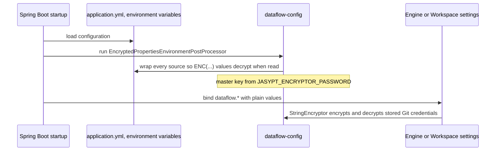

# Security scan fixes and the Spring Boot 4 upgrade

This page explains what the code scanner found in October 2026, what was changed, and why each change was made the way
it was. It is for anyone reviewing a dependency upgrade or reading a new scan report.

## The scanner

[Qodana](https://www.jetbrains.com/qodana/) is JetBrains' code scanner. The workflow
`.github/workflows/qodana_code_quality.yml` runs it on every pull request and on `master`. It reports two kinds of
problems:

- **Inspections**: patterns in our own code, such as a file path built from text that came in an HTTP request, or a
  method that has grown too long.
- **Vulnerable libraries**: a library version (often a *transitive* one, pulled in by another library rather than
  declared by us) that has a published vulnerability. Each vulnerability has an ID: a **CVE** (Common Vulnerabilities
  and Exposures, the public catalogue), or a `WS-` ID from Mend.io's own database, which Qodana uses.

The report is a SARIF file (a standard JSON format for analysis results). The workflow keeps it for 90 days as the
artifact `qodana-report` of each run; download it with `gh run download <run id> --name qodana-report`.

## What the scans found

| Scan                                      | Commit    | Findings                                                                                                          |
|:------------------------------------------|:----------|:------------------------------------------------------------------------------------------------------------------|
| `master`, 2026-10-27                      | `c0fc148` | 212: 192 vulnerable libraries, 14 path checks, 6 maintainability                                                  |
| This pull request, first pass, 2026-10-28 | `404130f` | 18: 6 vulnerable libraries, 12 code warnings from the Boot 4 move (deprecated APIs, null safety, one long method) |

The library count is high because one library is counted once per module that pulls it in: `jackson-databind` 2.21.4
alone was reported 18 times. The 192 findings came from 47 distinct library versions, 46 Java and 1 in the UI.

## Why Spring Boot 4

Most of the library findings were Spring Framework 6.2, Spring Security 6.5 and Tomcat 10.1, which Spring Boot 3.5
brings in. Spring publishes the free fixes for these only in its newest line; the fixes for the 6.x line are for paying
support customers. For example, the [advisory for CVE-2026-47884](https://spring.io/security/cve-2026-47884) lists 7.0.9
as the only open-source fix and 6.2.20 as "Enterprise Support Only". Staying on Boot 3.5 would have meant keeping known
vulnerabilities, so both applications moved to Spring Boot 4.1.2, which brings Spring Framework 7.0.10, Spring Security
7.1.2 and Tomcat 11.0.27.

What Boot 4 changed for us:

| Change                                                                                                                     | Before                                                                                               | Now                                                                                                                                                  |
|:---------------------------------------------------------------------------------------------------------------------------|:-----------------------------------------------------------------------------------------------------|:-----------------------------------------------------------------------------------------------------------------------------------------------------|
| Boot splits its auto-configuration into one module per technology; a technology is set up only when its starter is present | `spring-boot-starter-web`, `spring-boot-starter-oauth2-client`, `spring-session-jdbc`, `flyway-core` | `spring-boot-starter-webmvc`, `spring-boot-starter-security-oauth2-client`, `spring-boot-starter-session-jdbc`, `spring-boot-starter-flyway`         |
| The interface that lets a library change configuration before the application starts moved                                 | `org.springframework.boot.env.EnvironmentPostProcessor`                                              | `org.springframework.boot.EnvironmentPostProcessor`                                                                                                  |
| HTTP 422 has its standard name (RFC 9110)                                                                                  | `HttpStatus.UNPROCESSABLE_ENTITY`                                                                    | `HttpStatus.UNPROCESSABLE_CONTENT` (same code, 422)                                                                                                  |
| Null annotations follow [JSpecify](https://jspecify.dev), the common standard Spring 7 uses                                | Checker Framework's `@NonNull`                                                                       | `org.jspecify.annotations.@NonNull` / `@Nullable`; `dataflow-config` declares its whole package `@NullMarked` (everything is non-null unless marked) |
| JSON library                                                                                                               | Jackson 2 (`com.fasterxml.jackson`)                                                                  | Jackson 3 (`tools.jackson`) in the Workspace; see below                                                                                              |

### Jackson 3 in the Workspace

Jackson is the library that turns Java objects into JSON and back. Boot 4 uses Jackson 3, whose classes live in the new
package `tools.jackson`. The Workspace now uses Jackson 3 everywhere: for its HTTP API and for reading answers from
Dagster, ClickHouse, Grafana and GitHub.

Jackson 3 changed some defaults. `spring.jackson.use-jackson2-defaults: true` in the Workspace's `application.yml` keeps
the JSON the browser sends and receives exactly as before: times as text (`"2026-10-27T00:00:00Z"`), unknown fields
ignored, a missing number read as `0`. `JsonConfigurationTest` checks all three.

Two behaviours differ when reading a JSON tree, checked against both versions:

| Call                                                   | Jackson 2 | Jackson 3                  |
|:-------------------------------------------------------|:----------|:---------------------------|
| `asText()` / `asString()` on a JSON `null`             | `"null"`  | `""`                       |
| `asLong()` on text that is not a number, such as `"x"` | `0`       | throws `JsonNodeException` |

Parse errors are now unchecked (`JacksonException`, a `RuntimeException`) instead of `IOException`. Every place that
read JSON in the same `try` as an HTTP call (the tower, Grafana alerts, GitHub) now catches both, so a garbled answer is
still reported as "not reachable" instead of an internal error.

The engine, `dataflow-spec` and Spark keep Jackson 2: Spark 4.2 is built on it. The two versions sit side by side
without conflict because their packages differ; only the annotations (`@JsonProperty`, `@JsonIgnore`) are shared, and
both versions read them.

## Libraries with no fix: replaced or removed

Three findings had no fixed release at all, so the library was taken out.

**Jasypt Spring Boot** (`com.github.ulisesbocchio:jasypt-spring-boot`
3.0.5, [CVE-2026-9370](https://github.com/advisories/GHSA-jgj7-c8vj-w563)). It decrypted the `ENC(...)` values in
configuration, such as `LAKE_SECRET_KEY`. The new module `libs/dataflow-config` does the same job in about 170 lines on
top of the core [Jasypt](http://www.jasypt.org) library (1.9.3), with the same algorithm and settings (
`PBEWITHHMACSHA512ANDAES_256`, random salt and IV, 1,000 key iterations, Base64), so every existing `ENC(...)` value and
every stored Git credential still decrypts. `EncryptedPropertiesTest` decrypts a value made by `./dataflow encrypt` (in `dataflow-local`) to
prove it.



The master key is needed only when an encrypted value is actually read: an application with no `ENC(...)` values starts
without it, and a wrong key stops start-up with "Cannot decrypt secret; verify JASYPT_ENCRYPTOR_PASSWORD".

**json-smart** (every version through
2.6.0, [CVE-2026-113602](https://www.vulncheck.com/advisories/json-smart-through-2.6.0-strict-mode-validation-bypass-via-0x1a-character)).
It came in through Nimbus `oauth2-oidc-sdk`, which Spring Security uses for two things: looking up an identity
provider's endpoints from its issuer URL, and parsing the `WWW-Authenticate` header of an error. The Workspace lists
every endpoint of its provider explicitly, so the first is unused. For the second, the Workspace gives its token and
user-info clients Spring's ordinary HTTP error handling (`SecurityConfiguration.tokenClient` and `oidcUserService`), so
Nimbus is never needed and is excluded. The trade-off: when the provider refuses a login, the log shows Spring's
`invalid_token_response` instead of the provider's own code (such as `invalid_grant`). `OidcTokensTest` and
`OidcUsersTest` cover a good answer, an error answer, a `WWW-Authenticate` challenge and a mismatched user.

**android-json** (CVE-2026-110974) and json-smart also came in through `spring-boot-starter-test` (for JSON assertions
we do not use), so `json-path`, `jsonassert` and `json-smart` are excluded from it. `SecurityLibrariesTest` fails if any
of these classes come back.

## Versions pinned in `dataflow-bom`

Where Boot or Spark brings a version with a published fix available, `dataflow-bom` pins the fixed one. A pin is a
`<dependencyManagement>` entry (or an imported BOM placed before Boot's, since the first import wins).

| Library                             | Brought in by          | Was                         | Pinned                       | Why                                                                                                                                                                                                                              |
|:------------------------------------|:-----------------------|:----------------------------|:-----------------------------|:---------------------------------------------------------------------------------------------------------------------------------------------------------------------------------------------------------------------------------|
| Jackson 2 (`com.fasterxml.jackson`) | Spark, `dataflow-spec` | 2.21.4                      | 2.21.8                       | Several CVEs in `jackson-core` and `jackson-databind`; YAML merge depth (below)                                                                                                                                                  |
| Jackson 3 (`tools.jackson`)         | Boot 4.1.2 (3.1.7)     | none                        | 3.1.8                        | Same fixes on the 3.x line                                                                                                                                                                                                       |
| Logback                             | Boot 4.1.2 (1.5.38)    | 1.5.34                      | 1.6.6                        | CVE-2026-13006 (fixed in 1.5.38) and [CVE-2026-19880](https://github.com/qos-ch/logback/releases): a log file name taken from request data could point outside the log folder, fixed only from 1.6.3. Boot 4.2 also moves to 1.6 |
| Tink                                | Spark                  | 1.20.0                      | 1.24.0                       | CVE-2026-15432, a timing leak when checking a message authentication code                                                                                                                                                        |
| Parquet                             | Spark                  | 1.17.0                      | 1.18.1                       | CVE-2026-73334                                                                                                                                                                                                                   |
| ZooKeeper                           | Spark                  | 3.9.5                       | 3.9.6                        | Several CVEs                                                                                                                                                                                                                     |
| lz4-java, zstd-jni, snappy-java     | Spark                  | 1.11.0, 1.5.6-9, 1.1.10.7   | 1.12.1, 1.5.7-24, 1.1.10.12  | Native library and decompression CVEs                                                                                                                                                                                            |
| Guava, ASM, Ivy, XmlSchema          | Spark, Hadoop          | 32.0.0, 9.7.1, 2.5.3, 2.3.1 | 33.7.2, 9.11.1, 2.6.0, 2.3.3 | One or more CVEs each                                                                                                                                                                                                            |
| Jersey                              | Spark                  | 3.1.x                       | 3.1.12                       | Not a CVE: Boot 4.1.2 would move Jersey to 4.0, which Spark 4.2 is not built for; the pin keeps Spark's 3.1 line at its latest release                                                                                           |

Netty is no longer pinned: Boot 4.1.2 brings 4.2.19, the latest. The Spring Cloud BOM was removed; nothing used it.

**The YAML advisory.** The [advisory for
`jackson-dataformat-yaml`](https://github.com/FasterXML/jackson-dataformats-text/security/advisories/GHSA-255r-36wv-4qpr) (
deeply nested YAML merges overflow the stack) still lists 2.21.x as affected, but the
maintainer [backported the fix](https://github.com/FasterXML/jackson-dataformats-text/issues/707) to 2.21.6.
`YamlConstraintsTest` parses the advisory's nested-merge input and expects a clean "nesting depth" error instead of a
stack overflow. A scanner may keep reporting it until its database is corrected.

## Path checks in the spec store

The 14 path findings were reported in three controllers (`DatasetController`, `SpecController`, `TaskController`); each
passes a dataset name taken from the URL to `SpecStore`, which reads `pipelines/<dataset>/pipeline.yml`. A name like
`../../etc` could in principle point outside the pipelines folder. The scanner did not recognise the existing name check
as a guard, so `SpecStore` now checks the path itself as well. Three checks stand in the way:

1. the name must match `[a-z][a-z0-9_]*`, so `../../etc` is refused at once (this check existed already);
2. the resolved path, with `..` removed, must still start with the pipelines folder;
3. the real path, after following symbolic links, must too: a link `pipelines/earthquakes -> /etc` is refused, a link to
   another folder inside `pipelines/` is allowed.

`SpecStoreTest` covers each case.

The six maintainability findings were two long methods (`ColumnRoles.of`, `ClickHouse.post`), now split into smaller
ones, and two pairs of `catch` blocks in `Releases` and `DeployedSpecs` that logged the same message, now one `catch`
each.

## The web app's libraries

The UI's test runner, Vitest, moved from 5.0.3 to 5.0.5 (CVE-2026-112948). The code editor, Monaco, bundles DOMPurify,
the library that cleans HTML before it is shown; an `overrides` entry in `ui/package.json` raises it to 3.4.17, so
`npm audit` reports no vulnerabilities. Monaco itself stays at 0.57.0.

## Strict dependency analysis

`mvn dependency:analyze-only` compares what each module declares in its POM with the classes its compiled code actually
uses. It now fails the build on any warning (`failOnWarning` in the parent POM), as RULE-M04 asks. That is why the
module POMs list libraries such as `spring-web` or `spark-catalyst` that used to arrive only through a starter: code
that uses a library declares it. Libraries loaded only by name at run time (Boot starters and auto-configuration, the
Logback JSON encoder, Hadoop's S3 file system, Delta's Spark extension, Flyway's PostgreSQL support) cannot be seen by
the analysis, so each one is named in that module's `usedDependencies`.

## How to check

From the platform root:

```bash
mvn verify dependency:analyze-only
```

In `apps/dataflow-workspace/ui`: `npm ci`, `npm test`, `npm run typecheck`, `npm run build`, `npm audit`. The pull
request's Qodana run gives the fresh report.

## Rolling back

No data, table or database schema changes. To go back, revert the pull request and rebuild the engine and Workspace
images together; `ENC(...)` values and stored credentials read the same in both versions.
