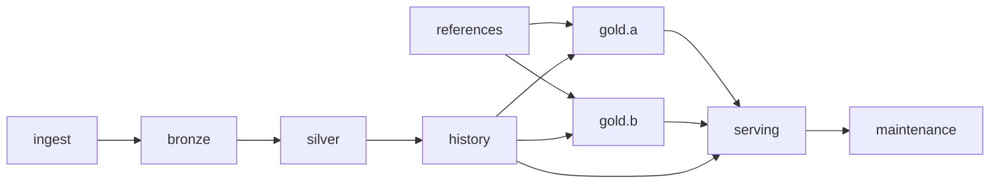
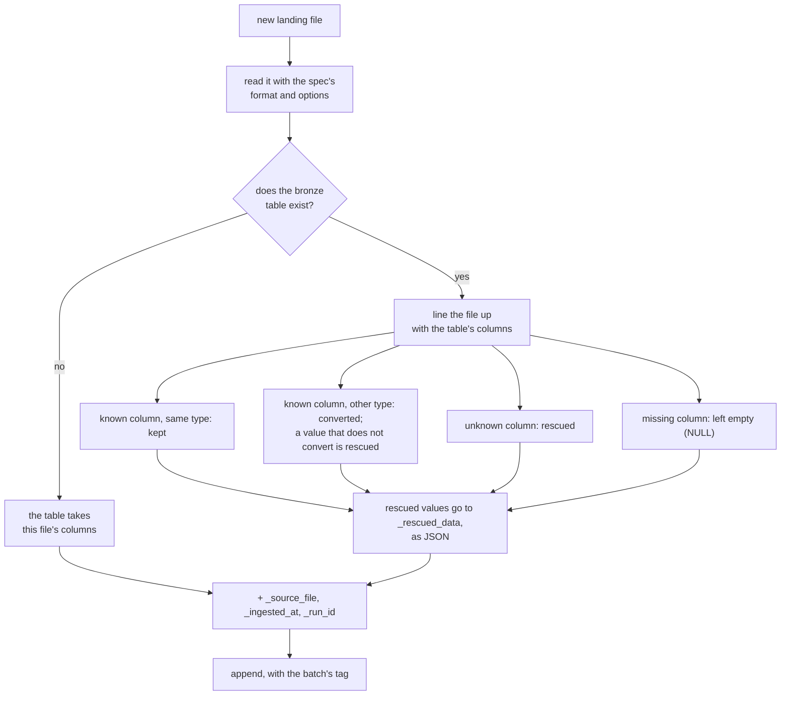
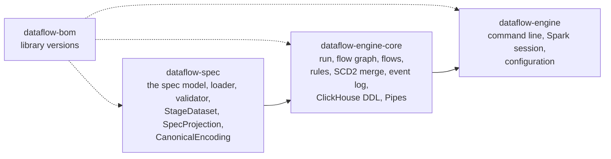
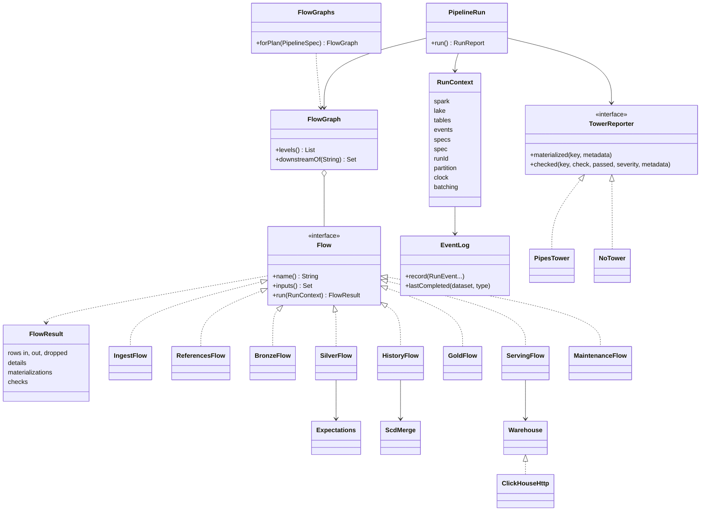

# Engine

The **engine** is the program that does the data work. It is a Java command-line program, `dataflow-engine`, built on
Apache Spark (a data processing engine) and Delta Lake (the table format). It is packaged as the Docker image
`dataflow-engine:latest`.

The engine does not run all the time. For each run, the tower (Dagster) starts one engine container. The engine reads
the dataset's spec, runs every step in order, records what happened, and exits. Between runs no engine is running, which
keeps 1.2 to 1.8 GB of memory free on the 4 GB machine.

## Commands

```bash
dataflow-engine run --dataset=taxi_trips --partition=2024-01 --trigger=backfill
```

Runs one dataset. `--partition` is only for datasets with partitions (here, the month to process). `--trigger` records
why the run started (`schedule`, `backfill`, `sensor` or `manual`); the tower fills it in from the run's tags.
`--full-refresh` first deletes the dataset's bronze, silver, quarantine and history tables and their checkpoints, so
every landed file is processed again. Landing and the event log stay.

```bash
dataflow-engine validate
```

Checks every spec in the pipelines folder (`PIPELINES_LOCATION`, `/pipelines` in the container) and lists every problem,
without running anything.

Every command also takes `--release=<project>@<commit>`. The engine then copies that release from the releases store (
`releases/<project>/<commit>/`, refused if its `release.json` is missing), loads the project's `dataflow.yml` and
pipelines from it, and ignores the pipelines folder. Runs the tower starts always pass it, so a run uses exactly the
released commit, and its `run` events carry `"release": "examples@5ea326b…"` in `details`. Every `run` event also carries
`settings`: the engine's `dataflow.engine.*` values for that run, each with its type and meaning, without secrets or
task inputs (`EngineSettings`); Settings → Configuration in the Workspace shows the newest.

Two more commands serve the Workspace's spec editor. They take a draft spec (passed base64-encoded in the environment
variable `ENGINE_DRAFT`), work on a sample of 20,000 rows (from bronze, or from the source for a dataset that has no
data yet), write one JSON result to `system/tasks/<task>.json`, and touch no table:

```bash
dataflow-engine preview --dataset=earthquakes --task=<uuid>
dataflow-engine impact --dataset=earthquakes --task=<uuid>
```

- **`preview`** shows what the draft produces: the silver rows, how many rows fail each rule, the rows a `drop` rule
  would send to quarantine, and every gold table computed over the sample.
- **`impact`** applies the saved spec and the draft to the same rows and compares them: how many values change in each
  column, which rules fail more or less, records that a new key would merge or split, records that would get a new
  version, and gold row counts. Example: changing how `region` is derived showed "region changes on 14,524 rows" before
  anything was saved.

Both reuse the real steps' code (`SilverFlow.project`, `Expectations.measure`, `HistoryFlow.versions`), so what they
show is what a run would do. A preview takes 13 to 20 seconds, most of it starting Java and Spark.

A third task serves the pipeline assistant: it needs no draft, only a source.

```bash
dataflow-engine infer --dataset=quakes --task=<uuid> --source=https://earthquake.usgs.gov/earthquakes/feed/v1.0/summary/all_month.csv
```

- **`infer`** downloads the file (http or https only) into `/data/_tasks/<task>/`, reads up to 20,000 rows, drafts a
  spec with the reason for each choice, validates it, writes the result to `system/tasks/<task>.json` and removes the
  download. The rules it follows are in [pipeline-assistant.md](pipeline-assistant.md).

Without `--release` and without a pipelines folder, the engine starts with no pipelines: tasks on a dataset that was
never released still work.

The engine exits with **0** when the run completed, **1** when it failed, **2** when the command line was wrong.

## What a run does

A run is a small graph of **flows**. A flow is one step: "read from something, write to one table". The engine builds
the graph from the spec, then runs it level by level: flows that do not depend on each other run at the same time.



`references` exists only when the spec has lookup tables, `serving` only when the spec publishes tables and ClickHouse
is configured, and `maintenance` unless it is switched off. If a flow fails, every flow after it is marked `SKIPPED` and
the run fails.

| Flow              | Reads                         | Writes                             | What it does                                                                                                                                                                                                                                    |
|:------------------|:------------------------------|:-----------------------------------|:------------------------------------------------------------------------------------------------------------------------------------------------------------------------------------------------------------------------------------------------|
| ingest            | the source URL or path        | `landing/<ds>/`                    | Downloads the file (or lists the files matching a path) and saves it under a name ending in its content fingerprint, such as `all_month.bd8a205c5fd1587d.csv`. A fingerprint already seen is skipped, so the same file is never processed twice |
| references        | lookup file URLs              | `reference/<ds>/<name>/`           | Reads each lookup file and replaces its table                                                                                                                                                                                                   |
| bronze            | new landing files             | `bronze/<ds>/`                     | Reads only landing files it has not read before, keeps every value as text, adds `_source_file`, `_ingested_at`, `_run_id`                                                                                                                      |
| silver            | new bronze rows               | `silver/<ds>/`, `quarantine/<ds>/` | Converts types, computes derived columns and `factUniqueId`, evaluates every rule; kept rows go to silver, rows failing a `drop` rule to quarantine, and a failing `fail` rule stops the run before writing                                     |
| history           | new silver rows               | `history/<ds>/`                    | Computes `contentHash`, keeps the newest version per record, and merges: closes the old version, inserts the new one                                                                                                                            |
| gold.&lt;name&gt; | current versions + references | `gold/<ds>/<name>/`                | Runs the spec's SQL and replaces the table; adds `computedAt`                                                                                                                                                                                   |
| serving           | history, gold                 | ClickHouse                         | Creates or replaces the published views, refreshes the copies, and the `run_events` view                                                                                                                                                        |
| maintenance       | every table of the dataset    | the same tables                    | At most once an hour: merges small files (`OPTIMIZE`), sets how long deleted files are kept, deletes older ones (`VACUUM`)                                                                                                                      |

Each run of earthquakes on 2026-10-25 took between 20 seconds and a minute. A full taxi month (2.96 million rows) takes
about three minutes: silver 17 s, history 87 s.

### How bronze, silver and history read only what is new

These three flows are Spark **streaming queries**. A streaming query keeps a **checkpoint**: a folder (
`system/checkpoints/<dataset>/<flow>/`) recording what it already read. Bronze records which landing files; silver
records which version of bronze; history which version of silver. Each run reads everything after the checkpoint, in
small slices called **micro-batches**, then stops (Spark's "available now" mode: process what is there, then end,
instead of waiting for more).

Every write of a micro-batch carries a tag: the stream's ID and the batch number. Delta refuses a tag it already has, so
if the engine dies after writing a batch but before recording it, the retried run does not write that batch
twice. [Reliability](reliability.md) walks through the crash cases.

## Bronze: raw rows, with rescued data

Bronze keeps each source file's rows as read. Each new file is read on its own, so a CSV whose columns changed order
between files still lines up by name. Names match without regard to case (the taxi files changed the case of
`Airport_fee` between months).



Example: if a new month's file had a column `congestion_fee` that the table did not know, each row would keep
`{"congestion_fee": "2.5"}` in `_rescued_data`, and the run would carry on. With `schema-evolution: add-new-columns` in
the spec, it would become a real column instead.

## Memory

A run's memory depends on the size of a micro-batch, not of the dataset. Five limits keep it bounded:

| Limit                                     | Setting                                         | Why                                                     |
|:------------------------------------------|:------------------------------------------------|:--------------------------------------------------------|
| At most 500,000 rows per written file     | `dataflow.engine.batching.max-records-per-file` | Large files are built in memory before they are written |
| At most 2 files per streaming batch       | `dataflow.engine.batching.max-files-per-batch`  | A batch is processed in memory as a whole               |
| Step inputs cached on disk, not in memory | Spark storage level `DISK_ONLY`                 | Silver and history read their input more than once      |
| Parquet row groups of 32 MB               | Spark setting                                   | A row group is assembled in memory while writing        |
| Java heap 60% of the container's 1,800 MB | `JDK_JAVA_OPTIONS` in the image                 | Leaves room for Spark's memory outside the heap         |

Before these limits, the first full taxi month crashed in silver with `Java heap space` (exit code 52) on an 800 MB
heap.

## Logs

The engine writes one JSON object per log line on its standard output. Each line carries the dataset, the run ID and the
flow, so it can be filtered. One INFO line sums up each flow:

```json
{"@timestamp":"2026-10-25T07:13:33.768Z","level":"INFO","logger_name":"com.dataflow.engine.core.run.PipelineRun",
 "message":"Flow silver COMPLETED in 4058 ms: 9963 rows in, 9963 out, 0 dropped","dataset":"earthquakes","flow":"silver"}
```

Spark, Hadoop, Parquet and Delta log only warnings. Known harmless warnings (on streaming plans, local checkpoints,
scheduler pools created on demand, long plan strings) and the start-up messages of Jasypt and Hibernate Validator are
cut. The maintenance flow logs each table it works on ("Maintaining s3a://lake/history/earthquakes/"), followed by
Delta's own plain line ("Deleted 0 files and directories…").

Messages for the tower (Dagster Pipes: "this table was written", "this rule passed") are JSON lines on the same output,
marked `__dagster_pipes_version`. The tower takes those and saves every other line as the run's log, on the volume
`tower-storage`. Dagster's UI and the Workspace's run Log tab show it.

## Code organisation



- **`dataflow-spec`** reads and checks specs. The Workspace uses it too, so the editor shows exactly the errors a run
  would give.
- **`dataflow-engine-core`** is plain Java with no Spring: every class receives what it needs in its constructor. So a
  whole run works the same in a unit test (`PipelineRunTest` runs a spec against a lake on the local disk) as in the
  container.
- **`dataflow-engine`** is the Spring Boot program: command line, configuration, logging, the Spark session.



How to read it: `PipelineRun` takes the graph built by `FlowGraphs.forPlan` and runs its levels; flows of one level run
in parallel threads, each in its own Spark scheduler pool so they share the CPU fairly. Every flow implements `Flow` and
returns a `FlowResult` (rows in, out, dropped, and what to report). `TowerReporter` tells the tower what happened:
`PipesTower` when the tower started the engine, `NoTower` (does nothing) when you run it by hand, so the engine never
depends on Dagster.

## Configuration

Settings live in `application.yml` (defaults) and `application-docker.yml` (which reads environment variables in the
container).

| Setting (`dataflow.engine.*`)                     | Environment variable                                                          | Default                                  | Meaning                                                                                                               |
|:--------------------------------------------------|:------------------------------------------------------------------------------|:-----------------------------------------|:----------------------------------------------------------------------------------------------------------------------|
| `pipelines-location`                              | `PIPELINES_LOCATION`                                                          | `/pipelines`                             | Where the specs are when no `--release` is given                                                                      |
| `releases-root`                                   | `RELEASES_BUCKET`                                                             | `s3a://releases`                         | Where releases are read from                                                                                          |
| `lake-root`                                       | `LAKE_BUCKET`                                                                 | `s3a://lake`                             | The bucket that holds every table                                                                                     |
| `cache-dir`                                       | `ENGINE_CACHE_DIR`                                                            | `/data`                                  | Where downloads of partitioned sources are kept                                                                       |
| `batching.*`                                      |                                                                               | 500,000 rows per file, 2 files per batch | The memory limits above                                                                                               |
| `maintenance.interval`                            | `ENGINE_MAINTENANCE_INTERVAL`                                                 | `1h`                                     | Run maintenance at most this often per dataset                                                                        |
| `maintenance.retention-hours`                     | `ENGINE_MAINTENANCE_RETENTION_HOURS`                                          | `168`                                    | How long deleted files are kept, so how far back time travel works                                                    |
| `serving.enabled`, `url`, `user`, `password`      | `SERVING_ENABLED`, `CLICKHOUSE_URL`, `CLICKHOUSE_USER`, `CLICKHOUSE_PASSWORD` |                                          | Where ClickHouse is; the password is encrypted (Jasypt)                                                               |
| `serving.database`, `collection`, `refresh-every` |                                                                               | `serving`, `lake`, `1 DAY`               | The ClickHouse database for published tables, the stored connection to the bucket, and the copies' safety-net refresh |
| `tasks.sample-rows`                               |                                                                               | `20000`                                  | The preview and impact sample size                                                                                    |

Spark's own settings live only in `application-spark.yml` (Spring profile `spark`):

| Setting                           | Meaning                                                                                               |
|:----------------------------------|:------------------------------------------------------------------------------------------------------|
| `local[*]` master                 | Run Spark inside the engine's process, on all CPU cores                                               |
| Kryo serializer                   | A faster way for Spark to copy data between its threads                                               |
| Adaptive query execution (AQE)    | Spark adjusts a query's plan while it runs, using real data sizes                                     |
| FAIR scheduler                    | Flows running at the same time share the cores instead of queueing                                    |
| Delta extension and catalog       | Turns on Delta Lake's SQL (`MERGE`, `OPTIMIZE`, `VACUUM`)                                             |
| Deletion vectors off              | ClickHouse cannot read them correctly in old versions ([history and serving](history-and-serving.md)) |
| Abortable checkpoint file manager | Writes checkpoints safely on S3, which has no "rename a file" operation                               |
| Parquet row group 32 MB           | One of the memory limits above                                                                        |
| s3a endpoint and keys             | How Spark reaches RustFS; the secret key is encrypted                                                 |

Secrets are stored encrypted as `ENC(...)` and decrypted with one master key, `JASYPT_ENCRYPTOR_PASSWORD`, passed in
from outside (`./dataflow encrypt` (in `dataflow-local`) encrypts a value).
