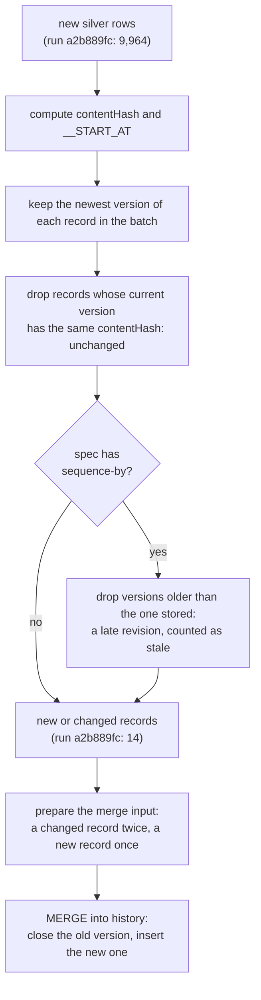
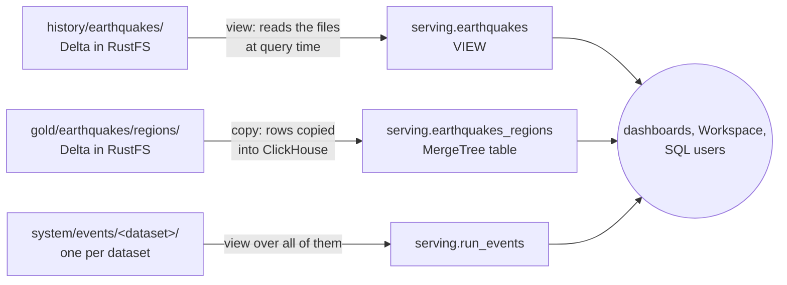

# History and serving

This page explains the last part of a run: how the history table keeps every version of every record, how gold tables
are computed from it, how ClickHouse makes the tables queryable, and how maintenance keeps them fast.

## History: every version of every record

A source changes its mind. USGS publishes an earthquake within minutes, then revises it as seismologists review the
data: a better depth, a corrected place, a different magnitude type. The history table keeps **each version as its own
row**, with the time it became true and the time it stopped being true. This is called a "slowly changing dimension,
type 2" (SCD2).

A real example, earthquake `us6000tzln` in Nicaragua:

| eventId    | depthKm | place                                 | `__START_AT`        | `__END_AT`          |
|:-----------|:--------|:--------------------------------------|:--------------------|:--------------------|
| us6000tzln | 167.36  | 12 km N of Villa El Carmen, Nicaragua | 2026-10-05 02:06:18 | 2026-10-25 03:14:47 |
| us6000tzln | 168.259 | 11 km N of Villa El Carmen, Nicaragua | 2026-10-25 03:14:47 | *(empty: current)*  |

USGS revised the depth and the place on 2026-10-25 at 03:14:47. The run at 07:13 merged that revision: the old row got
an end time, the new row was added. Nothing was overwritten, so both questions have an answer:

- *What do we know now?* The rows whose `__END_AT` is empty. That is the `current` view, and the `serving.earthquakes`
  table in ClickHouse.
- *What did we know on 2026-10-20?* The rows that had started and not yet ended at that moment:

```sql
SELECT eventId, depthKm, place
FROM deltaLake(lake, filename = 'history/earthquakes/')
WHERE eventId = 'us6000tzln'
  AND __START_AT <= '2026-10-20 00:00:00'
  AND (__END_AT IS NULL OR __END_AT > '2026-10-20 00:00:00')
```

This returns the first version: 167.36 km, "12 km N of Villa El Carmen". On 2026-10-25 the earthquakes history held
10,181 rows for 10,170 earthquakes: 11 had been revised.

### The columns that make it work

| Column         | What it holds                                                                                                                          | Example                                          |
|:---------------|:---------------------------------------------------------------------------------------------------------------------------------------|:-------------------------------------------------|
| `factUniqueId` | A fingerprint of the record's key (`history.keys`, here `eventId`). It says "this is the same earthquake"                              | SHA-256 of `us6000tzln`                          |
| `contentHash`  | A fingerprint of the record's content: the declared silver columns, minus those in `track-history-except`. It says "something changed" | `60bdc80a…`, then `6fcfa5c7…` after the revision |
| `__START_AT`   | When this version became true: the `sequence-by` column if the spec has one, otherwise the time of the merge                           | `updatedAt` of the version                       |
| `__END_AT`     | When the next version replaced it; empty while it is the current one                                                                   | the next version's `__START_AT`, exactly         |

The names are the ones Databricks uses for `AUTO CDC ... STORED AS SCD TYPE 2`, so the table reads the same as a
Lakeflow one.

### What counts as a change

Only a different `contentHash` makes a new version. Two consequences, both deliberate:

- Columns listed in `track-history-except` never make a version. The earthquakes spec lists `updatedAt`: USGS bumps it
  for small internal reasons, and a new row each time would only add noise.
- Derived columns (`derive:` in the spec, such as `region`) never make a version either: they are computed from the
  other columns, so they cannot change on their own.

### How a batch is merged

Most of each file is old news. The USGS feed holds the last 30 days; every run downloads all of them again. Run
`a2b889fc` read 9,964 earthquakes, and only 14 reached the history table, all new. Run `8f620025` sent 53: 47 new, 6
revised. The history step filters before it writes:



Why filter first: a Delta `MERGE` rewrites every file that contains a matched row, even when nothing about that row
changes. Sending 9,964 rows to change 14 would rewrite most of the table each run.

Why a changed record goes in twice: a `MERGE` does one thing per input row. Closing the old version (set its `__END_AT`)
and inserting the new one are two things, so the changed record is sent once with its key (it matches the old version,
which gets closed) and once with an empty key (it matches nothing, so it is inserted). A new record is sent once and
inserted. This is the "staged updates" pattern from the Delta documentation:

```sql
MERGE INTO history t
USING staged s
ON t.factUniqueId = s.mergeKey AND t.__END_AT IS NULL
WHEN MATCHED AND t.contentHash <> s.contentHash THEN UPDATE SET __END_AT = s.__START_AT
WHEN NOT MATCHED THEN INSERT (... , __END_AT) VALUES (... , NULL)
```

The history step reports what it did in the event log, for example
`{"new_facts":47,"changed_facts":6,"stale_versions":0}` for run `8f620025`. A batch with nothing new commits nothing.

### When the spec changes

- **A new declared column** is added to the table by the merge itself (`withSchemaEvolution()`). Old versions have it
  empty. The content fingerprint now covers one more column, so each record gets a new version the next time it arrives,
  even if nothing else changed. If that is not wanted, list the column in `track-history-except`; its changes are then
  never versioned.
- **A new derived column** is added and computed for every existing version before the merge, so old versions have it
  too (`ScdMerge.addDerivedColumns`).
- **The key** (`history.keys`) must not change once data exists: every `factUniqueId` would change, and every record
  would look new.

## Gold: tables for questions people ask

A gold table is a SQL query over the current records, saved as a table. The earthquakes spec has two; this is `regions`:

```sql
SELECT coalesce(region, 'Unknown')  AS region,
       count(*)                     AS events,
       round(max(magnitude), 1)     AS maxMagnitude,
       round(avg(magnitude), 2)     AS avgMagnitude
FROM current
GROUP BY 1
```

`current` is a temporary view of the history rows whose `__END_AT` is empty. Each reference table (`references:` in the
spec, such as `taxi_zones`) is a view too, under its own name. The engine runs the query, adds a `computedAt` column and
replaces `gold/<dataset>/<name>/` entirely. On 2026-10-25 `regions` held 142 rows, led by Alaska (3,428 earthquakes),
CA (2,777) and Texas (562).

Rebuilding in full each run is simple and cheap here: each earthquakes gold table took about 2 seconds, and the gold
tables of one spec run at the same time.

## Serving: making tables queryable in ClickHouse

Dashboards, the Workspace and SQL users query ClickHouse, not Spark (the reason is
in [Architecture: ClickHouse](architecture.md#serving-clickhouse)). Each entry of a spec's `serve:` list publishes one
table in the ClickHouse database `serving`, in one of two ways:



| Mode   | What it is                                                                            | Strength                                                                  | Cost                                                        |
|:-------|:--------------------------------------------------------------------------------------|:--------------------------------------------------------------------------|:------------------------------------------------------------|
| `view` | A saved query that reads the Delta files in RustFS each time                          | Always up to date: a new run's data is visible on the next query. No copy | Each query reads Parquet files from RustFS                  |
| `copy` | A ClickHouse table (`MergeTree`) holding a copy of the rows, refreshed after each run | ClickHouse's own storage, sorted by `order-by`: the fastest reads         | A second copy of the data; refreshed per run, not per query |

Measured on 2026-10-25, the same question both ways:

| Question                       | View                                               | Copy                                                       |
|:-------------------------------|:---------------------------------------------------|:-----------------------------------------------------------|
| Earthquakes per region (top 3) | `serving.earthquakes`: 30 ms, reads 10,181 rows    | `serving.earthquakes_regions`: 13 ms                       |
| Taxi trips in January 2024     | `serving.taxi_trips`: 163 ms, reads 2,964,413 rows | `serving.taxi_daily_zone_revenue`: 3 ms, reads 20,363 rows |

Both are fast at this size. Use `view` by default, and `copy` for a table a dashboard queries again and again. The
shipped specs serve `current` as a view and their gold tables as copies.

### What the engine runs

For a view:

```sql
CREATE OR REPLACE VIEW serving.earthquakes AS
SELECT * EXCEPT (contentHash, __END_AT)
FROM deltaLake(lake, filename = 'history/earthquakes/')
WHERE __END_AT IS NULL
```

For a copy (ClickHouse calls the second statement a "refreshable materialized view": a query whose result is written to
a table on a schedule):

```sql
CREATE TABLE IF NOT EXISTS serving.earthquakes_regions
ENGINE = MergeTree ORDER BY region
SETTINGS allow_nullable_key = 1
EMPTY AS SELECT * FROM deltaLake(lake, filename = 'gold/earthquakes/regions/');

CREATE MATERIALIZED VIEW IF NOT EXISTS serving.earthquakes_regions_refresh
REFRESH EVERY 1 DAY
TO serving.earthquakes_regions EMPTY
AS SELECT * FROM deltaLake(lake, filename = 'gold/earthquakes/regions/');

SYSTEM REFRESH VIEW serving.earthquakes_regions_refresh;
SYSTEM WAIT VIEW serving.earthquakes_regions_refresh;
```

The last two lines refresh the copy at the end of each run. The daily refresh (at midnight) is only a safety net. A
refresh swaps all rows at once, so a reader never sees a half-filled table. If a gold table's columns change, the engine
notices that the copy and its source no longer describe the same columns, drops the copy and builds it again.

The serving step also recreates `serving.run_events`, a view over the event log of every dataset that has one, so a
dashboard queries all runs in one place.

### Details worth knowing

- **No secret in any query.** `lake` is a ClickHouse "named collection": the RustFS address and keys, saved in
  ClickHouse's configuration and read from its environment.
- **Timestamps are not shifted.** Spark's `timestamp_ntz` (a timestamp without time zone) arrives in ClickHouse as
  `DateTime64(6)` with the same value.
- **Deletion vectors are off.** They are a Delta feature that marks deleted rows instead of rewriting files. ClickHouse
  26.10 ignores them when reading an old version of a table and miscounts them in the change feed (spike S2), so every
  table is written without them (rule F07).

## Maintenance: keeping tables fast and storage bounded

Each micro-batch writes new files, so tables collect many small files, and every rewrite leaves old files behind for
time travel. Maintenance is the last step of a run, and does two things to each table (bronze, silver, quarantine,
history, each gold table and the event log):

- **`OPTIMIZE`** merges small files into bigger ones, grouped by the table's clustering column. Run `a2b889fc` merged 3
  bronze files into 1, and 52 event log files into 1.
- **`VACUUM ... LITE`** deletes files that no version needs any more, once they are older than the retention. "LITE"
  reads the table's log to find them instead of listing every file in the bucket. If Delta refuses LITE, a full VACUUM
  runs instead.

| Setting                              | Default | Meaning                                                                                                                                                 |
|:-------------------------------------|:--------|:--------------------------------------------------------------------------------------------------------------------------------------------------------|
| `ENGINE_MAINTENANCE_INTERVAL`        | `1h`    | At most one maintenance per dataset per hour. The engine reads the last `maintenance` event in the event log to decide; a run in between skips the step |
| `ENGINE_MAINTENANCE_RETENTION_HOURS` | `168`   | How long replaced files are kept: 7 days. It is also how far back time travel and the change feed reach                                                 |

Delta 4.4 ignores the number in `VACUUM ... RETAIN 168 HOURS` unless it is 0. The retention therefore lives in each
table's property `delta.deletedFileRetentionDuration`, which maintenance sets to the configured hours whenever it
differs.

`OPTIMIZE` changes how data is stored, not what it says, and records that in its commit (`dataChange = false`). The
streaming steps skip such commits, so compaction never looks like new data to silver or history. A maintenance error is
logged as a warning: the run still completes, and the next maintenance tries again.
