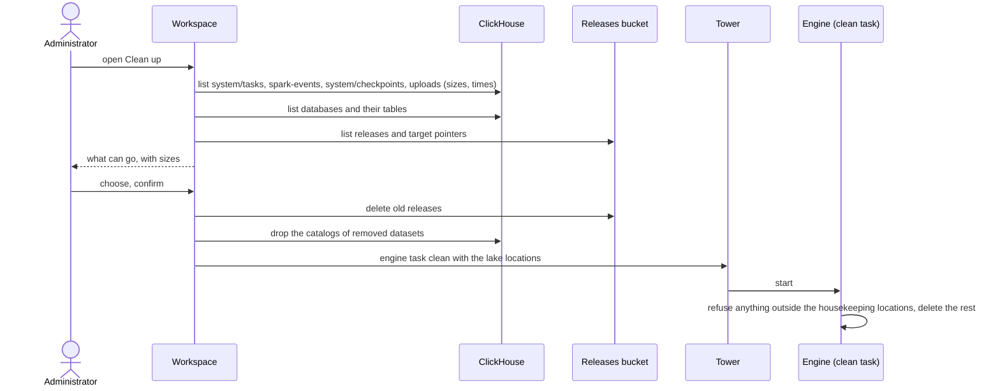

# Housekeeping

The platform keeps things it no longer needs: preview results, Spark event logs, checkpoints of datasets that were
removed, old uploaded files, releases nobody runs any more, old images. Settings → Maintenance → **Clean up** lists them
with their size; an administrator picks what to remove and confirms. Only DataFlow's own locations can be removed (goal
G7).

Set `HOUSEKEEPING_SCHEDULE` to a Spring cron expression (second, minute, hour, day, month, weekday), for example
`0 0 3 * * *` for 03:00 every day, and the Workspace removes everything the list would offer at that time, without
asking. The lake part runs as a `clean` task started by `platform`, so it shows in Runs like any other. The default, `-`,
leaves every removal to an administrator.

## What it looks for

| What                            | Where                                                  | Offered for removal when                                                   | Setting                                  |
|:--------------------------------|:-------------------------------------------------------|:---------------------------------------------------------------------------|:-----------------------------------------|
| Preview and inference results   | `system/tasks/*.json` in the lake                      | older than 7 days                                                          | `HOUSEKEEPING_PREVIEW_DAYS`              |
| Spark event logs                | `spark-events/` in the lake, one entry per application | last written more than 14 days ago                                         | `HOUSEKEEPING_EVENT_LOG_DAYS`            |
| Checkpoints of removed datasets | `system/checkpoints/<dataset>/`                        | no released spec has that dataset any more                                 |                                          |
| Uploaded files                  | `uploads/<person>/<id>/` in the lake, one per upload   | uploaded more than 30 days ago and no released spec reads it               | `HOUSEKEEPING_UPLOAD_DAYS`               |
| Catalogs of removed datasets    | a ClickHouse database named after a dataset            | no spec has that dataset and every table in it is a view over the lake     |                                          |
| Old releases                    | `<project>/<commit>/` in the releases bucket           | not among the 5 newest of the project and no target points to it           | `HOUSEKEEPING_KEEP_RELEASES`             |
| Old DataFlow images             | Docker                                                 | dangling (replaced by a newer build) and labelled `org.dataflow.component` | `./dataflow prune` (in `dataflow-local`) |

An upload a pipeline in a Git folder reads, but no released spec, is offered once it is old enough: release the
pipeline, or copy the file to its landing location, before cleaning.

Finished engine containers are already removed by the tower after each run; on Kubernetes, run Jobs disappear 10 minutes
after they end and take their Spark pods with them ([Kubernetes](kubernetes.md)).

## How a clean up runs

The Workspace reads the lake only through ClickHouse and holds no lake keys, so deleting lake files is the engine's job:
the tower starts the `clean` task with the chosen locations, and the engine accepts only keys under `system/tasks/`,
`spark-events/`, `system/checkpoints/` and `uploads/` (`Lake.cleanable`). One location outside them and the whole task
removes nothing. At most 2,000 lake locations go in one task; run it again for the rest.

## API

| Method | Path                | What                                                                                      |
|:-------|:--------------------|:------------------------------------------------------------------------------------------|
| GET    | `/api/housekeeping` | administrators: what can be removed, with files and bytes                                 |
| POST   | `/api/housekeeping` | `{kinds: [PREVIEWS, EVENT_LOGS, CHECKPOINTS, UPLOADS, RELEASES, CATALOGS]}`: remove those |
