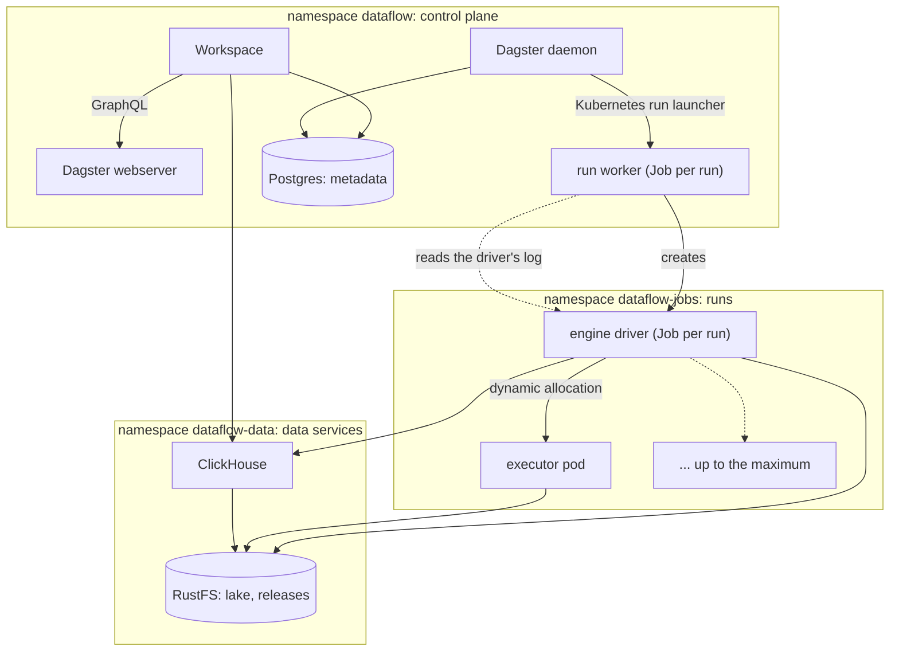
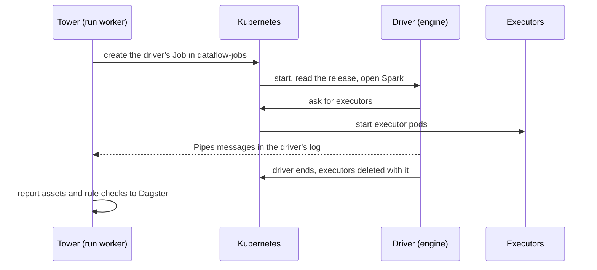

# Kubernetes

How DataFlow runs on Kubernetes: what the chart installs, how one run goes from the tower to Spark pods and back, how
Spark grows and shrinks with the load, and what was measured on a laptop cluster. The chart and its settings are in the
`dataflow-helm-charts` repository; the settings of each installation are in `dataflow-environments`, applied by Argo CD.
On Docker nothing changes: the tower still starts one engine container per run.

Kubernetes is parked for now, so CI builds the `engine-k8s` and `tower-k8s` images only on a manual run of the workflow
or on a `k8s/*` branch; every push still builds the Compose images.

## Words used here

| Word               | Meaning                                                                                            | Here                                                      |
|:-------------------|:---------------------------------------------------------------------------------------------------|:----------------------------------------------------------|
| Pod                | One or more containers Kubernetes starts together on a machine (a node)                            | The Workspace pod, one Spark driver pod per run           |
| Job                | A pod that runs to the end once                                                                    | Dagster runs each pipeline run in a Job, the *run worker* |
| Spark driver       | The Spark process that plans the work and hands tasks out                                          | The engine (`run --dataset=…`), as on Docker              |
| Executor           | A Spark process that runs tasks for the driver                                                     | Pods the driver asks for when work queues up              |
| Client mode        | Spark's driver runs in the process that started it, and asks Kubernetes for executors itself       | The driver is the pod of the run's Job                    |
| Pod template       | A description of a pod that Spark starts its executors from                                        | ConfigMap `dataflow-engine-pods`, from the chart          |
| Dynamic allocation | Spark asking for executors when tasks wait and giving them back when idle                          | Bounds from the spec's `compute:` or the chart defaults   |

## The pieces

Three namespaces keep apart what has different lives. The **control plane** is small and always on. The **runs** come
and go and can be large: the quota and default limits apply to their namespace only, so a burst of runs never stops a
control-plane upgrade, and network policies let nothing from outside reach them. The **data services** keep volumes and
backups of their own and accept connections only from the control plane and the runs. Postgres stays with the control
plane because it holds only metadata (Workspace, Dagster, Keycloak). Runs get a Secret with the lake's credentials and
ClickHouse's password only (`dataflow-lake-secrets`), never the control plane's. Setting `namespaces.data` or
`namespaces.jobs` to the release namespace puts things back together.

Who starts the driver was decision D3 (section 9 of [design/target-architecture.md](design/target-architecture.md)). The
tower does, with a plain Kubernetes Job, and Spark's own Kubernetes support starts the executors. It was first built with
the Kubeflow Spark Operator, which added a controller, a webhook and a resource definition, ran `spark-submit` (a Java
process) inside itself for every run, and needed a 768 MiB limit for it. A Job gives what mattered from it without any
of that: `kubectl get jobs -n dataflow-jobs` lists the runs, and a finished one removes itself. Given up:
`SparkApplication` as a resource, and the operator's support for batch schedulers. The `compute:` section of a spec reads
the same either way.

## One run

1. **The tower submits.** The run worker builds a Job from the spec's `compute:` and the chart's defaults (`spark.*`
   values): memory and cores of driver and executors, executor bounds, the allowed `spark-conf` settings. Lake settings
   reach the pods from the `dataflow-engine` ConfigMap and the `dataflow-lake-secrets` Secret of the jobs namespace, so
   no key is written into the Job. Executors get them through their pod template, the ConfigMap `dataflow-engine-pods`.
2. **The engine starts as the driver.** The image `dataflow-engine-k8s` holds Spark's launch scripts, the engine's Java
   runtime and its libraries; Spark's executor entry point needs that layout, which the distroless Docker image does not
   have. The engine reads its release, as on Docker, and builds its Spark session with the `k8s` profile: the master is
   left to `spark-submit`, in client mode. Executors reach the driver at its pod's address, which Kubernetes hands the
   pod; no Service is needed, because nothing outside the namespace talks to a driver.
3. **Spark scales.** With dynamic allocation the driver asks Kubernetes for executor pods while tasks wait and releases
   them after 60 idle seconds. Before an executor goes, its data is moved to another one (decommissioning,
   `spark.decommission.enabled` and shuffle block migration).
4. **Results come back through Pipes.** The engine writes its Dagster messages (materializations, rule checks, logs) on
   standard output as it does on Docker; the run worker reads the driver pod's log and replays them to Dagster. The rest
   of the log becomes the run's compute log, stored in the releases bucket under `system/compute-logs/`, which the
   Workspace's Log tab reads.
5. **Nothing stays behind.** Executors carry an owner reference to the driver's pod. A run that is cancelled or fails to
   start deletes its Job at once, and the pods go with it; a finished Job removes itself after `spark.ttlSeconds` (10
   minutes). When runs and run workers share a namespace, the driver's Job is also owned by the run worker's Job. Across
   namespaces it cannot be: Kubernetes treats an owner in another namespace as missing and would delete it at once.

Compiled transformations reach the executors too: the engine packs the classes it compiled into a jar and adds it to the
Spark session, which serves it to every executor.

## Settings

| Where | Setting                                                                                  | Example                                                            |
|:------|:-----------------------------------------------------------------------------------------|:-------------------------------------------------------------------|
| Spec  | `compute.driver-memory`, `executor-memory`, `driver-cores`, `executor-cores`             | `executor-memory: 4g`                                              |
| Spec  | `compute.executors.min`, `max`                                                           | `{ min: 1, max: 8 }`                                               |
| Spec  | `compute.spark-conf`, allowlisted keys only                                              | `spark.sql.shuffle.partitions: "64"`                               |
| Chart | `spark.driverMemory`, `executorMemory`, `memoryOverhead`, `minExecutors`, `maxExecutors` | defaults for specs without `compute:`                              |
| Chart | `spark.driverTemplate`, `executorTemplate`                                               | node selectors, tolerations, cloud identity labels                 |
| Chart | `spark.serviceAccountAnnotations`                                                        | an IAM role (IRSA) or a workload identity for driver and executors |
| Chart | `spark.cpuRequest`                                                                       | `250m`: what each Spark pod reserves; it may still use its cores   |
| Chart | `spark.singlePod`                                                                        | `true`: Spark runs inside the driver, with no executors            |
| Chart | `spark.startupTimeoutSeconds`, `runTimeoutSeconds`                                       | `21600`: how long a run may take before the tower stops it         |
| Chart | `localPorts.enabled`                                                                     | Workspace, Dagster, RustFS and ClickHouse on a laptop's `localhost` |

The memory a pod asks Kubernetes for is the heap plus the overhead: a `512m` executor with `384m` overhead asks for 896
MiB.

The `local` environment is sized for a small machine: one run at a time, in a single pod of 1800 MiB like a run on
Docker (`spark.singlePod`), reserving a quarter of a core. Other installs keep a driver and executors.

## Measured on OrbStack

One node, a 5 GB VM, on 2026-10-31, with the Spark Operator gone. The Compose stack was stopped: 5 GB does not hold both.

| Step                                         | Result                                                                                                              |
|:---------------------------------------------|:--------------------------------------------------------------------------------------------------------------------|
| `helm install --wait` on an empty namespace  | 45 s (1 min 39 s with the operator)                                                                                 |
| Idle                                         | Pods 1.39 GiB, 2.65 GiB free                                                                                        |
| `earthquakes`, driver 768m, one executor 512m, overhead 512m | Succeeded in 266 s: 9,974 rows, 12 materializations and 4 rule checks reported to Dagster, nothing killed; lowest free memory 549 MiB |

A run costs more here than on Docker. Each one adds a run worker pod of about 390 MiB, which on Docker is a 60 MB process
inside the code server, and pods get no swap, so the machine has less room. Not yet tried on this setup: `spark.singlePod`
on a cluster, a taxi month, cancelling a run, losing a driver, and whether the network policies refuse a pod from another
namespace.

## What the live install found

These problems passed every unit test and only showed on the cluster; each is fixed and now covered by a test where one
can catch it.

| Symptom                                    | Cause                                                                                                          | Fix                                                                        |
|:-------------------------------------------|:---------------------------------------------------------------------------------------------------------------|:---------------------------------------------------------------------------|
| Two ServiceAccounts named `dataflow-tower` | Dagster's chart created its own next to ours                                                                   | Dagster's accounts are off; one account per role                           |
| Every run failed before starting           | Dagster's S3 log store accepts no keys and addresses buckets as `releases.host`, which RustFS does not serve   | `LakeComputeLogManager`: the lake's keys, region and path-style addressing |
| Runs queued forever after a crash          | Dagster kept the crashed run's pool slot                                                                       | Slots are freed 60 s after a run ends                                      |
| `spark-submit` failed with a null pointer  | The driver pod template had no container                                                                       | Templates always name Spark's container                                    |
| `NoSuchFileException: dataflow-engine.jar` | Spark copies the main jar into its working directory and removed the jar already there                         | The jar lives in `/opt/dataflow/`                                          |
| A failed run kept its driver and executors | Dagster could not read the Job's status (`jobs/status` missing from the role) and the driver had no owner      | The permission, and the driver owned by the run's Job                      |
| A 1.73 GB engine image                     | Deleting Spark's jars in a later layer does not shrink an image, and it carried two Java runtimes              | Only Spark's launch scripts are copied onto Ubuntu: 503 MB                 |
| A run failed with `UnknownHostException`   | Two runs at once ran the node out of memory; with no swap the kernel killed DNS and the Dagster daemon         | `local` allows one run at a time                                           |
| The driver OOMKilled at 895 of 896 MiB     | A 512m heap and 384m overhead leave too little for a driver that compiles and plans                            | At least 768m and 512m                                                     |
| Executors stayed `Pending`                 | Each Spark pod reserved a whole core, so a 4-core node held four pods                                          | `spark.cpuRequest`                                                         |
| Four 403 errors as a driver stopped        | Spark removes its pods, Services and ConfigMaps as a collection, which the role did not allow                  | `deletecollection` in the engine's role                                    |
| A red migration pod after every install    | Dagster's migration started seconds before Postgres was ready                                                  | The Job waits for Postgres first                                           |

## Not built yet

A sign-in proxy in front of the Dagster UI (use `kubectl port-forward` for now), Grafana and its alert rules in the
chart, workload identity for ClickHouse and the Workspace (Spark has it), a Spark History Server for finished runs, and
a run against a real cloud cluster with a node autoscaler.
