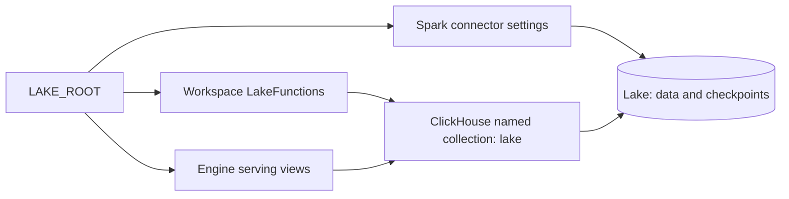

# Object storage

`LAKE_ROOT` names the place where pipeline data lives. A pipeline uses relative table names, so its spec stays the same
when the lake moves. A connector is the library that lets Spark read and write a storage service through Hadoop's file
API.

| Root                                             | Spark connector                | ClickHouse table reader                  | ClickHouse file reader     |
|:-------------------------------------------------|:-------------------------------|:-----------------------------------------|:---------------------------|
| `s3a://lake`                                     | Hadoop S3A                     | `deltaLake`                              | `s3`                       |
| `abfss://lake@account.dfs.core.windows.net/prod` | Hadoop Azure                   | `deltaLakeAzure`                         | `azureBlobStorage`         |
| `gs://lake`                                      | Google Cloud Storage connector | `deltaLake` through Google's S3 endpoint | `s3` through that endpoint |

These are storage locations, not sample accounts that have been provisioned. RustFS is the running development store.
Azure and Google adapters have configuration and query-rendering tests; neither has passed an end-to-end test against a
cloud account yet.

## Choosing a store

For RustFS, Compose defaults to `s3a://lake`. `LAKE_BUCKET` still supplies the default when `LAKE_ROOT` is absent. The
engine, Workspace and tower receive the root. Event logs default to its `spark-events/` directory; `SPARK_EVENT_LOG_DIR`
overrides that location.

The engine only loads settings for the schemes it needs: its lake, releases and event logs. S3's abortable checkpoint
writer is selected from the **lake's** scheme. Reading a release from S3 must not change checkpoint handling for an
Azure or Google lake. Explicit `dataflow.spark.config` values take precedence over connector defaults.

## Identity and credentials

| Store         | Inputs                                                                                                                                                                                                                            |
|:--------------|:----------------------------------------------------------------------------------------------------------------------------------------------------------------------------------------------------------------------------------|
| S3-compatible | `LAKE_ENDPOINT`, `LAKE_ACCESS_KEY`, `LAKE_SECRET_KEY`; `LAKE_S3_REGION`, `LAKE_S3_PATH_STYLE`, `LAKE_S3_SSL`                                                                                                                      |
| AWS           | An empty endpoint uses AWS; select the region, HTTPS and virtual-host addressing. Hadoop's credential chain can read an IAM role or a web identity token; `LAKE_S3_CREDENTIALS_PROVIDER` selects an explicit provider when needed |
| Azure         | `AZURE_TENANT_ID`, `AZURE_CLIENT_ID`, `AZURE_FEDERATED_TOKEN_FILE`; the default token provider is Hadoop's `WorkloadIdentityTokenProvider`                                                                                        |
| Google        | `LAKE_GCS_AUTH_TYPE=COMPUTE_ENGINE` uses the metadata service. `APPLICATION_DEFAULT` uses application default credentials; a credential file must be mounted at `GOOGLE_APPLICATION_CREDENTIALS`                                  |

A workload identity is a short-lived identity assigned to a pod, so there is no long-lived cloud key in a spec. Token
and credential files must exist inside every driver and executor that uses them. Passing their path through the tower
does not mount them. Docker secrets keep the existing Jasypt encryption; cloud pod identity and mounts belong to the
Kubernetes install.

## ClickHouse

Credentials stay in ClickHouse's named collection `lake`. The Workspace only sends the collection name and a relative
file path. For S3 and Google, the collection's URL includes the lake's prefix. Google's S3-compatible endpoint needs
HMAC credentials; these differ from the Spark connector's identity.

Azure's collection names the storage account and container. Its functions override `blob_path`, so DataFlow adds the
root prefix to each path: the root ending in `/prod` and table `history/earthquakes/` produce
`prod/history/earthquakes/`. Catalog listings remove the storage prefix before identifying tables.

Set the collection to the same store and prefix as `LAKE_ROOT`. Changing the root does not currently rewrite the Compose
collection automatically.

## Releases and remaining checks

Releases are separate from pipeline data. The Workspace release writer and tower currently require an S3-compatible
release store, even when the engine's lake uses Azure or Google. `RELEASES_ROOT` uses `s3a://releases` for the engine;
the tower accepts both `s3a://` and `s3://`. Native Azure and Google release writers remain to be built.

Before calling a cloud store supported, verify a complete release and run, preview results, catalog discovery,
timestamps, time travel and change feed against that store. Those checks require real cloud resources; rendered SQL
alone does not establish storage compatibility. Delta checkpoint-based metadata discovery and log-retention tests are
also pending.

References: [ClickHouse Delta functions](https://clickhouse.com/docs/reference/functions/table-functions/deltalake), [Azure named collections](https://clickhouse.com/docs/reference/functions/table-functions/azureBlobStorage), [Hadoop Azure identity](https://hadoop.apache.org/docs/current/hadoop-azure/index.html), [Google connector configuration](https://github.com/GoogleCloudDataproc/hadoop-connectors/blob/v4.0.6/gcs/CONFIGURATION.md).
