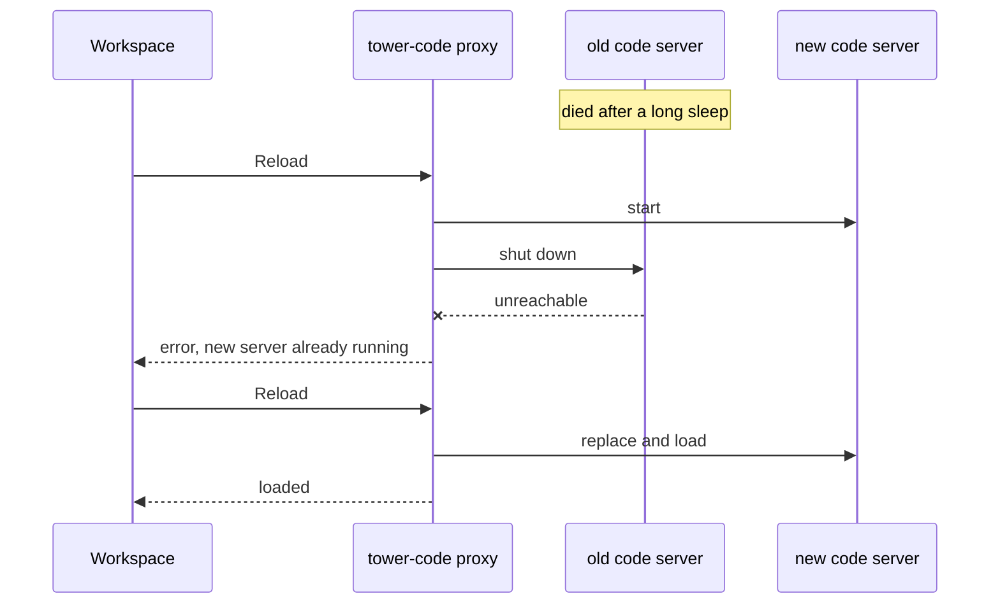

# Operations

How to run the platform on one machine, what it costs in memory and disk, where its state lives, and what to do when
something breaks.

## What runs

Everything runs in Docker Compose, from the sibling repository `dataflow-local`. Its `compose.yaml` includes one file
per concern: `storage/` (RustFS, Postgres, ClickHouse), `sign-in/` (Keycloak and the sign-in proxies), `platform/`
(tower, Workspace, engine) and `monitoring/` (Grafana, Mailpit). This repository only builds the images.

| Container                                      | What it is                                                                                                                                     | Open at                                  | Memory idle (limit) |
|:-----------------------------------------------|:-----------------------------------------------------------------------------------------------------------------------------------------------|:-----------------------------------------|:--------------------|
| `dataflow-rustfs`                              | The object store: the lake's files                                                                                                             | API :9100, console http://localhost:9101 | 367 MiB (512)       |
| `dataflow-postgres`                            | Three databases: `dagster` (the tower), `workspace` (Git folders, drafts, credentials, releases, sessions) and `keycloak` (sign-in)            | :5432                                    | 45 MiB              |
| `dataflow-keycloak`                            | Sign-in (OIDC), realm `dataflow` imported from `sign-in/realm/`; `keycloak-init` applies the clients in `sign-in/clients/` and the first person | http://localhost:8180                    | ~410 MiB (768)      |
| `dataflow-tower-sign-in`                       | oauth2-proxy in front of Dagster's UI, administrators only                                                                                     | http://localhost:3070                    | ~10 MiB (64)        |
| `dataflow-rustfs-network`                      | Owns RustFS's network: its `rustfs` name and ports, and `localhost:8180` forwarded to Keycloak                                                 | (9100, 9101)                             | ~1 MiB (32)         |
| `dataflow-clickhouse`                          | The query engine for dashboards, the Workspace and SQL                                                                                         | HTTP :8123, native :9009                 | 180 MiB (1 GiB)     |
| `dataflow-tower-code`, `-daemon`, `-webserver` | The tower: definitions and runs, schedules and queue, web UI                                                                                   | http://localhost:3070                    | 356 MiB together    |
| `dataflow-workspace`                           | The web app people use                                                                                                                         | http://localhost:3080                    | 336 MiB (640)       |
| `dataflow-grafana`                             | Dashboards and alert rules                                                                                                                     | http://localhost:3000                    | 111 MiB (256)       |
| `dataflow-mailpit`                             | A local mailbox that catches alert emails                                                                                                      | http://localhost:8025                    | 21 MiB              |
| engine (one per run)                           | Starts with a run, exits when it ends                                                                                                          |                                          | up to 1800 MiB      |

Measured on 2026-10-25: about **1.05 GB** idle without the Workspace, **1.4 GB** with it. Nothing runs Java between runs
except the Workspace: the engine exists only while a run or a preview is going.

### On a 4 GB machine

A run adds up to 1.8 GB (the engine's limit; its Java heap is 60% of that). So one run always fits. Two runs at once (
the queue allows two, one per dataset) fit when both are small, like two earthquakes-sized datasets; a full taxi month
uses the whole engine limit and should run alone. Building an image while the platform runs is fine: nothing needs to be
stopped first.

RustFS runs on a small heap, in Docker and in the `local` environment on Kubernetes. Its allocator keeps freed memory per
thread, so memory follows the thread count: two worker threads, at most 16 blocking threads that exit after 10 idle
seconds, no object cache, and freed pages returned at once (`storage/compose.yaml` in `dataflow-local`). Measured with the
same work (an earthquakes run, a `zone_hours` run, a full ClickHouse scan, 1 GiB of multipart uploads and downloads):

| RustFS                | Before  | After   |
|:----------------------|:--------|:--------|
| Heap at its peak      | 523 MiB | 217 MiB |
| Heap when idle        | 451 MiB | 68 MiB  |
| Threads when idle     | 98      | 16      |
| Earthquakes run       | 150 s   | 113 s   |
| `zone_hours` run      | 59 s    | 44 s    |

The runs were no slower; the shorter times are within their usual spread (earthquakes 112 to 149 s), not a gain. The limit
is 320 MiB. It held with both runs and the uploads going at once: heap peak 210 MiB, no kill. The rest of what `docker stats` shows is the kernel's file cache, which it gives back under pressure.

Keycloak runs with the serial garbage collector and a heap capped at 40% of its 768 MiB limit (`JAVA_OPTS_KC_HEAP` in
`sign-in/compose.yaml`). Its start script forces G1, which keeps about 45 MiB of bookkeeping beside the heap; for a
container this small the JVM would pick the serial collector by itself. Measured after a fresh start and the same work
(20 admin sign-ins, each followed by three admin API reads), with native memory tracking on in both:

| Keycloak              | Before (G1, 65%) | After (serial, 40%) |
|:----------------------|:-----------------|:--------------------|
| Memory after the work | 495 MiB          | 421 MiB             |
| GC bookkeeping        | 45 MiB           | 0.6 MiB             |
| Threads               | 41               | 33                  |
| The work              | 39 s             | 36 s                |

Sixty more rounds kept the heap at 169 MiB with no error, and a browser sign-in to the Workspace works. Without tracking,
the same work leaves 407 MiB.

To read a service's real memory, add `anon` from `memory.stat` to `memory.swap.current` in its cgroup: when the VM runs
short, the kernel swaps idle services out and `docker stats` no longer counts that memory.

## Starting, stopping, running

`./dataflow` in `dataflow-local` is the one entry point. Settings that are not secret (ports, versions, memory limits,
names) are in its committed `settings.env`; secrets are in `.env`, which `./dataflow init` writes with random values and
Git never sees. A value in `.env` wins over `settings.env`.

| Command                                                                             | What it does                                                                                                                                                    |
|:------------------------------------------------------------------------------------|:----------------------------------------------------------------------------------------------------------------------------------------------------------------|
| `./dataflow init`                                                                   | writes the missing secrets into `.env` (existing ones are kept)                                                                                                 |
| `./dataflow up` / `down` / `restart` / `status`                                     | starts, stops, restarts or lists the containers                                                                                                                 |
| `./dataflow build [engine\|workspace\|tower\|engine-k8s]`                           | builds images from `../dataflow-platform` (all three main ones when none is named) and recreates the containers that use them                                  |
| `./dataflow run <dataset> [partition]`                                              | queues a run in the tower, exactly like Run now in the Workspace: same queue, one run per dataset, retry, history; tagged `triggered-by=dataflow-local`          |
| `./dataflow engine run --dataset=<name> --release=<project>@<commit> [--partition=<key>]` | debugging only: the engine once, outside the tower (no queue, no retry, not in the tower's history, and nothing stops a tower run of the same dataset writing at the same time) |
| `./dataflow logs [container]`                                                       | follows the logs                                                                                                                                                |
| `./dataflow encrypt <value>`                                                        | prints `ENC(...)` of a value, for settings the engine and the Workspace read                                                                                   |
| `./dataflow prune`                                                                  | removes dangling DataFlow images                                                                                                                                |

Check every spec of a project without running anything with the [command line](cli.md):
`dataflow validate ../dataflow-examples/pipelines`.

### Local Git remotes

Real projects use https:// remotes (GitHub, GitLab, Azure Repos, Bitbucket) with a credential from **Settings → Git
credentials** (a token, or GitHub sign-in: [projects-and-releases.md](projects-and-releases.md#git-credentials)). For a
laptop without a Git server, `REMOTES_DIR` (default `../remotes`, next to the repositories) is mounted in the
Workspace at `/remotes`, and Git folders may clone `file:///remotes/<name>.git`. Keep **bare** repositories there (
`git clone --bare`), used like a server: your own clone pushes and pulls to it, the Workspace too. The examples project
is set up that way: `remotes/dataflow-examples.git` is the `origin` of `dataflow-examples`.

### Looking at the data

The easiest way is the Workspace's SQL page (http://localhost:3080/sql). It is read-only and shows at most 10,000 rows.
For anything else, use ClickHouse's own client:

```bash
docker exec -it dataflow-clickhouse clickhouse-client -u dataflow --password
```

Two useful queries: the last flows of every run, and how many earthquake versions were closed by a revision.

```sql
SELECT dataset, flow, status, rows_out, dateDiff('second', started_at, ended_at) AS seconds
FROM serving.run_events WHERE event_type = 'flow_progress' ORDER BY ts DESC LIMIT 20;

SELECT count() AS versions, countIf(__END_AT IS NOT NULL) AS closed_versions
FROM deltaLake(lake, filename = 'history/earthquakes/');
```

## Where the state lives

All lasting state is in Docker volumes of the project `dataflow`:

| Volume                     | Holds                                                                                                                                                                                   | If it is deleted                                                                                                                                                                                                                                                        |
|:---------------------------|:----------------------------------------------------------------------------------------------------------------------------------------------------------------------------------------|:------------------------------------------------------------------------------------------------------------------------------------------------------------------------------------------------------------------------------------------------------------------------|
| `dataflow_rustfs-data`     | The lake (bucket `lake`), the releases (bucket `releases`) and the 2.0 archive (bucket `archive-v2`)                                                                                    | Every table, checkpoint, event log and downloaded file is gone, and so are the releases. The specs are in their projects' Git repositories, so a release can be made again and the tables rebuilt by running again, but only from sources that still offer the old data |
| `dataflow_clickhouse-data` | The `serving` database, the Workspace's catalog views, the copy tables                                                                                                                  | Nothing is lost: the next run of each dataset recreates its serving tables, and the Workspace recreates its views at start                                                                                                                                              |
| `dataflow_postgres-data`   | The tower's run history, schedule states, asset history (database `dagster`); the Workspace's Git folders, drafts, encrypted Git credentials and release history (database `workspace`) | The tower forgets past runs and paused schedules; the Workspace forgets its folders and **unsaved drafts** (commits already pushed are safe in Git). The data is untouched                                                                                              |
| `dataflow_workspace-cache` | The Workspace's clones of each Git folder and copies of releases                                                                                                                        | Nothing is lost: both are fetched again on demand                                                                                                                                                                                                                       |
| `dataflow_tower-storage`   | The engine output of every run (compute logs), shown in the run Log tab                                                                                                                 | Old run logs are gone. The event log in the lake still has every run's numbers                                                                                                                                                                                          |

On 2026-10-25 the lake used 2.2 GB on disk. Most of it is history (1.18 GiB, mostly the 3-million-row taxi month and its
replaced files kept for time travel), then landing (74 MiB), Spark's own event logs (72 MiB), silver (30 MiB) and
bronze (28 MiB).

Run logs are never pruned. At about 17 KB per run they stay small; deleting old run folders under
`/opt/dagster/home/storage` in `tower-code` is safe.

## Signing in

The Workspace asks people to sign in through Keycloak (`WORKSPACE_AUTH=oidc`, the default). The first person is
`PERSON_ID` (`local`), created by `keycloak-init` in group `admins` with the temporary password
`PERSON_INITIAL_PASSWORD` from `.env`; the first sign-in asks for a new one. More people and groups: Keycloak's
console at http://localhost:8180 (realm `dataflow`, groups `admins`, `engineers`, `analysts`), as `admin` with
`KEYCLOAK_ADMIN_PASSWORD` from `.env`.

## Secrets

No password is written in plain text in Git or in an image. Here is how:

- The engine reads `LAKE_SECRET_KEY` and `CLICKHOUSE_PASSWORD` **encrypted**, as `ENC(...)`. It decrypts them at start
  with [Jasypt](http://www.jasypt.org) and one master key, `JASYPT_ENCRYPTOR_PASSWORD`, the only secret it needs from
  outside.
- `./dataflow init` writes those encrypted values next to the plain ones in `.env`; `./dataflow encrypt <value>`
  encrypts any other.
- The servers that cannot decrypt (RustFS, ClickHouse, Postgres, Keycloak, Grafana) get their passwords in plain text
  from `.env`, which never enters Git or an image.
- ClickHouse queries never contain a key: the RustFS address and keys are ClickHouse's named collection `lake`.

### Rotating the secrets

Delete a line from `.env`, run `./dataflow init` for a new value, then `./dataflow up`. Two values are also stored
inside the data and need one more step: the Postgres password (`ALTER USER dataflow PASSWORD ...` in the
`dataflow-postgres` container) and the Keycloak admin password (`kcadm.sh set-password -r master --username admin`).
A new `JASYPT_ENCRYPTOR_PASSWORD` makes the Git credentials saved in the Workspace unreadable: decrypt them with the
old key and encrypt them with the new one before switching (all secrets were rotated this way on 2026-10-28).

## The 2.0 archive

The MinIO bucket of DataFlow 2.0 was copied byte for byte into the RustFS bucket `archive-v2` (1,417 objects, 829 MiB).
ClickHouse no longer has a named collection for it; add one like `lake` in `storage/clickhouse/lake.xml` to query it.
The rest of 2.0 was cleaned up on 2026-10-24; its Postgres tables were saved to
`archive-v2/postgres/dataflow-2.0-postgres.sql.gz` (restore with `psql`). The 2.0 code is the Git tag `v2.0.0-kafka`.

## Spark's own event logs and the History Server

Spark can record each run in detail (stages, tasks, timings) for its History Server, a web UI for past Spark jobs. It is
on in `settings.env` (`SPARK_EVENT_LOG_ENABLED=true`); the logs go to `s3a://lake/spark-events/`, and each run's event
records its Spark application id (`spark_app`). A target or a pipeline can turn it on or off for its own runs with
`spark.eventLog.enabled` in `compute.spark-conf` (**Event log** in the compute form), which wins over `settings.env`.
The History Server is a `dataflow-local` profile, off by default because
it holds about 300 MiB while it runs. It sits behind the same sign-in proxy as the tower, for `admins` only:

1. Build it once: `docker compose --env-file settings.env --env-file .env --profile spark-history build spark-history`
   (on `apache/spark:<SPARK_VERSION>-scala2.13-java21-ubuntu`, plus hadoop-aws for `s3a://`).
2. Set `SPARK_HISTORY_LINK=http://localhost:18080` in `settings.env`, then `./dataflow up spark-history
   spark-history-sign-in workspace keycloak-init`. The Workspace then lists **Spark UI** on Services, and a run with an
   event log gets **Open in Spark UI** beside **Open in tower**.
3. To turn it off, empty `SPARK_HISTORY_LINK`, `docker stop dataflow-spark-history dataflow-spark-history-sign-in` and
   `./dataflow up workspace`, so no link points at a stopped server.

## When something goes wrong

| What you see                                                                    | Why, and what to do                                                                                                                                |
|:--------------------------------------------------------------------------------|:---------------------------------------------------------------------------------------------------------------------------------------------------|
| A run fails with exit code 52                                                   | The engine ran out of memory. Lower `max-records-per-file` or `max-files-per-batch`, or raise `ENGINE_MEMORY`                                   |
| The engine fails at start: `No such file or directory: s3a://lake/spark-events` | Spark event logs are on, but the folder is missing. `rustfs-init` creates `spark-events/.keep`; run it again                                       |
| The tower says "Could not reach user code server"                               | `./dataflow status` shows `tower-code` unhealthy: its code server process died (sleep longer than the allowance below, or a crash). The Workspace notices within two minutes and reloads the code location twice: the first Reload starts a new code server but still reports the error, the second loads. Runs in progress are not touched. Its log says `answers again after reload 2 of 2`, or `still unreachable`; then recreate `tower-code`. By hand: Dagster UI → Deployment → Reload, twice |
| A run stays Running after `tower-code` restarted                                | Local runs live inside `tower-code`, so a restart (crash, out of memory, a recreate) kills their workers while Dagster still shows them started and holds their dataset's slot. The `orphaned_runs` sensor (every minute, Docker installs only) fails every started run older than the code server's own start, after its engine container has finished, removes that container, and lets run retries start it again. Kubernetes runs have their own pods and are watched by Kubernetes|
| The tower daemon stops with a concurrency error                                 | `max_concurrent_runs` must be a plain number under `concurrency.runs` in `dagster.yaml`                                                            |
| A copy table keeps old columns                                                  | The next run rebuilds it when its columns differ from the source. `DROP TABLE serving.<table>` is also safe: it is only a copy                     |
| A new spec does not show in the tower                                           | The tower reads specs when it loads. Save from the Workspace (which reloads it), or Deployment → Reload                                            |
| The Lakehouse board shows too few rows or files                                 | It reads the `_delta_log/*.json` commit files only. Delta removes old ones after 30 days, and the board does not read Delta's checkpoint files yet |
| Files named `something 2.xml` or `Old 2.java` appear                            | iCloud Desktop restores deleted files as copies. Check `git status` and delete them before building                                                |

The local tower uses `TOWER_CODE_HEARTBEAT_TTL_SECONDS=604800` (one week) so its child code server survives ordinary
laptop sleep. This is Dagster's `code-server start --heartbeat-ttl`, not the proxy's own `--heartbeat-timeout`.
The Compose health check asks the proxy for the repository list over raw gRPC, because Dagster's basic gRPC health
command succeeds while the child is dead. It passes when the proxy answers, including with a load error: a broken
spec or an unreachable release store must stay visible in the Dagster UI and the Workspace, not keep the webserver
and daemon, which wait for this check, from starting. It does not import Dagster, so it stays small next to the runs
that share the container's memory. A pause longer than the allowance needs the two Reloads above, which the
Workspace runs on its own: every `dataflow.workspace.catalog.sync-every` (two minutes) it asks the tower for the
execution plan of the `engine_task` job with placeholder settings, and for the location's load error. Building a
plan needs the code server and runs nothing. Either answer naming `DagsterUserCodeUnreachableError` means the code
server is dead: the plan right after it dies, the load error after one Reload. Any other load error, such as a
broken spec, counts as an answer and is left for a person. Kubernetes keeps its own code-server settings.



## How the images are built

| Image                       | Built from                                                           | Size   |
|:----------------------------|:---------------------------------------------------------------------|:-------|
| `dataflow-engine:latest`    | `Dockerfile`, target `engine`                                        | 398 MB |
| `dataflow-workspace:latest` | `Dockerfile`, target `workspace` (Node builds the UI, Maven the jar) | 403 MB |
| `dataflow-tower:latest`     | `tower/Dockerfile`                                                   | 356 MB |

The engine image is small for a Spark program because it has no operating system shell and only the Java it needs:

- **jlink** builds a Java runtime with the modules the program uses. All modules are kept, because Spark loads some by
  name at run time.
- **distroless** (`distroless/base-debian12`) is a base image with only what a program needs to run: the C library
  Spark's native code needs, and no shell or package manager. Without a shell, Hadoop is pointed at folders that exist (
  `fs.s3a.buffer.dir=/tmp`, `spark.sql.warehouse.dir=/tmp`).
- The AWS SDK comes as three small jars (`s3`, `s3-transfer-manager`, `sts`) instead of the 600 MB `bundle`, and the BOM
  excludes a second logging binding that Delta 4.4 brings through `unitycatalog-client`.
