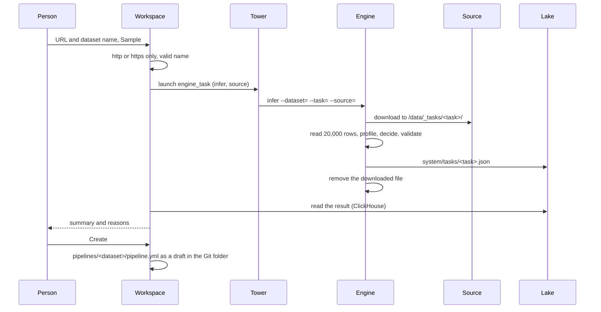

# Pipeline assistant

Writing a first spec means knowing the file's format, its columns and their types, which column identifies a record, and
which values are normal. The **pipeline assistant** works these out from the file itself: paste a URL or a path in the
lake in the Workspace (Create → Pipeline → From source), and it drafts a spec that already passes validation, with one
line explaining each choice. It uses fixed rules, not a language model, so the same file always gives the same draft,
and every choice can be traced to a number in the sample. The design is section 12
of [design/target-architecture.md](design/target-architecture.md) (goal G11).

## Words used here

| Word        | Meaning                                                                                      | Example                                                   |
|:------------|:---------------------------------------------------------------------------------------------|:----------------------------------------------------------|
| Sample      | The first rows of the file (20,000 at most), which every choice is read from                 | 9,895 rows of `all_month.csv`                             |
| Profile     | For each column: how many values are empty, how many are different, the smallest and largest | `mag`: none empty, from -1.42 to 7.7                      |
| Key         | The columns whose values identify one record, kept as `history.keys`                         | `id`                                                      |
| Sequence-by | The column that says which version of a record is newer                                      | `updated`                                                 |
| Reason      | One drafted choice and why it was made                                                       | `keys: id` because "unique and never empty in the sample" |

## What it decides, and how

| Choice        | Rule                                                                                                                                                                                                                                                                    | Example                                                           |
|:--------------|:------------------------------------------------------------------------------------------------------------------------------------------------------------------------------------------------------------------------------------------------------------------------|:------------------------------------------------------------------|
| Format        | The file name's extension (`.csv`, `.tsv`, `.json`, `.jsonl`, `.parquet`, `.orc`, also when compressed); otherwise the first bytes: `PAR1` is Parquet, `{` or `[` is JSON, anything else CSV                                                                            | `all_month.csv` → csv                                             |
| CSV separator | The character among `,` `;` tab `\|` that appears most in the first line                                                                                                                                                                                                | `,`                                                               |
| JSON layout   | A file starting with `[` is one document (`multiLine`), otherwise one record per line                                                                                                                                                                                   |                                                                   |
| Column names  | camelCase of the source names, made unique; a leading acronym stays readable                                                                                                                                                                                            | `trip_distance` → `tripDistance`, `PULocationID` → `puLocationID` |
| Types         | Spark's inference on the sample; in text formats, a column whose every value reads as a date and time becomes `timestamp` with `from: to_timestamp(...)`                                                                                                                | `time` → `timestamp`                                              |
| Required      | A column with no empty value in the sample                                                                                                                                                                                                                              | `id: required`                                                    |
| Keys          | The column that is unique and never empty, preferring one whose name ends in `id`; else the first unique pair among the six most varied columns; else every column, flagged for review                                                                                  | `id`                                                              |
| Sequence-by   | A timestamp named like a revision (`updated`, `modified`, `changed`, `version`, `last`), also left out of the content hash                                                                                                                                              | `updated`                                                         |
| Rules         | Every key `IS NOT NULL` (drop); up to three numeric measures `BETWEEN` their sampled range plus a 10% margin, never below 0 when nothing in the sample was (warn), skipping ids and coordinates; text columns with 2 to 8 values that each repeat, as `IN (...)` (warn) | `mag BETWEEN -3 AND 9`, `status IN ('automatic', 'reviewed')`     |
| Partitions    | A date in the file name: `YYYY-MM` gives monthly partitions, `YYYY-MM-DD` daily, starting at that date; the date becomes `{partition}`                                                                                                                                  | `yellow_tripdata_2024-01.parquet` → monthly from 2024-01          |
| Schedule      | None for a partitioned source (it is loaded by backfilling); every hour for a feed named `hour`; otherwise every 6 hours (a file seen before is skipped)                                                                                                                | `0 */6 * * *`                                                     |
| Gold          | Rows per day, by the first text column with at most 50 values, over the first timestamp                                                                                                                                                                                 | `SELECT to_date(time) AS day, magType, count(*) AS rows ...`      |
| Serving       | A view of `current` and one of the gold table                                                                                                                                                                                                                           | `quakes`, `quakes_daily_counts`                                   |

The draft goes through the same validator as a saved spec. Anything it still refuses is listed under the reasons, so
nothing invalid is ever saved silently.

## How it runs

The Workspace reads data only through ClickHouse and runs nothing heavy itself, so sampling is an engine task like
preview and impact: one engine container, started by the tower, that writes its answer to `system/tasks/<id>.json` and
exits.



- **Upload** next to the source box sends a file from your computer (200 MB at most) to your own folder in the lake,
  `uploads/<you>/<id>/<file>`, and fills in its key. Only you can sample or draft from that folder. On a lake that is not
  on S3 the Workspace refuses uploads.
- The source is an `http` or `https` URL, or a file in the lake given by its key (
  `inbox/sensors/readings_2026-03-04.csv`) or full path (`s3a://lake/…`). The Workspace, the tower and the engine all
  refuse anything else: `file:`, absolute disk paths, `..`, and `system/` (event logs, checkpoints, task results). A
  lake file becomes `source.path` in the draft; a URL becomes `source.url`.
- The whole profile is one aggregation over the sample; picking the key needs one more exact count of the candidates,
  and accepted values read at most nine distinct values per column.
- The draft lands as an uncommitted file in the Git folder, opened in the editor, where Preview and Data impact work on
  it before anything is committed.

## Example

`https://earthquake.usgs.gov/earthquakes/feed/v1.0/summary/all_month.csv`, named `quakes`:

```yaml
history:
  keys: [id]
  sequence-by: updated
  track-history-except: [updated]
```

Measured on 2026-10-25 against the live feed: the task took 14 seconds from launch to answer (11 in the engine
container, download included), sampled 9,895 rows and drafted 22 columns, `time` and `updated` as timestamps, six rules
and a daily count by `magType`, with nothing left for the validator to refuse. Its reasons include `keys: id` (unique
and never empty in the sample), `sequence-by: updated` (a timestamp named like a revision: the newest version wins),
`rule plausible_mag` (seen from -1.42 to 7.7 in the sample; 10% margin) and `rule known_type` (5 values in the sample:
earthquake, explosion, ice quake, landslide, quarry blast).

## Tests

| Test                                         | What it proves                                                                                                                                                                                               |
|:---------------------------------------------|:-------------------------------------------------------------------------------------------------------------------------------------------------------------------------------------------------------------|
| `SourceInferenceTest`                        | A USGS-like CSV becomes a valid spec with key `id`, sequence-by `updated`, timestamps, ranges (clamped at 0) and accepted values; a date in a file name becomes the partition                                |
| `NamesTest`                                  | Source names become camelCase                                                                                                                                                                                |
| `EngineCommandTest`, `EngineApplicationTest` | `infer` needs `--source` and hands it to the task launcher; the engine starts with no release and no spec folder (as for a task on a dataset not yet released)                                               |
| `test_tasks.py`                              | The tower passes `--source` for `infer` and refuses a source that is not http or https                                                                                                                       |
| `EngineTasksTest`                            | The Workspace launches `engine_task` with the source and no draft, and refuses a file URL or an invalid name                                                                                                 |
| `sourceName.test.ts`                         | The dataset name proposed from a URL drops the date and the extension                                                                                                                                        |
