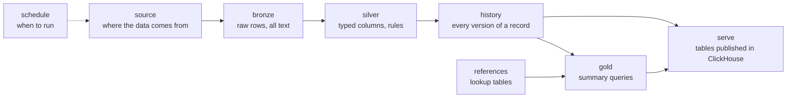
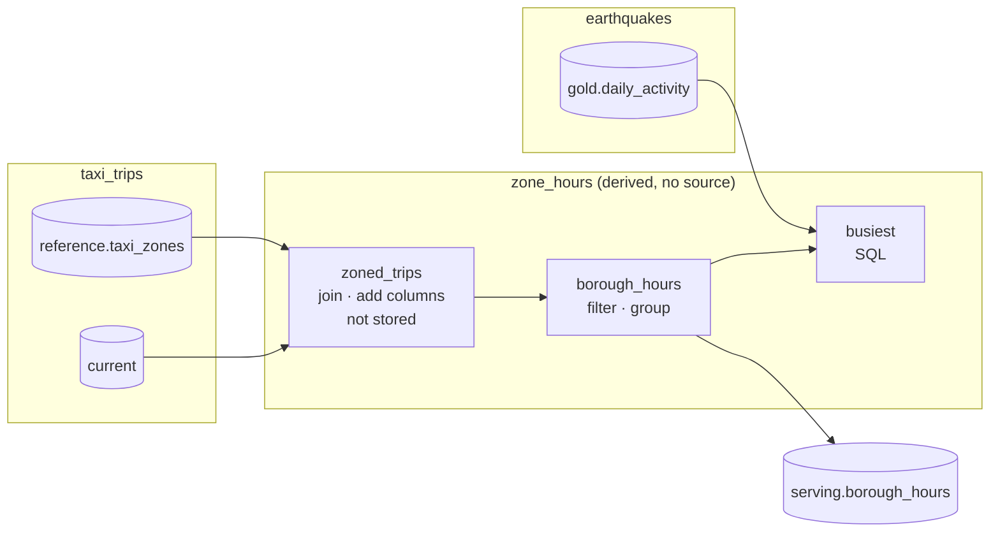
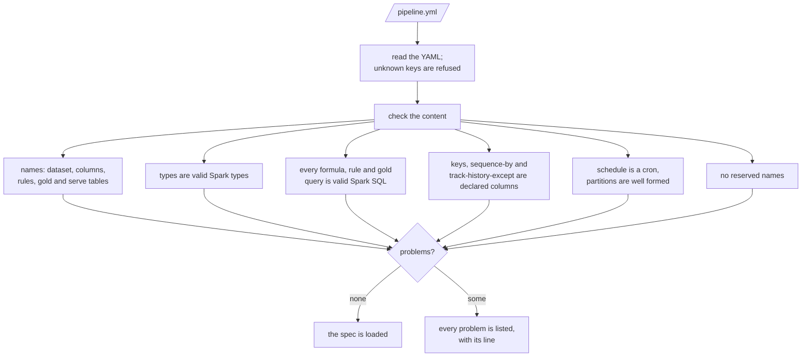
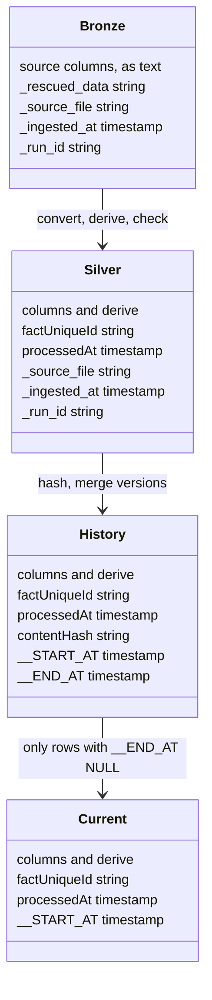

# Pipeline specs

A **pipeline spec** is the YAML file that defines one dataset: where its data comes from, how to clean and check it, how
to keep its history, which summaries to compute and which tables to publish. It lives at
`pipelines/<dataset>/pipeline.yml`. The platform knows nothing else about a dataset: adding one is adding a folder, with
no Java change and no restart.

This page explains every section of a spec with the two shipped examples, `earthquakes` and `taxi_trips`, then how a
spec is checked and which tables it produces.

## A spec, section by section

A spec reads top to bottom in the order the data flows:



### Identity

```yaml
dataset: earthquakes
version: 3
owner: platform
description: USGS events of the last 30 days; magnitudes get revised, so history matters
```

- `dataset` is the name, and must match the folder name. Lower case letters, digits and `_`, starting with a letter.
- `version` is the spec format version, 3 or more.
- `owner` and `description` are shown in the Workspace.

### Source: where the data comes from

```yaml
source:
  url: https://earthquake.usgs.gov/earthquakes/feed/v1.0/summary/all_month.csv
  format: csv
  options: { header: "true" }
```

- **`url` or `path`, exactly one.** A `url` is downloaded at every run. A `path` is a file or a pattern of files (a "
  glob", such as `/data/sensors/*.csv`) on a disk the engine can see.
- **`format`** is any file format Spark can read: `csv`, `json`, `parquet`, `orc`, `avro`, `text`.
- **`options`** are passed to Spark's reader as they are. `header: "true"` means the first CSV line holds the column
  names.

Some sources publish one file per period. `partitions` tells the platform so, and the URL contains `{partition}`, which
each run replaces with the period it processes:

```yaml
source:
  url: https://d37ci6vzurychx.cloudfront.net/trip-data/yellow_tripdata_{partition}.parquet
  format: parquet
  partitions: { monthly: { start: 2024-01 } }
```

A run of partition `2024-03` downloads `yellow_tripdata_2024-03.parquet`. Partitions are `monthly` (keys like `2024-03`)
or `daily` (keys like `2026-01-15`), starting at `start`. Downloads of partitioned sources are kept in
`/data/<dataset>/`, so running a month again does not download it again.

### Schedule: when to run

```yaml
schedule: "0 */6 * * *"
```

A cron expression of five fields: minute, hour, day of month, month, day of week. `0 */6 * * *` means "at minute 0 of
every sixth hour": 00:00, 06:00, 12:00, 18:00 UTC. The tower runs the dataset on that schedule. Without `schedule`, a
dataset runs only when someone asks (the taxi months are run this way, one backfill at a time). A schedule can be paused
without editing the spec, from the pipeline's ⋯ menu in the Workspace.

### Bronze: raw rows

```yaml
bronze:
  schema-evolution: rescue
```

Bronze keeps every row as it was read, every value as text. What happens when a file has a column bronze has not seen
before is decided by `schema-evolution`:

- `rescue` (the default): the unknown column's values go into a JSON column, `_rescued_data`. Example: if USGS added a
  column `felt`, bronze would store `{"felt": "12"}` in `_rescued_data` and carry on.
- `add-new-columns`: the new column becomes a real bronze column.

`max-files-per-trigger` (default 10) is how many new landing files bronze reads in one go. You rarely need it.

### Silver: typed, derived and checked

```yaml
silver:
  columns:
    - { name: eventId,    type: string,    required: true, from: id }
    - { name: occurredAt, type: timestamp, required: true, from: "to_timestamp(time)" }
    - { name: magnitude,  type: double,                    from: mag }
  derive:
    - { name: region, type: string, from: "trim(element_at(split(place, ', '), -1))" }
  expectations:
    - { name: has_magnitude,       check: "magnitude IS NOT NULL",       on-failure: drop }
    - { name: plausible_magnitude, check: "magnitude BETWEEN -2 AND 10", on-failure: drop }
    - { name: reviewed,            check: "status = 'reviewed'",         on-failure: warn }
```

**`columns`** are the typed columns of the dataset. Each has:

- `name`: the column's name in silver and after.
- `type`: a Spark SQL type: `string`, `int`, `bigint`, `double`, `boolean`, `date`, `timestamp`, `timestamp_ntz` (a
  timestamp without time zone), `decimal(18,2)` and so on.
- `from`: a Spark SQL expression over the raw bronze columns. `mag` copies the bronze column `mag`;
  `"to_timestamp(time)"` converts the text in `time` into a timestamp. Taxi trips uses `"uuid()"` to give every trip a
  random ID.
- `required: true`: the column is created as NOT NULL, so a row without a value makes the write fail, and the run with
  it. Add a `drop` rule such as `eventId IS NOT NULL` if such rows should go to quarantine instead.

**`derive`** computes more columns from silver columns, in the order listed, so a derived column can use an earlier one.
`region` takes the text after the last ", " of `place`: "218 km ENE of Nagqu, China" gives "China".

**`expectations`** are quality rules. Each `check` is a SQL condition on silver columns; a row passes when it is true. A
NULL result passes too, so `has_magnitude` exists to catch missing magnitudes. `on-failure` says what happens to a
failing row:

| `on-failure` | What happens                                                                                   | Example                                                                                                |
|:-------------|:-----------------------------------------------------------------------------------------------|:-------------------------------------------------------------------------------------------------------|
| `warn`       | The row is kept; the run records how many rows failed                                          | `reviewed`: most recent earthquakes are still "automatic", not reviewed; on 2026-10-25, 1,853 of 9,964 |
| `drop`       | The row goes to the `quarantine` table instead of silver, with the names of the rules it broke | `plausible_magnitude`: a magnitude of 99 would be quarantined                                          |
| `fail`       | The run stops before anything is written to silver                                             | none in the examples                                                                                   |

Taxi trips has a rule that uses a system column: `pickup_in_file_month` compares a trip's pickup month with the month in
the name of the file it came from (`_source_file`), and drops trips that do not belong to that month.

### History: every version of a record

```yaml
history:
  keys: [eventId]
  sequence-by: updatedAt
  stored-as: scd2
  track-history-except: [updatedAt]
```

History keeps every version of every record, each with the time it was valid. This is called SCD type 2 ("slowly
changing dimension, type 2"), and `stored-as: scd2` is the only kind supported today.

- **`keys`** say what identifies one record. For earthquakes it is `eventId`. For taxi trips, which have no ID in the
  source, it is the combination `pickupTime, dropoffTime, pickupLocationId, fareAmount`. The engine hashes the keys into
  one column, `factUniqueId`. **Keys cannot change once data exists**: every stored record is identified by that hash.
- **`sequence-by`** says which version is newer. USGS sends the whole month every time; with `sequence-by: updatedAt`, a
  version older than the one already stored is ignored, so a late or replayed file can never overwrite fresher data.
  Without `sequence-by` (taxi trips), the time of the run decides.
- **`track-history-except`** lists columns whose change alone is not a new version. If USGS only bumps `updatedAt`
  without changing anything else, no new version is stored.
- **`keep-closed-days`** (optional) forgets old versions: maintenance deletes versions that were replaced more than that
  many days ago (`__END_AT` older than the limit). Current versions are never touched, so `current` and everything
  served from it stay the same; only time travel and the change feed before that date lose detail. Example:
  `keep-closed-days: 365`. The run's maintenance event records how many were removed.

What a revision looks like in history:

| eventId    | magnitude | `__START_AT`     | `__END_AT`       |
|:-----------|:----------|:-----------------|:-----------------|
| us6000u4ty | 5.9       | 2026-10-25 12:16 | 2026-10-26 08:02 |
| us6000u4ty | 6.0       | 2026-10-26 08:02 | NULL             |

`__END_AT` is NULL for the current version. *(The second row is an illustration; today the earthquake has one version.)*

### References: lookup tables

```yaml
references:
  - name: taxi_zones
    url: https://d37ci6vzurychx.cloudfront.net/misc/taxi_zone_lookup.csv
    format: csv
    options: { header: "true", inferSchema: "true" }
```

A reference is a small file loaded as is at every run and replaced each time, to be joined in gold queries. `taxi_zones`
turns a pickup zone number (`pickupLocationId = 132`) into a borough and a zone name ("Queens", "JFK Airport").

### Gold: summaries

```yaml
gold:
  - name: regions
    sql: |
      SELECT coalesce(region, 'Unknown')  AS region,
             count(*)                     AS events,
             round(max(magnitude), 1)     AS maxMagnitude,
             round(avg(magnitude), 2)     AS avgMagnitude
      FROM current
      GROUP BY 1
```

Each gold table is a Spark SQL query recomputed at every run. Queries can read `current` (the current version of every
record) and each reference by its name, as `taxi_trips` does with `LEFT JOIN taxi_zones`. The engine adds a `computedAt`
column.

A gold table can also come from a [transformation](transformations.md#gold-transformations) instead of SQL, when the
summary needs Java:

```yaml
gold:
  - name: zone_hours
    transformation: zone_hours@1
    inputs: { trips: current, zones: reference.taxi_zones }
    params: { min-trips: 10 }
```

Exactly one of `sql`, `transformation` and `from` (below). A transformation's inputs are `current`,
`reference.<name>`, an input or another gold table of the pipeline.

### Inputs: reading other pipelines

Real work rarely stops at one source: trips are joined with zones, orders with customers, two feeds are appended and
summarised. A pipeline reads another pipeline's tables through **inputs**, each given a short name it is known by in this
spec:

```yaml
inputs:
  trips:  taxi_trips.current
  zones:  taxi_trips.reference.taxi_zones
  quakes: earthquakes.gold.daily_activity
```

A table is written `<dataset>.<table>`, where the table is `current`, `history`, `silver`, `bronze`, `quarantine`,
`gold.<name>` or `reference.<name>`. Inside the spec, `trips` then works like `current` or a reference: gold SQL reads
`FROM trips`, a step joins `zones`. Each input is read at one Delta version for the whole run, so every table of the run
sees the same data even while the other pipeline writes; the versions read are recorded in the run's events.

A pipeline **without `source`** is a *derived* pipeline: it has no landing, bronze, silver or history, only gold tables
built from its inputs and references. It runs on its `schedule`, or, with no schedule, as soon as one of its inputs
lands: the tower watches the tables it reads and starts it (for example when a taxi month finishes, `zone_hours`
runs). A pipeline with a source can have inputs too, to join its own `current` with another pipeline's tables.



### Gold tables built step by step

Besides SQL and Java, a gold table can start `from` a table and go through **steps**, one operation each, in order,
like the applied steps of a spreadsheet tool. This is what the Workspace's designer writes when you pick operations from
a form, and every step is checked before anything runs.

```yaml
gold:
  - name: zoned_trips
    from: trips
    materialize: false
    steps:
      - join: { with: zones, type: left, on: { pickupLocationId: LocationID }, prefix: zone }
      - derive: { hour: "hour(pickupTime)", day: "to_date(pickupTime)" }

  - name: borough_hours
    from: zoned_trips
    steps:
      - filter: "zoneBorough IS NOT NULL"
      - aggregate:
          by: [zoneBorough, hour]
          measures: { trips: "count(*)", revenue: "round(sum(fareAmount), 2)" }
```

| Step        | What it does                                                                                     | Example                                                    |
|:------------|:-------------------------------------------------------------------------------------------------|:-----------------------------------------------------------|
| `join`      | Matches rows with another table: `on` pairs columns, or `condition` over `left.` and `right.`   | `{ with: zones, type: left, on: { pickupLocationId: LocationID } }` |
| `union`     | Appends the rows of other tables; columns are matched by name, missing ones left empty           | `union: [trips_2023, trips_2024]`                          |
| `filter`    | Keeps the rows where a SQL condition holds                                                       | `filter: "fareAmount > 0"`                                 |
| `derive`    | Adds or replaces columns, in order, so a later one can use an earlier one                        | `derive: { hour: "hour(pickupTime)" }`                     |
| `select`    | Keeps only these columns or expressions, in this order                                           | `select: [tripId, "fareAmount * 1.1 AS gross"]`            |
| `rename`    | Gives columns new names                                                                          | `rename: { LocationID: zoneId }`                           |
| `drop`      | Leaves columns out                                                                               | `drop: [service_zone]`                                     |
| `aggregate` | Groups rows `by` columns and computes `measures`; without `by`, one total row                    | `aggregate: { by: [day], measures: { trips: "count(*)" } }` |
| `dedupe`    | Keeps one row per `keys`; with `latest-by`, the row with the greatest value of that column       | `dedupe: { keys: [orderId], latest-by: updatedAt }`        |

Join types are `inner` (only matches), `left` (every row, matches add their columns), `right`, `full`, `semi` (rows
that have a match, own columns only) and `anti` (rows without a match). When both tables have a column of the same name
that is not a matching key, the join refuses to guess which one you mean: set `prefix` (the joined table's `Borough`
becomes `zoneBorough`), or rename or drop one first. Renaming or dropping a column that does not exist is an error too,
not a silent no-op.

`materialize: false` keeps a table out of the lake: it is computed inside the tables that read it, never written, and
cannot be served. Use it for intermediate steps nobody queries. Stored tables (the default) are flows of their own, so
`busiest` waits for `borough_hours`, and independent tables run in parallel. Tables may read each other in any order,
but never in a loop.

### Serve: what ClickHouse publishes

```yaml
serve:
  - { from: current,      table: earthquakes,         mode: view }
  - { from: gold.regions, table: earthquakes_regions, mode: copy, order-by: region }
```

Each entry publishes one table in ClickHouse's `serving` database, for SQL users and dashboards:

- **`from`** is `current` (pipelines with a source) or a stored `gold.<name>`.
- **`table`** is the name in ClickHouse: `serving.earthquakes`.
- **`mode: view`** creates a saved query that reads the Delta files every time: always up to date, nothing copied.
- **`mode: copy`** copies the table into ClickHouse's own storage after each run: the fastest to query, for tables
  dashboards hit all the time. A copy needs `order-by`, the columns ClickHouse sorts it by (choose the columns
  dashboards filter on).

[History and serving](history-and-serving.md) explains both modes in detail.

## The two shipped specs

|                          | earthquakes                                                | taxi_trips                                                               |
|:-------------------------|:-----------------------------------------------------------|:-------------------------------------------------------------------------|
| Source                   | USGS CSV of the last 30 days, downloaded every run         | New York TLC monthly Parquet files, one partition per month from 2024-01 |
| Schedule                 | every six hours                                            | none: months are run on demand (backfills)                               |
| Keys                     | `eventId`                                                  | pickup and drop-off time, pickup zone, fare                              |
| Newer version decided by | `updatedAt`                                                | the run's time                                                           |
| Notable rule             | `reviewed` (warn): most recent events are not reviewed yet | `pickup_in_file_month` (drop): the trip must belong to its file's month  |
| Gold                     | `daily_activity`, `regions`                                | `daily_zone_revenue`, joined with the `taxi_zones` reference             |
| Published                | `earthquakes` view, two copies                             | `taxi_trips` view, `taxi_daily_zone_revenue` copy                        |

## How a spec is checked

Before anything runs, the spec goes through two checks, and every problem is reported at once rather than one per
attempt.



What the checks catch, with the messages they give (from a deliberately broken copy of the earthquakes spec):

| Mistake                                             | Message                                                                                                                                                      |
|:----------------------------------------------------|:-------------------------------------------------------------------------------------------------------------------------------------------------------------|
| A key that does not exist (`retries: 2` on line 12) | `line 12: unknown key 'retries', expected one of [bronze, dataset, description, gold, history, owner, references, schedule, serve, silver, source, version]` |
| A misspelt type (`type: dubble`)                    | `silver.columns.magnitude.type: cannot parse 'dubble': Unsupported data type "DUBBLE" (line 1, pos 0)`                                                       |
| Invalid SQL in a rule (`BETWEN`)                    | `expectation plausible_magnitude: cannot parse 'magnitude BETWEN -2 AND 10': Syntax error at or near '-' (line 1, pos 17)`                                   |
| A key column not in the spec (`keys: [eventIdd]`)   | `history key 'eventIdd' is not declared`                                                                                                                     |

Reserved names cannot be used as column names because the platform adds those columns itself: anything starting with
`_`, `factUniqueId`, `processedAt`, `contentHash`, `failedExpectations` and `computedAt`. Two specs may not publish the
same ClickHouse table.

Gold tables are checked as a graph: every table a query, transformation or step reads must be `current`, a reference,
an input or another gold table (`gold busiest reads 'trips_2025', which is not current, a reference, an input or a gold
table of this pipeline`); a query that names another dataset directly is told to declare it under `inputs`; tables that
read each other in a loop are refused (`gold tables read each other in a loop: a -> b -> a`); gold SQL must be one
`SELECT` query. When a project is released, inputs are checked against the other pipelines of the project
(`zone_hours input zones reads taxi_trips.reference.taxi_zone, but taxi_trips declares no reference taxi_zone`), and
pipelines that read each other in a loop are refused.

The checks run in four places, always with the same code: the Workspace's spec editor (as you type), the engine's
`validate` command, the tower when it loads the specs, and every build (`PipelineSpecLoaderTest.shippedPlans_areValid`
checks the shipped specs).

## The tables a spec produces



The columns the platform adds:

| Column                         | Meaning                                                        |
|:-------------------------------|:---------------------------------------------------------------|
| `_source_file`, `_ingested_at` | Which landing file a row came from, and when it was read       |
| `_rescued_data`                | Values bronze did not expect, as JSON                          |
| `_run_id`                      | The run that wrote the row                                     |
| `factUniqueId`                 | A hash of the `keys`: one value per record                     |
| `processedAt`                  | When silver processed the row                                  |
| `contentHash`                  | A hash of the tracked columns; a new value means a new version |
| `__START_AT`, `__END_AT`       | When a version became valid and when it was replaced           |
| `failedExpectations`           | In quarantine only: the rules the row broke                    |
| `computedAt`                   | In gold only: when the summary was computed                    |

`contentHash` covers the `columns` minus `track-history-except`. Derived columns never count, so adding a derived column
later never creates new versions; the engine fills the new column in for the versions already stored.

The two hashes are computed the same way everywhere, so the same values always give the same hash, on any machine,
language setting or time zone: columns in the declared order, separated by an invisible separator character (`\x1F`),
NULL written as an empty value, numbers with 6 decimals, timestamps in UTC, then SHA-256.

In the engine's Java code, each table shape is a Spark schema built from the spec (`PipelineSpec.silverSchema()`,
`currentSchema()`), and the type of a dataset says which layer it is (`StageDataset<Silver>`), so passing bronze rows to
a step that expects silver does not even compile.

## Steps

Between `columns` and `derive`, `silver.steps` can call [transformations](transformations.md): Java classes in the
project's `transformations/` folder, for logic a SQL expression cannot hold. Each step names the transformation and its
version, wires its inputs (`rows`, `reference.<name>`, `<dataset>.<table>`), passes `params` and declares the columns it
adds:

```yaml
  steps:
    - name: energy
      transformation: quake_energy@1
      params: { base: 4.8 }
      adds:
        - { name: energyJoules, type: double }
```

## Adding a dataset

A spec lives in a project ([Projects and releases](projects-and-releases.md)). In the Workspace:

1. **Pipelines → Create pipeline**, pick the Git folder of the project, give the dataset a name. The folder opens with a
   starting spec saved as a draft at `pipelines/<dataset>/pipeline.yml`.
2. Fill in the source and press **Preview**: the engine reads a sample (20,000 rows) and shows the source columns, with
   a button that turns them into silver columns.
3. Adjust columns and rules until the Problems tab is empty; the Design view shows the tables the spec will produce.
4. **Save**, **Commit**, **Push**, then **Release** to `prod`. The tower reloads; the dataset's schedule and checks
   appear.
5. **Run now**, or for a partitioned source, pick months on the Partitions tab and **Backfill**.

By hand: write `pipelines/<dataset>/pipeline.yml` in a clone of the project, and from `dataflow-platform` run
`dataflow validate <project>/pipelines` (the [command line](cli.md)) until it is clean; then commit, push and release from the Workspace.

## Changing a dataset later

| Change                 | Effect                                                                                                       |
|:-----------------------|:-------------------------------------------------------------------------------------------------------------|
| Add a silver column    | Safe. New rows get it; history gets the column                                                               |
| Add a derived column   | Safe. Filled in for every stored version, no new versions                                                    |
| Add or change a rule   | Safe for new data. **Data impact** in the editor shows how many rows the change would affect before you save |
| Change a column's type | Not automatic: treat it as a new dataset or migrate by hand                                                  |
| Change the `keys`      | Not possible on existing data: every stored record is identified by them                                     |

The Workspace's editor classifies every change in its Impact tab as safe, changing data, or risky, before you save.
