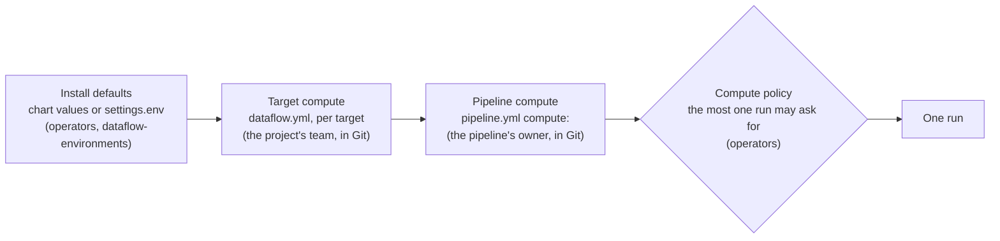
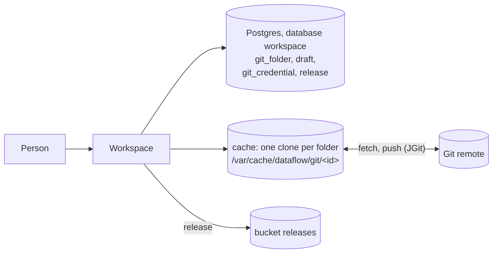
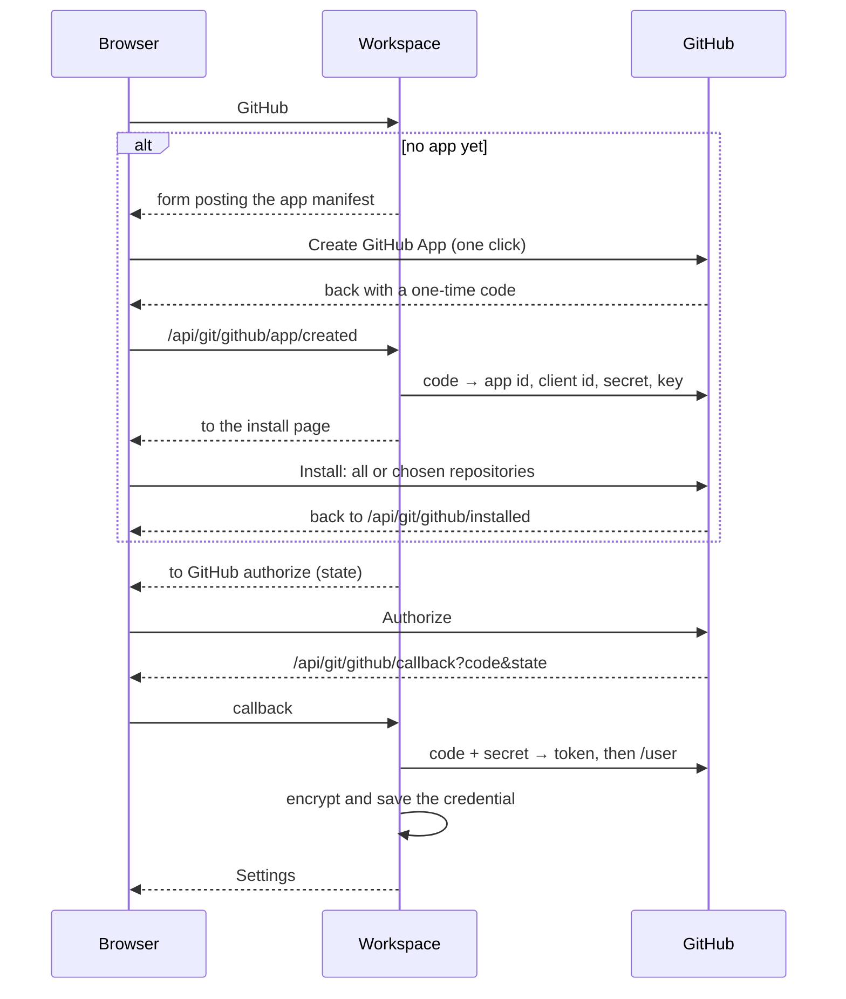
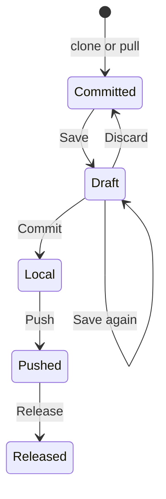
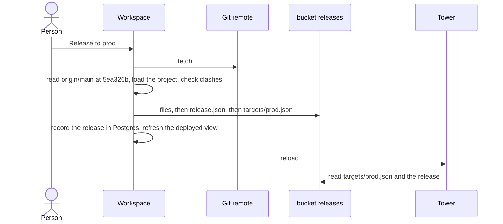
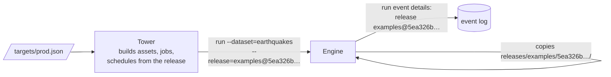

# Projects and releases

Where the pipelines people write live, how they are edited in the Workspace, and how a change reaches the runs. The
design and the comparison with the big platforms are in [design/target-architecture.md](design/target-architecture.md) (
sections 4 and 5, ADR-13 to ADR-16).

## Words used here

| Word               | Meaning                                                                                             | Example                                                                          |
|:-------------------|:----------------------------------------------------------------------------------------------------|:---------------------------------------------------------------------------------|
| Project            | A Git repository with a `dataflow.yml` at its root and pipelines under `pipelines/`                 | `dataflow-examples`, project name `examples`                                     |
| Git folder         | A project connected in the Workspace: which remote, which branch, where it is shown                 | `Shared/examples`, remote `file:///remotes/dataflow-examples.git`, branch `main` |
| Draft              | A file saved in a Git folder but not committed yet; kept by the Workspace, used by no run           | an edited `pipelines/earthquakes/pipeline.yml`                                   |
| Commit, push, pull | Git's own words: record the drafts as one change, send it to the remote, bring the remote's changes |                                                                                  |
| Target             | A named place a project is released to, declared in `dataflow.yml`                                  | `prod`, which takes the branch `main`                                            |
| Release            | A frozen copy of one commit of a project, written to the releases store                             | `releases/examples/5ea326bfa2b2…/`                                               |
| Pointer            | The small file that says which release a target currently runs                                      | `releases/examples/targets/prod.json`                                            |

## Why datasets left the platform repository

Until 2026-10-25 the specs sat in `dataflow-platform/pipelines/`, next to the engine's code, and the Workspace edited
files in that checkout. One repository then mixed two owners and two rhythms: the platform changes with releases of the
product, a dataset changes many times a day. A product that teams install cannot ask them to edit its own source tree.
Databricks, Snowflake and dbt all keep the customer's pipelines in the customer's repositories; DataFlow now does the
same.

## A project

```
dataflow-examples/
├── dataflow.yml
├── README.md
└── pipelines/
    ├── earthquakes/pipeline.yml
    └── taxi_trips/pipeline.yml
```

```yaml
project: examples
description: Two public datasets that show what DataFlow does
targets:
  dev:
    mode: development
  prod:
    mode: production
    branch: main
    compute:
      driver-memory: 2g
      executors: { min: 1, max: 4 }
      spark-conf: { spark.sql.shuffle.partitions: "16" }
```

- `project`: the project's name, lower case, digits and `-`. Release paths and run labels use it.
- `targets`: at least one. A `production` target names the branch it takes; at most one target is production. A
  `development` target releases the folder's current commit, pushed or not (for trying things; runs from it are not
  wired yet).
- `compute`: optional, per target. The size every pipeline of the project runs with when released to that target, with
  the same keys as a pipeline's own `compute:` (memory, cores, executors, allowlisted Spark settings). A pipeline's own
  `compute:` overrides it key by key, and `executors` and `spark-conf` merge entry by entry, as Databricks Asset Bundles
  do with a job cluster per target.
- Unknown keys are refused with their line, like in a pipeline spec: `line 2: unknown key 'owner'`.

### Where a run's size comes from



A pipeline's own size is set in the designer, on its Pipeline block (section Compute), or in the YAML; the form names the
install's limits. The last layer that sets a key wins. The tower merges the target's and the pipeline's `compute` when it reads a release,
so a change of size is a commit and a release, like any other change: reviewed, recorded and undone with Git. On
Kubernetes every key applies to the Spark driver and executors. On a laptop a run is one container: `driver-memory` is the
container's memory limit, `driver-cores` its CPU limit, `spark-conf` is applied, and `executors` has no effect.

### Compute policy: the most one run may ask for

Teams size their own runs; operators cap them, as a Databricks compute policy does. The policy is five settings of the
install, each empty for no limit: `COMPUTE_MAX_DRIVER_MEMORY`, `COMPUTE_MAX_DRIVER_CORES`, `COMPUTE_MAX_EXECUTOR_MEMORY`,
`COMPUTE_MAX_EXECUTOR_CORES` and `COMPUTE_MAX_EXECUTORS` (`settings.env` on a laptop, `computePolicy` in the chart's values
on Kubernetes, so `dataflow-environments` holds it per environment). It is enforced twice:

- The Workspace refuses a compute edit above it before committing anything (`compute.driver-memory 3g is above the
  install's limit of 2g`), and Settings → Compute shows the limits under "Install limits".
- The tower lowers a released size above it when a run starts, and says so in the run's log (`Compute policy:
  driver-memory 3g lowered to the install's limit of 2g`). A release made before the policy changed keeps running, at the
  size the install allows, instead of failing.

The rule is `ComputePolicy` in `libs/dataflow-spec` (the Workspace) and `compute_policy.py` in the tower; both compare
memory in mebibytes (`1800m` is under `2g`).

The code is `ProjectSpec`, `TargetSpec` and `ProjectLoader` in `libs/dataflow-spec`.

## Git folders

In the **Workspace** browser, **Create → Git folder** asks for a remote URL, a name, a branch and optionally a
credential (added under **Settings → Git credentials**). Created from Home it lands under `Users/<you>/<name>`, from
Shared under `Shared/<name>`. An empty repository works too: the folder starts with a draft `dataflow.yml` named after
it, and the first commit and push create the branch on the remote. The Workspace clones the remote, and the folder's
files appear in the same tree as everything else, with their draft state (M, A, D) next to their names.

| Allowed remote                                         | Why                                                                                                                                          |
|:-------------------------------------------------------|:---------------------------------------------------------------------------------------------------------------------------------------------|
| `https://…`                                            | Every Git provider: GitHub, GitLab, Azure Repos, Bitbucket, a company server                                                                 |
| `file:///remotes/<name>.git`                           | Local remotes for a laptop, only under the folders listed in `WORKSPACE_FILE_REMOTES`                                                        |
| anything else (`http://`, `ssh://`, other local paths) | Refused: plain HTTP sends tokens in clear, SSH keys are not managed yet, and an arbitrary local path would let a page read the server's disk |

### Where the Workspace keeps them

The big platforms keep people's working copies in their **control plane**, not in the data lake: Databricks clones into
its control plane (notebooks in its database, other files on its disk for up to 30 days), Snowflake into a "repository
stage" inside Snowflake, and Azure Data Factory keeps no copy at all and commits each save straight to the branch. The
Workspace does the same with what it already has:



- **Postgres** holds what must not be lost: the folders, the drafts, the Git credentials (encrypted with Jasypt, never
  shown again) and the history of releases. Several Workspace replicas share it.
- **The cache** is a clone per folder. It is only a cache: when it is missing, the next request clones again. JGit, a
  Git implementation in pure Java, does the cloning, committing and pushing, so the container needs no `git` program.
- A request on a folder takes that folder's lock, so two people cannot move one clone at the same time.

### Git credentials

Two kinds, under **Settings → Git credentials** (and the GitHub button next to the credential picker of a new Git
folder):

| Kind   | How                                                                                                                                                                                               | Stored                                                                                   |
|:-------|:--------------------------------------------------------------------------------------------------------------------------------------------------------------------------------------------------|:-----------------------------------------------------------------------------------------|
| GitHub | **GitHub**: GitHub asks which repositories to give (all, or chosen ones, private included), then asks you to authorize; you come back with a credential named after your login (`GitHub octocat`) | Access and refresh token, encrypted; refreshed before Git uses an expiring one (8 hours) |
| Token  | **Token**: a name, a username and a personal access token from any provider                                                                                                                       | The token, encrypted                                                                     |

The first click also creates the Workspace's own **GitHub App**, the way Databricks has its app, except that each
install owns its app:
GitHub's [manifest flow](https://docs.github.com/en/apps/sharing-github-apps/registering-a-github-app-from-a-manifest)
shows a page with one button, *Create GitHub App*, and returns its ID, client secret and private key, which the
Workspace keeps encrypted in Postgres (`github_app`). Nothing to register by hand.



- The app is private to your account, may read and write repository contents, and receives no webhooks. **Choose
  repositories** (the link next to a GitHub credential) adds or removes repositories later.
- Every step carries a random state (32 bytes), kept 10 minutes and usable once, by the person who started it; a sign-in
  started elsewhere is refused.
- A company that already has an app (or an OAuth App) sets `GITHUB_CLIENT_ID`, `GITHUB_APP_SLUG` and
  `GITHUB_CLIENT_SECRET_ENC` instead, and no app is created. GitHub Enterprise: set the host and API addresses.
- Pending states are rows of `github_sign_in` in Postgres, taken with one `DELETE … RETURNING`, so any Workspace replica
  can finish a sign-in another one started, and a state can never be used twice.

### Drafts, commits, branches



- **Save** stores a draft: the file's text, the commit it started from, who saved it and when. A draft with problems is
  kept (your work is not lost) and the problems are shown at their lines, but **Commit** refuses while any draft has a
  problem.
- **Commit** writes all the folder's drafts into the clone, loads the whole project once more (so a change that breaks
  another file is caught), and records one commit with you as the author. Before single sign-on, "you" is
  `WORKSPACE_GIT_NAME` and `WORKSPACE_GIT_EMAIL`.
- **Push** sends the branch; a refused push (someone pushed first) says "pull first". **Pull** fetches and fast-forwards
  or merges; a pull that conflicts with local commits is refused, and the conflict is resolved in a clone.
- **Branches**: the branch menu switches or creates one. Drafts belong to the branch they were saved on.

## Releases

**Release** in a folder copies one commit of the project to the `releases` bucket. For a production target that commit
is the head of its branch **at the remote** (after a fetch), never unpushed work. Measured on 2026-10-25, releasing the
examples took 2.7 seconds:

```
releases/
└── examples/
    ├── 5ea326bfa2b220575798e550fee6ebfd80804829/
    │   ├── dataflow.yml
    │   ├── pipelines/earthquakes/pipeline.yml
    │   ├── pipelines/taxi_trips/pipeline.yml
    │   └── release.json        written after the files
    └── targets/
        └── prod.json           written last: {"project":"examples","target":"prod","commit":"5ea326b…",…}
```



- Only `dataflow.yml`, `pipelines/`, `transformations/` and `dashboards/` are copied; a README is not.
- The project is loaded before anything is written: an invalid spec stops the release with the spec's own message.
- A dataset already released by another project for the same target stops the release: two projects cannot both own
  `earthquakes`.
- A release never changes once written. Releasing the same commit again only moves the pointer.

### Why a copy, when Git already has the files

Git stays the source of truth; nobody edits a release. The copy exists so that runs never talk to Git: the tower and the
engine need no Git credentials for every provider, a provider outage or an expired token never stops a scheduled run,
only code that passed the checks and was released by someone ever runs, and a run stays reproducible after a force push
or a deleted branch. Databricks Asset Bundles, Snowflake's repository stage and Azure Data Factory's publish keep such a
copy too.

## How runs use a release



- The **tower** reads every project's pointer for `RELEASES_TARGET` (`prod`), copies those releases to a local cache,
  and builds the same assets, checks, jobs and schedules as before. Each job is tagged with `project` and `release`,
  visible in Dagster. A schedule keeps its state across releases: earthquakes stayed paused.
- The **engine** gets `--release=<project>@<commit>`, copies that release itself (it refuses one without
  `release.json`), and loads the project from it. A run's `run` events carry the release: the first run from a release,
  on 2026-10-25, recorded `{"trigger":"manual","release":"examples@5ea326bfa2b220575798e550fee6ebfd80804829"}` and
  finished in 50 seconds (9,924 rows, 117 history changes).
- The **Workspace** keeps a "deployed view" of the current releases (refreshed every minute and after each release). The
  catalog, pipelines, runs, quality pages and the spec editor's impact all read the released specs from it.

The tower reads the bucket with `fsspec` and `s3fs`, the Python counterparts of Hadoop's file systems. Its environment
holds the lake keys encrypted (`ENC(...)`); `dataflow_tower/jasypt.py` decrypts them with the master key the tower
already has, so no plain-text key was added. The engine reads with Hadoop's S3A, and writes the local copy with Java's
own file API, because Hadoop's local file system calls the `chmod` program, which the distroless engine image does not
have.

## Local remotes

Without a Git server, `DATAFLOW_REMOTES` (default `../remotes`) is mounted at `/remotes` in the Workspace. Keep **bare**
repositories there (`git clone --bare`): they behave like a server. A push into a normal clone would update its branch
but not its files (JGit, like `git`, does not touch another clone's working files), leaving that clone confused. The
examples are set up this way: `remotes/dataflow-examples.git` is the `origin` of `dataflow-examples`, so `git pull` in
`dataflow-examples` brings what the Workspace pushed.

## What is not built yet

| Missing                                      | Today                                                                           |
|:---------------------------------------------|:--------------------------------------------------------------------------------|
| Merge and conflict resolution in the UI      | Pull refuses a conflict; resolve it in a clone                                  |
| One identity per person                      | One configured person until single sign-on (G2)                                 |
| Runs from a development target               | Development targets can be released; the tower schedules only `RELEASES_TARGET` |
| Release on merge (webhook, CI)               | Someone clicks Release                                                          |
| Folder permissions (READ, RUN, EDIT, MANAGE) | Everyone sees every folder (G8)                                                 |
| Pruning old releases                         | They are kept; each is a few kilobytes                                          |

## Tests

| Test                                               | What it proves                                                                                                                                  |
|:---------------------------------------------------|:------------------------------------------------------------------------------------------------------------------------------------------------|
| `ProjectLoaderTest`, `ReleaseIdTest`               | `dataflow.yml` is read with every problem at once; release names are checked                                                                    |
| `GitFoldersTest`                                   | Clone, drafts with problems, commit as the person, push to the remote, pull, branches, refused remotes and paths                                |
| `ReleasesTest`                                     | Files then manifest then pointer, production takes the remote branch not local commits, clashes between projects, unknown targets               |
| `ReleaseFilesTest` (engine)                        | A release is copied and loaded; one without `release.json` is refused                                                                           |
| `test_releases.py`, `test_assets.py`, `test_jasypt.py` (tower) | Plans come from releases and each run passes `--release`; an incomplete release is refused; Python decrypts what `./dataflow encrypt` (in `dataflow-local`) encrypted |
