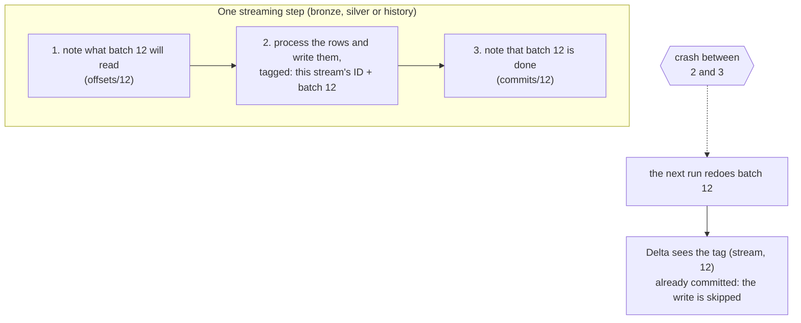
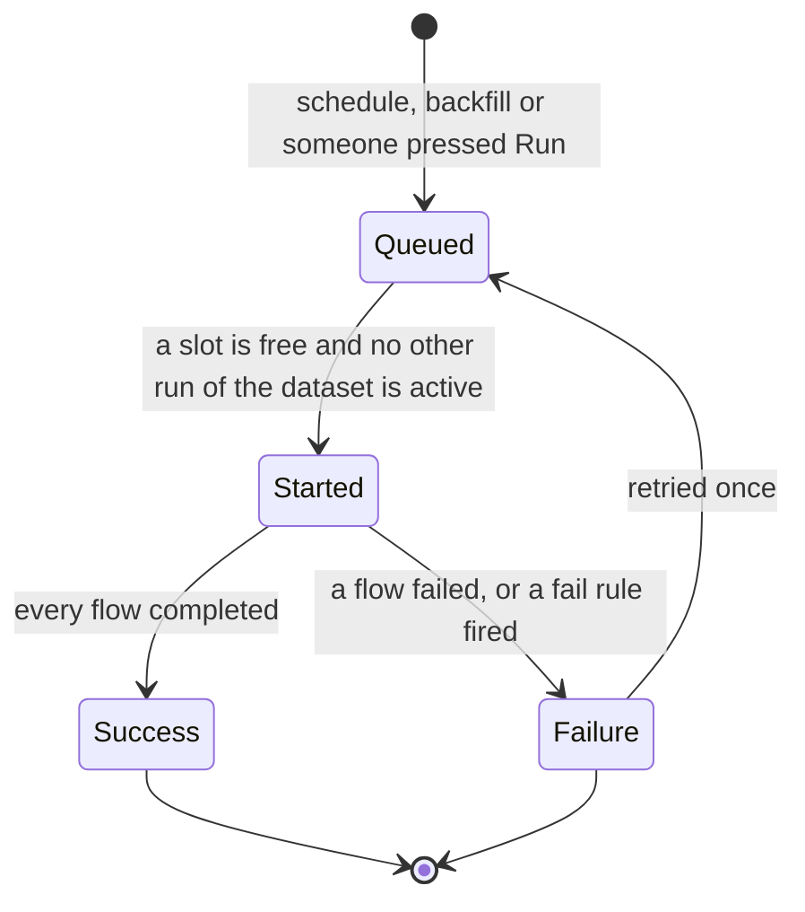
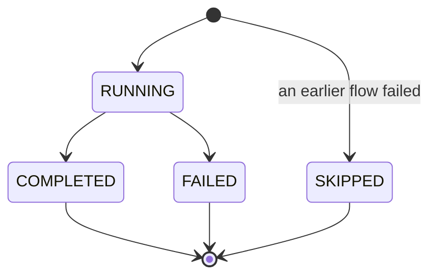

# Reliability

This page explains what happens when things go wrong: the engine crashes, a file arrives twice, a run is retried, a rule
fails. The short answer: **a run only processes data it has not processed before, and writing the same data twice is
refused by the table itself.** So a run can be retried at any time, and nothing ends up duplicated or lost.

## The problem, and how 2.0 solved it

Pipelines that run again and again have two classic problems:

- **Doing work twice.** If the engine crashes after writing rows but before noting that it did, the retry writes them
  again: duplicates.
- **Skipping work.** If the engine notes "done" before the rows are safely written, a crash loses them.

DataFlow 2.0 solved this with four mechanisms of its own: messages in Kafka that pointed at the data ("claim checks"), a
table in Postgres recording each stage's progress ("notifications"), a table of already-processed message IDs to drop
repeats (the "dedup gate"), and code that detected a service shutting down. They worked, but they were four things to
build, test and keep consistent.

v3 uses two mechanisms that Spark and Delta Lake already provide: **checkpoints** and **tagged writes**. This is also
how Databricks' Auto Loader and Lakeflow streaming tables work.

## Checkpoints: each step remembers where it stopped

Bronze, silver and history are Spark **streaming queries**. A streaming query reads its source in slices called *
*micro-batches**, and keeps a **checkpoint**: a folder (`system/checkpoints/<dataset>/<flow>/`) with two lists.

- `offsets/`: what each batch will read. Batch 12 might be "landing files `all_month.bd8a205c5fd1587d.csv`".
- `commits/`: which batches are finished.

At the next run, the query starts after the last finished batch. In this platform it runs in Spark's "available now"
mode: process everything new, then stop, instead of waiting for more data.

Two runs of earthquakes on 2026-10-25 show it:

- Run `6cbada49` found the same USGS file as the run before. The download step recognised its fingerprint, and bronze,
  silver and history found nothing after their checkpoints: **0 rows** written.
- Run `a2b889fc` found a new file. Bronze read exactly that file: **9,964 rows**.

The Workspace's run Timeline shows this as a comparison with the previous run.

## Tagged writes: a replayed batch is refused

A batch goes through three moments:

If the engine dies between 2 and 3, the next run sees batch 12 noted but not done, and redoes it. Without protection,
its rows would be written a second time. The protection is the **tag**: every write carries the stream's ID (`txnAppId`)
and the batch number (`txnVersion`). Delta stores the tag in the same commit as the rows, so either both are saved or
neither is. When the replayed write arrives with a tag Delta already has, Delta skips it.

For plain appends (bronze, silver, quarantine) the tag is passed as writer options. For the history merge it is passed
as two Spark session settings (`spark.databricks.delta.write.txnAppId` and `txnVersion`), which Delta 4.4 honours for
`MERGE`.

The stream's ID is read from the checkpoint's `metadata` file. A new checkpoint (rebuilding a table from scratch) gets a
new ID, so its batch numbers restarting at 0 are not mistaken for replays.

## What can go wrong, and what happens

| What goes wrong                            | What happens                                                                                                                                     |
|:-------------------------------------------|:-------------------------------------------------------------------------------------------------------------------------------------------------|
| The engine crashes in the middle of a run  | The run fails. The tower retries it once; each step starts after its last finished batch, and steps that had finished find nothing new           |
| A batch is redone after a crash            | Its write carries a tag Delta already has, so it is skipped (`IdempotentWritesTest` covers appends and the merge)                                |
| The same source file is downloaded twice   | Landing names end in the file's content fingerprint, so the copy is recognised and not saved again; bronze's checkpoint never reads a file twice |
| The same record appears twice in one batch | History keeps one version per record: the newest by `sequence-by`, then by processing time                                                       |
| A record arrives again unchanged           | History compares fingerprints of the record's content (`contentHash`) and drops it before the merge; a batch with nothing new commits nothing    |
| An older version arrives late              | With `sequence-by`, a version older than the one stored is counted as stale and not merged                                                       |
| Two runs write the same table              | Cannot happen: the tower runs one run per dataset at a time. With one writer per table, Delta on S3 needs no lock service                        |
| A container is stopped                     | Nothing special: the run fails, and the retry resumes from the checkpoints                                                                       |

The event logs are one table per dataset (`system/events/<dataset>/`) for the same reason: two datasets' runs can run at
the same time, and two writers committing to one Delta table at once on S3 would need a lock service to decide who wins.
ClickHouse combines the per-dataset tables in the view `serving.run_events`.

## Runs and flows: two lifecycles

The tower tracks **runs**:

The event log tracks the **flows** (steps) inside a run:

During a run, the event log receives: `run` RUNNING at the start, one `flow_progress` event per flow (rows in, out,
dropped, details), one `expectation` event per quality rule, a `maintenance` event when cleanup ran, and `run` COMPLETED
or FAILED at the end.

If the engine dies too abruptly to write its final event, the run stays RUNNING in the event log; the Runs dashboard
shows it as STALLED once it has been silent for two hours. The tower sees the container's exit code either way, marks
the run failed, and sends its failure email.

## What each kind of failure does

| Situation                 | Effect                                                                                                                                                                  |
|:--------------------------|:------------------------------------------------------------------------------------------------------------------------------------------------------------------------|
| A `warn` rule fails       | The rows are kept. The rule's check in the tower shows a warning                                                                                                        |
| A `drop` rule fails       | The failing rows go to `quarantine/<dataset>/`, each with `failedExpectations` (the rules it broke). The check shows a warning                                          |
| A `fail` rule fails       | Silver writes nothing for that batch, the flow fails, history, gold and publishing are skipped, and the run fails. The check is marked as blocking, with severity ERROR |
| Any other error in a flow | That flow fails, the ones after it are skipped, the engine exits with code 1                                                                                            |
| Maintenance fails         | Logged as a warning; the flow still completes, and the next maintenance window tries again                                                                              |

## What is tested

| Test                                                                         | What it proves                                                                                                                                 |
|:-----------------------------------------------------------------------------|:-----------------------------------------------------------------------------------------------------------------------------------------------|
| `PipelineRunTest.firstRun_writesEveryLayerAndReportsToTheTower`              | A first run fills every table, quarantines failing rows, computes gold, publishes to ClickHouse, writes the event log and reports to the tower |
| `PipelineRunTest.secondRunOnTheSameFile_changesNothing`                      | The same file again: no new landing file, empty batches, history unchanged                                                                     |
| `PipelineRunTest.revision_closesTheOldVersion_whileALateRevisionIsIgnored`   | A revision closes the old version (its `__END_AT` is the new version's `__START_AT`); a late, older revision is ignored                        |
| `PipelineRunTest.failingExpectation_failsTheRunAndSkipsEverythingDownstream` | A `fail` rule fails the run, skips the later flows and reports a blocking check                                                                |
| `IdempotentWritesTest.replayedBatch_afterALostStreamCommit_isWrittenOnce`    | A batch redone after a crash between write and commit is written once                                                                          |
| `IdempotentWritesTest.replayedMerge_withTheSameTransaction_isIgnored`        | A merge replayed with the same tag changes nothing                                                                                             |
