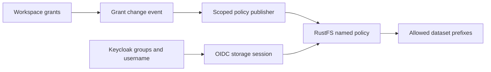

# Dataset access in RustFS

Workspace dataset grants govern direct lake reads through RustFS as well as queries through ClickHouse.
`SELECT` and `MANAGE` on a dataset allow read-only object access to that dataset. `RUN`, folder grants and table-only
grants do not grant raw dataset access. A logical table such as `current` shares physical history files with other
views, so a table grant cannot safely become a raw dataset grant.

## Enforcement

The `dataflow_datasets` policy contains separate statements for the administrator's `admin:*` and `s3:*` actions.
Both require membership in a configured administrator group. Each dataset grant adds statements conditioned on
the signed `jwt:groups` or exact `jwt:preferred_username`. A group name can also carry the leading slash that the
Workspace strips when reading identity claims.

Dataset readers can read objects and list below `landing/<dataset>/`, `bronze/`, `silver/`, `quarantine/`, `history/`,
`reference/`, `gold/` and `system/events/`, with the dataset included after each layer. The trailing slash is part
of every boundary. They receive no object-write or delete action, no checkpoint or Spark-log access, and no access
to the releases bucket. Bucket names can be listed for console navigation; root and parent-prefix object listings
are refused, because an S3 listing cannot hide the names of sibling datasets.

The Workspace's object-store app opens `/storage` for non-administrators. It lists only datasets with a whole-dataset
read grant, with links to the RustFS browser's exact bucket and prefix, for example
`/rustfs/console/browser/?bucket=lake&key=bronze%2Fearthquakes%2F` (the trailing slash after `browser` keeps the query
through the console's redirect). Sign in to the object store once, then open a layer. Knowing another object's address
does not bypass its policy. Administrators retain the full console.

The console's bucket list does not work for non-administrators in RustFS 1.0.3 and 1.0.4. Both bundle console v0.1.37,
whose bucket page reloads the caller's policy on every mount; while that reload runs the page's permission guard
unmounts it, so it mounts again and repeats, about 600 requests a second for as long as the tab stays open (upstream
[rustfs/console#279](https://github.com/rustfs/console/issues/279)). Console v0.1.38 has the fix
([rustfs/console#272](https://github.com/rustfs/console/pull/272)); no RustFS release bundles it yet. The prefix links
never open that page. Until RustFS ships the fixed console, readers should not click the console's **Buckets**
breadcrumb or its **Browser** menu entry.

RustFS's fixed `RUSTFS_IDENTITY_OPENID_ROLE_POLICY=dataflow_datasets` selects this conditional policy for every
DataFlow console login. It avoids treating arbitrary group names as policy names. The RustFS OIDC client emits
actual group membership; the initializer no longer grants `readwrite` to engineers or `readonly` to analysts.
RustFS's secondary role-claim merge is disabled: a client role with the same name as a group must not satisfy
a Workspace group grant. Existing sessions issued with role merging enabled must be revoked or renewed when
changing this mapping; their signed claims do not change when the provider configuration changes.
Scoped storage requires the Workspace and console to use the same `groups` and `preferred_username` claims.
Publication refuses a different Workspace identity mapping instead of silently applying policies to another identity.

## Application and failure handling

The Workspace publishes on startup, after an access change, during catalog reconciliation, and from the
administrator's **Apply permissions** action on Object storage. It uses AWS SDK Signature V4 and the already
configured release-store administration credentials; lake data continues to be read through ClickHouse.

Policies are replaced under the same name. RustFS resolves their current documents when evaluating existing STS
credentials, so dataset revocation takes effect without issuing new credentials. Identity-provider group membership
is the signed session's membership; after changing groups in the identity provider, revoke or renew that person's
storage session. Direct bucket policies, extra IAM identities and service accounts must not grant around this model.

The grant record is saved before publication. If publication fails, the access request returns an explicit error
saying the grant was saved but storage permissions were not applied. The grants table is refreshed even on this
error. Object storage shows the failure and disables its layer links; scheduled reconciliation retries the update.
Existing credentials continue to use the last successfully applied policy until RustFS accepts a replacement.

## Local migration and rollback

`STORAGE_ACCESS_ENABLED=true` enables the projection in `dataflow-local`. The integration is disabled by default
for other installs. Configure `dataflow.workspace.storage-access` with the RustFS administration endpoint, lake
bucket, public browser URL and request timeout. The release-store credentials need policy administration rights.
Administration and console URLs must be HTTP(S) origins; a trailing slash is normalized. Path prefixes, credentials,
queries and fragments are rejected because the administration API (`/rustfs/admin/v3/`) and the console
(`/rustfs/console/`) are fixed paths on those origins.

`STORAGE_LEGACY_POLICIES=readonly,readwrite` is explicit for the local install: it replaces those two old console
policy documents with the same scoped document before publishing `dataflow_datasets`. This closes the broad-policy
path for already-issued console credentials. Older sessions lacking the group claim may need to sign in again.
The publisher refuses to migrate `consoleAdmin` or another arbitrary policy name. It never changes the root engine
credentials or data. Only opt into alias migration on a RustFS install where those aliases belong to this console;
other IAM users of the aliases would also inherit the scoped rules.

Before enabling migration, save each original document from the signed native
`GET /rustfs/admin/v3/info-canned-policy?name=<name>` response's `policy` field. The local rollback copies are in
`dataflow-local/.storage-policy-backup/`, ignored by Git. Rollback is deliberate: stop scoped publication, restore
the backed-up documents with `PUT /rustfs/admin/v3/add-canned-policy?name=<name>`, restore the previous OIDC mapping,
and renew affected sessions. Restoring the old aliases restores their broad access, so it is not automatic.

Implementation references for the installed RustFS 1.0.4 revision:
[policy mapping](https://github.com/rustfs/rustfs/blob/46337942d55f3a8e6a97b147ca98d9ea8115555d/crates/iam/src/federation/mapper.rs),
[OIDC claim configuration](https://github.com/rustfs/rustfs/blob/46337942d55f3a8e6a97b147ca98d9ea8115555d/crates/iam/src/oidc/config.rs),
[request-time evaluation](https://github.com/rustfs/rustfs/blob/46337942d55f3a8e6a97b147ca98d9ea8115555d/crates/iam/src/sys.rs),
[policy administration](https://github.com/rustfs/rustfs/blob/46337942d55f3a8e6a97b147ca98d9ea8115555d/rustfs/src/admin/handlers/policies.rs).
