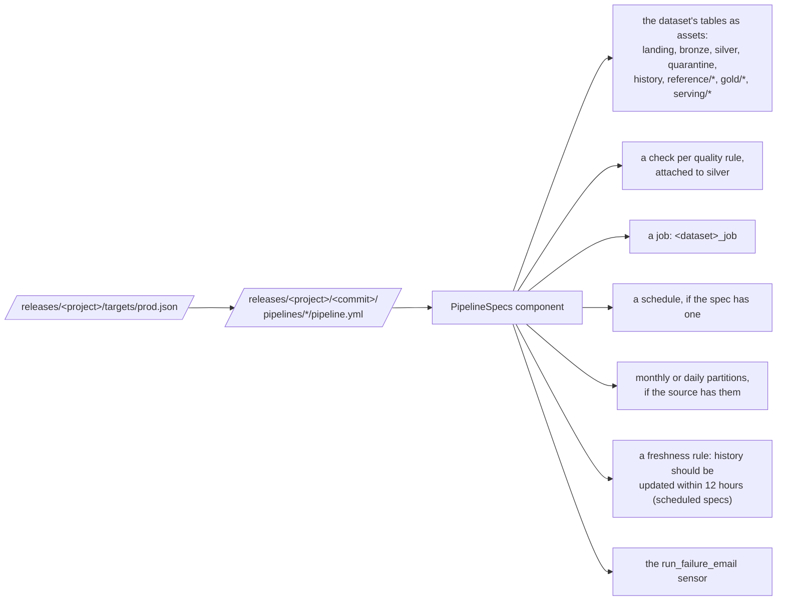
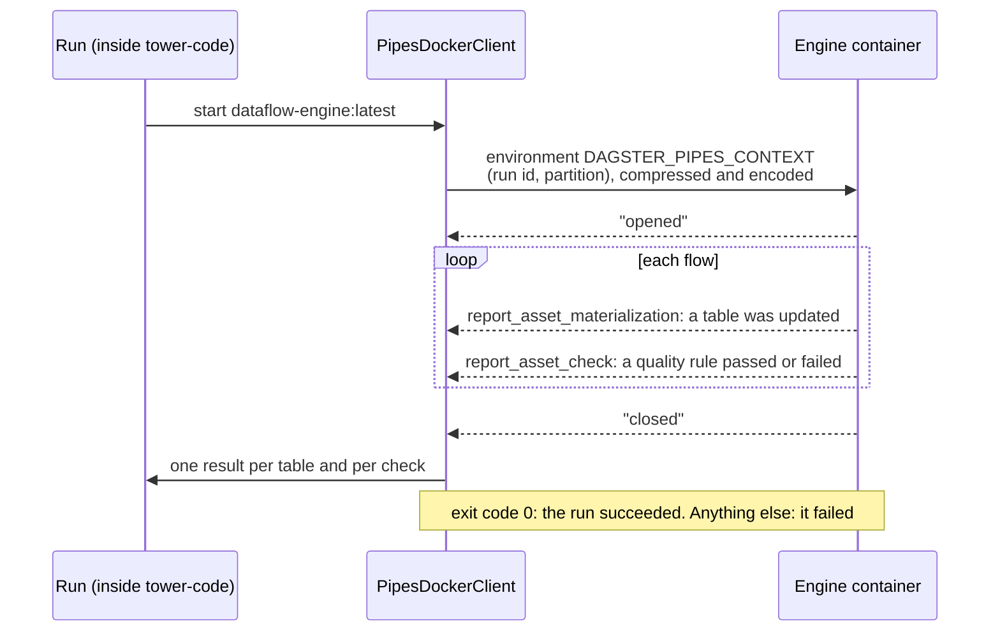

# Tower

The tower decides **when** a run happens and keeps the record of every run. It starts runs on a schedule or on request,
queues them so the machine is not overloaded, starts the engine for each one, records what the engine reports, retries a
failed run once and emails when a run fails. It does not touch data itself: the engine does.

The tower is [Dagster](https://dagster.io) OSS 1.13, with its run history in Postgres. Its web UI is
at http://localhost:3070; most people use the Workspace instead, which talks to the tower behind the scenes. Why Dagster
and not Airflow or cron is explained in [Architecture](architecture.md#tower-dagster-with-postgres).

## Words used on this page

| Word          | Meaning here                                                         | Example                                              |
|:--------------|:---------------------------------------------------------------------|:-----------------------------------------------------|
| Asset         | A table the tower knows about, with its history of updates           | `earthquakes/history`                                |
| Asset check   | A pass or fail test attached to an asset. Here: one per quality rule | `reviewed` on `earthquakes/silver`                   |
| Job           | Something that can be run                                            | `earthquakes_job` runs the earthquakes pipeline      |
| Schedule      | A job plus a timetable (a "cron" expression)                         | `earthquakes_schedule`: `0 */6 * * *`, every 6 hours |
| Partition     | One slice of a dataset that is run on its own                        | taxi trips of month `2024-01`                        |
| Sensor        | A small check the tower repeats, which can act                       | `run_failure_email` mails on failure                 |
| Pool          | A limit on how many runs of something happen at once                 | `run-earthquakes`: one at a time                     |
| Code location | The Python package the tower loads its definitions from              | `tower/`, named `dataflow` (code server `--location-name`, `[tool.dg.project]`, the Workspace's `dataflow.workspace.tower.location`) |

## From specs to what the tower shows

The tower holds almost no code of its own. The package in `tower/` contains one component, `PipelineSpecs`, which reads
the current **release** of every project for one target (`RELEASES_TARGET`, `prod` by
default; [Projects and releases](projects-and-releases.md)) and builds the definitions for each dataset in it:



For the two shipped specs, that is 19 assets, 8 checks, 2 jobs and 1 schedule:

| Dataset     | Assets                                                                                                        | Checks on silver                                                                          | Timing                                          |
|:------------|:--------------------------------------------------------------------------------------------------------------|:------------------------------------------------------------------------------------------|:------------------------------------------------|
| earthquakes | landing, bronze, silver, quarantine, history, gold/daily_activity, gold/regions, 3 serving tables             | `has_magnitude`, `plausible_magnitude`, `plausible_depth`, `reviewed`                     | every 6 hours                                   |
| taxi_trips  | landing, bronze, silver, quarantine, history, reference/taxi_zones, gold/daily_zone_revenue, 2 serving tables | `pickup_in_file_month`, `dropoff_after_pickup`, `fare_not_negative`, `known_payment_type` | monthly partitions from 2024-01, run on request |

A run always runs a dataset's whole graph, from landing to serving: the tower cannot run silver alone (the assets cannot
be "subset"). Asset names (`earthquakes/silver`) are the same strings the engine reports, so its reports land on the
right asset.

A check is **blocking** when its rule says `on-failure: fail`: the tower then knows the tables after silver were not
updated. Rules that `warn` or `drop` give non-blocking checks; a failing one shows as a warning.

### Its settings

The component also adds a resource, `tower_settings`, that nothing runs. Its config fields are the component's
settings in effect, flattened to names such as `tower.docker.image`, each with its type, value and the meaning written
beside the field in the code. Dagster shows them under Deployment → Resources, and the Workspace's Settings →
Configuration reads them with the `topLevelResourceDetailsOrError` query. A Docker install with no `docker` block shows
the defaults it runs with; the block of the engine not in use is left out.

### Adding or changing a spec

The tower reads the specs when it loads. After a spec is saved in the Workspace, the Workspace asks the tower to reload.
After editing a file by hand: Dagster UI → Deployment → Reload. Nothing is rebuilt or restarted.

### Pausing a schedule

A schedule is created RUNNING. Pausing it (in Dagster's UI, or from a pipeline's ⋯ menu in the Workspace) saves STOPPED
in Postgres, and that saved state wins over the code until someone resumes it. The Workspace marks paused schedules in
its pipeline lists.

## How a run starts the engine

When a run starts, the tower starts one engine container for it and waits for it to finish. They talk through **Dagster
Pipes**, a small protocol: the tower hands the engine a context in an environment variable, and the engine prints its
reports as JSON lines on its standard output.



A real check report, from run `a2b889fc` (one line on the engine's output):

```json
{"__dagster_pipes_version":"0.1","method":"report_asset_check","params":{"asset_key":"earthquakes/silver","check_name":"reviewed","passed":false,"severity":"WARN","metadata":{"failing_rows":{"raw_value":1853,"type":"int"},"evaluated":{"raw_value":9964,"type":"int"},"action":{"raw_value":"warn","type":"text"},"check":{"raw_value":"status = 'reviewed'","type":"text"}}}}
```

The engine writes these lines itself (`PipesTower`, about 100 lines of Java). A community Java client exists (
`io.dagster:pipes:1.1.1`), but it writes every message twice and prints debug lines that Dagster rejects (spike S3).

What the engine receives:

| What                 | How                                                                                                                                                |
|:---------------------|:---------------------------------------------------------------------------------------------------------------------------------------------------|
| Run id               | From the Pipes context. The engine uses it as its own run id, so the tower, the event log and the Workspace all show `a2b889fc…` for the same run  |
| Partition            | From the context, passed on as `--partition=2024-01`                                                                                               |
| Trigger              | From the run's tags: `schedule`, `backfill`, `sensor` or `manual`                                                                                  |
| Specs                | `--release=<project>@<commit>`: the engine reads that release from the releases store itself. The run is tagged `project` and `release` in Dagster |
| Downloads            | The host folder `HOST_DATA` mounted at `/data`                                                                                                     |
| Settings and secrets | Every variable of the tower whose name starts with `JASYPT_`, `LAKE_`, `RELEASES_`, `ENGINE_`, `SERVING_`, `CLICKHOUSE_` or `SPARK_`; nothing else (the tower's own database password stays with it) |
| Memory               | A container limit of 1800 MB (`ENGINE_MEMORY` in `dataflow-local`; `TASK_MEMORY` for engine tasks)                                                                                                  |

The run executes inside the `tower-code` container (Dagster's `DefaultRunLauncher`), which starts the engine through the
mounted Docker socket, on the compose network `dataflow_default`.

### Where the engine's log goes

Every line the engine prints that is not a Pipes message (its JSON log lines) lands in the run's **compute log**: a file
under `$DAGSTER_HOME/storage/<run id>/compute_logs/`. That folder is the volume `tower-storage`, mounted in
`tower-code` (which writes it) and `tower-webserver` (which serves it), so the log shows in Dagster's UI and in the
Workspace's run Log tab. A run's log is about 17 KB.

## The queue

The machine has 4 GB for everything, and one run can use 1.8 GB. The queue keeps that safe:

| Limit                               | Value | Setting                                                     |
|:------------------------------------|:------|:------------------------------------------------------------|
| Runs at the same time, all datasets | 2     | `concurrency.runs.max_concurrent_runs` in `dagster.yaml`    |
| Runs at the same time, per dataset  | 1     | the pool `run-<dataset>`, `concurrency.pools.default_limit` |
| Retries of a failed run             | 1     | `run_retries.max_retries`                                   |
| Launch attempts while the code server is unreachable | 5, one a minute | `run_coordinator.config.max_user_code_failure_retries`, `user_code_failure_retry_delay` |
| Time a run may take to start        | 300 s | `run_monitoring.start_timeout_seconds`                      |

A run queued while the code server is dead waits instead of failing: the daemon tries to launch it once a minute, up
to five times, which covers the two minutes the Workspace takes to notice and reload a dead code server
([Operations](operations.md)). Checked on 2026-10-30: a run queued with the code server killed showed "Run dequeue
failed to reach the user code server, re-submitting the run into the queue" three times, then started one minute after
the Workspace's reload. A run whose launch was lost mid-way (stuck in STARTING) is failed after 300 seconds by run
monitoring, so it shows as failed and `run_retries` starts it again; engine tasks are never retried.

One run per dataset is also what keeps every Delta table to a single
writer ([Reliability](reliability.md#what-can-go-wrong-and-what-happens)). Dagster 1.13 refuses `max_concurrent_runs`
under `run_coordinator` once pools are configured, and accepts only a plain number there.

### Engine tasks

The Workspace's preview and impact buttons also run the engine, through the job `engine_task`. They wait in the same
queue, so a preview never runs alongside two pipeline runs. A task gets the draft spec in `ENGINE_DRAFT`, a 1200 MB
limit, and the tag `workspace/task`, which keeps it out of the Workspace's run lists. A preview of earthquakes took 13
seconds. The pipeline assistant's `infer` task has no draft, only a `source`, which the op refuses unless it is an http
or https URL.

## Alarms

| Alarm                            | Who raises it | How                                                                                                                                                                        |
|:---------------------------------|:--------------|:---------------------------------------------------------------------------------------------------------------------------------------------------------------------------|
| A run failed                     | tower         | `run_failure_email` mails `ALERT_EMAIL` over plain SMTP (`SMTP_HOST`, `SMTP_TIMEOUT`; Mailpit at http://localhost:8025 by default). Dagster's own email sensor only speaks SSL or STARTTLS |
| History not updated in 12 hours  | tower         | the freshness rule on scheduled specs                                                                                                                                      |
| Quarantine rate above 5%         | Grafana       | a rule over `serving.run_events`                                                                                                                                           |
| Scheduled dataset not completing | Grafana       | a rule over `serving.run_events`: no completed run in over 12 hours                                                                                                        |

## Image and tests

`tower/Dockerfile` starts from `python:3.12-slim` and installs the package in editable mode (`pip install -e .`, so
Dagster's `load_from_defs_folder` finds `pyproject.toml`) with `dagster==1.13.26`, `dagster-webserver`,
`dagster-postgres` and `dagster-docker` 0.29.26, and `sqlalchemy<2.1` (2.1 makes psycopg 3 the Postgres driver, which
dagster-postgres does not use). Idle, the three tower containers use about 360 MiB together.

The tower reads the releases store with `fsspec` and `s3fs` (the Python counterparts of Hadoop's file systems). Its
environment holds the lake keys encrypted (`ENC(...)`), like the engine's; `dataflow_tower.jasypt` decrypts them with
the Jasypt master key the tower already holds, so no plain-text key is added.

The package, one concern per module:

| Module                                       | What it holds                                                                                          |
|:---------------------------------------------|:-------------------------------------------------------------------------------------------------------|
| `component.py`                               | `PipelineSpecs`, the Dagster component: reads the released specs and builds assets, jobs, schedules    |
| `specs.py`                                   | `Spec`, what the tower needs from a `pipeline.yml`, as typed values                                    |
| `releases.py`                                | `ReleaseStore`: which commit each project runs on a target, copied locally once                       |
| `assets.py`                                  | The assets of a spec, a check per rule, partitions, job tags, the trigger of a run                     |
| `engine.py`                                  | `Engine`, the one method a launcher has (`run`), and `DockerEngine`                                     |
| `kubernetes_engine.py`, `driver_job.py`      | `KubernetesEngine`: the driver's Job of a run, its log, its end ([kubernetes.md](kubernetes.md))       |
| `tasks.py`                                   | The `engine_task` job: preview, impact, infer, clean                                                   |
| `alerts.py`                                  | The failure email                                                                                      |
| `lake.py`, `jasypt.py`, `compute_logs.py`    | Access to the lake with decrypted keys; run logs kept in the lake on Kubernetes                        |

`defs/pipelines/defs.yaml` chooses the launcher: a `docker:` block (image, memory, task memory, network, data folder)
or, from the Helm chart, a `kubernetes:` block (namespace, image, identity, Spark sizes).

The tests (`tower/tests/`, `pytest` in `tower/`) check that every layer becomes an asset, that each rule becomes a check, the
partitions, the schedule, the trigger read from run tags, the engine task command, that a release is read and pinned on
each run, that a dataset two projects release is kept once, that an incomplete release is refused, and that Python
decrypts what `./dataflow encrypt` (in `dataflow-local`) encrypted:

```bash
docker run --rm -v "$PWD/tower:/opt/dagster/app" -w /opt/dagster/app --entrypoint sh dataflow-tower:latest -c 'pip install -q -e ".[test]" && python -m pytest -q'
```
