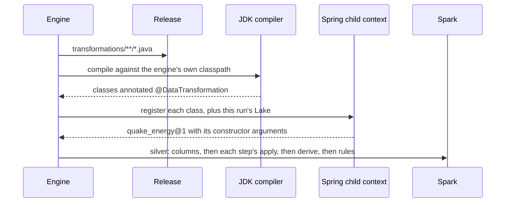

# Transformations

When a column cannot be written as one SQL expression (a join with a lookup table, a computation with parameters, logic
someone wants to test and reuse), a pipeline can call a **transformation**: a small Java class, written with Spark's
`Dataset` API, kept in the project next to the specs. The design is
in [design/target-architecture.md](design/target-architecture.md), section 6; this page is how it works today.

## Words used here

| Word           | Meaning                                                                                                | Example                                    |
|:---------------|:-------------------------------------------------------------------------------------------------------|:-------------------------------------------|
| Transformation | A Java class implementing `Transformation<In, Params>`: one method that takes Datasets and returns one | `QuakeEnergy`                              |
| Step           | A use of a transformation in a spec's `silver.steps`                                                   | `energy`, using `quake_energy@1`           |
| Inputs         | A record of the Datasets the transformation needs, each wired in the spec                              | `In(Dataset<Row> quakes)`, wired to `rows` |
| Params         | A record of settings, filled from the spec's `params`                                                  | `Params(double base)`, `base: 4.8`         |
| Catalyst       | Spark's query optimizer, which plans the whole stage including every step                              |                                            |

## Writing one

A transformation lives under `transformations/` in the project:

```java
@DataTransformation(name = "quake_energy")
public final class QuakeEnergy implements Transformation<QuakeEnergy.In, QuakeEnergy.Params> {

    public record In(Dataset<Row> quakes) {}

    public record Params(double base) {}

    @Override
    public Dataset<Row> apply(In in, Params params) {
        return in.quakes().withColumn("energyJoules", pow(lit(10.0), col("magnitude").multiply(1.5).plus(params.base())));
    }
}
```

and a spec uses it as a step, between `columns` and `derive`:

```yaml
silver:
  columns: [...]
  steps:
    - name: energy
      transformation: quake_energy@1
      params: { base: 4.8 }
      adds:
        - { name: energyJoules, type: double }
  derive: [...]
```

- **One method.** The contract is `Dataset<Row> apply(I inputs, P params)`; everything else (reading, writing,
  checkpoints, transactions, events) stays the engine's job.
- **Inputs** are the fields of the `In` record, all `Dataset<Row>`. The spec wires each by name: `rows` (the silver rows
  at this point), `reference.<name>` (a lookup table of the dataset), or `<dataset>.<table>` (another dataset's
  `bronze`, `silver`, `history`, `current` or `gold.<name>`). A transformation with a single input and no `inputs` gets
  `rows`.
- **Params** are the fields of the `Params` record, filled from `params` by name in kebab-case (`location-column` fills
  `locationColumn`); an unknown key is refused. `NoParams` and `NoInputs` exist for transformations that need none.
- **`adds`** declares the columns the step adds, with their types. They join the silver schema like derived columns:
  they do not count in the history's content hash, and `derive` may use them.
- **The lake**: a transformation that needs more than its inputs takes `Lake` in its constructor and calls
  `lake.table("earthquakes.current")` or `lake.files("landing/…", "csv")`. Each table is read at one Delta version for
  the whole run, and every read is recorded in the silver step's details.
- **The version** in `@DataTransformation(version = …)` (1 by default) is what a step pins: `quake_energy@1`. Publishing
  a changed transformation under a new version leaves pipelines that pinned the old one unchanged.

## What the platform checks

| When                                | What                                                                                                                                                                                                                                                                                                                                                                                                             | Example message                                                                              |
|:------------------------------------|:-----------------------------------------------------------------------------------------------------------------------------------------------------------------------------------------------------------------------------------------------------------------------------------------------------------------------------------------------------------------------------------------------------------------|:---------------------------------------------------------------------------------------------|
| Saving a `.java` file               | It compiles with the folder's other transformations; errors land on their line                                                                                                                                                                                                                                                                                                                                   | `cannot find symbol; symbol: method row(); location: variable in of type Echo.In` at line 12 |
| Committing                          | Every draft compiles and the whole project loads                                                                                                                                                                                                                                                                                                                                                                 |                                                                                              |
| Releasing                           | The commit's transformations compile, and every step's transformation exists                                                                                                                                                                                                                                                                                                                                     | `earthquakes step echoed uses echo@1, which no transformation of 5ea326b… declares`          |
| Each run, on the plan a step builds | In silver, aggregations fail the step (they would summarize one micro-batch, not the table) and sorts are warnings. Everywhere: actions while building the plan (`count`, `collect`), typed lambdas (`map`, `mapPartitions`), cross joins, non-deterministic expressions, `coalesce(1)` / `repartition(1)`, and plans of more than 400 steps (`withColumn` in a loop) are warnings in the flow's `step_warnings` | `a non-deterministic expression (uuid) gives a different result when a batch is replayed`    |
| Each run, on the step's output      | Exactly the input columns plus `adds`, with the declared types                                                                                                                                                                                                                                                                                                                                                   | `declares pickupZone but does not produce it`                                                |

Catalyst still optimizes everything: a step only builds a plan, and the stage's columns, steps, derived columns and
rules are one plan when Spark runs it. That is why the checks look at the plan rather than at the code.

## Gold transformations

A transformation can build a whole gold table. It is the same contract, with two differences: its inputs are `current`,
references and other datasets' tables (no `rows`), and aggregations are allowed, because gold is recomputed over the
whole table at every run. There is no `adds`: the output is the table, and the engine adds `computedAt`.

```java
@DataTransformation(name = "zone_hours")
public final class ZoneHours implements Transformation<ZoneHours.In, ZoneHours.Params> {

    public record In(Dataset<Row> trips, Dataset<Row> zones) {}

    public record Params(long minTrips) {}

    @Override
    public Dataset<Row> apply(In in, Params params) {
        return in.trips()
                .join(in.zones(), col("pickupZoneId").equalTo(col("LocationID")))
                .groupBy(col("Zone"), hour(col("pickupAt")).as("hour"))
                .agg(count(lit(1)).as("trips"), avg("fare").as("avgFare"))
                .where(col("trips").geq(params.minTrips()));
    }
}
```

## Testing one

`TransformationHarness` (in `dataflow-engine-core`) runs a transformation the way a run does, on rows written in the
test, and applies the same plan checks:

```java
Dataset<Row> quakes = spark.createDataFrame(List.of(RowFactory.create("ak1", 1.6)), schema);

TransformationHarness.Result result = TransformationHarness.of(new QuakeEnergy())
        .input("quakes", quakes)
        .param("base", 4.8)
        .asSilverStep();

assertThat(result.passed()).isTrue();
assertThat(result.output().select("energyJoules").as(Encoders.DOUBLE()).first()).isCloseTo(1.585e7, withPercentage(1));
```

`asSilverStep()` refuses aggregations as a silver step would; `asGold()` accepts them. Inputs and params bind by name
exactly as in a spec (`param("min-trips", 10)` fills `minTrips`).

## A contract that lasts

Transformations in projects are compiled against `dataflow-transformation-api`, so the platform must never break them.
`ApiContractTest` records the module's public surface in `src/test/resources/api.txt` (every type and member, with
generics) and fails the build when it changes. Adding a member means adding its line on purpose; removing or changing
one is a breaking change that needs a new major version of the API. This plays the role japicmp plays for published
libraries, without needing a previous release in a registry.

## How a run loads them



- Compiling happens once per run, and only when a spec has steps. Measured on 2026-10-25: `QuakeEnergy` compiled in 395
  ms inside the engine container, and a preview of earthquakes with that draft step took 21 seconds end to end (
  container start included); its silver rows carried `energyJoules` right after the declared columns (magnitude 1.6
  gives 1.58 × 10⁷ J). The engine image already contains the JDK's compiler; Spring Boot applications in the images run
  from extracted jars (`app.jar` plus `lib/`), because the compiler cannot read jars nested inside one jar.
- The classes live in a child Spring context created for the run, so a transformation's constructor gets the `Lake` (and
  any other bean it declares) by injection, and nothing of it outlives the run.
- A preview started from a Git folder sends the folder's transformation sources with the task, so a draft transformation
  can be tried on real rows before anything is committed.

## Tests

| Test                              | What it proves                                                                                                                                                                                                         |
|:----------------------------------|:-----------------------------------------------------------------------------------------------------------------------------------------------------------------------------------------------------------------------|
| `PipelineSpecLoaderTest` (steps)  | Steps are read and validated: names, `<name>@<version>`, input sources, declared columns                                                                                                                               |
| `TransformationCompilerTest`      | Compilation finds annotated transformations, gives each error its file and line, refuses a duplicate id                                                                                                                |
| `TransformationStepsTest`         | A step joins a reference and adds its columns; an aggregating step is refused in silver and accepted in gold; the output must match `adds`; params bind by name; warnings for actions, random values and `coalesce(1)` |
| `TransformationHarnessTest`       | A transformation runs on rows written in a test, with the run's checks                                                                                                                                                 |
| `ApiContractTest`                 | The public API is exactly the recorded one                                                                                                                                                                             |
| `SpringTransformationCatalogTest` | The class becomes a bean in a child context with the run's `Lake` injected                                                                                                                                             |
| `GitFoldersTest`, `ReleasesTest`  | A `.java` file is compiled on save with errors at their line; a release refuses a step whose transformation is missing and accepts it once it exists                                                                   |

## Writing one in the Workspace

The editor completes Java as you type: after a dot it offers the methods of what is on the left (`in.rows().` lists
`Dataset` methods, `col("mag").` lists `Column` methods, `Window.` the window builders), Spark's `functions` and the
DataFlow API anywhere, with their parameters shown while you fill a call. Inside a column argument such as `col("`
it offers the column names of the catalog. Picking a function or a class that is not imported adds the import.

The list comes from the Workspace itself (`GET /api/editor/java`, read once by the browser and cached for an hour): it
reads the public methods of those classes from the Spark and DataFlow jars it runs with, so it always matches the
versions the engine compiles against. Methods that only Scala can call are left out.
