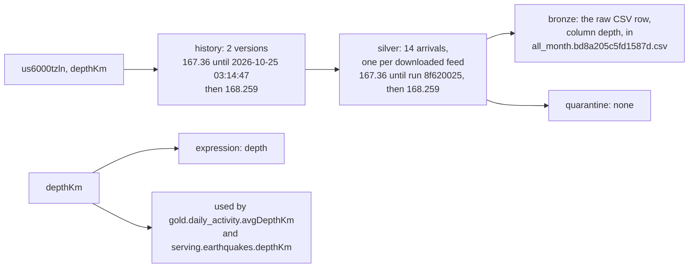
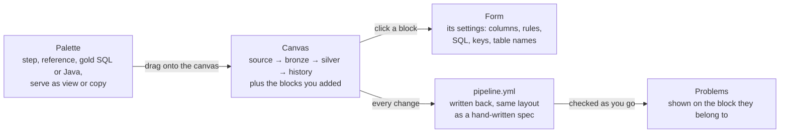
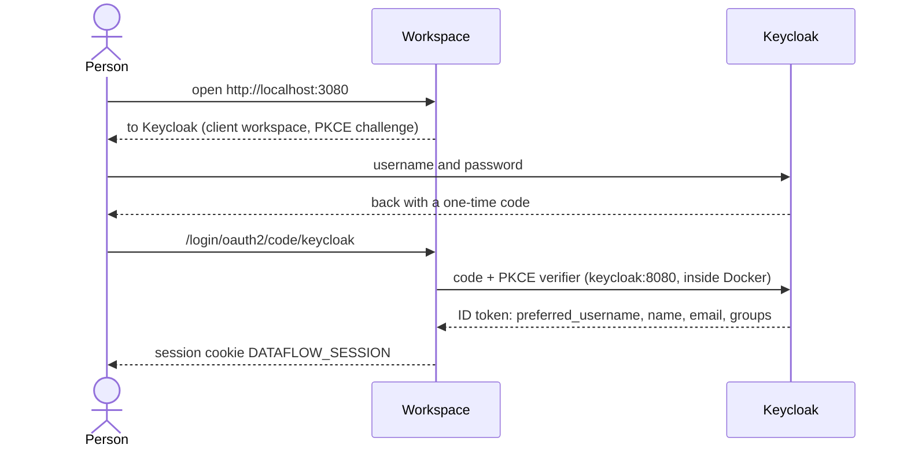
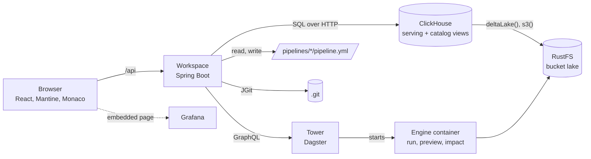
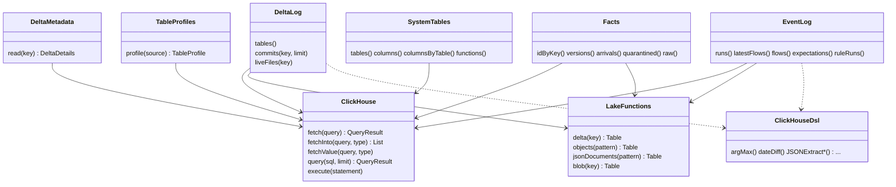
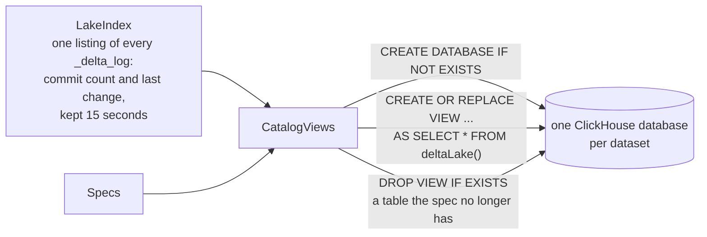
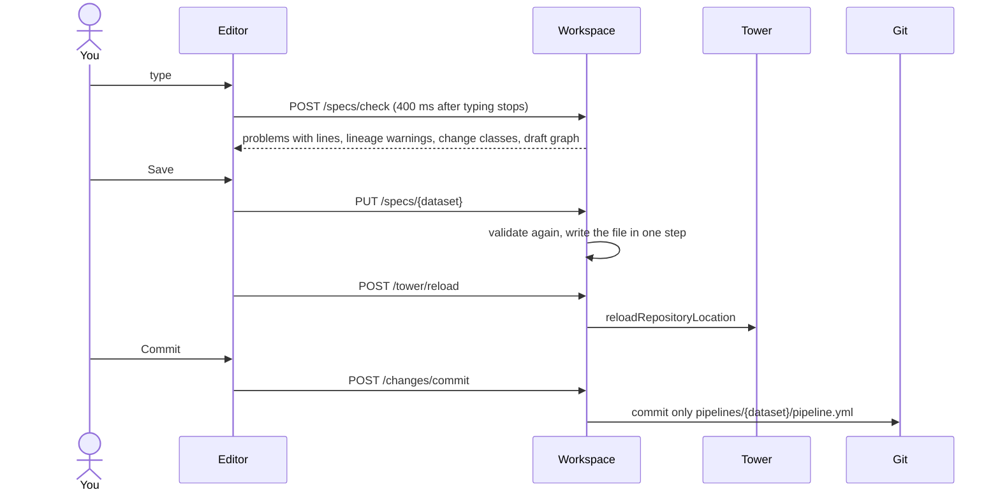
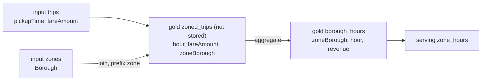
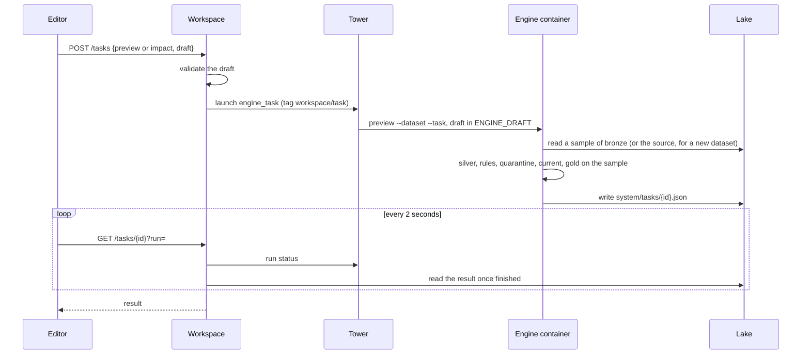

# Workspace

The Workspace is the web app people use: http://localhost:3080. It puts the tables, a SQL editor, the pipelines, their
runs, data quality, the spec editor and the dashboards behind one address, so nobody needs to know that Dagster, RustFS,
ClickHouse and Grafana are separate products. Their own UIs stay one click away in the apps menu (top right), for the rare deep dive.

It is `apps/dataflow-workspace`: a Java service (Spring Boot 4.1) that also serves the React app built from
`apps/dataflow-workspace/ui`.

## A tour

| Page       | What it is for                                                                                                                                                                                                                                                                                                                           | Example                                                                          |
|:-----------|:-----------------------------------------------------------------------------------------------------------------------------------------------------------------------------------------------------------------------------------------------------------------------------------------------------------------------------------------|:---------------------------------------------------------------------------------|
| Home       | Where things stand: each pipeline's last run, what you opened recently                                                                                                                                                                                                                                                                   | earthquakes: last run COMPLETED                                                  |
| Workspace  | One tree of everything people write: Home (your own Git folders), Shared (the team's); a listing of the selected folder; opening a file opens its editor beside the tree. **Create** makes a Git folder, a pipeline (blank, or drafted from a source URL by the [pipeline assistant](pipeline-assistant.md)), a transformation or a file | `Shared/examples/pipelines/earthquakes/pipeline.yml`                             |
| Catalog    | Every table of the lake and every published table. Tabs: Overview (columns and what the spec says about them), Sample, Profile, Details, History, Lineage                                                                                                                                                                                | `earthquakes.history`: 10,181 rows; its History tab lists every Delta commit     |
| SQL        | Queries in ClickHouse SQL, with completion of tables, columns and functions                                                                                                                                                                                                                                                              | `SELECT region, count() FROM earthquakes.current GROUP BY region`                |
| Pipelines  | One page per dataset. Tabs: Graph, Runs, Partitions, Quality, Lineage, Spec, Trace. Run, backfill, pause the schedule, rebuild from the landed files (More → Full refresh, for people who may edit the pipeline), edit the spec. A Releases tab lists what each project runs                                                                                                                                                        | earthquakes: its graph from landing to the three published tables                |
| Runs       | Every run, with a Graph, a Timeline (rows per step, compared with the run before), its Quality results and its Log                                                                                                                                                                                                                       | run `a2b889fc`: 9,964 rows in, 46 seconds                                        |
| Automation | What starts on its own: each pipeline's schedule or input trigger with its last check and next time, pause and resume; platform checks for administrators only |
| Quality    | Every rule with its recent results                                                                                                                                                                                                                                                                                                       | `reviewed` (warn): 1,853 of 9,964 earthquakes not yet reviewed in run `a2b889fc` |
| Dashboards | A generated board per pipeline (freshness, runs, rules, charts of its tables, see [dashboards.md](dashboards.md)); the Grafana boards under Grafana                                                                                                                                                                                      | `/dashboards/earthquakes`                                                        |
| Settings   | Whether the tower and ClickHouse are reachable, links to their own UIs, Git credentials                                                                                                                                                                                                                                                  | Dagster at :3070, RustFS console at :9101                                        |

Search (⌘K) opens on your recent pages and quick actions; typing searches pipelines, tables, columns, saved queries,
runs and pages, and the chips under the box (Pipelines, Tables, Columns, Queries, Runs) narrow it to one kind. Each
result shows its kind, where it lives and, for recents, when you last opened it. `?` lists the keyboard shortcuts.

The look: the sidebar and header sit on a darker shell and each page is an inset surface; one iris accent; the mark is a
flow line through three medallion dots (copper, silver, gold) on an iris tile, the same on the sign-in pages.

The layout stays the same everywhere:

- **Header:** the sidebar button, search, then three buttons: runs in progress (a count, and a menu that opens each run),
  platform apps (Dagster, Grafana, ClickHouse, RustFS and Mailpit in a new tab) and the account menu (Settings, keyboard
  shortcuts, sign out, the version). The theme is in Settings → Preferences: light, dark, or the computer's setting.
- **Sidebar:** Home, Workspace, Catalog and Services, then the SQL and Data Engineering groups; nothing is pinned to the
  bottom. The sidebar button (or ⌘B) narrows it to a rail of icons, with names as tooltips, and widens it again; the
  button's icon follows the sidebar, and the choice is remembered. Services shows a dot: green when the tower and
  ClickHouse answer, red when one does not.
- **Panels:** side and bottom panels (Workspace, Catalog, the SQL tools, the SQL results, the spec details) resize by
  dragging their edge, reset with a double-click, and collapse from the Collapse button at the right of their header: a
  side panel to a labelled strip, a bottom panel to its header. Every Collapse and Expand button, the sidebar's
  included, uses one icon whose panel strip shrinks and whose chevron turns. Size and state are remembered per panel.
- **Graphs:** the pipeline graph, the lineage graph and the designer share one look (a card per table, tinted by its
  layer, curved edges, a dot grid) and one bar: Arrange, zoom out, zoom in, fit. Arrange lays the graph out again in
  even columns (rows in the designer): every block glides there in about half a second, its edges following, while the
  view eases to frame the result. A table from the Tables list of the Blocks panel can be dragged onto the canvas, or clicked, and becomes an input. Blocks can be dragged anywhere; a drag moves only that block and is saved on release.
  The designer's right panel holds **Properties** and **Problems**, one at a time, as tabs in its header. It opens and
  folds exactly like the Blocks panel on the left: Collapse shrinks it to a rail listing both tools, and clicking a
  tool on the rail opens the panel on it; the tool, width and folded state are remembered. Problems shows its count
  on the tab and the rail and filters errors and warnings by kind; clicking one centres its block and opens its
  properties. On the lineage graph,
  hovering a column tints its path; clicking it (or picking it in Trace a column) pins the trace and dims the rest.
- **Tabs:** one style for every set of tabs: the label in grey, the open one darker and underlined in blue.
- **Toolbars:** every editor has one bar whose buttons are always there, greyed out when they do not apply, each with a
  tooltip and its shortcut.

Every tree is the same component: rows of one height, children drawn only when opened and only the visible rows
rendered, so a folder of thousands of files scrolls as smoothly as ten; arrow keys move, open and close, Enter opens.

## Following a value back to its source

"Where does this number come from?" is the question the Trace drawer answers. Click a row in silver, history or current,
or open a pipeline's Trace tab and type a key.

A real example: the depth of earthquake `us6000tzln`, which is 168.259 km today.



The drawer shows each part as a table: the versions, every arrival with its run and source file, rows a rule dropped,
the raw row as it arrived, the column's expression from the spec, and where the column comes from and goes. The raw row
can be found only when every key column is a plain source column; a key computed by an expression cannot be looked up by
value, and the drawer says so.

## Changing a pipeline

Pipelines are YAML files in a **project**: a Git repository the Workspace connects as a **Git folder
** ([Projects and releases](projects-and-releases.md)). The Workspace edits them safely:

1. **Edit.** Open the dataset's file in its Git folder (the pipeline page's **Edit** button goes there). As you type,
   the Workspace checks the draft (every 400 ms after you stop) and marks problems at their line, for example
   `silver.columns.magnitude.type: cannot parse 'dubble'`. It also warns about things the engine cannot know, like a
   gold query reading a column `current` does not have. The Design view draws the pipeline live; the Diff view, in
   the toolbar beside Design and Code for every file, compares the text with the last save or the last commit.
2. **Preview.** Runs the draft on a sample of real rows: the silver rows it produces, how many rows each rule fails,
   what would be quarantined, every gold table. Nothing is written to any table. An earthquakes preview took 13 seconds.
3. **Impact.** Runs the released spec and the draft on the same rows and compares them row by row: which values change,
   which rules fail more or less, which records would get a new history version. For example, changing how `region` is
   derived showed "region changes on 14,524 rows" of the 20,000-row sample.
4. **Save.** Saving keeps a **draft**: your version of the file, stored by the Workspace, visible only in this folder
   and branch. Nothing runs from a draft.
5. **Commit, push, release.** Commit turns the folder's drafts into one Git commit authored by you (it is refused while
   any draft has a problem); push sends it to the remote; **Release** copies what is on the target's branch at the
   remote to the releases store, and the tower runs exactly that commit from then on.

Each draft change is also classified before it is saved: SAFE (no effect on stored data, like a new gold table), DATA (
changes stored values, like a derived column computed differently) or RISKY (could orphan data, like a changed history
key).

### Designing on a canvas

A `pipeline.yml` opens in **Design** view; **Code** shows the YAML. Both edit the same file, so switching back and forth
loses nothing.



- **The spine is fixed.** Every dataset has a source, bronze, silver and history; they are always on the canvas and cannot
  be removed. What varies is around them: Java steps between silver and history, lookup tables (references), gold tables
  and what is served to ClickHouse.
- **Where a block sits is up to you; what it reads is not.** A block can be dropped and dragged anywhere, and the canvas
  remembers where (per file, in this browser). What a block reads follows the spec: dropping a serving block on a gold
  table serves that table, dropping a Java table on a reference gives it that input. Java steps run in their order in
  the spec, changed with **Move earlier** and **Move later** in the step's form. **Arrange** lays the diagram out again;
  zoom and **Fit to view** move smoothly and nothing re-zooms on its own.
- **Everything can be undone.** Undo and redo (Ctrl/Cmd+Z, Ctrl+Y or Cmd+Shift+Z) cover the spec, the block positions
  and Arrange, in both Design and Code, and survive switching between them. Typing in one field is one step.
- **The same toolbar every time.** File name and state, the view switch, Undo and Redo, the spec checks (status,
  Validate, Preview, Impact), Discard and Save are always there and are greyed out when they do not apply.
- **Panels behave alike.** Blocks, Properties, the Workspace tree, the Catalog tree and the SQL tools are resizable
  (drag the edge, double-click to reset) and fold into a labelled rail from the button in their header, with the same
  200 ms width transition. A panel with several tools, like the designer's Properties and Problems, lists each on its
  rail and switches between them with tabs in its header.
- **Forms for each block.** Columns, derived columns and quality rules are rows to add and remove. A Java step or Java
  table picks its transformation from the folder's `transformations/`; its inputs then become choices (silver rows or
  `current`, or a reference) and its parameters typed fields (numbers, switches, text).
- **Wiring is drawing a line.** A line from history or a gold table to a serving block chooses what it serves; a line
  from a reference to a Java step or a Java gold table adds an input. Lines a block cannot take are refused while you
  draw. A gold SQL table reads `current` and the references its SQL names, so its lines follow the SQL.
- **Renaming carries over.** Renaming a gold table updates the serving blocks that read it; renaming a reference updates
  the inputs that use it.
- **Right-click and keys.** Right-clicking a block offers Duplicate (also Ctrl/Cmd+D; the copy lands next to the
  original under a free name), Open in catalog (in a new tab, so the draft stays open) and Delete. The arrow keys move the
  selection along the lines (right to what reads this block, left to what it reads) and up and down within a column;
  the view pans to the selected block whenever it is off screen, whether picked by key, added from Blocks or chosen
  under Problems.
- **Readable on a laptop.** The canvas fits the pipeline when it opens, never below half size; when the whole pipeline
  does not fit, it starts at the first block and the rest is a drag away.
- **Problems sit on the block.** The same check as the code view runs as you edit; a block with a problem gets a red
  border and a count, and its form lists the messages. The Properties panel of the pipeline lists them all.
- **Nothing is lost.** The YAML is written in the house style (canonical key order, one aligned line per column or
  rule, SQL as a block). The example specs come back byte for byte (earthquakes) or with only spacing changed (taxi trips).

### Previewing Markdown

Markdown files such as `README.md` switch between **Edit**, **Split** and **Preview** in the toolbar, where specs show
Design and Code. The preview follows the text as you type (tables, task lists, fenced code); in Split it is a resizable
panel on the right.

### Validate before running

**Validate** checks what the spec depends on, not only the spec itself:

| Check            | Passes when                                                                                          |
|:-----------------|:-----------------------------------------------------------------------------------------------------|
| Spec             | it has no problems                                                                                   |
| Source           | the URL answers (HEAD, or a one-byte GET when HEAD is refused), or the lake path matches some files  |
| Reference *name* | the same, for every lookup table                                                                     |
| Transformation   | every `name@version` a step or gold table uses compiles in the folder's `transformations/`           |
| Tower, Lake      | Dagster answers; ClickHouse can list the lake                                                        |
| ClickHouse       | it answers, when the spec serves anything                                                            |

A source that answers 404, a missing transformation or a stopped service is a failure; a lake path with no files yet is
a warning. The Workspace only reports the host and the status code of a web source, never what it sent back.

### Git folders

| Databricks Git folders                                     | Here                                                                                                |
|:-----------------------------------------------------------|:----------------------------------------------------------------------------------------------------|
| A Workspace browser where a Git folder is one kind of item | The same: **Workspace → Create → Git folder**, then Pull, Commit, Push, Release in the folder's bar |
| Branches: create and switch                                | The same; drafts belong to the branch they were saved on                                            |
| Jobs run a pinned branch, tag or commit                    | Runs use a **release**: a frozen copy of one commit, written when someone releases a target         |
| Merge and conflict resolution in the UI                    | Not built: a pull that conflicts with local commits is refused; resolve it in a clone and push      |

How folders, drafts and releases are stored and why is in [Projects and releases](projects-and-releases.md).

## Signing in

People sign in once, at Keycloak; the Workspace never sees a password. It follows the OIDC "authorization code with
PKCE" flow, the one browsers use with any modern login provider:



- **Who you are** comes from the token: `preferred_username` names your Home folder (`Users/<you>`), and commits carry
  your name and email. **Groups** (`admins`, `engineers`, `analysts`) come from the token's `groups` claim; the account
  menu (top right) shows them, with Sign out.
- **No secret to keep.** The `workspace` client is public and uses PKCE: a one-time proof that the code was exchanged by
  whoever asked for it, so there is no client secret to store. A company that requires a confidential client sets its
  secret in `dataflow.workspace.auth.client-secret`.
- **Two addresses.** The browser reaches Keycloak at `http://localhost:8180`, the Workspace container at
  `http://keycloak:8080`; tokens always name the first as their issuer, and the Workspace checks exactly that.
- **Sessions in Postgres** (`spring_session`), so several Workspace replicas share them and a restart signs nobody out.
  A Workspace session ends after 7 days without use; its cookie lasts 30 days. When it ends, Keycloak signs you back
  in without a password while its own session lives: 7 days idle and 30 at most, or 30 and 90 with **Keep me signed
  in** (`SESSION_*` and `REMEMBER_ME_*` in `dataflow-local/settings.env`).
- **The sign-in page** is the Keycloak theme `dataflow` (`dataflow-local/sign-in/themes/dataflow`): the Workspace's
  colours, light or dark with the computer. It asks for the email first (Google above it when Google is on), then the
  password on a second step that shows the email with Use another account, and Forgot password? (the reset mail goes
  through Mailpit locally). The realm's browser flow `email-first` (Username Form, then Password Form) does this;
  `keycloak-init` builds it and rebuilds it if it is incomplete.
- **Google** is off until `.env` has `GOOGLE_CLIENT_ID` and `GOOGLE_CLIENT_SECRET`: create an OAuth client of type *Web
  application* in Google Cloud (APIs & Services → Credentials), add the redirect URI
  `http://localhost:8180/realms/dataflow/broker/google/endpoint`, put both values in `.env`, then `./dataflow up`
  (the `keycloak-init` step adds the provider). `GOOGLE_HOSTED_DOMAIN` in `settings.env` limits it to one Google
  Workspace domain; without it any Google account can sign in. A first Google sign-in creates a user with no group, who
  sees only their own Home folder until an admin adds a group or a grant ([access](access.md)).
- **Requests that change something** carry a CSRF token: the server sets the cookie `XSRF-TOKEN` and the UI copies it
  into the `X-XSRF-TOKEN` header; a POST without it is refused (403). Scripts send a bearer token instead (
  `Authorization: Bearer …`, from client `dataflow-cli`), which needs no CSRF token.
- An API call without a session answers 401, and the UI goes to sign-in. `WORKSPACE_AUTH=none` turns all of this off.

### One sign-in for every app

Keycloak keeps one session per browser, so after signing in to the Workspace the other UIs open without asking again:

| App                          | How it signs in                                                                  | Who gets in                                                                                     |
|:-----------------------------|:---------------------------------------------------------------------------------|:------------------------------------------------------------------------------------------------|
| Grafana (:3000)              | Its own OIDC login (client `grafana`, PKCE), automatic                           | Everyone; role from groups: `admins` Admin, `engineers` Editor, others Viewer                   |
| Object store console (:9101) | RustFS's own OIDC login (client `rustfs-console`); Settings links straight to it | Everyone; policy from groups: `admins` consoleAdmin, `engineers` readwrite, `analysts` readonly |
| Tower, Dagster (:3070)       | oauth2-proxy in front (Dagster has no login)                                     | `admins`                                                                                        |
| Mail, Mailpit (:8025)        | oauth2-proxy in front                                                            | `admins`                                                                                        |
| Spark UI (:18080)            | oauth2-proxy in front, with the `spark-history` profile                          | `admins`                                                                                        |

Clients and their secrets are applied by `keycloak-init` (files in `dataflow-local/sign-in/clients/`, secrets from `.env`), so a new
install and an existing realm end up the same. RustFS checks that the address it discovers Keycloak at is the token's
issuer (`http://localhost:8180/realms/dataflow`); a small forwarder (`rustfs-network`, socat) owns RustFS's network so
that `localhost:8180` inside it leads to Keycloak, the same address browsers use. Grafana boards embedded in the
Workspace sign in inside the frame: the realm allows being framed by the Workspace (`frame-ancestors`), and both are on
`localhost`, so the session cookie is sent.

## Services

**Services** (sidebar, under Catalog, with its health dot) shows each part of the platform once: the tower (Dagster), serving (ClickHouse),
the lake and the release store, sign-in, alerts (Grafana), and mail and the Spark UI where there are. Each row has its health, the
reason in plain words when it fails (for example `Cannot write bucket releases: Access Denied`), the address of its own
UI, and its actions for people who manage it: reload the pipeline specs in the tower, recreate the catalog views. The
lake check is that ClickHouse can list it through its named collection; the release store check writes
`system/checks/workspace.txt` and reads it back; sign-in checks that the provider signs tokens with the issuer the
Workspace expects. A failing service also shows on Home. Services are granted like datasets: `MONITOR` to see one,
`MANAGE` to act on it ([access](access.md)); administrators see them all. This is the first page of a new install (G5).

Administrators also see **ClickHouse, last hour** from its system tables: queries started by a client, how many failed,
their average and slowest time (`system.query_log`), the server's memory now (`MemoryResident` in
`system.asynchronous_metrics`) and refreshable views whose last refresh failed (`system.view_refreshes`, the error on
hover).

Settings → **Configuration** lists every Workspace setting with its value in effect, its meaning and, on hover, where it is set (the file, or the environment variables a `${...}` placeholder leads to) (passwords, secrets,
keys and tokens masked), the ClickHouse settings changed from their defaults, and the engine's settings as the newest
run recorded them (the Workspace cannot read the engine, which only exists while a run lasts; hover shows the dataset,
run and time), and the tower's settings as its `tower_settings` resource reports them over GraphQL
([tower](tower.md#its-settings)). [settings.md](settings.md) is the same
list with defaults and environment variables, generated by `scripts/settings-reference.py`.

## Tools for data engineers

| Where                               | What                                                                                                                                                                                                                                           | Example                                                                                           |
|:------------------------------------|:-----------------------------------------------------------------------------------------------------------------------------------------------------------------------------------------------------------------------------------------------|:--------------------------------------------------------------------------------------------------|
| Catalog → a history table → History | **Changes in a version, or between two**: the rows those versions inserted and closed (Compare: at most 50 versions), from the Delta change feed (`_change_type`), read by ClickHouse with the change-feed settings passed on the request; at most 500 rows shown, the counts are exact         | version 22 of `earthquakes.history`: 31 inserted, 4 closed                                        |
| Catalog → a bronze table → Overview | **Rescued**: the keys found in `_rescued_data`, either source columns the spec does not declare yet (**Add to draft** writes a line under `silver.columns` of the pipeline's Git folder and opens the draft; the line reads the value from `_rescued_data`; or copy it) or values that did not fit their declared type | `- { name: tsunamiFlag, type: string, from: "get_json_object(_rescued_data, '$.tsunami_flag')" }` |
| Catalog                             | **Queries (30 d)**: how many finished queries read each table or published table in the last 30 days, from ClickHouse's `system.query_log`; only tables you may read are counted                                                               | `earthquakes.current`: 41                                                                         |
| SQL editor → Saved                  | **Saved queries**, yours or shared with everyone; Save keeps the current tab, the link button copies `/sql?saved=<id>`                                                                                                                         |                                                                                                   |
| Queries → Saved, Alerts             | **Query alerts**: the owner of a saved query puts it on a timer (5 minutes to a day) with a condition: any rows, no rows, or the first value above, below or equal to a number. It runs with that person's access, as they had it when they last saved the alert; a query that fails shows Error with the reason. Alerts lists them; nothing is sent by mail yet |
| Queries → History                   | **Query history** of the last 7 days from ClickHouse's `system.query_log`: when, query, status (the error on hover), duration, rows read and returned; yours, or everyone's for administrators; a query opens in the SQL editor | |
| Home → Favorites                    | **Favorites**: the star on a pipeline, a lake table, a published table or a saved query keeps it on Home for you (stored per person; hidden once you can no longer read the dataset) | |
| Terminal                            | **`dataflow`** command line: sign in, validate specs, start and follow runs, read logs, query ([cli.md](cli.md))                                                                                                                                        | `cli/dataflow run earthquakes --wait`                                                             |

## How it is built



Four rules keep it simple, each with a reason:

- **ClickHouse is the only way the Workspace reads the lake.** Delta tables through `deltaLake(lake, ...)`, file
  listings and Delta logs through `s3(lake, ...)`. So the Workspace holds no object-store keys, and every read is fast
  SQL.
- **The tower is the only way it starts work.** Runs, backfills, previews and impact checks are tower launches, so they
  share one queue (at most two at a time), and the 4 GB machine is never asked for three engines at once.
- **Specs live in Git.** The editor writes `pipelines/<dataset>/pipeline.yml` and commits it with JGit (a Java Git
  library). The tower reloads after every save (rule F06).
- **No SQL text in Java.** Queries are built with jOOQ, a library that writes SQL from Java code, then rendered for
  ClickHouse with every value escaped. Only the SQL editor sends text typed by a person, and ClickHouse runs it
  read-only (`readonly=2`).

### Reading data

What a jOOQ query looks like: the quality results of one run, from the event log.

```java
serving.fetchInto(select(
                jsonText(DETAILS, EXPECTATION).as("name"),
                jsonText(DETAILS, "check").as("check"),
                jsonText(DETAILS, "action").as("action"),
                ROWS_IN.as("evaluated"),
                ROWS_DROPPED.as("failing"))
        .from(events(dataset))
        .where(EVENT_TYPE.eq(EXPECTATION))
        .and(RUN_ID.eq(runId))
        .orderBy(STARTED_AT), ExpectationResult.class);
```

`events(dataset)` is `deltaLake(lake, filename = 'system/events/earthquakes/')`. Table functions like this are the only
SQL written as text templates (`LakeFunctions`), and they never contain user input. `ClickHouse` sends the query over
HTTP with a row cap, reads the answer as `JSONCompact` and maps each row to a Java record by column name.

One class per kind of data:



| Class           | Reads                                                              | Used for                                                                                   |
|:----------------|:-------------------------------------------------------------------|:-------------------------------------------------------------------------------------------|
| `DeltaLog`      | the `_delta_log` files of every table                              | the catalog's table list, History tab, last change                                         |
| `DeltaMetadata` | the newest metadata of one table's log                             | the Details tab: properties, clustering, protocol, features                                |
| `TableProfiles` | a whole table in one scan                                          | the Profile tab: missing and distinct values, minimum, maximum. About 1 second for 3M rows |
| `EventLog`      | `system/events/<dataset>/`                                         | runs, flows, rule results, the Timeline                                                    |
| `Facts`         | history, silver, quarantine, bronze                                | the Trace drawer                                                                           |
| `SystemTables`  | ClickHouse's `system.tables`, `system.columns`, `system.functions` | completion in the editors                                                                  |

### Catalog views

So that the SQL editor reads like a warehouse, each Delta table gets a ClickHouse view named `<dataset>.<table>`:
`earthquakes.silver`, `earthquakes.current`, `taxi_trips.gold_daily_zone_revenue`.



The views are created when the Workspace starts, again every two minutes for tables whose commit count changed, and on
demand from the catalog's refresh button. They need refreshing because a view remembers its columns: after a table gains
a column, the old view would not show it. A view is created only once its table exists (its `_delta_log` folder).
Each sync also drops the views in a dataset's database that its spec no longer declares, such as a removed gold table;
a declared table that is not written yet keeps its view. The database of a removed dataset stays, for Settings → Cleanup.
`current` is history without the closed versions and without `contentHash` and `__END_AT`. A dataset named like a
ClickHouse system database gets the database `lake_<dataset>` instead.

### Checking a draft



The check uses the same loader and validator as the engine (`PipelineSpecLoader`, `PipelineSpecValidator`), then adds
what only a whole-pipeline view can see: lineage warnings and the SAFE / DATA / RISKY classes (`SpecImpact`). Spark's
SQL parser (Catalyst) checks every expression; it runs on two threads with 64 MB stacks (`Parsing`), because deeply
nested expressions overflow Java's default stack.

### Column lineage

Column lineage answers "where does this column come from?" without running anything: `ColumnLineage` reads the spec
alone. A silver column points at the bronze columns its `from` expression names, a SQL gold table at the columns its
`SELECT` list reads (Catalyst parses the query), and a table built with `steps` is followed one step at a time
(`StepLineage`):

| Step                 | What happens to the columns                                                                                    |
|:---------------------|:---------------------------------------------------------------------------------------------------------------|
| `filter`, `dedupe`   | unchanged                                                                                                      |
| `derive`             | each new column comes from the columns its expression reads                                                    |
| `select`             | only the listed expressions stay; `*` keeps every column                                                       |
| `rename`, `drop`     | columns change name or go away                                                                                 |
| `join`               | the right table's columns are added, renamed by `prefix` (`zone` turns `Borough` into `zoneBorough`)           |
| `union`              | each column also comes from the same-named column of the other table                                           |
| `aggregate`          | only the `by` columns and the measures stay                                                                    |

Some tables have columns the spec never lists: another pipeline's table read through `inputs`, a reference file, and
any table built from them without a `select` or `aggregate`. These are *open* tables. When a later step reads a column
that is not known yet, say `zoneBorough` from `zoned_trips`, the column is added to the open table and traced back the
same way: `zoneBorough` starts with the join prefix `zone`, so it is `Borough` of the `zones` input.



A read that matches no column becomes a lineage warning in the editor, for example
`gold joined step 2 reads 'nothere', which is not a column there`. Tables computed by a Java transformation are listed
without column edges: their code is not read.

### Preview and impact



The sample is 20,000 rows (`dataflow.engine.tasks.sample-rows`), in a 1200 MB container. Most of a task's time is
starting Java and Spark.

## API

| Method            | Path                                                                                                                                     | Returns                                                                                                |
|:------------------|:-----------------------------------------------------------------------------------------------------------------------------------------|:-------------------------------------------------------------------------------------------------------|
| GET               | `/api/status`                                                                                                                            | whether tower, ClickHouse and Git are reachable, the version, links to their UIs                       |
| GET               | `/api/settings/effective`                                                                                                                | administrators: every Workspace setting as resolved (secrets masked) and ClickHouse's changed settings |
| GET               | `/api/catalog/usage?days=30`                                                                                                             | finished queries per table in that window, limited to what the caller may read                         |
| GET               | `/api/catalog/usage/columns?table=earthquakes.current&days=30`                                                                           | finished queries per column of a table, empty if the caller may not read it; the Profile tab's Queries column |
| GET               | `/api/services`                                                                                                                          | the services the caller may monitor: health, reason, address, and the actions the caller may take      |
| GET               | `/api/services/serving-health`                                                                                                           | ClickHouse activity of the last hour, memory and failed refreshes; administrators only |
| GET               | `/api/datasets`, `/api/datasets/{ds}`                                                                                                    | pipelines with their last run                                                                          |
| GET               | `/api/datasets/{ds}/graph`, `/lineage`, `/partitions`, `/why?id=&column=`                                                                | graph with each step's last status, column lineage, partitions, the trace                              |
| GET, POST         | `/api/datasets/{ds}/schedule`, `/schedule/pause`, `/schedule/resume`, `/api/schedules`                                                   | the schedule's state and next run; pause or resume it; the state of every schedule you can see         |
| GET, POST         | `/api/automation`, `/api/automation/{name}/pause`, `/resume`                                                                             | every schedule and sensor you can see, with its last check and next time; pause or resume one          |
| GET, PUT, DELETE  | `/api/sql/alerts`, `/api/sql/saved/{id}/alert`                                                                                           | alerts on saved queries you can see; set or remove your own                                            |
| POST              | `/api/uploads`                                                                                                                           | a file from the browser, stored under `uploads/<you>/` in the lake; returns its key for the assistant  |
| GET               | `/api/catalog`, `/api/catalog/schema`                                                                                                    | lake and published tables; columns with types, for completion                                          |
| POST              | `/api/catalog/sync`                                                                                                                      | recreate the catalog views                                                                             |
| GET               | `/api/catalog/{ds}/{table}`, `/sample`, `/profile`, `/details`, `/history`; `/api/catalog/{ds}/landing/files`                            | a table, its rows, profile, Delta details and commits; the downloaded files                            |
| GET               | `/api/catalog/{ds}/quarantine/reasons`                                                                                                   | quarantined rows per broken rule                                                                       |
| GET               | `/api/serving/{table}/sample`, `/profile`, `/columns`                                                                                    | published tables                                                                                       |
| POST, GET         | `/api/sql`, `/api/sql/format`, `/api/sql/functions`                                                                                      | a read-only query (at most 10,000 rows), the query formatted, function names                           |
| GET, POST         | `/api/runs`, `/api/runs/{id}`, `/api/runs/{id}/output`, `/api/runs/{id}/previous?dataset=`, `/api/runs/{id}/terminate`, `/api/backfills` | runs, the engine's log, the previous completed run's steps, stop a run, start a backfill               |
| GET, POST, PUT    | `/api/specs/...`, `/api/changes`, `/api/changes/commit`, `/api/tower/reload`                                                             | the spec editor                                                                                        |
| POST, GET         | `/api/tasks`, `/api/tasks/{id}?run=`                                                                                                     | preview and impact of a draft; `infer` from a `source` URL                                             |
| GET               | `/api/quality`, `/api/dashboards`                                                                                                        | rules with recent results, the configured Grafana boards                                               |
| GET               | `/api/boards/{dataset}`, `/overview`, `/{table}/{chart}`                                                                                 | generated boards, see [dashboards.md](dashboards.md)                                                   |
| GET               | `/api/catalog/{dataset}/{table}/changes?from=&to=`                                                                                       | change feed of a history table between two versions (at most 50)                                       |
| GET               | `/api/catalog/{dataset}/bronze/rescued`                                                                                                  | keys of `_rescued_data`, with suggested silver columns                                                 |
| GET, POST, DELETE | `/api/sql/saved`, `/api/sql/saved/{id}`                                                                                                  | saved queries (owner edits; shared ones readable by everyone)                                          |
| GET               | `/api/sql/history?days=&limit=`                                                                                                          | SQL editor queries from `system.query_log` (yours; everyone's for administrators), at most 30 days and 500 rows |
| GET, PUT, DELETE  | `/api/favorites`, `/api/favorites/{pipeline\|table\|served\|query}/{ref}`                                                                 | your favorites; PUT adds, DELETE removes                                                               |
| GET               | `/api/alerts`                                                                                                                            | firing and pending Grafana alerts the caller may see                                                   |
| GET, POST, DELETE | `/api/access/grants`, `/api/access/audit`                                                                                                | grants, see [access.md](access.md)                                                                     |

Errors come back as `{"error": "...", "problems": [...]}` with 404 (not found), 422 (a draft that does not validate),
400 (a bad request), 409 (Git refused) or 502 (the tower did not answer).

## The UI in detail

React 19 with Mantine 9 (components), React Query (data loading and caching), Monaco (the editor of VS Code, served by
the Workspace itself) for SQL and YAML, and React Flow for graphs.

- **SQL editor:** completion of tables and columns and of ClickHouse's ~2,000 functions, with syntax and a summary on
  hover. ⌘↵ runs the statement under the cursor or the selection. Errors are marked where ClickHouse reports them, and
  its "Maybe you meant" suggestions become quick fixes (⌘.). Results sort, copy a cell with ⌘C, download as CSV, and
  draw as a chart.
  - **Queries are tabs:** each keeps its own text, cursor, undo history and last result, and runs on its own, so a
    long query in one tab does not block another. Double-click or F2 renames, a middle click closes, and a dot replaces
    the close button while a saved query has unsaved changes. A new tab puts the cursor in the editor.
  - **Toolbar:** Run (⌘↵) and the row limit; Undo, Redo and Format; then the state of the query (Draft until it is saved,
    Saved, or Unsaved), Save (⌘S), Copy link, and More (save as a new query, rename, close).
  - **Panels:** Schema, Saved and History on the left, each with a search box (Escape clears it); Results and Chart
    below, with the row count and time (hover for rows and bytes read). A thin bar runs along the top of the results
    while the query runs, and the previous result stays visible, dimmed, until the new one arrives.
- **Spec editor:** problems as markers, hover help for every spec key, ⌘S saves, and leaving with unsaved edits asks
  first. A collapsed Tables panel on the left lists what this pipeline's queries read by name (`current`, references,
  inputs, other gold tables) and their columns; a click inserts the name at the cursor. The designer's SQL form opens the
  same list from a Tables button.
- **SQL files in a folder:** a `.sql` file has the SQL editor's Schema panel and completion. The panel inserts ClickHouse
  names, which are what such a file runs against; it is not offered in Java or Markdown files, whose names mean something else.
- **Runs:** a finished run can be started again with the same dataset and partition; while one runs, the Run button
  opens it instead of queueing another. The Timeline flags a step whose rows dropped by a fifth or more compared with
  the previous run. A pipeline's Runs tab draws every flow across its last runs, by duration or by
  rows, with the same rule marking each drop in amber. The Log tab shows the engine's log, filterable and followed live, and the tower's events one click
  away. A run that finishes while the app is open shows a notice; a failure stays until dismissed.
- **Time travel:** each commit on a table's History tab opens the table as it was at that version in the SQL editor (
  `SETTINGS delta_lake_snapshot_version = n`).
- **Quality and lineage:** each rule shows its failing share over recent runs; the lineage graph follows a column up to
  its sources and down to everything that uses it.
- **Speed:** pages load their code on first use and are fetched in advance once the first page is idle; Monaco and the
  chart library load only when needed; lists show placeholder rows while loading; hovering a row fetches the page it
  opens. Built files are cached for a year, `index.html` never.
- **Errors:** each page fails on its own, behind an error boundary, without taking the app down.
- **Tests:** plain logic in `ui/src/lib` has unit tests (`npm test`, Vitest); the image build runs them first.

## Running it

|                 |                                                                                                                                          |
|:----------------|:-----------------------------------------------------------------------------------------------------------------------------------------|
| Compose service | `workspace` on port `${WORKSPACE_PORT:-3080}`, 640 MB limit, about 340 MiB in use                                                        |
| Image           | `dataflow-workspace:latest`, target `workspace` of the root `Dockerfile` (a Node stage builds the UI)                                    |
| Build           | `./dataflow build workspace` (in `dataflow-local`)                                                                                                               |
| Mounts          | `./pipelines` and `./.git`, both read-write (it saves and commits specs)                                                                 |
| Settings        | `dataflow.workspace` (`WorkspaceProperties`); `application-docker.yml` maps `CLICKHOUSE_*`, `TOWER_GRAPHQL_URL`, `WORKSPACE_*`, `LINK_*` |

For development, run the jar on :8090 against the running platform, and `npm run dev` in `ui/` (Vite forwards `/api`
to :8090, or to `WORKSPACE_API`). Sign-in works on the dev server too: Vite also forwards `/oauth2`, `/login` and
`/logout` and keeps the browser's host on them, so the sign-in service sends the person back to :5173, which the
`workspace` client allows. After sign-in the Workspace returns to the page that asked for it, never to an `/api` call:
only page requests are remembered.

Grafana boards are shown inside the Workspace (Grafana allows it with `GF_SECURITY_ALLOW_EMBEDDING`). They ask for
Grafana's login once; both apps are on `localhost`, so the login is remembered.
